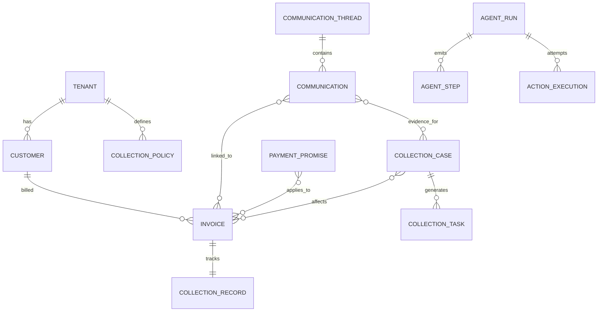
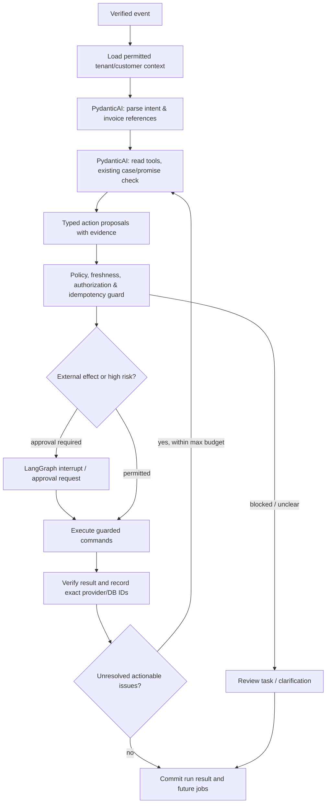

# ACO — Product and Engineering Specification

**Product:** ACO — Autonomous Collections Operator  
**Scope:** Standalone, multi-tenant AI collections SaaS and technical assessment.  
**Release scope:** The repository supports local evaluation with synthetic accounting and simulated providers. Hosted HTTPS, live provider operations and commercial readiness have distinct acceptance gates. This specification defines those gates and the product contracts; verification records establish what was exercised.  
**Related material:** [README](README.md) for setup and evaluation, [engineering guide](AGENTS.md) for maintenance, and the [traceability fixture](tests/fixtures/verification/traceability.md) for executable verification mappings.

## 1. Product objective, customer and official assessment

**Positioning:** *Your AI-powered collections team.* ACO helps Australian B2B SMEs **Collect more, collect faster and spend less time chasing payments**. ACO augments existing Xero/QuickBooks-type accounting systems rather than replicating them. It owns communications, follow-up, investigation and case resolution; the accounting source owns invoice creation, payment allocation, amounts and authoritative paid status.

**Primary customer:** SME owner, finance manager or accounts receivable operator at a credit-invoicing B2B organisation, especially distribution/wholesale, logistics and services. Assume customers already use basic accounting reminders; do not claim savings against a fictional all-manual baseline. Admin configures company policy and permissions; operators resolve exceptions; viewers inspect permitted data.

**Assessment scope:** The original assignment requires at least three of five listed capabilities. ACO targets all five and a separately verified HTTPS demo. The AI must perform an observable business function such as investigation with typed tools, classification or guarded action.

**Boundaries:** ACO is a standalone collections product. An accounting ledger, invoicing editor, financial write-back, payment processing, bank reconciliation, debt threats, legal negotiation, generic CRM, generic multi-agent tooling and Blueprint integration are out of scope. Preserve the separately maintained ARI product.

**Quality principle:** Buy commodity capability, build domain differentiation, own the measured customer outcome. Prefer mature libraries; do not build SMTP servers, speech recognition, TTS, an LLM SDK, a scheduling framework, custom cryptography or a custom authentication stack.

### 1.1 Mandatory feature mapping

| Official capability | ACO behavior | Minimum demonstration |
|---|---|---|
| CRUD | User creates, reads, edits, soft-deletes a `CollectionTask` (policy editing additionally) | Reload retains persisted changes; changes audited |
| Analytics | Operations and Business Impact dashboards from stored invoice, payment, case and usage records | At least 2 responsive, correctly computed KPIs/charts; sample vs observed labels |
| Drag-and-drop | Human Review Queue priority ordering only | Reorder items, refresh and observe persisted business ordering; does NOT affect Paid state |
| Streaming/scheduled | Scheduler runs reminders and promise checks; SSE shows Agent execution steps | Browser reconnect replays steps, job proceeds if tab closes |
| AI agent | LangGraph flow invokes PydanticAI with tools, investigates multiple invoices, executes guarded business actions | Show real step/tool outcomes and changed DB records, not a chat-only demo |

**Financial analytics:** Overview shows current source-backed outstanding and overdue amounts and tenant-calendar aging (§6.4). The separate cash, mature cohort, operational and cost measures have their own definitions and gates (§§7/12.7).

## 2. Product experience and screens

**Connected investigation interface:** `/agents` selects one–three actual workspace invoices and starts a persisted investigation; `/agent-runs/{id}` displays saved run status, observable tool input/output, errors, model authenticity and actual committed outcome references. `/tasks/{id}` reads the resulting persisted task with current workspace authorization. A proposal is displayed as executed only when the server returns an executed outcome and actual changed IDs.

**Identity foundation:** Sign in or register through the maintained identity provider. A new authenticated subject may atomically create a synthetic workspace and its own owner Membership, or accept an owner-issued, expiring, single-use invitation bound to the verified identity email. Invitations are manually shared codes; creating one never sends mail. Workspace timezone is a validated IANA zone. Demo accounting selection creates a NOT_CONFIGURED connection skeleton; The explicit synthetic seed initializes and imports the selected source; no other provider is represented as connected. Signup/visit leaves automation off, outbound paused and budgets ungranted.

**Onboarding:** (1) create tenant and choose timezone; (2) select demo accounting adapter for assessment; (3) configure an authorised collections inbox; (4) set collection policy; (5) preview scheduled sends, recipients, holds, contact frequency and account-sync health; (6) explicitly confirm native accounting auto-reminders are disabled for managed flows; (7) activate, with visible global/tenant **Pause Outbound**. Do not claim an Xero public API can universally change its native reminder settings.

**Top-level UI:**

| Area | User can see and do |
|---|---|
| **Overview** | Outstanding and overdue receivables, aging, payment status/freshness, AI activity and `Needs Your Attention`; link to Business Impact |
| **Receivables** | Search/filter customer/invoice-level balances and due dates; separate accounting financial status from collection operational state; open invoice workspace; **No editing accounting amounts or Paid status** |
| **Conversations** | Unified customer timeline of full inbound/outbound emails, threaded replies, calls, transcripts, authorised recordings, message-to-invoice links, Agent runs, actions and evidence; view source and timestamps |
| **Human Review Queue** | Approvals, tasks, reason and evidence, agent recommendation, approve/deny/modify, task CRUD and priority drag-and-drop; urgent/legal deadlines cannot be overridden by sort order |
| **Settings** | Tenant members/roles, accounting and communication adapters, customer-defined policies, templates, approval/autonomy levels, consent/retention, service health and kill switch |
| **Business Impact** | Outcome before/after cohorts, actual vs synthetic labels, costs, AI autonomy and defensible estimated labour savings |

Invoice detail includes all linked messages even if originally received in another invoice's email thread. Label provenance (e.g. “INV-102 mentioned in INV-101 thread”) so an absent reply on thread B never implies invoice B had no customer response. Provide clear loading/empty/error/disabled states, accessible control labels, and desktop/mobile-responsive layouts. Demo company branding uses synthetic identities and must not imply an organizational affiliation.

**Workspace capabilities:** The application derives Overview, receivables and customer/invoice read views from current Membership and imported records. Communications, cases, promises, tasks and audit retain separate read and execution authority. Policy drafting, saved-version preview, recipient review and archival provide internal scheduling controls. Missing impact data is shown as Insufficient data; display actions and links only when supported.

**Current integrated Overview:** The financial position remains the canonical source-backed current view. A separate current-human `GET /api/workspaces/{id}/overview/workload` returns company operational counts for open nondeleted tasks, persisted pending approvals, unresolved cases, active/unconfirmed/missed promises, active/completed/failed investigations and stopped/uncertain actions. All counts derive from tenant-filtered saved records in one database statement; they are neither financial outcomes nor historical reporting-window KPIs. Completed live and simulated investigations are identified separately. Current automation/pause and accounting connection state/oldest imported observation are visible without claiming a live provider probe. Each record family links to its existing usable review/history/settings flow. Refresh only reads. Current Membership and INVOICE_READ are required; an invoice-scoped service/voice context cannot be promoted to company aggregation. `workflow_availability=available` now denotes this integrated operational read surface, not completion of every external-provider/release gate. Business Impact navigation must not hardcode insufficient cohorts after real cohort functionality exists.

## 3. Domain boundaries and data model

**Canonical identity:** Every tenant-owned entity has a UUID, `tenant_id`, created/updated timestamp and relevant version; every external item keeps provider connection/source identifier, source timestamps and provenance. Invoice numbers are display identifiers **Not** globally unique keys. Use unique `(tenant_id, accounting_connection_id, external_invoice_id)` for invoice snapshots. All financial amounts use Decimal or minor units plus ISO currency; never floats. All instants UTC with explicit tenant timezone for calendar rules/DST. Never combine currencies silently.

**Canonical code names:** Persist `provider_connection_id` for all provider connection FKs (`accounting_connection_id` and `connection_id` in illustrative DTOs identify that same connection); payment identity is `(tenant_id, provider_connection_id, external_payment_id, external_allocation_id)` or a documented provider-equivalent stable allocation key. One trusted identity `(issuer, subject)` may have several tenant memberships; identity itself is not tenant authority. Persist task `priority_rank`; `queue_position` means the same ordering in UI examples. Canonical case waiting states are `WAITING_CUSTOMER`, `WAITING_INTERNAL`, `AWAITING_APPROVAL`; title-case aliases in examples map losslessly. Provenance `explicit`/`contextual` maps to `explicit_reference`/`contextual_inference`; tool aliases map to the same per-kind command, never a second implementation. Preserve original void, credit and write-off facts separately even when a display status groups them.

**First-workspace authority:** `create_workspace(ctx: AuthenticatedSubject, command: CreateWorkspace) -> WorkspaceView` is the sole pre-membership tenant creation boundary. `AuthenticatedSubject` contains verified issuer/subject, persisted user/session IDs, authentication timestamp and server correlation ID, never caller-chosen tenant or role. One database transaction creates Tenant, creator owner Membership, unconfigured demo ProviderConnection and audit. Subsequent `resolve_context(subject, selected_workspace: UUID) -> TenantContext` requires current active same-tenant Membership; selected UUID is a lookup request, never authority. Mutation services re-read membership under the tenant lock.

**Core entities and relationships:**

| Entity | Key behavior / relation |
|---|---|
| `Tenant`, `User`, `Membership` | Multi-tenant, server-enforced RBAC (`owner`, `finance_manager`, `operator`, `viewer`) |
| `ProviderConnection` | Tenant, provider type, external organisation/account, encrypted credentials reference, capabilities, sync cursor, health |
| `Customer` / `CustomerContact` | Imported, source-backed data; recipient/contact restrictions across all customer invoices |
| `InvoiceSnapshot` | Imported read-only customer, issue/due dates, original amount, balance, currency, status, source version, last sync |
| `VerifiedPaymentAllocation` | Imported payment IDs, invoice allocations, reversals, refunds, source dates; only verified money counts as paid |
| `CollectionRecord` | Exactly one per invoice; policy, next-action and collection-operational indicators separate from accounting state |
| `CollectionPolicy` + versions | Tenant-configured rule sets with overrides, contact/approval/hold policy, immutable definitions/effective timestamps and retained archive history |
| `PolicyEvent`, `PolicyActivation`, `PolicyOccurrence` | Real policy trigger linked to canonical audit; immutable enabling-human/worker/version authority; stable invoice/rule/due-date occurrence across replacement grants |
| `RecipientControl`, `CollectionHold`, `ContactReservation` | Reviewed source-bound destination/timezone restrictions; independent evidence-bearing hold reasons composed on CollectionRecord; atomic customer and normalized-destination exposure |
| `DispatchRead`, `DispatchTicketRecord` | Same-attempt AccountingObservation binding, version, incarnation, expiry and one-use execution authority |
| `CommunicationThread` | Email provider thread and **Originating invoice** (not the only relevant invoice) |
| `Communication` | **One canonical record per sent/received email or call**; full in-scope original message, metadata, raw artifact IDs, attachments, call transcript and lawful recording reference |
| `CommunicationInvoiceLink` | Many-to-many link with `origin_thread`, `explicit_reference` or `contextual_inference`, evidence spans/confidence |
| `CollectionCase` + `CaseInvoiceLink` | Issue entity; **Many-to-many with invoices**, per-invoice effect and resolution. Distinct issues must not be merged merely because invoice ID/type matches |
| `CaseEvidence` | Links messages, calls, source documents and action results to a case; never duplicate raw originals |
| `PaymentPromise` + `PromiseInvoiceLink` | Date/amount/status/evidence; can cover one or many invoices; unknown allocation remains explicitly unresolved |
| `CollectionTask` | User CRUD, assignee, state, due date, `priority_rank`, soft-delete/audit, source action/case |
| `ScheduledAction`, `ActionExecution`, `ApprovalRequest` | Durable job state, effect/result/idempotency key, human review and approval decision |
| `AgentRun`, `AgentStep`, `AuditEvent` | Goal, observable execution stages, tool inputs/outputs (redacted appropriately), actor, mutation, time, result |
| `ConsentEvidence`, `RetentionPolicy`, `Artifact` | Call recording/transcript/legal basis, retention, encrypted access-controlled object reference and deletion |
| `ProviderUsageEvent`, `CostAllocation` | Actual/estimated usage, currency, case/run/message linkage and allocation weights so shared actions cost only once |

**Financial vs operational lifecycle:** ACO may display `Open`, `PartiallyPaid`, `Paid`, `Voided` from imported accounting snapshots. It does not set them itself. Collection operations may be active/closed, follow-up pending, held with one or more reasons, and escalated; these dimensions are **Not a single exclusive enum**. Payment promises and cases have independent lifecycles.

**Case lifecycle:** `Open → Investigating ↔ AwaitingCustomer/AwaitingInternal/AwaitingApproval → Resolved → Closed`, with reopen on new evidence, preserving prior closure history. A closed invoice's separate billing dispute or refund issue is not automatically resolved merely by full payment. A single case may cover multiple invoices; closure must check each impacted invoice independently under the evidence criteria in §12.3.5. Administrative closure is explicitly non-resolution and cannot enter the resolved KPI numerator.

**Promise lifecycle:** `Captured/NeedsConfirmation → Active → Fulfilled | Missed | Superseded | Cancelled`, including partial payments and instalments. Ambiguous “next Friday” requires message timestamp, customer timezone and confirmation if unresolved. A payment claim is not verified payment. Payment promise triggers appropriate reminder hold; after expiry re-evaluate policy and source rather than dispatching all held reminders.

**Communication semantics and duplicate prevention:**

- Every reminder is **Per invoice** by default, with independent due-date schedule and reply thread; never automatically consolidate multiple invoices. Apply customer/recipient-level contact safeguards even if multiple reminders are due.
- A reply on INV-101's thread mentioning INV-102 preserves thread A and that single original message; link the message to **Both** invoices, and apply independently validated invoice-specific actions. Thread reply status != invoice engagement status.
- A second reply in INV-102's thread about the **Same dispute** is a different communication (must be saved), but linked to the **Same case** if verified; append new evidence, avoid duplicate cases/tasks. Distinct new issues on one invoice remain separate cases.
- Technical duplicate (repeated signed webhook or same provider message ID) stores/processes once. Semantic duplicate (new email/call, same business issue) preserves every communication but deduplicates the **Business action**. Ambiguous matching should ask for human review.
- Voice calls have a primary invoice context but can refer to others; store one complete call record, link to multiple invoices and cases.

**Accounting foundation:** Synthetic source rows are persisted separately from imported snapshots. Customer/contact, invoice and immutable revision/allocation/event records use composite tenant+connection foreign keys; invoice numbers remain display-only. Financial DTOs reuse canonical Money with maintained ISO 4217 currency/exponent validation. Source dates retain calendar precision; effective and observed UTC timestamps, organisation, revision and synthetic/authenticity markers survive import. In-place changes to an already imported payment identity are rejected; correction uses a new explicit refund/reversal allocation linked to its original, plus a new replacement identity where needed. No implicit FX or staff/model financial CRUD is exposed.

### 3.1 Enforceable schema and state invariants

**Canonical actor/action foundation:** A single `Actor` supertype represents human or tenant-scoped fixed-purpose `durable_worker` identities. Human Actor IDs equal existing User IDs; migration backfill and a new-User trigger preserve that invariant. Exactly the existing AuditEvent.actor_id, AccountingObservation.actor_id, UsageAttempt.actor_id and BudgetScope.creator_id FKs move to Actor without changing historical values. Human TenantContext and its four roles remain unchanged. Internal ServiceContext has no role and cannot be deserialized by session/API dependencies. An immutable ScheduledAction is the narrow operation grant; current human initiator Membership/permission/version, actor active/version, tenant generation/pause, connection/version, source revision, policy generation, command/version, due time, lease and stored library JobRef are revalidated. Workers never acquire SETTINGS, approval or general spend authority. Existing attached reservations bind the exact operation and revalidate the actual human's current synthetic authority and caps; UNKNOWN retains exposure.

`ActionSource` retains every distinct original accounting event. The unchanged legacy accounting-triggered kinds (`accounting_recheck`, `internal_task`, `approval_request`) deduplicate by tenant+connection+invoice+opaque source revision+operation kind. Policy scheduling instead uses the occurrence and version-qualified immutable-grant keys in §4; source revisions cannot create a new policy occurrence. `CollectionTask`, `ApprovalRequest` and `ApprovalDecision` are single canonical base models; Internal services persist guarded task create/update and exact scoped proposal material with audit. Requests are pending non-grants; retain actual proposing human initiator alongside service proposer, and original source-action initiator through the immutable action link; later self-approval checks compare both humans and material editors. The human CRUD, decision and ordering paths share those records and enforce the 24-hour expiry, material-change invalidation and one-use approval requirements. Internal task and proposal services cannot approve or dispatch.

**Human tasks and queue:** Human-created `CollectionTask` rows use the same canonical table with nullable source action/event and optional verified same-tenant invoice link; generated rows retain exact source action/event identity, original command and creator. Current human `TASK_WRITE` Membership permits title, owner, priority, due time, status and notes updates and audited soft delete on either origin under optimistic task versions. A service actor cannot enter the human CRUD or queue API; the existing exact scoped internal-work path remains separate. Active assignees must be current same-tenant members. Tenant-scoped queue state versions serialize full-list reorder and rank persistence; due deadlines stay ahead of manual convenience order. The additive review migration preserves historical source/action/audit rows and refuses lossy downgrade with human tasks or saved queue evidence. Approval decisions and graph resume remain pending, never inferred from task CRUD.

**Human approval:** The canonical ApprovalRequest/ApprovalDecision support current-Membership list/detail/approve/deny with independent owner/finance review, exact captured action/material/current-state hashes and optimistic versions. Readable source evidence references actual AccountingEvents, never invented communications; invoice amounts serialize exact decimal strings. Additive decision review bindings retain financial/source/policy/recipient/hold/initiator/approver state; immutable proposal identity and append-only decision history preserve provenance. Database protection rejects deletion of original pending proposals even before any decision exists; only request status/version/grant/expiry/consumption metadata remain mutable. Expiry is inclusive at the earlier explicitly selected grant duration and 24 hours; stale/current-state-changed, consumed or unreviewed legacy grants fail closed. At this historical checkpoint AI_APPROVAL_EXECUTOR_UNAVAILABLE remained. Later internal-task and exact offline agent-email continuations below add guarded resume/consumption for those typed effects only; a decision alone never authorizes dispatch or paid/live operations, and unsupported legacy outbound effects still fail closed.

**Additive schema contract:** Alembic r0005 extends the existing canonical tables without rewriting source, version, audit or usage rows. ScheduledAction has nullable policy-event/activation/occurrence references with a CHECK enforcing exclusive policy_due versus legacy accounting trigger provenance. Composite foreign keys bind tenant+policy-version, tenant+activation+event, tenant+activation+policy-version; activation binds actual tenant Membership/Actor and event, event binds canonical tenant AuditEvent, and DispatchRead binds tenant+invoice+actual AccountingObservation. Policy events/activations/reads and existing action authority are immutable. Contact history binds invoice to its actual same-tenant customer. Empty additive migration can be reversed; any policy/dispatch evidence or archive history blocks lossy downgrade. Migration tests must use migrated PostgreSQL, not metadata create_all.

A delayed duplicate's authorization refusal is a no-op on newer committed action state. Blocking a refused queued claim requires a refreshed tenant→action lock, the exact still-queued version and genuine stored library task/argument binding; it cannot overwrite a newer executing, retry or terminal result.

The source adapter enforces the source ledger, imported invoice revisions, payment allocations, accounting events, accounting read observations, demo operation results and policy versions as append-only PostgreSQL rows (UPDATE/DELETE rejected). Its financial migration extends the accepted identity head; full financial downgrade removes the migration's financial/policy data and preserves identity. The additive observation/currentness migration backfills only explicit event origin/invoice/revision relation metadata from immutable existing results, preserving original payloads and evidence. Its downgrade preserves financial/identity data but refuses when read-origin events exist, because the older schema requires a native event ID and cannot represent that history without fabrication or loss. Composite foreign keys reject a payment or contact link to another connection even inside the same tenant.

**Mandatory relational constraints (not just diagrams):**

- `InvoiceSnapshot`: unique `(tenant_id, provider_connection_id, external_invoice_id)`. Imported `customer_id`, issue/due date, balance, amount, currency, provider status, observed-at and source revision must be retained. A correction to the source snapshot is an event, not a silent rewrite of collections history. A genuine source customer correction updates the current snapshot while retaining old communication/customer associations. Append-only `InvoiceCustomerAssociation` rows record each observed tenant/accounting-connection/invoice/customer tuple and its capture revision/time/verification flag. Capture derives atomically from accepted projection insert/customer change; migration backfill is explicitly current-projection capture, never invented earlier history. These rows are relationship evidence only, including explicitly unverified captures; they never authorize current-customer context, financial status or outreach. ACO never offers invoice/ledger CRUD to staff or LLM tools.
- `CollectionRecord`: unique `(tenant_id, invoice_id)`. Financial status is calculated only from accounting snapshots; collection eligibility/hold reasons are separately computed from active restrictions, promises and cases. An invoice may be Paid while a separate billing/refund dispute remains open.
- `Communication`: unique provider message/call identity within a tenant+provider connection, including stable original message ID, `direction` (incoming/outgoing), `channel` (email/voice), event time, sender/recipients, delivery lifecycle, raw artifact pointer and authenticity/ingest metadata. Preserve all permitted sent **And** received communications; a single communication object may link to multiple invoices and cases without duplicating its original body/recording. Email `Thread` references *origin invoice* but does not dictate the *only* invoice referenced in replies.
- `CommunicationInvoiceLink`: unique `(tenant_id, communication_id, invoice_id, claim_or_context_key)`; reference provenance (`origin_thread`, `explicit_reference`, `contextual_inference`), confidence, exact evidence excerpt/offset and classification are required. Uncertain references must not trigger sensitive actions.
- `CollectionCase` and `CaseInvoiceLink`: cases hold issue identity, status and evidence; each linked invoice can have its own impact/hold/resolution. Many cases per invoice and many invoices per case are both required. Do not enforce uniqueness merely on `(invoice_id, issue_type)`; compare claim identity, parties, substance and existing evidence before semantic upsert.
- `PaymentPromise` and `PromiseInvoiceLink`: preserve source communication and originally stated text, capture/confirmation status, currency, total amount, per-invoice allocations only when supported, instalments, promised dates and any replacement relationship. A revised promise must not overwrite historical commitments without versioned events.
- `ScheduledAction` and `ActionExecution`: retain job identity, due time, policy version, owner, attempt number, status, execution result, provider operation ID and idempotency key. Use database uniqueness on operation keys, transaction boundaries and durable execution to resist concurrent duplicate workers. A timeout after an external send is `UNKNOWN_SIDE_EFFECT`, not automatically `FAILED_NOT_SENT`.
- `AgentRun`, `AgentStep`, `AuditEvent`: link the initiating business event, input evidence IDs, state version, checkpoint/thread ID, validated tool arguments/outcome, actor (human/agent/system), policy version and monotonic sequence. Audit events for changes and communication records must preserve who acted and when; redaction and lawful retention still apply.
- `Artifact` and `ConsentEvidence`: retain private object key, checksum, content type, encryption/access class, consent/legal basis, retention expiry and deletion evidence; never expose provider recording URLs as public permanent assets. Where call capture is prohibited, do not retain raw audio/transcript under a different name.
- `ProviderUsageEvent`: unique external operation identity, linked case/invoice allocation, model/provider/version, units/quantity, cost quality and rate snapshot. Cost of one call or email mentioned across multiple invoices is charged once; allocations must sum to 1.

All FK/link operations require same-tenant enforcement, ideally database-level safety plus application-level authorization. Soft delete a user-created task without deleting its audit record or severing historical evidence. Timestamps are UTC; local policy scheduling uses tenant timezone and handles DST. Use decimal/minor-unit money, zero/negative/credit/reversal cases and ISO currencies explicitly.

**Required state transition tests:** resolve a dispute on an unpaid invoice → collection re-evaluation, not Paid; one Paid invoice in a multi-invoice case → do not incorrectly close the entire case; two separate issues on one invoice → two cases; a later email repeating a case → one case plus two evidence links; a new confirmed promise replacing another → old promise remains traceable; a pending dispute hold plus an expired promise hold → the dispute hold continues; full source payment followed by reversal → collection re-evaluates safely.

**Persisted outbound ownership:** r0007 after r0006 adds canonical communication/thread/invoice-link/source/delivery records, immutable EmailExecutionActivation/EmailDispatchBinding/CommunicationCaptureGrant and revocations, independent EmailSubmission intent/outcome, and a separate durable simulated native mailbox ledger. Composite tenant FKs bind source/action/contact/connection/actor/artifact/usage identities; additive unique keys support existing contact and usage references. Existing accounting connection remains on ScheduledAction; its email result must match the separately persisted dispatch binding, operation and accepted native message. Downgrade refuses retained outbound history before any destructive operation. Raw original bytes remain only in private Artifact storage; JSON stores normalized content and original references.

## 4. Collection policies, reminders and reconciliation

**Synthetic seed policy:** Seed different A/B DRAFT definitions using canonical CollectionPolicy and immutable CollectionPolicyVersion persistence. Both remain inactive, with automation paused; no policy scheduling, activation or CRUD acceptance is implied. Future dispute/promise seed stories are synthetic input evidence until their owning services execute them.

**Policy ownership:** Owner configures tenant-wide reminder offsets around due date, templates, per-customer overrides, working hours/timezones, recipient controls, voice escalation, customer opt-outs, dispute holds, promise holds, approval thresholds and AI autonomy. Version rules and audit edits; historical decisions point to the effective policy version. Policy cannot override mandatory safety restrictions. A policy builder previews future actions and blocked recipients before activation. Policy Delete is a version-preserving archive: an archived version remains readable in historical actions/audit and cannot authorize new work. Archiving an active policy atomically installs a validated replacement and recomputes future actions, or suspends automation and cancels unsent actions; reject archive if neither safe transition is selected. Never erase historical policy versions.

Recipient review compares the caller’s exact expected version against refreshed committed RecipientControl under the existing tenant-first transaction and recipient row lock. An independently committed revocation cannot be overwritten by a retained Session’s earlier review. Stale versions return409 VERSION_CONFLICT before recipient fields/version, audit, activation or future-work changes; creation requires version0 and a current-version update advances the actual stored version. Recipient lists and previews likewise read current committed recipient restrictions and evidence, without durable business mutation. Refresh imported CustomerContact before displaying its destination or comparing the review’s source revision/destination. Preview refreshes InvoiceSnapshot before choosing customer scope or calculating the due-date anchor; its displayed due date and calculated recipient-local schedule must use the same current committed invoice. A source contact change invalidates the old review and independently reports recipient_unverified. The submitted review must bind the exact source revision and nullable destination displayed to the human, not merely the unchanged RecipientControl version. Compare current control version first, then exact opaque source revision/destination and, when confirming tenant-timezone fallback, the exact displayed tenant timezone under the existing tenant-first lock. Refuse mismatches before recipient creation/update, audit, activation or future-work changes. Same address with a new source revision still requires fresh review; null is distinct from an empty address. A later workspace timezone change cannot inherit an earlier fallback confirmation. Explicit verified recipient timezones remain independent of workspace timezone changes.

**Default reminder:** Deterministic scheduler checks each unpaid invoice separately; for example due −3, due +3, due +10 (illustrative defaults only, customer-editable). Before a send, check authoritative source freshness, balance, policy, permission/approval, customer contact limits, recent calls/emails, active holds, duplicate dispatch and global pause. Each attempted and delivered message has immutable source event metadata and outcome. Never treat a timeout as proof no email was sent; mark delivery unknown and reconcile rather than blindly retry. Use a transactional outbox and idempotency keys.

**Initial demonstration boundary policy:** Across email and voice, at most one outreach per customer in any rolling 24 hours and three in any rolling seven days; apply the same caps to a normalized recipient destination shared by customer records. Atomically reserve capacity across workers/invoices/channels. Count accepted/connected and `UNKNOWN_SIDE_EFFECT` attempts, plus in-flight reservations; release only on verified no-effect failure/cancellation. At time `t`, count attempts in `(t−24h, t]` and `(t−7d, t]`, so an attempt exactly at the lower boundary no longer consumes that window. A call request that may have reached the participant consumes capacity even if no answer is proved. This is a conservative demo setting, not a legal safe harbor.

Schedule new outreach only Monday–Friday at recipient-local times `09:00 <= local_time < 17:00`, without assuming public-holiday/legal permission. Use a verified recipient timezone; tenant timezone is allowed only when an authorized owner explicitly confirms it applies to that recipient. Missing/contradictory timezone blocks dispatch for review. For calendar-computed times that are nonexistent or ambiguous in DST, move forward to the first uniquely valid instant within the next permitted window; never choose an earlier duplicated instant silently. A stricter restriction always wins; live activation additionally needs jurisdiction/holiday settings verified for the approved test scope.

Immediately before each provider submission, re-read the authoritative invoice/payment source in that dispatch attempt and compare versions. Require a successful verified read, positive outstanding balance and source age `0 <= now−source_observed_at <= 15 minutes`; future timestamps, older data or unverifiable source block. Periodic reconciliation initially runs every five minutes, but never substitutes for this final read. A changed financial/source/recipient/policy/hold version invalidates a prepared dispatch ticket and any materially affected approval; re-evaluate instead of sending. A ticket authorizes one submission only, expires when `now−issued_at >= 60 seconds`, and cannot survive a worker restart or be reused to bypass final checks.

**Stop/resume rules:** For a resolved paid invoice, cancel unsent reminders and close collection operations. For a pending payment promise, pause only the applicable invoice(s) until verified/expired. For a disputed invoice or opt-out, suppress appropriate outreach independently of other conditions; removing one hold must not remove another. On missed promises or resolved disputes, **Recompute** future action using current facts; do not fire backlogged reminders. Dispute case and payment verification are different concepts.

**Accounting updates:** Future Xero/QuickBooks adapters may use webhook alerts, provider API fetch, incremental reconciliation and pre-outbound verification. Events are hints to re-read authoritative financial state, not paid truth. Webhooks may contain several organisations and must be verified/routed **Per event**. The assessment uses a seeded **DB-backed DemoAccountingAdapter** with an owner/finance_manager-only simulated payment event to drive the same canonical handler; it is visibly labelled synthetic and cannot modify a real external ledger. Reversals/reopens re-evaluate collection status. If payment is not yet posted in accounting, ACO must not invent it; if accounting data are stale or sync fails, block risky sends.

**Durable jobs:** Retain due time, idempotency, status, attempts, last error and result. Worker restarts and duplicate delivery cannot duplicate customer outreach. Use a maintained Postgres-backed job framework; verify compatibility through executable checks. Do not implement a scheduler from scratch. Commit business state plus outbox atomically; enqueue/consume at least once with durable domain operation keys. Do not assume worker/checkpoint transactions share the domain transaction. For verified no-side-effect transient failures only, initial retry policy is at most three total attempts at delays 60 and 300 seconds, extended by provider `retry_after`; then dead-letter for review. `UNKNOWN_SIDE_EFFECT` has zero automatic resubmissions, even after vendor idempotency expiry; reconcile the existing operation or leave blocked for review. Long-running collection state is stored in business tables, **Not** inside a forever-running agent graph.

**Maintained runtime:** Procrastinate 3.11.0 owns scheduling, periodic maintenance and worker heartbeats. Explicit outbox dispatch uses its supported `defer_job_async(..., connection=...)` with SQLAlchemy's existing psycopg transaction; domain write/outbox commit together, then library enqueue/JobRef mapping commit together. Lock order is tenant→action→budget. Separate workers automatically inspect stalled library jobs through periodic `get_stalled_jobs`/`retry_job`; uncertain EXECUTING actions are fenced UNKNOWN before any library retry. No timeout/key expiry establishes no effect. Verified no-effect retry timestamps start at the provider response, with at most three attempts and delays max(60 or 300 seconds, retry_after); exhaustion is explicit DEAD_LETTER, while other terminal failures remain FAILED. Result provider/connection identity must match the stored execution binding; unexpected identity after invocation is UNKNOWN without trusted foreign linkage. The scheduler supports synthetic accounting recheck and internal records only; policy scheduling/reminders/graph/live execution require separate executed evidence.

Recovery also resolves retained OutboxEvent action/version/JobRef ownership after a committed domain retry advances the action but the old worker dies before library acknowledgement. An owned historical job is retried through the maintained library; the current domain version fence returns without an effect, allowing normal acknowledgement while retaining job/outbox history and the newer retry. Concurrent maintenance rechecks persisted job status, worker incarnation, attempts and actual task arguments under the action lock. Unowned/mismatched references cannot fence another action or authorize recovery. The uncertain domain fence commits before retrying its library job.

Recovery of an owned current QUEUED action atomically advances its existing domain generation, clears the active JobRef and appends a canonical outbox entry before retrying the now-historical library job. Preserve the same logical operation/key, due time, command, source/policy/initiator/reservation and all original job/outbox history; do not increment actual attempts, invent an execution/provider effect, alter budget exposure or fabricate a source event. Record truthful operational audit provenance. Dispatch creates a distinct current JobRef. The delayed old invocation retains its old expected version and cannot claim; an old normal library acknowledgement can affect only its historical job. A job-status/incarnation check alone is insufficient because the maintained finish operation is keyed by JobRef.

The retry phase also refreshes the action's current version/JobRef/status under tenant→action lock. If a matching current action is EXECUTING without a committed uncertainty fence, leave its job unchanged and defer to a fresh maintained periodic pass that commits the matching lease's UNKNOWN fence before library retry. Already committed executions are never rotated into blind resubmission. Never fence an unrelated newer lease; historical owned versions use the domain version guard without altering a newer pending retry. All current initiator/actor/source/policy/hold/cancellation/material-approval/reservation guards still apply before effects. A claim not committed before the first recovery lock is refused by the new generation, rather than permitted and later marked UNKNOWN. Eventual automatic convergence is required, without promising immediate same-JobRef availability.

Queued ServiceContext permits only scoped invoice-read inspection for claiming; it cannot create/update tasks, propose approval, or invoke accounting providers. Direct claim independently requires due time and a persisted library job whose task name and action/version arguments match the stored JobRef. Every executing authorization rechecks that actual binding plus the current execution lease; effect permissions require EXECUTING. An exact stored command alone does not authorize an effect before claim.

Human-only receivables/usage summaries, synthetic source-payment controls, public action enqueue/cancellation and unknown inspection reject ServiceContext and every internal policy proof/context at runtime, independent of Python annotations. Explicit scoped accounting/worker/internal-record ActorContext entrypoints retain their service authority. The narrow policy producer described below independently validates a role-free stored scheduling proof and writes a canonical policy_due grant; it does not broaden generic ActorContext or invoke public human enqueue. Trusted `record_verified` and audit producer seams retain their committed attribution contracts; service actors receive no tenant-wide read, source-payment, cancellation, settings or approval grant.

**Policy occurrence, activation and scheduling:** Extend the canonical policy/version and CollectionRecord. Versions retain their saved name in canonical audit evidence as well as immutable definitions/effective timestamps. Before renaming a legacy policy, append actual name-observed-before-rename audit/event evidence for legacy versions lacking a saved name; preserve prior visible labels without reconstructing unknown creation-time names or updating original version/audit rows; policy archive preserves every version and historical action. Active archive with replacement requires the exact reviewed `replacement_expected_version`, independently of the archived policy’s `expected_version`. Under the existing tenant lock, missing/stale replacement proof rejects before any cancellation, activation, recomputation or history write; existing configuration/native-reminder checks still apply. A policy rule has a stable UUID. An occurrence is uniquely identified by tenant, accounting connection, invoice, logical policy, rule UUID and the authoritative invoice due-date calendar value (`YYYY-MM-DD`, the due-date anchor). Source revision, policy version, generation and wall-clock recomputation do not make that occurrence new. Immutable replacement action keys include the current policy-version ID; the occurrence spans grants. Actual reserved, executing/in-flight, accepted and UNKNOWN work fences replacement across versions. Only verified-unsent work may be cancelled/replaced. Preserve legacy keys and all old JobRefs/outbox/executions.

An immutable PolicyActivation stores the actual enabling human and Membership version, exact policy version, actual fixed-purpose worker Actor/version and reviewed configuration/native-reminder attestations. An internal role-free scheduling proof references this persisted scope; every scheduling boundary revalidates current human permission, actor, tenant generation/pause, policy and attestation. It cannot enter session/API authentication or generic ActorContext authorization, create arbitrary jobs, acquire SETTINGS/spend, or synthesize a human Owner. Human enqueue remains human-only. PolicyEvent is a real immutable policy trigger linked to canonical AuditEvent, with tenant-scoped FKs. Only policy_due actions may use its exclusive policy trigger in place of the legacy AccountingEvent FK; the three existing action kinds retain their original accounting trigger requirement. No accounting event is fabricated.

`policy_due` executes deterministic same-invoice authoritative source/eligibility checks and persists exact reasons. An unavailable outbound executor yields FAILED with OUTBOUND_EXECUTOR_UNAVAILABLE (a blocked prerequisite, no automatic retry), never a successful reminder or provider submission. A verified no-outreach eligibility result does not consume outreach. Persist the occurrence's next reconsideration state (at least the next day); a later explicit current-facts recompute selects at most one currently permissible next action per invoice, ordered by future permissible time, then latest rule offset, then stable rule UUID. It retains the selected occurrence, increments its no-outreach continuation generation and creates a fresh immutable grant. Other pending verified-no-outreach occurrences are superseded with CURRENT_NEXT_ACTION_SELECTED_NO_BACKLOG. A past occurrence without genuine pending reconsideration, including hold-suppressed history, is not recreated. Source/policy/holds/recipient/calendar/caps are recomputed; a future timestamp alone is not permission to replay old rules. Uncertain invocation remains fenced. Owner SETTINGS governs configuration/recipient timezone; pause and resume retain the four-role matrix, with Finance Manager resume separate from policy editing. Policy activation grants no external execution authority.

Reason-specific hold records retain manual/source evidence, version, expiry/release and canonical audit; the existing CollectionRecord remains the sole operational projection. Source freshness changes only stale_accounting and retains all independent holds. Missing operational projection fails closed while financial read views remain available. Accounting creates the operational projection only for a genuinely new invoice snapshot; an existing invoice with missing projection remains unavailable after source recheck, including when independent hold evidence survives. Valid financial facts, revisions, observations and source events still persist. Contact reservations serialize under the established tenant-first lock order, enforce both customer and normalized destination across channels/customer records, and retain inflight/accepted/UNKNOWN exposure. Release derives from verified no-effect evidence, never elapsed time or a caller assertion. Contact counting, idempotent reservation lookup and release refresh committed rows under tenant-first row locks; retained ORM objects cannot replace current submission time/status/evidence/version. Refused release leaves the complete UNKNOWN row and audit history unchanged. Hold placement/expiry and accounting reconciliation likewise lock and refresh current CollectionRecord (and hold expiry candidates) before composing reasons or incrementing its current version; source freshness removes only stale_accounting, never a separately committed dispute. No global Session expiration or new authority is implied.

Dispatch source proof binds a newly persisted actual AccountingObservation from this invoice/payment read to the exact attempt/action, actor and process incarnation. Source age is inclusive0–900seconds. Tickets bind that proof and current source/policy/recipient/hold/permission/approval/pause versions, expire at60seconds, are consumed once and die with the process incarnation. Prove both exact denial paths and positive authority with an actual current outbound executor. Positive proof requires final source reread immediately before submission and exact single-submission evidence. A caller boolean, cached DTO or simulated availability flag confers no execution authority.

**Deterministic dispatch phases:** An actual maintained-worker claim precedes committed preparation of exact policy/source/recipient/template material, stable UUIDv5 operation derived from tenant plus full action operation key, per-invoice thread, shared customer/destination reservation, canonical draft and bounded capture grant. Archive genuinely composed original MIME outside final authority locks. Reacquire current authority, perform a new authoritative accounting read for the same attempt/incarnation, retain verified source changes, then issue and consume an actual persisted single-use ticket. Ticket bindings include exact payload/operation/email connection/activation/original/contact and current source/policy/recipient/hold/permission/approval/pause state; `0 <= age < 60s`, current source age inclusive0–900s. Independent submission and usage intent commits before provider invocation; native acceptance survives business rollback. Accepted, pending and UNKNOWN submission fences survive process recreation/vendor-key expiry. No-effect release requires persisted proof; acceptance is not customer reply or delivery. Terminal failure finalization uses the current exact action/job/attempt/lease and process incarnation under tenant→action locking, atomically recording the actual failed/dead-letter outcome with occurrence reconsideration even when refusal preceded binding. Only committed absence of submission intent or canonical persisted no-effect evidence permits contact release and truthful failed communication/history. Retryable queued work retains reservation and preparation; pending/accepted/UNKNOWN submissions retain exposure. Retry exhaustion uses the existing action retry policy, never a second retry counter. Explicit recompute selects one future action from current source/policy/contact facts, preserves the failed history and still excludes past backlog/capped contacts. AI-authored email requires exact independent approval and the canonical worker/ticket path. A schema-only trigger does not enable sending.

**Stopped-action visibility:** Company email Settings reads the existing current-human, tenant-scoped scheduled-action API for failed and dead-letter states across action kinds. Show actual attempts, last error, timestamps and execution/provider references, with the existing 100-row limit stated per status. Refresh is read-only; link to current invoice/policy review without a retry/resend mutation. Uncertain accepted/pending outcomes retain their separate reconciliation and permanent fences. Empty, pending and denied/error reads never imply successful delivery or empty history.

## 5. AI agent, voice execution and observable progress

**Architecture:** One Collection Agent, with **LangGraph** owning graph execution, branches, checkpoint/resume and human interrupts; **PydanticAI** inside bounded AI nodes owns LLM tool use, typed dependencies and structured results, with Pydantic v2 schemas. Avoid two competing orchestrators. ACO's application layer/Tool Gateway owns actual domain mutations, idempotency, approval and audit. External voice runtime is a communication adapter, not a second source of collection truth.

**Core workflow:** `Event → Ingest/Deduplicate → Load Context → Identify Invoice(s) & Intent → Investigate with Read Tools → Propose Typed Actions → Policy/Permission Guard → Human Approval if required → Execute Idempotently → Verify/Persist → Schedule Follow-up → Complete Run`. The agent may loop investigation when it needs facts; has a bounded tool budget, cost budget, retries and latency budget. Do not expose private model chain-of-thought; show useful **Observable** steps, tool results, evidence and changes.

**Read tools:** `get_customer`, `get_invoice`, `list_customer_invoices`, `get_verified_payments`, `get_communication_history`, `find_existing_cases`, `get_payment_promises`, `get_collection_policy`.

**Agent email execution foundation:** `r0031_agent_email_dispatch` adds a genuine `agent_email` trigger requiring the existing same-tenant run/step foreign key and nonnull policy version, with no accounting-event, deterministic occurrence, promise, voice or generic budget-reservation trigger. It preserves each installed prior trigger predicate and adds durable `awaiting_action` run state. Model-supplied `DraftCustomerEmail` contains only invoice ID and bounded plain subject/body; it cannot carry destination, approval, policy, spend or capture authority. The connected offline producer records inert original drafts and immutable independent approval requests. Only a current approved request can queue the genuine action through the maintained worker, fresh accounting read, existing private-original capture, policy/contact reservation, exact one-use dispatch ticket and submission fence. Current approval consumption and ticket consumption are atomic; accepted or unknown submission never permits automatic resend. Text-only replacement executes the reviewed replacement while preserving the original AI recommendation. Destination, policy, activation, cost basis and evidence are server-derived, never model authority. DemoEmail and explicit MOCKED_HTTP remain the offline defaults. An explicitly selected current LIVE provider binding may use only the same existing EmailLiveGrant, server runtime authorization, canonical per-wire budgets and allowlisted sender/recipient as deterministic dispatch; no proposal or approval creates or expands that authority. The graph durably waits in awaiting_action, then records the canonical communication outcome and real request_email_send step. Prompt/schema v8 versions this language; historical runs retain their versions.

**Guarded action tools:** `upsert_collection_case`, `link_communication`, `record_payment_promise`, `create_collection_task`, `request_collection_hold`, `schedule_followup`, `draft_customer_email`, `request_email_send`, `request_voice_call`, `request_human_review`. Route all channels through the **Same authenticated Tool Gateway** with tenant, actor, context, policy and idempotency checks. Agents do **Not** directly update source financial fields or independently send to arbitrary recipients.

**Approvals:** Internal low-risk tasks and validated factual records can execute automatically; AI-proposed external communications initially require human approval in the assessment. Deterministic reminders follow explicitly activated configured policy and test allowlists. Only owner/finance_manager may grant or deny an external approval. Bind approval to tenant, proposer, concrete action/version, exact content, invoice/customer scope, destination/channel, source evidence, policy version, estimated cost bound and consent mode. It expires at the earlier of its configured expiry and 24 hours from grant (`now >= expires_at` is expired), is single-use, and is invalidated by any material change to those fields or relevant financial/hold/permission state. Modifying an action creates a new version requiring approval. High-risk self-approval is prohibited: all real external collection communication, capture enablement and spend/budget elevation are high risk; an authorized human may not approve an action they proposed or materially edited. An AI/service proposal requires an independent authorized human approver; a service/model identity cannot approve. Owner has no exception. Revalidate all guards immediately before dispatch, including after an interrupt. Model output/partner email content is untrusted data, never an override of tool permissions.

**Agent run vs collection workflow:** Agent runs may finish after recording a promise and scheduling a future check; the long-lived collection lifecycle continues independently. Agent states include `Queued`, `Running`, `AwaitingApproval`, `Completed`, `PartiallyCompleted`, `Failed`, `Cancelled`. Each step has sequence, type, status, timestamps, read evidence and action ID. Store steps in DB; emit real-time updates via **SSE** with reconnection/replay (`Last-Event-ID`). Closing a browser does not terminate a running worker.

**Email:** Bidirectional actual inbound/outbound support in one approved test environment. Preserve both directions, MIME/original content when permitted, metadata, attachments, delivery statuses, provider message IDs, thread IDs and sender/recipient references. Parse multiple invoice references from one reply; do not attach a reply exclusively to the originating invoice. Distinguish provider delivery receipt from actual customer reply. Support provider rate limits and webhook verification; keep source evidence when adapter changes.

**Voice:** Prepare per-call context using current invoice, payment, prior emails, active promise/case and call objective, with safe permissions and recipient identity checks. Voice Provider conducts real-time conversation, calls the ACO Tool Gateway for approved read/actions **During the call** (e.g. create/upsert a dispute case, register a verified promise, request hold), and returns transcript/results. Post-call reconciliation links full transcript, permitted recording, call metadata, tools and results to all mentioned invoices/cases **Without executing the same action twice**. Consent must be established as applicable; ACO does not assume every recording/transcription is lawful. If recording/transcript is not permitted, do not secretly retain it; preserve only lawful permitted operational metadata. In assessment, use consented allowlisted test recipients/numbers.

**Security:** Server-enforced RBAC, tenant scoping on API/DB/queries/SSE/storage/tool gateway, OAuth secrets encrypted/restricted, signed webhooks, source token validation, audit trail, retention/deletion and a global pause control. Never insert credentials into client JS or commit secrets. Restrict outbound emails/calls to verified demo allowlists; avoid any actual collection activity against real debtors as part of this assessment.

### 5.1 Typed AI output and action authorization contract

The following are illustrative Pydantic-facing domain shapes; adopt compatible types in implementation, but retain their semantics and validation boundaries:

```python
from decimal import Decimal
from typing import Literal
from pydantic import BaseModel, Field

class InvoiceIssue(BaseModel):
    invoice_ref: str | None
    reference_method: Literal["origin_thread", "explicit", "contextual"]
    intent: Literal["payment_promise", "dispute", "payment_claim", "contact_change", "contact_stop", "no_action", "unclear"]
    evidence_text: str
    confidence: float = Field(ge=0, le=1)

class InvestigationResult(BaseModel):
    customer_ref: str | None
    issues: list[InvoiceIssue]
    clarification_needed: bool
    user_visible_explanation: str

class ProposedAction(BaseModel):
    kind: Literal["upsert_case", "record_promise", "create_task", "place_hold", "schedule_followup", "draft_reply", "request_email_send", "request_voice_call", "request_human_review"]
    target_invoice_ids: list[str]
    source_communication_ids: list[str]
    idempotency_key: str
    parameters: dict  # Must be narrowed to a per-kind validated command before execution
```

Only read-only, tenant-scoped tools may be used freely by bounded PydanticAI investigation nodes. Side-effect proposals from any model or voice tool are dispatched through the ACO Tool Gateway with **Per-kind Pydantic schemas**, fresh authority/source checks, RBAC, policy constraints, optional approval and idempotency. A generic dict of model-supplied parameters may never be handed directly to SQL or provider APIs. Do not rely on a model-proposed confidence alone to permit external communication or ledger updates.

**Graph ownership and recovery:** LangGraph is the sole outer run-state owner. Persist a checkpoint ID and map it to ACO `AgentRun`/`AgentStep`; the checkpoint is not authoritative customer/business data. Human interrupt persists the pending action; on resume, revalidate source balance, recipient, restrictions, policy version and approval scope before executing. Persist the observable step to the audit database before broadcasting SSE (`agent.step.started`, `agent.step.completed`, `agent.approval_required`, `agent.completed`, `agent.failed`). Include `(run_id, sequence, status, safe description, action ID)` and reconnect/replay cursor; never display hidden model reasoning. Tool execution success is verified against committed action/DB results, not assumed from a fluent answer.

**Minimum agent evaluation cases:** single-invoice promise; one email mentioning 3 invoices; repeat dispute across distinct threads; amended promise; unverified payment claim; ambiguous “all invoices” promise; prompt injection in external email; concurrent duplicated inbound messages; stop-contact request; a Voice AI post-call result referring to a tool action already committed during the call. Each fixture checks valid structured extraction, evidence linkage, real domain mutations, prohibited mutations and costs where present.

**Voice action specifics:** Call context includes target invoice, source-balance-as-of timestamp, related cases/promises, recent relevant communications, call objective, constrained allowed tools and restrictions. Never pass the full historical mailbox indiscriminately. Map provider call/tool IDs to canonical ACO action IDs, so post-call reconciliation attaches transcript/call records but does not replay completed writes. If an action times out or fails, the voice agent must not tell the caller it succeeded. Consent/recording notice handling must be decided before enabling capture; no assumption that consent from the SME equals consent from the called party.

## 6. Technology stack, provider plan and infrastructure

### 6.1 Technology decisions

| Layer | Technology / principle |
|---|---|
| Web | Next.js + TypeScript strict mode; Tailwind CSS and shadcn/ui; TanStack Query for server state; Recharts; dnd-kit for queue reorder |
| API | Python FastAPI, Pydantic v2 DTOs, OpenAPI schemas; typed web client where feasible |
| Agent | **LangGraph** graph, Postgres-backed checkpoints; **PydanticAI** for bounded LLM/tool nodes with validated outputs; no duplicate agent orchestration |
| Persistence | PostgreSQL + SQLAlchemy 2 + Alembic; transactional outbox, versioned state and unique constraints |
| Scheduling | Mature maintained Postgres-backed durable task library, selected after compatibility verification; API and worker separate processes |
| Streaming | Server-Sent Events (SSE), persisted events and reconnect/replay |
| Object store | S3-compatible port; SeaweedFS 4.54 for local development/testing and production private object storage |
| Test | pytest/unit/integration, adapter contract suites, Playwright E2E, seeded scenario tests; Ruff, ESLint, strict types |
| Packaging | `uv` and `pnpm` with generated lockfiles; Docker image for API and worker, Next.js deployable as container |
| Deployment | Docker Compose local and **Railway** prototype; container/standard ports make future Vercel+Render+AWS-style deployment possible with configuration changes |
| Monitoring | Structured logging, run/case correlation, cost and error telemetry; no sensitive raw content in ordinary logs |

Versions must be compatible, maintained and recorded in lockfiles. Avoid inventing current version numbers. If a specific library choice proves incompatible, document the evidence and proposed replacement before switching foundational technology. Do not build unnecessary Redis/Kafka/Kubernetes or a general vector DB. Plain Postgres search and indexed customer/invoice joins are the default; add semantic retrieval only when its value is demonstrated.

### 6.2 Initial external providers (targets, not proof of live integration)

| Port | Assessment implementation | Later expansion / proof |
|---|---|---|
| Accounting | **DB-backed Demo Accounting Adapter** emitting canonical invoice/payment events | Xero, QuickBooks via separate adapters, webhooks, rate-limited reads and reconciliation |
| LLM | **OpenAI API**, model ID configurable through environment and selected only after checking actual API access, structured-output/tool support and cost | Anthropic/Gemini/etc. via model adapter; tests enforce capability differences |
| Email | **Resend** HTTPS send/receive API and webhook, test sender/recipient configured lawfully | Authorised Gmail / Microsoft 365 account adapters, provider-specific thread APIs and OAuth |
| Voice AI | **Vapi** real-time browser/web-call tool execution first; actual approved outbound telephone call targeted when telephony is available | Retell/other voice adapters; preserve ACO business contracts |
| Telephony | **Twilio** only if needed to place real PSTN calls; avoid purchasing phone capability for mock E2E | Other telephony service via separate adapter |
| Storage | Local SeaweedFS 4.54; deployment S3-compatible private bucket | AWS S3 or alternative with compliant encryption/residency |
| Hosting | Local Compose and Railway | Deployment-specific manifests for other clouds, same application business code |

**Provider constraints:** No private company domain or branded address is required or should be exposed. Railway's assigned HTTPS domain is fine. Resend inbound test addresses and outbound verified sender requirements are **Different**; do not claim a free inbound address is unrestricted outbound sender identity. A custom demo-only domain/subdomain may be required for true unrestricted sender identity; record this as an onboarding prerequisite, not as already provisioned. Vapi browser voice testing and Twilio outbound PSTN calling are separate acceptance gates. Real Voice telephone calls may require number purchase, appropriate permissions and region restrictions. Gmail/Outlook production OAuth approvals are not implicitly completed by a Resend demo.

**Model identity:** No particular OpenAI model string is guaranteed available to the account. Model must be runtime-configurable. On planning/startup, verify compatibility, tool calling, structured results, API cost and fallback before enabling; do not hard-code an unverified model identifier.

**Provider independence across every external API:** Domain and application services depend on vendor-neutral ports. Adapters transform provider payloads to canonical DTOs and events, including errors, rate limits, ID translation, capability discovery and usage/cost metadata. Do not leak a Resend email ID or Vapi call object into a domain rule. Contract tests must run on fake providers and each implemented adapter. Switching vendors does not erase historical messages, calls, evidence or case states. Provider parity is not assumed where features differ.

### 6.3 Local and Railway deployment

- **One repository**, with the web application, API, worker, core and integrations, database migrations and tests. Use canonical shared domain models.
- **Local**: one `docker compose up --build` workflow for web, API, worker, PostgreSQL and SeaweedFS, with migration/seed command and synthetic demo users. External credentials optional for default tests; fake adapters enable offline demo flows.
- **Cloud demo**: Railway project with separate frontend/API/worker services, managed PostgreSQL, private object storage, env/secrets, HTTPS addresses, health checks, backup/restore consideration and deployment logs. Deploy the same app source; platform-specific configs may differ.
- FastAPI exposes liveness/readiness and REST/webhook/SSE endpoints. Worker can be restarted without losing scheduled follow-ups. Never place durable running jobs exclusively inside an HTTP request or a browser session.
- Secrets encrypted/held in environment or secret management, not in Git. Domain and OAuth callback/redirect settings are environment-scoped. Disable unauthorised production outreach from public assessment sign-ups, and restrict demo tenants to safe allowlists.
- Railway is an assessment convenience, **Not** a claim of Australia data residency or enterprise-grade compliance. Before commercial use with real Australian client mail/recordings, review jurisdiction, residency, encryption, backup, retention, legal basis, permissions and provider terms.

**Shared Docker runtime:** `scripts/dev-init --config config/development.env --mode offline` generates new private credentials and one strict selection file; `scripts/dev-up --config <file>` builds and starts the existing `compose.yaml` + `compose.product.yaml` services with the configuration-only development overlay. Offline and Live use identical API/worker/Next images, entrypoints, services, domain workflows, migrations and schema. No native application supervisor or macOS startup sandbox is required. A stdlib Python entrypoint supports macOS/Linux and Windows through WSL2/Docker Desktop; unavailable platform runtime tests remain NOT RUN. Independent fake/OpenAI, mock/Resend and mock/Vapi selections translate to the existing guarded private loaders, never blanket real authority or a second response pipeline. Both modes use synthetic accounting. Fake API/worker networks are internal; explicit real selections permit transport but still require every current credential, source, grant, canonical allocation, recipient/participant, approval, budget and kill check. Only backend services receive selected provider configuration and private mounts; the browser receives only the internal API origin. No provider probes, jobs, grants or communications are performed by initialization/composition checks. Missing explicit real prerequisites fail closed without fallback. Config selection is not spend/contact authority; Production convenience remains refused. Model/endpoints/limits remain in existing provider schemas. Real receiving needs separate ROUNDTRIP authorization, never the outbound-only DELIVERY grant. Applies to AC-20/24, AT-17/18, TP-01–TP-10 and DOC-01–DOC-07; current executed evidence is recorded separately. Cooperative canonical ledger transactions use atomic directory exclusion without automatic abandoned-lock takeover. Mixed host/container SQLite access can break exclusion even when the cooperative lock passes in isolation. Paid Docker startup remains blocked by the image-side campaign check until the actual supported mount proves canonical concurrency and source correspondence. There is no configuration waiver.

### 6.4 Minimum public API surface (illustrative paths)

The following API capabilities are required: tenant sessions/members and role checks; list/detail invoices and customers; policy read/update/preview and automation pause; task CRUD/reorder; communication list/detail and provider webhook ingress; cases and promises detail; initiate Agent Run, list run/steps and SSE events; approvals/deny; simulated payment ingest **Demo-only**; analytics operations/impact; provider connection status; cost usage summaries; health endpoints. OpenAPI must accurately describe request/response contracts. All queries/actions filter tenant server-side; SSE, media URLs and tool callbacks must authenticate and authorize.

**Concrete identity API:** `GET /api/auth/login`, `GET /api/auth/callback`, `POST /api/auth/refresh`, `POST /api/auth/logout`, `GET /api/me`; `POST /api/workspaces`, `GET/PATCH /api/workspaces/{id}`, `GET /api/workspaces/{id}/members`, `PATCH /api/workspaces/{id}/members/{user_id}`, `POST /api/workspaces/{id}/invitations`, `POST /api/invitations/accept`. The workspace response includes a server-computed role permission view for onboarding/settings UI; permission is distinct from feature availability. AC-17/AT-15 remain partial until future invoice/task/tool/SSE/media/worker boundaries execute.

**Reviewed member administration:** The existing member list returns typed current `user_id/email/role/active/version` records to current Owners. Existing PATCH requires `role`, `active` and `expected_version>=1`, and returns the saved member plus canonical audit. A changed version returns `409 MEMBERSHIP_VERSION_CHANGED` without mutation. Current Owner authorization, tenant serialization, same-tenant target and last-active-Owner checks remain independent; inactive memberships retain attribution and can be explicitly reactivated. UI captures the displayed member version and proposed changes for review, never silently swaps a stale review or retries a conflict. Roles govern the company workspace, not an individual portfolio/mailbox. Invitation creation remains manual, verified-email-bound, expiring and single-use; it sends no email.

**Accounting reconciliation result contract:** Existing `ReconciliationResult.collection_lifecycle` remains a string: active/closed when the operational projection exists, and explicit `unavailable` in result/event evidence when an existing invoice lacks it. This does not create a stored lifecycle or mutate financial status. `recheck_invoice` retains its None return behavior while persisting source observations and any new-revision event; source-hint application retains its existing result contract. Financial read APIs keep null lifecycle/holds for absence.

**Read query contract:** Authenticated `GET /api/workspaces/{workspace_id}/overview`, `/receivables`, `/receivables/{id}`, `/customers`, `/customers/{id}` independently require current active Membership with invoice-read permission (including Viewer), never accounting-sync permission. Workspace/resource UUIDs are lookup requests. Missing CollectionRecord projections cannot hide accounting invoices: read queries outer-join operational state and return null lifecycle/holds (explicitly unavailable), distinct from active/no holds. Financial metrics are independent of operational joins; future action guards must fail closed until operational state is reconstructed by its owning service. Responses use the existing async business transaction and canonical financial/source models; no financial mutation endpoint is added. List filters are case-insensitive literal customer/invoice search, customer UUID, overdue boolean, financial status, collection lifecycle/held state, ISO currency, inclusive min/max signed decimal-string minor-unit amounts (up to 30 digits, currency required; exact NUMERIC binds avoid bigint filter overflow), stale boolean, page and page_size (1–100), with stable number/UUID order. Customer read views retain canonical SourceStamp (stored source observation, revision, connection/external identity, synthetic label; effective timestamp unavailable where not supplied). Customer detail aggregates actual imported invoices and the recorded customer contact metadata defined below; it does not invent activity for an empty population.

**Customer contact and saved-action read contract:** Customer detail counts canonical Communication originals once across invoice links, within the fixed 30-day event-time interval `(window_start, as_of_at]`, excluding rows created after the response watermark. Tenant-scoped retained thread customer identity and validated immutable reviewed association commands determine customer attribution; a later accounting customer correction cannot reassign the old conversation. Counts disclose incoming/outgoing, channel, persisted delivery state and synthetic provenance. A separate canonical ContactReservation view reports 24-hour/7-day exposure using submitted time, or reserved time before submission, and the current states reserved/inflight/accepted/connected/unknown_outcome; released reservations are excluded. UNKNOWN is retained exposure, never successful delivery. These are current recorded ACO facts, not a historical reconstruction, all external contact, or permission to send. Known empty recorded history is zero. Current human INVOICE_READ, including Viewer, is required; counts expose no body, destination, private original or credentials. The existing customer timeline remains the detailed history surface.

Invoice list/detail returns `next_action` with `availability=saved_pending|none_scheduled`, nullable action ID/kind/status/channel/due time and `eligibility=not_evaluated`. Select the earliest saved action by due time then ID among proposed/validated/awaiting_approval/queued/executing records for that exact tenant/invoice. Unknown/failed/terminal records remain in their existing history/failure surfaces, never an inferred retry. A saved due time does not imply current eligibility, delivery or outreach authorization. Invoice workspace section availability denotes implemented readable capability, not record presence or mutation permission; implemented communications/cases/promises/tasks are available even when empty; audit stays unavailable until its separately implemented reader is integrated, then becomes available on the same capability basis. Missing CollectionRecord state remains separately null/unavailable.

Read-view JSON serializes canonical Money minor units as decimal **Strings**, with accurate serialization OpenAPI and generated TypeScript; internal Money integers, command schemas and immutable accounting payloads are unchanged. Current-only `MetricQuery` accepts optional currency; as_of_at is a server-generated UTC response watermark, not a historical reconstruction request. Unknown query keys (including as_of/role/tenant and ordinary unrecognized keys) are rejected with 422 on all five read endpoints; invoice and customer detail accept no query parameters. Valid requests retain current Membership/resource authorization, and rejected requests never trigger sync or financial/history mutation. Queries age current snapshots against that instant in the tenant IANA timezone: due today is not overdue; buckets current (days<=0), 1–30, 31–60, 61–90, 91+ sum exactly to outstanding. No historical source correction is represented as historical as-of state.

The current AR basis is positive, verified imported open/partially_paid balances, grouped by currency/exponent with no FX. Stale verified balances are last-known evidence and make the group explicitly provisional; unknown/unverified, future-effective or missing read evidence makes the group incomplete, never an invented zero. Zero, negative credit, voided, credited, written-off and unknown rows remain visible, with excluded counts and signed balances separately disclosed. Empty population is unavailable (no currency groups); a currency with only unknown/unverified/future-effective facts returns null outstanding/overdue/aging, retaining its signed excluded balance and currency metadata, not zero exposure; a known eligible population with zero exposure may display zero. Overdue amount uses the same basis; overdue ratio is Decimal text rounded to 40 significant digits using ROUND_HALF_EVEN (exact numerator/denominator are the overdue/outstanding minor-unit fields), null for nonpositive denominator. Aging total reconciles that basis. Per-invoice last_synced_at is current accepted last_read_at, distinct from immutable SourceStamp observed_at and effective source_at. Group freshness uses the oldest read across every source row in that currency group, including excluded facts, not the latest invoice; age >15 minutes is stale, missing/unverified/future reads are unknown, and groups disclose synthetic/observed/mixed provenance. Later workflow/review/Business Impact panels remain explicitly unavailable/insufficient data, with no invented activity, ROI, case/promise/task counts or interactions. Full Business Impact acceptance depends on the broader measurement and cost gates.

**Usage API and UI:** `GET /api/workspaces/{workspace_id}/usage` revalidates current Membership/invoice-read permission, including Viewer. `UsageFilters` supports a same-tenant `provider_connection_id`, aware UTC `since` (inclusive) and `until` (exclusive) over original event/reservation creation time; it is evidence-time inspection, not historical price reconstruction. Malformed/unknown query fields or invalid intervals return 422; foreign/unknown connection lookup returns 403. Responses retain per-connection provider/kind and per-currency/synthetic reported versus estimated fee bases, combined known subtotals, unknown counts and partial/complete price coverage. `bundle_issues` exposes child/parent event IDs, connection, component names, exact known amounts or UNKNOWN, currencies and typed missing-parent/identity-conflict/unknown-parent/excess-child/excess-distinct-siblings/parent-outside-filter reasons. Diagnostic counts count affected component relationships. Relevant sibling context outside the selected time range is explicitly tagged `outside_filter` and labeled in the UI; those facts are not added to selected-window fees. Currency and provider coverage each include unresolved bundle counts; conflicting child facts remain separately visible while only top-level known amounts enter the labeled subtotal. The UI says total unavailable for unresolved overlap. Current workspace draft limits and unresolved-attempt warnings remain workspace-wide safeguards even when fee inspection is filtered. Reservations and reconciled budget spend are separately labeled and never added to provider fees. Provider amounts serialize as exact decimal strings, including sub-cent values and large 38-digit totals, without invoice Money exponent formatting or FX. Overview displays these persisted states and refreshes from the actual API. Owner-only `PUT /usage/draft-limit` saves exact-string monetary/request caps as DRAFT under existing CSRF/current-Membership guards; extra authority fields fail 422. The same-origin proxy forwards PUT method/body, current CSRF/session headers and upstream response cookies; the immediate saved view equals the independently persisted GET without a reload workaround. It never approves or activates spending. Loading/error/empty/unknown/reserved/blocked states remain explicit. Future case/run/call associations belong to their owning migrations, not fabricated UUIDs.

**API/UX contract:** `/api/workspaces/{workspace_id}/policies` lists/creates, `/{policy_id}` reads/versioned-updates, `/{policy_id}/versions` reads retained immutable history, `/{policy_id}/preview` returns read-only invoice-specific future schedules/exact recipients/holds/contact exclusions/source health/native-reminder warning, and `/{policy_id}/archive` performs explicit safe archive. Its replacement selection carries `replacement_policy_id` and positive `replacement_expected_version`; missing/stale reviewed-version proof returns409 atomically (`REPLACEMENT_VERSION_REQUIRED`/`REPLACEMENT_VERSION_CONFLICT`). `/{policy_id}/recompute` requires current Owner authority and expected active version, persists a real recompute event/activation, and selects only current future work using §4's no-backlog semantics. `/policy-recipients/{contact_id}` persists Owner-reviewed source-bound recipient/timezone restrictions with required `expected_version` (0 only for creation), required nonempty opaque `expected_contact_revision` and required nullable `expected_destination` copied from the displayed GET. `expected_tenant_timezone` is nonempty exactly when `owner_confirmed_tenant_timezone` is true and otherwise omitted/None. Missing source fields are422 validation errors, distinct from reached guard refusals. After current control-version409, source mismatch returns409 `RECIPIENT_SOURCE_CHANGED`; fallback-zone mismatch returns409 `RECIPIENT_TIMEZONE_CHANGED`, before any write. The view includes current `source_revision`, `destination`, `tenant_timezone`, persisted `reviewed_contact_revision`, `reviewed_destination`, `confirmed_tenant_timezone`, and `review_matches_source` (contact-source equality only, not full permission). Saved flags/evidence remain truthful historical values; fallback currentness separately compares saved/current tenant timezone. No schema or settings authority change is implied. The service refreshes/locks current RecipientControl after tenant authorization before comparison; stale reviews return409 `VERSION_CONFLICT` atomically, preserving the complete recipient row/evidence/version and all related tenant/policy/action/outbox/audit state. A retained service Session cannot restore independently revoked channels or reject the actual current version because of cached state. Recipient lists and previews refresh current recipient restrictions and imported contact destination/revision; a changed source destination requires fresh review. Preview uses the current imported invoice due date before computing the schedule, not a cached anchor followed by later display refresh. Reads persist no business changes; `/automation/pause` changes tenant pause under current role/attestation checks. All queries/mutations use current Membership, server tenant scope, strict DTOs (including aware preview instants and valid ISO approval currency), async business transaction and CSRF for mutations. UI exposes editable rules/templates/windows/caps/overrides/autonomy/voice/holds, preview, version conflicts and archive confirmation, with keyboard/mobile/loading/error/disabled states. Settings links to the policy editor; setup reflects actual saved pause/automation state. Activation schedules eligibility only and clearly discloses unavailable outbound execution. No source financial CRUD or live authority is introduced.

**Communication API/UX:** Current Membership-scoped GET `/communications` provides bounded invoice/customer/thread/direction filtering, `/communications/{id}` and `/communication-threads/{id}` expose normalized content, origin links, original representation/availability and delivery events. Reads never submit. Owner PUT `/email-execution` requires expected prior activation ID and explicit reviewed sender/destinations/capture/request-cap evidence, with current Owner Membership, connection versions, revocation and24hour expiry. GET exposes actual system enablement separately from reviewed activation. Default synthetic execution requires fake local/demo composition with `SYNTHETIC_EMAIL_ENABLED=true`, `OUTBOUND_ENABLED=true`, `AUTOMATION_KILL_SWITCH=false`. Explicit provider execution is a separate server-selected, immutable operator-grant lane under §§12.5/12.6, with current Owner/policy/contact/source/worker/capture/budget checks; neither these settings nor keys grant real outreach. Defaults stay off/paused, and real operations remain blocked absent that exact current authorization. Existing policy and recipient reviews/native-reminder attestation plus tenant resume remain independently mandatory. POST `/demo/reminders/run-due` requires DEMO_RUN_DUE, current reviewed scope, exact due queued policy action/version and CSRF; maintained outbox/worker performs the operation. Scheduled-action views include persisted kind/invoice_id and optional typed kind/status filters, deterministic newest-first, latest100 maximum. POST `/scheduled-actions/{id}/reconcile-delivery` requires INVESTIGATE and CSRF, reconciles independent stored acceptance/UNKNOWN into communication/contact evidence, and never resends or rewrites financial truth. UI shows source representation, missing/failed original, synthetic acceptance, current pause/configuration and loading/error/empty states; browser acceptance is independently verified after integration.

### 6.5 Minimum provider ports and normalized error semantics

These contracts specify **Capabilities**, not mandatory Python class naming. Implement a fake adapter for every port and the selected initial real adapter(s) without leaking vendor response objects into collection/domain logic.

| Port | Required canonical operations / behavior |
|---|---|
| `AccountingPort` | `list_customers(cursor)`, `list_invoices(cursor)`, `get_invoice`, `list_payments`, `get_change_feed`, `verify_webhook`, `describe_capabilities`. No source invoice/payment modification through the domain port. Webhook absence is explicit. |
| `EmailPort` | `connect_authorized_mailbox`, `validate_connection`, `send_email(OutboundEmail)`, `get_message`, `fetch_thread`, `sync_messages(cursor)`, `subscribe_or_renew_notifications`, `disconnect`, `verify_webhook`, `describe_capabilities`. Preserve Message-ID, In-Reply-To/References, provider thread ID, recipients, raw headers/MIME, attachment pointers, delivery attempt and reply references. |
| `VoicePort` | `start_call(CallObjective, CallContext, allowed_tools, consent_mode)`, `get_call`, `get_transcript`, `get_recording_if_permitted`, `verify_webhook`, `normalize_call_event`, `cancel_call_if_supported`, `describe_capabilities`; normalize lifecycle and tool callback events. Browser, PSTN, capture and cancellation flags are separate. |
| `LLMPort` | `run_typed(model_route, input_context, tools, output_schema, request_policy)`, `describe_capabilities`; typed PydanticAI result, structured-output/tool/streaming capabilities, model identity, token/cost metadata, safe timeout/error results. |
| `StoragePort` | `put_private_artifact`, `get_signed_read_url`, `delete_object`, `get_metadata`, `verify_integrity`, `describe_capabilities`, plus additive `read_private_artifact` for the authenticated proxy; SeaweedFS 4.54 local development/testing target under §11; deployed S3-compatible private store. |
| `TelephonyPort` | `verify_destination`, `describe_number`, `request_dial_out`, `get_call_status`, `cancel_if_supported`, `verify_webhook`, `describe_capabilities`; optional PSTN ownership/delegation explicit. Browser voice is not a successfully placed outbound phone call. |
| `IdentityPort` | `begin_login`, `complete_login`, `authenticate_request`, `rotate`, `logout`, `validate_connection`, `describe_capabilities`; async maintained OIDC/session library, trusted issuer/subject, membership-derived tenant and one-time authenticated callbacks. |
| External telemetry / notifications, if enabled | `emit_event(SafeTelemetry)` / `notify_operator(OperatorNotice)` plus `describe_capabilities`; local structured logs/in-app notices need no external service. Redacted tenant/correlation identity, replay-safe notice IDs, failures and cost quality remain explicit. |

**Accounting implementation:** All AccountingPort operations are asynchronous and transaction-bound. Its demo source has no external webhook/credentials/rate-limit operation; unsupported verification is a typed failure. The persisted read provenance includes native request/correlation, organisation/connection, authenticity, attempt and UNKNOWN/null cost; §12.5.3 defines batch authority and substitution evidence.

**Shared error classifications:** `AUTH_EXPIRED`, `UNSUPPORTED_CAPABILITY`, `RATE_LIMITED`, `TEMPORARILY_UNAVAILABLE`, `VALIDATION_FAILED`, `UNKNOWN_SIDE_EFFECT`. Preserve external request/message IDs, source revision, retry-after if present, redacted evidence and cost/usage classification. `UNKNOWN_SIDE_EFFECT` on email or call must never lead to an unguarded blind retry. A provider swap must preserve historical ACO-owned communications, audit, cases and usage. Provider contract tests must check capability mismatches, rate limiting, auth renewal/revocation, signed webhook replay, unknown outcome, tenant boundaries and object access. Do not claim two real providers were tested because they implement a shared interface.

`capabilities` in earlier examples means `describe_capabilities()`. Every listed method remains represented; unsupported methods return `UNSUPPORTED_CAPABILITY` with no claimed effect. Missing an essential capability blocks that adapter's live gate. Every request carries server-derived tenant/connection, actor/correlation, validated canonical DTO and an internal operation ID for effects; every result retains native identity, timestamps/revision, authenticity, attempt, cost/usage and typed error including `may_have_side_effect`. Never trust a payload-provided tenant. Stable event/message identity, semantic issue identity and effect idempotency are checked separately. Adapter contract suites must independently cover methods, errors, capabilities, identity/provenance, tenancy and idempotency for **Each** enabled family, including identity and optional external services.

**Implementation-first, endpoint-neutral API contract:**

- Tenant authentication/memberships/RBAC, demo tenant selection, connection health and provider selection.
- GET/list Invoice and Customer; GET collection timeline, cases, payment promises, related links and complete communication history.
- Policy CRUD/version/preview and tenant-wide pause/resume; Task CRUD, soft-delete and drag-to-reorder priority persistence.
- Incoming provider Webhooks, pre-send checks, outbound request approval/denial, background job status and reliable retry/cancel.
- Agent Run create/query, Agent Step query and SSE event stream with replay; analytics Operations/Business Impact and usage/cost breakdown.
- **Demo-only:** simulate payment, inject test inbound communication, reset seeded workspace. These commands must require the correct role and environment, never be exposed as a real accounting write API or enabled for genuine customer workspaces.

Keep tenant identity server-derived from authenticated session; include resource UUIDs and optional optimistic `version`, correlation IDs, `202 Accepted` for asynchronous commands, accurate OpenAPI request/response schemas and structured errors (`STALE_ACCOUNTING_DATA`, `APPROVAL_REQUIRED`, `CONTACT_PROHIBITED`, `IDEMPOTENT_REPLAY`, `PROVIDER_UNAVAILABLE`, `AMBIGUOUS_INVOICE_SCOPE`). SSE connections, signed media downloads and provider callbacks must be scoped and authenticated. Use provider secret storage; only minimal public browser configuration may be exposed in frontend builds.

**Provider activation gates and secrets:** Initial live targets are an approved OpenAI model available to the account, Resend send + receive with valid sender identity and inbound webhook, Vapi web voice + real tool callbacks, optionally Twilio-approved PSTN outbound, plus demo accounting. Validate actual capability/credentials before declaring live PASS. The main default test suite does not require these credentials. `.env.example` must use safe placeholders with no actual keys. Track which external configuration is missing, restricted, or externally approval-gated; do not silently replace real provider integration with a mock and claim completion.

## 7. Business Impact KPIs and unit economics

**Primary claim to demonstrate:** more cash collected sooner, lower overdue exposure, less human intervention. Actual cash recovery improvement requires real comparable data; the assessment uses clearly labelled **Synthetic baseline and after cohorts**, plus actual observed AI actions/usage from demo runs. The product must keep these categories distinct.

**Financial evidence:** Imported, provider-verified payments and invoice balances only. Never infer payments from customer's words or AI conclusions. Treat credits/write-offs as distinct from actual cash; handle reversals. Preserve source timestamps and freshness. At least one scenario must show a real app-state/payment-event update changing displayed KPIs.

**Comparison method:** Compare invoices due in equivalent periods, with **Same 30-day window after due date**, equivalent eligibility/maturity and credit terms. Do not label incomplete 30-day cohorts as fully observed. Prefer comparable balance and customer segments when possible. Synthetic figures are not proof of ACO uplift; before/after association is not causal attribution.

| KPI ID | Metric and canonical computation | Display rule |
|---|---|---|
| BI-01 | **30-day Cash Recovery Rate** = net verified horizon cash less qualifying linked post-opening refunds/reversals (including pre-opening cash and known after-horizon events under §12.7.2.1) / frozen eligible opening exposure; cap per invoice to `[0, exposure]` | Primary, percentages, mature cohort and version/restatement flag |
| BI-02 | **30-day Paid-in-Full Rate** = eligible invoices meeting both net cash coverage of frozen opening exposure and verified zero outstanding immediately before horizon end and at as-of, without non-cash settlement / eligible invoice count (§12.7.2.1) | Do not count write-offs as paid-in-cash |
| BI-03 | **Overdue AR Amount / Ratio** = sum unpaid balance where due date passed / all current outstanding balance | Display amount + ratio, both as-of and currency |
| BI-04 | **Days to Collect** = average paid-at minus issue-at for cash-fully-paid invoices; separately days beyond terms | Don't mislabel this as DSO; define partial-payment treatment |
| BI-05 | **Verified Cash Collected** = net source-backed payment allocations in reporting window, less reversals | Descriptive cash collected, not new sales or proven incremental impact |
| BI-06 | **Autonomous Issue Resolution Rate** = cases meeting actual resolution criteria with zero substantive human handling / eligible **Resolved** cases | Show unresolved backlog separately, don't count drafted replies as resolved cases |
| BI-07 | **Human Intervention Rate** = cases with substantive manual action / eligible cases | Separate approvals from manual handling effort |
| BI-08 | **Cost per Resolved Case** = allocated provider (LLM, email, voice, telephony) costs + measured human handling + clearly labelled fixed allocation / actually resolved cases | Mark provider-reported vs rate-estimated vs unknown components |
| BI-09 | **Estimated Time Saved / ROI** = stated baseline time per issue × eligible volume − actual human handling; convert to labour capacity with stated wage assumptions | Estimated capacity is not realised payroll savings |
| BI-10 | **Case Resolution Time** = resolved-at − opened-at; open-case age separately | Show appropriate timeframe and unresolved backlog |

**Dashboard priority:** Business outcomes (cash/recovery/overdue) first; operational AI autonomy second; economics third. Provide Operations and Business Impact views. Use explicit badges/labels `SYNTHETIC BASELINE`, `SYNTHETIC AFTER`, `OBSERVED`, `ESTIMATE`, `INCOMPLETE` rather than generic unqualified “+25% achieved”. A 60→75% rate change is **+15 percentage points** (+25% relative), not +25 percentage points. Group all money by currency.

**Usage & cost ledger:** Each tenant `ProviderUsageEvent` stores tenant, provider and model, unique operation key, agent run/message/call association, tokens input/output/cache or voice minutes or message count, quote/rate snapshot, actual/provider-reported vs estimated/unknown charge, time, currency and redacted metadata. A single email/call affecting N invoices is **Charged once**; `CostAllocation` weights across invoices/cases sum to one. Sum costs across unique events, not joined rows. Add configurable per-provider, per-run, tenant, phone-call and demo usage budgets. Controlled pre-membership `GLOBAL_IDENTITY` events have no tenant, never become tenant costs, and retain unavailable currency only for UNKNOWN/null charges. Provider-reported and rate-estimated subtotals, unknown counts and synthetic provenance remain separately visible; a combined known subtotal is explicitly labeled and never presented as verified actual cost. If provider prices are unknown do not silently use zero. ACO's own unit economics must not hide fixed fees or overstate savings.

**Acceptance:** Fixture calculations independently check eligible denominators, partial payment, credit/write-off, reversal, cross-currency handling, date boundaries, synthetic labels, and cross-invoice voice/email cost once. User-visible KPI changes after a demo verified payment event. Historical improvement can be demonstrated **Illustratively**, not described as measured customer uplift.

## 8. Test lanes, Gauntlet and evolving specifications

### 8.1 Testing isolation (TP-01–TP-10)

| ID | Mandatory policy |
|---|---|
| TP-01 | Unit tests: fake/mock ports, **Zero** live external traffic |
| TP-02 | Component tests: isolated, deterministic, zero live external traffic |
| TP-03 | Local integration: real local DB/API/worker/scheduler with fake external providers |
| TP-04 | Default mock E2E and Gauntlet: no billable LLM, email, voice, or telephony calls |
| TP-05 | Live provider tests isolated behind **Explicit opt-in** and proper credentials, test allowlists, usage/cost caps |
| TP-06 | Mock pass is not a live-provider PASS; report evidence and statuses separately |
| TP-07 | Live results use PASSED / FAILED / SKIPPED / BLOCKED and include usage and cost provenance |
| TP-08 | All adapters satisfy common port contract tests; real provider parity limitations documented |
| TP-09 | Final delivery verifies live functionality where required, without bypassing safe recipient/consent policies |
| TP-10 | Each product or implementation change synchronises the canonical specification, code, migrations, tests, traceability fixture and verification evidence. |

**Live gates:** OpenAI actual typed tool-using multi-step resolution; Resend actual allowlisted reminder sent and received with correct thread and AI processing; Vapi permitted realtime voice conversation and callback tool execution; Twilio real PSTN outbound only after opt-in and lawful consent. If a gate is blocked by account credentials/domain/provider approvals, mark **BLOCKED** rather than simulating it as success. Vapi browser voice and PSTN calling are different tests. Recording tests must follow legal consent/capture controls. Never run live gates automatically on a merge, install, every Gauntlet iteration, or CI PR.

### 8.2 Release and change-control workflow

1. Assess proposed changes against product goals, provider feasibility, affected users, risks and acceptance IDs.
2. Update the affected product, design, UI, API/adapter and acceptance clauses in the same change; document material decisions in §11.
3. Align schema, migrations, API, implementation and regression tests, and update the requirement-to-test mappings.
4. Run deterministic offline Gauntlet; fail on contradictory schemas, missing migrations, stale docs, wrong currency/tenant rules, duplicate sends and simulated data presented as actual.
5. Run explicitly approved separate live gate if relevant; capture cost and actual provider evidence. Select impacted regression/smoke tests under §8.3; comprehensive regression runs at major integration milestones and final delivery.
6. Only mark a slice done when feature, documentation, migration, tests, and evidence are coherent; show remaining blockers honestly.

**Quality gates:** lint/typecheck; unit; integration and DB migration; provider contract; auth/tenant security; scenario E2E; financial/collection state invariants; seeded KPI reconciliation; restart/duplicate/unknown delivery; docs/spec consistency; separate live-provider tests; deployment smoke test. The Gauntlet loop must not overfit static unit tests: verify changed DB records and actual UI flows.

### 8.3 Risk-based verification

**Maintained execution lanes:** Fast CI runs on push and pull request. The Linux-only comprehensive offline regression runs through `scripts/test-local-regression`. The Fast CI Python lane includes a focused safeguard selection on an isolated UTF-8 PostgreSQL 16 database. The product and comprehensive runner use PostgreSQL 17. Private-storage and durable-mailbox storage contracts run in the comprehensive lane. Report scope actually exercised.

Select focused change-impact regressions and practical integrated browser smoke tests during development. Verify actual UI, API, database, worker and provider-boundary behavior for integrated business workflows. Preserve all 81 acceptance IDs, 25 decisions, source-integrity checks and safety gates. Run only separately authorized, bounded live checks and report them separately from offline runs.
For every code change, record modified components, affected contracts, dependent modules and relevant safety invariants, then select and execute the tests required to verify those impacts. Reproduce a defect found in review with a targeted regression test, repair it, and rerun affected tests. Expand the scope for shared interfaces, database schemas, foundational behavior or a concrete dependent safety/correctness risk. Do not automatically rerun the entire backend/browser suite or rebuild all images for every repair. Run comprehensive regression at major integration milestones and before final delivery. Relevant tests that were not executed cannot be marked PASS.

| Risk | Required verification |
|---|---|
| Security, privacy, tenant isolation, financial integrity, data loss, unauthorized outreach, irreversible external action | Rigorous independent adversarial verification of affected invariants and applicable mandatory safety gates |
| Core business workflows, AI agents, tool execution, background jobs, provider integrations | Meaningful integration/E2E tests of affected production paths and independent review |
| Ordinary CRUD, UI, configuration, documentation | Focused applicable automated tests and one independent review; additional repair/review only for a material defect |

Reviewers classify findings Critical, High, Medium or Low by actual impact. Fix every acceptance-violating defect and material safety or correctness issue. Record nonblocking cosmetics and speculative hardening as follow-up work; they do not repeatedly reopen accepted tasks. Stop additional review iterations when all applicable predefined acceptance criteria and required tests pass and independent review identifies no unresolved material defect. Existing genuine security/correctness defects still require repair. No review-round cap may turn an unresolved material defect into PASS.

Reuse passing evidence only when relevant implementation, dependencies and environment remain unchanged, preserving its original source identity, authorship, command, lane and limitations. Documentation-only method/status changes may reuse application evidence when exact relevant code/configuration/lock/runtime bytes and modes are proved unchanged and focused documentation consistency tests plus independent review pass. This never relabels an old run as executed on a new manifest. The portable runner must still refuse stale source/image correspondence; explicitly build a matching image before its next execution. Live/provider/cloud requirements retain separate honest NOT_RUN/BLOCKED/SKIPPED status and authorization.

Maintain clear ownership of cross-cutting contracts and migrations. Use isolated test environments, and verify a coherent candidate at integration. Preserve resulting evidence and its source identity.

## 9. Canonical acceptance criteria (AC-01–AC-26)

**Priority:** P0 = the minimum credible product for this assessment. P1 = stronger demonstration; never fake a P1 success. These 26 IDs plus BI-01–BI-10 and TP-01–TP-10 must map to executable tests and evidence.

| ID | Priority | Test | Required observable pass condition |
|---|---|---|---|
| AC-01 | P0 | Invoice source isolation | App cannot create or mark production accounting invoice Paid; read-only snapshot updates only through provider |
| AC-02 | P0 | User task CRUD | Create, view, edit, soft-delete and reload task persisted; audit entries exist |
| AC-03 | P0 | Customer policy | Change reminder schedule in UI; new version persisted; due future actions recomputed; historical sends unchanged |
| AC-04 | P0 | Reminder execution | A due unpaid eligible invoice generates one approved reminder; original message + delivery result saved |
| AC-05 | P0 | Inbound threading | Reply to INV-101 email appears in correct original thread and persists full content |
| AC-06 | P0 | Multi-invoice response | One reply discussing INV-101/102/103 links same message to all three; creates separate validated outcomes |
| AC-07 | P0 | Cross-thread deduplication | Another reply about same INV-102 dispute appends evidence to same case; no duplicate case/task |
| AC-08 | P0 | Repeated webhook | Same provider event/message delivered twice → no duplicate communication/action |
| AC-09 | P0 | Promise and hold | Promise created, reminder held only for linked invoice(s), payment verification scheduled |
| AC-10 | P0 | Paid transition | Demo provider reports verified Paid → cancel follow-ups and close collection workflow; unrelated unresolved case is not falsely resolved |
| AC-11 | P0 | Non-payment follow-up | Missed promise triggers rule-based reevaluation; never replays all held reminders |
| AC-12 | P0 | Contact safety | Dispute/opt-out/stale data/kill switch forbids outbound despite due scheduler trigger |
| AC-13 | P0 | Analytics integrity | Real record changes update at least two KPIs and aging chart; computed figures reconcile to database |
| AC-14 | P0 | Review priority drag/drop | Reordering changes queue order, survives refresh and does not affect invoice payment status |
| AC-15 | P0 | AI tool execution | Agent identifies context, uses >=2 domain tools, persists meaningful action and shows every observable step |
| AC-16 | P0 | SSE and durability | Agent run proceeds when browser closes; reconnect reloads DB steps and streams subsequent events without duplication |
| AC-17 | P0 | Tenant security | Cross-tenant reads/writes, attachment access, SSE subscriptions and tool calls rejected |
| AC-18 | P0 | Live deployment | HTTPS URL, working sign-in/demo access, backend jobs, connected DB and documented repo setup |
| AC-19 | P0 | Replay resilience | Duplicate scheduler jobs/unknown provider responses cannot cause blind repeated sending |
| AC-20 | P0 | Provider contracts | Accounting, email, LLM, voice, storage ports are swappable and pass shared mocked contract suites |
| AC-21 | P0 | Live mailbox round trip | At least one **Approved test email provider and mailbox/domain** (for example a verified inbound/outbound email API or authorised Gmail/Microsoft 365 connection) sends a real reminder to an allowlisted recipient, receives a real reply, preserves the original message/thread linkage and triggers AI resolution. Direct Gmail/Microsoft mailbox OAuth is **Not mandatory** for the controlled assessment; unavailable permissions must be disclosed and mocks never reported as live. |
| AC-22 | P1 | Second email provider | A second independently implemented email adapter (e.g. Gmail, Graph or test adapter with distinct behavior) passes live integration or explicitly labelled adapter contract tests; never represented as live if not |
| AC-23 | P1 | Voice call | Approved allowlisted number is called using a commercial voice provider, permitted tool call executes, transcript and authorised recording stored |
| AC-24 | P1 | Provider change | Switching active supported LLM/email/voice adapter preserves historical communications and collection cases |
| AC-25 | P1 | Operational robustness | At least one forced provider failure, stale-source block, dead-letter inspection and kill-switch demonstration |
| AC-26 | P1 | Retention/consent | Lawful recording on/off paths, object permissions and deletion policy tested |

### 9.1 End-to-end demo scenarios

**S1. Reminder:** Synthetic unpaid invoice becomes eligible under editable tenant policy; a deterministic reminder is scheduled, guarded, sent once through a fake provider in default tests, recorded to original thread and shown in timeline. Verify the real Resend round trip in a separate live test.

**S2. Multi-invoice email:** Customer replies in INV-101 thread: “I will pay INV-101 Friday; INV-107 is incorrect; I already paid INV-113.” Preserve one original email. Link it to three invoices; verify claimed payment against the accounting source; create a promise and follow-up for INV-101; open or update dispute for INV-107; investigate INV-113. Show tool trace and apply policy guards.

**S3. Cross-thread repetition:** Customer replies in INV-107 thread about the same dispute with a corrected expected amount. Preserve the second email as new evidence, update the existing case without duplicate tasks, and keep both thread origins. Another distinct problem on INV-107 remains a separate case.

**S4. Promise and payment:** At promised date, a synthetic verified payment enters DemoAccountingAdapter and triggers canonical update. If fully paid, cancel pending reminders and close collection workflow; do not automatically close unrelated dispute. If not verified, re-evaluate reminder/contact policy; do not replay held mail. If payment data stale, block risky outreach.

**S5. Voice:** A consenting allowlisted demo participant speaks with the voice runtime (web voice first, PSTN separately). The agent receives scoped context, asks about an invoice, uses authenticated ACO Tool Gateway during the call to read or update case/promise, and reports a verified result. Store full transcript and legal recording; post-call reconciliation links all mentions and never duplicates previously committed tool effects.

**S6. Human review:** Agent requests approval for external AI-generated email/voice action; nothing is sent before approval; rejection prevents it; after approval the guard verifies current accounting and policy again. User creates, edits, reorders via drag, soft-deletes a task; refresh preserves the changes and audit trail.

**S7. Streaming:** Start an agent run; visible observable steps and real tool outcomes stream via SSE. Close and reopen browser. Execution continues in worker, persisted steps replay without re-running tools.

**S8. Tenant and safety:** Attempts to cross tenant boundaries via API, guessed IDs, tool calls, object URL and SSE fail; duplicates and malicious inbound prompt-injection text have no unauthorized effect; global pause and contact suppression work.

**S9. Reliability:** Duplicate webhook and scheduler events do not duplicate sends or cases; unknown delivery result is reconciled or reviewed rather than resent; worker restart recovers pending durable work; forced provider failure is visible and recoverable.

**S10. Business impact:** Load distinct mature synthetic pre/post invoice cohorts. Change source-backed payment allocations and refresh dashboard. Check recovery rate, paid-in-full rate, aging, verified cash collected, reversals, write-offs and single allocation of shared provider call costs. Label simulated comparison prominently and track actual model/tool usage separately.

### 9.2 Release acceptance and demonstration evidence

The hosted verification gate requires an accessible HTTPS URL, safe demo account or clearly documented secure access, functional live UI (no static-only dashboard), seeded sample dataset, repo with Docker Compose instructions, migrations, provider setup requirements, typed env template and test instructions. Show the five assignment capabilities, source-backed KPI updates, and at least one actual multi-step agent change. Provide a **Separate live integration status** table for OpenAI, Resend, Vapi and optional Twilio: `PASSED`, `FAILED`, `SKIPPED` or `BLOCKED`, evidence, usage and actual/estimated costs. Show pending external-provider approvals/credentials as blockers; do not make unsupported production compliance claims.

### 9.3 Detailed end-to-end acceptance scenarios (AT-01–AT-20)

Map each scenario to its executable selectors, fixtures, expected persisted state and user-visible evidence. Use the retained traceability fixture and report actual results separately for offline and live lanes.

| ID | Scenario | Observable pass condition |
|---|---|---|
| AT-01 | Collection policy CRUD/version | Policy persists, validates and recomputes upcoming jobs without changing historical sends |
| AT-02 | Task CRUD | Human creates/views/edits/soft-deletes a task; reload and audit agree |
| AT-03 | Human Queue drag/drop | UI reorder survives reload and changes actual API ordering; not Paid status |
| AT-04 | Analytics | Source payment/invoice changes recompute at least 2 KPIs/charts; date/currency arithmetic correct |
| AT-05 | Reminder eligibility | One eligible due reminder sent, blocked if Paid/stale/held; outbound raw evidence retained |
| AT-06 | Email round trip | Actual approved test message sent and reply ingested; original thread/raw metadata and AgentRun exist (separate live lane) |
| AT-07 | Multi-invoice interpretation | One reply on INV-101 refers to INV-102/103; one message linked 3 times, appropriate independent actions |
| AT-08 | Cross-thread same issue | Another invoice thread repeats dispute; 2 original messages, 1 existing case, new evidence, no duplicate task |
| AT-09 | Distinct issues same invoice | Wrong PO and payment-not-found remain separate cases if truly distinct |
| AT-10 | Payment promise | Verified scope/date/amount, hold and scheduled check; no model-inferred Paid status |
| AT-11 | Source payment update | Demo canonical accounting event updates invoice, closes collection and cancels sends, but not an unrelated case |
| AT-12 | Agent/SSE | Tool/step outcome streams, browser reload replays saved history and never re-executes tools |
| AT-13 | Human approval | No message/call before approval, reject prevents action, approval triggers fresh pre-send checks |
| AT-14 | Voice tool integration | Approved voice session calls real Tool Gateway, captures allowed transcript/recording and reconciles without replay |
| AT-15 | Tenant isolation | Cross-tenant invoice/case/media/SSE/policy/tool access denied |
| AT-16 | Webhook replay | Repeated signed delivery yields one message and one action effect |
| AT-17 | Unknown delivery | Provider timeout after possible send leads to reconciliation/review, never blind resend |
| AT-18 | Agent/provider failure | Invalid output, unavailable tool, rate limit and prompt injection cannot bypass guards or mutate unauthorized state |
| AT-19 | Worker restart | Durable job recovers after forced interruption without duplicating outbound effect |
| AT-20 | Public demo | Reviewer with clean browser can use HTTPS URL and reproduce real end-to-end user flow safely |

### 9.4 Cross-functional KPI and document consistency checks (BT-01–BT-08; DOC-01–DOC-07)

| ID | Assertion |
|---|---|
| BT-01 | Before/After 30-day cohorts have matched due-date horizons, only matured cohorts presented as complete, correct opening exposure denominator and partial-payment numerator |
| BT-02 | Reversals reduce net cash, credits/write-offs not counted as cash, paid-in-full cash criterion and multiple currencies correct |
| BT-03 | Every Before/After claim labelled simulated vs observed vs estimated; demo payment change recomputes real app-data KPIs |
| BT-04 | A drafted reply, created task or open case does not inflate autonomously resolved issue numerator |
| BT-05 | Provider usage metadata records token/message/minute quantities; one cross-invoice call contributes one unique charge; unknown cost stays UNKNOWN |
| BT-06 | Editable human-baseline effort and wage assumptions alter estimates; do not present estimated released capacity as realised payroll savings |
| BT-07 | Controlled specification-change rehearsal updates relevant canonical clauses, tests and verification mappings and catches a deliberately missing requirement reference |
| BT-08 | DB migration and provider swap preserve cases, audit history, related communications and cost attribution |

**Living-document obligations:** DOC-01–DOC-07 have the single cumulative definitions in §12.14.7, preserving the union of the original §9.4 and §12.14.7 obligations. They include decision scope/rationale, same-change requirements, all acceptance mappings, schema/migration/API consistency, provider preservation, fixtures, tests, traceability, executed evidence, internal references/version history, contradiction checks and Definition of Done evidence. These are obligations, not separate Markdown documents.

**Evaluation fixture minimum:** seed two tenants with different policies, overlapping due dates, multiple invoices per customer, duplicate cross-thread dispute, one invoice with two distinct cases, one case covering several invoices, partial-payment claim, changed promise, missed promise, verified paid event and reversal, opt-out and contact limits, stale source, malicious instruction, tool timeout, voice post-call duplicate. The demo triggers call real backend logic (not CSS-only status changes), clearly label all data synthetic, and let the reviewer see persisted changes in UI and cost/KPI recalculation.

**Per-feature verification evidence:** Requirement IDs; test name and command; environment and lane; PASS/FAIL/SKIPPED/BLOCKED; source event and changed database row IDs; UI path and relevant artifacts; provider operation ID, usage and cost for live integrations; residual risks. The traceability fixture supplies selectors, not an execution award.

## 10. Known constraints and release boundaries

- **Final product name:** ACO — Autonomous Collections Operator. Keep old ARI project, deployment and repository untouched.
- **Standalone app:** Blueprint integration is not required, nor is any assumption about proprietary Blueprint internals. Aim for reusable provider-neutral AI operations components without building an unrelated agent platform.
- **Initial providers:** Demo accounting, OpenAI API (model chosen after account verification), Resend bidirectional email, Vapi voice, optional Twilio PSTN, PostgreSQL/SeaweedFS 4.54 locally and Railway for deployed demo. These are implementation targets, **Not** already-connected accounts.
- **Quality over zero cost:** Do not degrade AI effectiveness solely to stay on free tiers; measure and cap per-action usage. Default automated tests always use fakes and cannot incur billable provider costs.
- **Risk and compliance:** Public prototype is not an unrestricted collections service. Any real outbound action is sandboxed and authorized. Recording, transcription, storage, contact policies and jurisdictional requirements need verification before genuine customer deployment.
- **External feasibility gates:** sender domain/Resend inbound+outbound ability; actual OpenAI model access; Vapi tool/web voice credentials; telephone provider availability; selected PostgreSQL durable job framework; local/Railway env differences. Report blockers, not silent scope cuts.
- **Data governance:** In-scope original emails, call histories, permitted recordings/transcripts and executed business events must remain auditable with lawful retention, access controls and deletion rules. Do not assume everything is legally allowed to be retained indefinitely.
- **Release documentation:** Keep the product contracts here, practical evaluation and setup in the README, and engineering guidance in `AGENTS.md`.
- **Verification and authority:** Offline validation, actual provider operation and hosted verification are separate lanes. Keys and a passing smoke test confer no authority to spend, contact a real recipient, operate on customer data, deploy or provision services. Provider readiness requires current evidence for the exact scope evaluated.

---

## 11. Binding decision register and no-discretion rules

The decision register governs changes to supported behavior and risk controls. Routine implementation choices may use maintained dependencies within those boundaries. Material changes require documented approval and updated verification.

| ID | Locked design choice | Implementation consequence |
|---|---|---|
| D-01 | ACO = Autonomous Collections Operator, new standalone multi-tenant SaaS | Do not modify previously deployed ARI project; no actual Blueprint API required |
| D-02 | Xero/QuickBooks/ERP owns invoice/payment financial truth | ACO has read-only financial source contract; synthetic demo source is clearly marked |
| D-03 | ACO owns all collections communication, including date-based reminders | Customer confirms native reminder collision disabled; direct reminders by invoice, no default consolidation |
| D-04 | Customer admin defines versioned Collection Policies | Server-enforced policy, not LLM discretion; preview, exception policy and audit |
| D-05 | Every external API/service (accounting, LLM, email, voice, telephony, storage, auth/notification/observability as applicable) uses replaceable ports | Business services never depend on vendor SDK/raw payloads; vendor feature gaps represented explicitly |
| D-06 | Actual bidirectional collections email is essential | Outbound+inbound, raw send and receive history, thread, message invoice links, source fidelity |
| D-07 | Voice AI is first-class, provider-independent channel | Pre-call context, mid-call approved Tool Gateway, post-call reconciliation; actual PSTN activation separate |
| D-08 | All permitted original records and events are auditable | Full in-scope inbound/outbound emails, attachments, call details, lawful transcripts/recordings, agent actions, approvals, source changes; retention and access constraints apply |
| D-09 | Invoice-centric collections, customer-aware contact policy | Each invoice own due/reminder schedule and default thread; shared contact limits; no default combined reminder |
| D-10 | One message can affect several invoices; multiple messages/threads can affect one issue | Canonical raw message stored once, N:M reference links, evidence source and ambiguity; never mark invoice unresponsive solely because own thread has no reply |
| D-11 | Invoice N:M Case; one invoice may have multiple independent cases | Distinguish issue identity from invoice, preserve case-per-invoice effects and partial resolution |
| D-12 | Semantic issue deduplication + technical event deduplication + side-effect idempotency are separate | Repeat message is preserved; repeat same issue augments existing case; repeat provider event never reexecutes business action |
| D-13 | Payment promises are not payments, even when customer says paid | Source-backed verification before Paid; independent promise lifecycle and multi-invoice installment rules |
| D-14 | Deterministic policies and scheduler; AI for comprehension/investigation/complex actions | No LLM required for ordinary due date reminder or source Paid transitions |
| D-15 | LangGraph owns graph/checkpoint/approval; PydanticAI owns bounded typed LLM investigation/read-tool use | No overlapping autonomous orchestrators; domain Tool Gateway controls mutations |
| D-16 | Browser SSE shows observable AgentRun steps, never private model reasoning | Persist steps before emitting; reconnect, event replay, browser-disconnect independence |
| D-17 | Human Review Queue has user CRUD and persisted priority drag/drop | Sort only review work; user cannot drag an invoice into financial Paid |
| D-18 | Payment Webhook + reconciliation + pre-send source freshness checks on future real accounting adapters | Existing demo source emits equivalent canonical accounting events; no misleading true realtime claims |
| D-19 | Default tests are offline and fail closed on external egress | Live Provider tests need explicit opt-in, consent, recipients and cost caps; no mock-to-live equivalence |
| D-20 | Use mature libraries rather than custom infrastructure | FastAPI, Next.js, LangGraph, PydanticAI, SQLAlchemy, Alembic, PostgreSQL and maintained durable worker; exact version/API verified |
| D-21 | One codebase supports Docker Compose local and Railway demo | Hosting settings vary, business logic does not. The optional product overlay uses a dedicated persistent project, APP-only credentials and exact browser/container issuer; native infrastructure stays separate. Railway/HTTPS remains separately verified; AWS/Vercel/Render only optional later targets |
| D-22 | Business outcome metrics before operational efficiency and unit economics | Mature matched invoice cohorts, actual/source vs simulated and measured vs estimated distinctions; count shared usage once |
| D-23 | Quality is higher priority than making every provider free | Actual usage and costs must be measured/capped; no undocumented downgrade to a weaker provider purely to save trial credit |
| D-24 | Demo is safe and honest | Synthetic financial data, authorised mailboxes and calls, allowlist, global pause, clear assessment/non-commercial status |
| D-25 | Specs evolve with implementation but cannot silently drift | Every change reconciles canonical clauses, migrations, APIs, tests, traceability mappings and evidence |

**Source-anchored promise dates:** The existing relative-date contract is made explicit in versioned investigation instructions: use original `Communication.event_at` plus an explicitly stated or verified customer IANA timezone; neither worker time nor an implicit workspace timezone establishes a due date. Ambiguity remains pending for explicit human clarification. This adds no natural-language parser, date-authority API or automatic confirmation.

**Assumption and readiness categories:** `LOCKED` is binding. `PROVISIONAL` requires bounded compatibility evidence. `GATED` depends on verified credentials, consent, vendor approval or legal readiness. `NON_GOAL` is out of scope. Document impact and obtain review before choosing a materially different approach.

### Decision clarifications

- **Case, promise and financial evidence:** Require independent evidence-based case and invoice resolution, explicit source-backed promise scope and allocations, and no blind retry. Decisions for human approval, 24-hour expiry and material-change invalidation are enforced separately from actor and dispatch authority. BI-02 requires both cash coverage and source-verified zero outstanding. Deduct verified post-D refunds or reversals of pre-D cash that reduced the opening exposure; preserve the frozen denominator, membership and raw net. Restate after-H results with a new version without double-counting pre-D-effective outflows. Promise fulfillment depends on residual net verified cash, including boundary timing and unknown-evidence holds. Each case in `tests/fixtures/policies/boundaries.json` maps exactly once to a test asserting production behavior and every required output.

- **Identity and sessions:** Workspace creation uses a verified pre-membership subject with an atomic first Owner membership. The maintained stack uses Authlib, Keycloak, itsdangerous/Fernet and database-backed sessions. Manual invitations use verified email and send no message. A test-only opaque-grant identity adapter exercises the same production route contract; it is unavailable for runtime fallback. Token mutations persist pending state. Outages and rollback preserve same-attempt provenance and only carry forward an already verified subject. Register an in-flight automatic refresh before publishing its marker. Same-process observers wait for a bounded interval, then re-authenticate once. Ownerless or unresolved markers and failure retain fail-closed, no-replay behavior.

- **Current receivables reads:** Overview, receivables and invoice/customer details are current-only, tenant-calendar and server-as-of projections. Require active Membership and reject unknown query fields, including caller-supplied role, tenant or as-of. Preserve positive open/partial receivables, excluded signed credit/void/unknown facts, provisional stale balances and missing verification. Use exact decimal-string minor units at the read boundary. These queries never change source, financial or observation history.

- **Source correction:** Keep read observations/current freshness separate from immutable revision facts and opaque revision identity. Effective timestamps do not order accepted revisions. Require explicit verified current-read evidence and serialize accepted-read comparison with tenant authorization. A recovered revision retains an internal read-origin normalized change and audit without inventing native IDs. Deduplicate later effects by actual revision identity. Additive event metadata backfill preserves evidence; rollback refuses unrepresentable read-origin history. Observed invoice/customer associations preserve original communication identity after source correction. Current-scope checks are independent of historical relations.

- **Accounting adapter:** Use the async transaction-bound canonical accounting models, inactive seeded policy versions and human-authorized per-event batch routing. The demo adapter has no webhook. Maintained ISO 4217 metadata validates currency and exponent while preserving the canonical Money type.

- **Scheduling and policy review:** Preserve the canonical Actor, policy occurrence, activation and policy-event identities with narrow automatic scheduling authority and maintained Procrastinate execution. Source, calendar and contact eligibility are separate from dispatch permission. Refresh committed contact, projection and hold state under applicable locks; preserve previously missing projections during recheck. Archive only against the reviewed replacement version or suspend under the policy contract. Never inherit an original policy form's attestation. Recipient review captures source identity and, for fallback, the reviewed zone. Lock and refresh the reviewed recipient control and compare both versions and source before writing. A conflict preserves state and prompts explicit refresh; successful review adopts its returned version. Recipient listing and preview refresh contact and review controls before derivation; preview also refreshes the invoice due anchor.

- **Worker and transaction boundaries:** Procrastinate owns automatic maintenance and the maintained external-connection outbox integration. Keep separate business and LangGraph checkpoint transactions. Preserve one canonical action-bound authority and existing human history. Retain library schema provenance in the migration and fail closed on incompatible migration/runtime state. Exhausted retries become explicit `DEAD_LETTER`. Use current worker, incarnation, lease and job protections during recovery.

- **Usage and reservations:** Create committed tenant and provider connection scaffolding before accounting invocation; seed commits only paused scaffolding separately from the atomic financial/source/policy import. Use `FOR NO KEY UPDATE` for tenant serialization where the independent usage writer needs an FK key-share lock. Persist provider intent before wire and results independent of caller commit; unknown/outage outcomes confer no retry. Track outer transaction outcomes across savepoints. Global identity events stay outside tenant accounting and identity subject IDs are not native billing operation IDs. Preserve existing usage evidence through additive migration and fail closed on lossy downgrade. Tenant budgets span all vendors and connections; provider budgets span same vendor and kind per tenant. Scope-wide quantity limits cannot be bypassed through currency selection; exact monetary sums remain currency-specific. Explicitly label unknown child charges, bundle containment violations and out-of-filter context. Compare latest known siblings together to the declared parent cost for consistency without substituting a sum or maximum for the parent or assuming an overlap or discount.

- **Private storage:** Use the pinned local `chrislusf/seaweedfs:4.54@sha256:4b42c212543a0acd4c0e675215ecdcaf62a186ef98def76c7e12701871222d15` image. Keep private S3-compatible deployment and provider-neutral storage contracts. Add the provider-neutral binary read seam to the six existing operations; authenticated reads cannot fetch arbitrary signed URLs. Local proof must cover tenant isolation, private access, encryption, signed reads, integrity, retention, deletion and recovery, including real control/filer peer-access denial, failed-init refusal and absence of plaintext recoverable through ordinary raw-volume inspection. An unavailable required capability remains blocked. Owner-authorized purge uses the canonical bound storage and usage records; automated privacy execution keeps its separately scoped authority.

- **Maintained integration choices:** Supported lockfile-backed wiring includes SQLAlchemy 2.1.9 async business/outbox transactions, LangGraph 1.2.22 and langgraph-checkpoint-postgres 3.2.1 persisted interrupts/resumes, PydanticAI slim 2.68.0 typed tools, Procrastinate 3.11.0 job recovery, and Authlib 1.9.8 with Keycloak 26.8.2 state/nonce/audience/issuer and S256 PKCE validation. Next.js builds with Webpack and the supported ESLint 10 setup. Infrastructure health adapters are narrow and fake-only defaults grant no business capability. SQLite verification ledgers log evidence; PostgreSQL retains business state.

- **Connection lifecycle:** Current Owners may disconnect email, LLM and Voice using a captured connection version. Retain historical records and fence ongoing operations against current configuration. Local disconnect neither revokes remote provider credentials nor cancels calls or recreates disabled mock connections. Fresh CI/private setup uses newly generated local storage admin and distinct bucket-scoped APP credentials with the canonical storage identity policy. Keep those inputs out of source and build contexts.

- **Verification integrity:** The optional pinned-base checker validates reviewed affected clauses and artifacts, including substantive Python changes and paired schema/migration changes. Review selector changes at assertion level and preserve requirement definition, ownership and external gaps. A renamed evidence pointer earns no award. The fixed milestone runs all offline backend groups, including evaluation and new owned tests, and writes the observed boundary report even on failure. Preserve the backend exit status and refuse missing, stale or incomplete evidence. The host runs a separate tracked-file secret scan, because Git metadata stays outside the test container. Portable and boundary inventories bind the README, executable traceability data, deterministic public metadata fixture, lockfiles, configuration, workflow and source, including `compose.product.yaml`. Image reuse requires exact correspondence. The fixed Node gate also runs the Voice web fixture.

- **Evidence and authorization:** Public URLs may identify approved, verified demo endpoints. Private service addresses, credential material, generated operating state and participant details stay private. Keep runtime and provider evidence separate and scoped to the actual source, configuration and test conditions. A provider feasibility probe alone earns no application or live gate.

**Order of authority:** Approved changes to this specification take precedence, then its locked decisions and normative requirements, then illustrative examples. Traceability fixtures and implementation comments cannot change a normative contract. Resolve contradictions explicitly and update the affected verification.

**Proposal modification:** The existing approve/deny/modify requirement uses immutable replacement lineage, not mutation of retained proposal material. Current Owner/Finance may change only outbound proposal content or internal-task title/notes. Every material editor remains excluded from approving descendants, including Owner. Voice/capture, destination, invoice, evidence, budget and policy changes are outside this text-only workflow; no broader dispatch grant follows it.

**Signed operational facts:** Implement existing D-02/D-07/D-08 and §§5/12.4/12.8 through a dual source contract: a genuine read incoming communication or minimal typed facts from the exact authenticated current voice invocation. Normalized business facts are unverified operational evidence, distinct from verbatim speech/media; they grant neither financial truth nor recipient permission. This is the approved original voice scope continuation, not a new actor role or capture authorization. Existing live/capture/PSTN gates remain unchanged.

## 12. Detailed implementation contracts — normative elaboration

The detailed contracts below govern product behavior, API and adapter interfaces, failure handling, measurements, safety and verification.

### 12.1 Detailed functional use cases and product UX

#### 2. User journey and information architecture

##### 2.1 First-use onboarding

1. Sign up and create or join a tenant; assign role and timezone.
2. Select accounting source: **Demo Accounting Provider** for the assessment, or a supported real connector when enabled. Read imported invoices/customers/payments. This is a source adapter, **Not** ACO invoice CRUD.
3. Connect an authorised collections mailbox (Gmail, Microsoft 365 or an approved adapter). Verify read, send and thread continuity. A demo inbox may be seeded; live demo end-to-end tests must use an actual authorised mailbox if provider credentials exist.
4. Configure reminder offsets, templates, approval autonomy, working hours/contact policies, dispute and promise holds, and voice escalation rules.
5. Show **Automation Preview**: due reminders, proposed recipients, excluded/held invoices, contact limits and possible duplicates with native accounting reminders.
6. Explicitly confirm native Xero/QuickBooks automatic reminders have been switched off for the managed workflow; do not claim the ACO application can universally toggle them via API.
7. Enable automation with an obvious **Pause All Outbound** control. Default demo mode is sandbox-safe.

**Explicit synthetic import entry:** Onboarding offers the current Owner of a demo workspace with server-provided settings permission an explicit synthetic accounting import action using the existing `POST /api/workspaces/{id}/demo/accounting/seed` and current CSRF session. Workspace creation alone never invokes it. Display imported invoice/customer counts and read timestamps from actual workspace read APIs, with direct receivables/customer links; the seed response itself supplies only its synthetic accounting connection reference. Repeated import preserves existing source records and later source changes, and never resets the workspace or enables outreach. Current server/environment/provider guards remain authoritative; unavailable reads or unconfirmed imports never become fabricated ready/count claims. Focused evidence is `web/tests/demo-setup.test.mjs`; `tests/e2e/demo-onboarding.spec.ts` is a real-identity/public-API browser candidate until its actual contained result is separately recorded.

##### 2.2 Core navigation

| Page | Core user task | Primary content / actions |
|---|---|---|
| Overview | Understand money, AI activity, human workload | Outstanding and overdue KPIs; aging chart; payment snapshot; active issues; approvals; sync health |
| Receivables | Explore invoice-level progress | Search/filter invoices; status, due date, balance, next action; open invoice workspace; no financial editing |
| Conversations | Understand communication and resolve issues | Unified customer timeline; original email/voice artifacts; invoice associations; reply draft; AI run and evidence |
| Review Queue | Handle only necessary human work | Ordered tasks, evidence, recommended action, approve/deny, edit/complete/delete; drag reorder |
| Settings | Configure and control ACO | Collection policies, providers, autonomy, team access, retention, recording consent, automation kill switch |
| Contextual detail | Investigate one invoice or case | Multiple cases, promises, scheduled actions, all linked evidence, visible execution trace |

The read-only current snapshot uses §6.4. Customer account detail shows imported identity/contact, actual invoice aggregation, recorded contact counts and the existing original-history timeline. Invoice list/detail shows the next saved pending action with explicit eligibility and empty-state labels; capability availability is separate from mutation authority.

##### 2.3 UX rules

- Display **Financial status** and **Collection operations state** separately; no UI control to mark an invoice Paid in the production app.
- Invoice view includes related communications even if they belong to a different originating email thread; label provenance ("mentioned in INV-101 thread").
- Message-level thread reply status is **Not** interpreted as whether the invoice has received any response.
- The default collections reminder is **Per invoice**, with an independent thread per invoice. Do not silently consolidate different invoices.
- A customer account view aggregates contact frequency and interactions across invoices for safety and context.
- Show source timestamps and freshness badges; do not show stale accounting snapshots as fully current.
- A customer might reply to one invoice reminder about several invoices, and later reply to the others. Show all original threads, all messages and a single issue history without duplicate cases.
- Human Review priority ordering is a convenience only: it cannot override mandatory legal constraints or approval deadlines.

#### 4. Collection lifecycle, policies and invariants

##### 4.1 Financial vs operational state

**Financial status** comes only from accounting: `open`, `partially_paid`, `paid`, `voided/credited` (normalised per provider). Do **Not** derive authoritative Paid from a customer email or an AI statement.

**Collection lifecycle**: `active`, `closed` (with reason); contact eligibility is a *derived decision* from current holds, policy, promised payments, disputes, contact restrictions, accounting freshness and legal guards. User-friendly badges such as “Promise Pending” or “Disputed” are composed views, not mutually exclusive single database states.

**Case lifecycle:** `open -> investigating -> waiting_customer | waiting_internal | awaiting_approval -> investigating -> resolved -> closed`; re-open on new relevant evidence with an audit entry. A paid invoice automatically closes its active collection workflow, **But does not necessarily close a distinct unresolved billing/refund issue**.

**Promise lifecycle:** `captured -> active -> fulfilled | missed | superseded | cancelled`. Capture != verified payment; partial/split payments use installments. A newly stated date does not silently override a prior promise when scope is ambiguous.

##### 4.2 Reminder rules

- Customers configure reminder offsets relative to each **Invoice's due date**, templates, business hours, contact limits, escalation and approval policies.
- Each invoice normally has a distinct reminder email thread. Preserve `Message-ID`, `In-Reply-To`, `References`, provider IDs and originating invoice association.
- Pre-send check: invoice still has an authoritative outstanding balance, sufficiently fresh accounting state, valid recipient, no blocking promise/dispute/opt-out/quiet hours, appropriate approval, within recipient/account-level contact policy, channel healthy, send not previously completed.
- Different unpaid invoices can have separate due reminders the same day; do **Not** automatically consolidate. However, customer-level frequency/recipient caps can delay or require review for excessive outreach.
- When a promise/dispute begins, create reason-specific holds; removing one hold **Must not** remove other active holds.
- When a hold ends, **Recompute the next permissible action** from current facts; never blast out accumulated past-due reminders.
- Customer-facing email content is scoped to the invoice and verified financial facts; no unverified threats/collection claims.

**Precise scheduling/guard seam:** The editable offsets are examples, not fixed defaults. Apply verified recipient IANA timezone, or an Owner-confirmed application of the tenant timezone; contradictory/unknown evidence blocks. Monday–Friday windows are half-open 09:00–17:00 or a stricter configured subset; move DST gaps/folds forward to the first unique permitted instant, never invent holiday/legal permission. Defaults cap each customer AND normalized destination across invoices/channels at one contact in (t−24h,t] and three in (t−7d,t]; stricter configured limits apply atomically under tenant-first locks. Reserved/in-flight/accepted/connected/UNKNOWN exposure counts, with release only on stored verified no-effect. Missing CollectionRecord blocks outreach while invoice financial facts remain readable. Fresh source reconciliation removes only stale_accounting, preserving every independent reason. Expiry releases only the evidenced expired promise reason and invokes single-next selection, never history replay. Source/calendar/contact eligibility alone is not aggregate dispatch authority. These decisions must use refreshed committed contact/projection/recipient state even when the caller retains ORM objects across independent commits. Refresh the source contact before destination/review comparison and the invoice before calendar calculation, so a committed source change cannot leave an old destination or a schedule computed from an obsolete due-date anchor. Recipient review must compare the actual current reviewed version, captured source revision/destination and conditional captured tenant timezone before any write; lists and preview must retain independently committed channel exclusions even when an unrelated missing-executor reason also blocks execution. Test cached UNKNOWN release and recent-submission counting, concurrent hold composition, current-version progression, and actual accounting stale-hold removal under both transaction orders; a passed uncached test does not establish this property.

##### 4.3 Payment state changes

**Proposed production sync:** provider webhook when available -> verify and enqueue -> fetch authoritative affected object -> update snapshot -> re-evaluate collection workflow -> cancel pending reminders/voice calls if paid; plus periodic incremental reconciliation and a final freshness check before any outreach. A webhook is a *change notification*, not proof of settlement. If provider data isn't fresh, block sensitive outreach. If a payment later reverses, re-evaluate instead of leaving collection permanently closed.

**Demo source:** a tenant-isolated fake accounting provider can simulate external `PaymentRecorded` and invoice balance changes **Only** on a labelled demo route. Its event must pass through the *same normalisation and collection workflow* as real connectors.

##### 4.4 Issue deduplication

Three distinct problems:
1. **Transport duplicates** (same provider webhook/message) → idempotent ingestion, stored once.
2. **Semantic repetition** (different messages about same invoice dispute) → both communications stored; existing case updated with new evidence; no duplicate case or task.
3. **Action retry** (same business operation run twice) → unique idempotency key, transactional checks and provider delivery reconciliation; do not blindly resend after an ambiguous timeout.

Do not collapse distinct issues merely because `invoice_id` and `issue_type` match. Compare evidence, underlying complaint and case lifecycle; route uncertain merges to review.

#### 5. AI Collection Agent
##### 5.1 Runtime model

A **Single goal-driven tool-using Collection Agent** is launched on selected events (`EmailReceived`, `VoiceCallCompleted`, ambiguous issue update, manual reprocess). Deterministic engine handles reminder due, accounting changes, promised-payment verification and scheduling. The agent can perform bounded sequences of read tools, reasoning over verified context, and business action tools, subject to execution guards. Store the observable trace, **Not private model chain-of-thought**.

**Agent loop:** ingest -> identify source thread/customer -> extract referenced invoices and intents -> validate account ownership and invoice identities -> inspect historical messages/cases/promises/payment snapshots -> plan and perform authorised actions -> verify persisted outcomes -> schedule next actions -> write structured result and stream visible steps.

**Trigger classification:** `payment_promise`, `payment_claim`, `partial_payment`, `amount_or_PO_dispute`, `contact_change`, `extension_request`, `no_response`, `stop_contact`, `other/uncertain`.

**Cross-invoice rule:** thread origin is evidence, **Not an exclusive invoice scope**. Explicit references to other invoices receive separate validated action records; vaguely phrased “all outstanding invoices” must be grounded against the customer account and clarified if scope could affect consequential actions.

##### 5.2 Agent tools and policy

| Tool | Business semantics | Baseline permission |
|---|---|---|
| `get_customer`, `get_invoice`, `list_customer_invoices` | Read tenant-verified accounting snapshot | Read |
| `get_payment_records` | Retrieve payment evidence + freshness | Read |
| `get_communication_history`, `search_case_evidence` | Retrieve relevant verified communications | Read |
| `find_collection_cases`, `get_payment_promises`, `get_policy`, `list_collection_tasks` | Inspect existing business state; task reads remain selected-invoice scoped | Read |
| `link_communication` (business alias `link_communication_to_invoice`) | Add proven references, never clone original | Current-human TASK_WRITE or exact guarded agent action |
| `upsert_collection_case` | Create issue or merge new evidence into matching case | Guarded, dedupe |
| `record_payment_promise` | Validate invoice scope, date, amount and source | Guarded, may require clarification |
| `create_collection_task`, `update_collection_task` | Record internal work | Guarded; CRUD accessible to humans |
| `request_collection_hold` | Add reason-based pause; policy engine calculates actual eligibility | Guarded |
| `schedule_followup` | Durable follow-up entry; no blind recursion | Guarded |
| `draft_customer_email` | Prepare evidence-grounded reply | Draft only |
| `request_email_send` | Outbound side effect; check live state | Approval by default for AI-written emails |
| `request_voice_call` | External call side effect; check consent/time/contact limits | Human approval by default |
| `request_human_review` | Assign case or proposed action with evidence | Guarded |

**Reviewed communication association:** Current membership reads `GET /communications/{id}/link-review`; current TASK_WRITE plus CSRF submits `POST /communications/{id}/invoice-links` with customer_id, distinct invoice_ids (1–3), expected_version, retained-original source_sha256 and exact communication evidence excerpt/character offset. Review is explicitly captured; refresh never silently replaces its version/hash. The same `LinkCommunication` command is a genuine `link_communication` agent proposal through the canonical action gateway, requiring a completed current-run communication read carrying that version/hash and current selected invoice/customer/accounting scope. An arbitrary communication ID grants no read or write authority. Exact command replay returns the existing outcome without another original or link batch.

Candidates retain all three provenance modes: unique explicit invoice references, retained origin_thread and scoped RFC contextual_inference. Ambiguous duplicate numbers, conflicting threads/customers/connections, changed captured customer scope (including an RFC parent's reviewed links), missing/expired/revoked originals and stale source versions refuse association. Explicit-reference links must be present in the submitted exact excerpt; contextual links cite the actual retained source without inventing invoice text. Audit retains canonical command/hash and reviewer or executing action attribution. Existing originals/thread origins remain unchanged; a previously null thread customer can support Case evidence only through these current exact reviewed links. Non-null customer mismatch still rejects. Linking never verifies sender identity, resolves a financial issue, releases a restriction, authorizes outreach or automatically starts an investigation. Human link-review and communication queries reject ServiceContext at runtime even when it has scoped INVOICE_READ permission. Customer conversation filters use the retained thread customer or exact captured reviewed-command customer, never a corrected current invoice customer; original/invoice history remains retained.

Conversations exposes received originals even when unlinked, linking to an explicit source review panel with cancel, error/retry and reload behavior. The default-off Owner-only `unverified_reference_reply` simulation publishes a fixed synthetic native message naming genuine selected seed invoices from an unknown synthetic sender, through existing signed receipt/private-original capture. It stays unlinked/review-required until an authorized review; it is not verified customer ingress. Acceptance evidence is in `test_communication_association.py`, `communication-link.test.mjs` and the focused Conversations browser candidate; mock/native proof is separate from live ingress and final UAT.

**Inert email draft boundary:** Saving evidence-grounded subject/body requires the genuine current run, selected invoice and current completed source reads, but not an outbound sender, execution activation, recipient allowlist or send-policy activation. Persist the exact proposal-index-bound draft step and audit once; replay with changed material conflicts. It creates no dispatch action, approval, outbox, contact reservation or send-budget reservation and cannot authorize subsequent transmission. `request_email_send` remains a distinct guarded action with all current policy, destination, activation, approval, source, budget, ticket and submission checks. Existing historical draft actions remain readable; new inert drafts have no action ID.
**Reviewed AI-email cost scope:** An external LIVE-mode email approval captures the immutable current grant ID/version, USD cap, request/message/receiving caps, positive per-request USD ceiling and its source reference/timestamp. `cost_basis=SHARED_GRANT_AUTHORIZATION_CEILING` and `cost_bound=min(max_usd,max_requests*request_usd_ceiling)` describe the whole shared authorization ceiling, including optional identity/read requests and retries, not a predicted per-email fee or actual provider billing. Exact content modifications preserve this scope and require independent review. Current approval validation re-derives and compares it; revoked/expired grant, changed connection/account/recipient/source/role/activation/price provenance refuses. Remaining exposure is independently enforced immediately before every actual wire by the existing runtime and canonical BudgetReservation. Each request retains its full authorized exposure while billing is UNKNOWN; unavailable billing never becomes zero. Optional identity lookup exhaustion preserves acceptance and incomplete identity without another send. LIVE-code HTTPX MockTransport tests are offline application evidence only; real sender verification and provider acceptance remain separately gated.

**All mutating tools**: tenant identity from authenticated context (never trusted model input), validated schema, owner/role permission, policy guard, idempotency, transaction, audit event, data source and proof link. Provider names/SDK shapes never appear in the agent's business-tool schemas.

##### 5.3 Action execution states

`proposed -> validated -> awaiting_approval? -> queued -> executing -> succeeded | failed | dead_letter | unknown_outcome | cancelled`. On `unknown_outcome`, reconcile the provider operation before retry. Approved actions are validated **Again** immediately prior to side effect. An approval is scoped to a concrete action and cannot grant unlimited future authority.

##### 5.4 Long-running workflow

An AgentRun completes when its **Current objective** is met (e.g., promise recorded and verification scheduled); it does not stay running until the customer pays. Future scheduled action or payment webhook starts new processing. Agent run states: `queued`, `running`, `awaiting_approval`, `completed`, `partially_completed`, `failed`, `cancelled`.

##### 5.5 Concrete example

Incoming reply in INV-101 thread:  
“**We'll pay INV-101 this Friday. INV-102 has the wrong amount, and we already paid INV-103.**”

Expected sequence:
1. Preserve original email **Once** and original thread provenance.
2. Identify all three invoice references; verify they belong to the tenant/customer.
3. Determine explicit date relative to email timestamp and customer timezone; if ambiguous, request confirmation.
4. For INV-101, record payment commitment and pause its routine reminders; schedule future payment verification.
5. For INV-102, find matching open dispute; upsert once; add current email as evidence; apply dispute hold.
6. For INV-103, check authoritative payments, not the unverified claim; if missing, create/maintain a payment investigation case.
7. Prepare factually accurate response and route through policy/approval.
8. Display each tool and result with visible real-time steps; same event delivered again creates no additional actions.

#### 6. Email integration (provider-neutral, two-way)

##### 6.1 Contract

`EmailProvider` capabilities: `connectAuthorisedMailbox`, `validateConnection`, `sendThreadedMessage`, `fetchMessage`, `fetchThread`, `syncChanges(cursor)`, `subscribeOrRenewNotifications`, `disconnect`, `getCapabilities`. Separately normalise inbound provider notifications and maintain provider-native IDs, headers, raw RFC822/MIME where available, attachments, sent/received status, error and delivery metadata.

Adapters: `GmailAdapter`, `MicrosoftGraphMailAdapter`, optional `SafeTestEmailAdapter` and future providers. Core services depend solely on the email port and canonical data model. Gmail uses watch + history synchronisation; Microsoft Graph supports message change notifications/subscription lifecycle. **Do not assume notification arrival means full message content is included.**

**Provider switch:** retain historical messages/threads and their original provider IDs; connect new provider, verify send/receive and map new address; do not pretend external message IDs migrate seamlessly or that a prior-provider thread can always be continued on the new service.

**Synthetic adapter boundary:** The initialized application registry labels a concrete DemoEmailRuntime as configured; this is a runtime-composition label, not a LIVE evidence label. Bare default Settings still resolve all unbound ports as fake, with outbound disabled and kill enabled. DemoEmailRuntime binds the actual tenant/email connection to a durable independent native operation/invocation ledger. Supported send/read/thread/sync/health/disconnect behavior is simulated and labeled; remote OAuth/webhooks/subscriptions remain truthfully unsupported. Its vendor key TTL may expire while ACO retains its internal fence. The outgoing original is genuine stdlib-composed RFC822/MIME with stable Message-ID/boundary/hash, explicitly `ACO_COMPOSED`; native raw source is `UNAVAILABLE`, never falsely labeled provider-original. Deterministic templates have no attachment authoring surface; unsupported attachments block composition until a trusted producer resolves each through the capture grant. Verified ingress owns provider-original capture and distinct/identical representation provenance; it cannot borrow an unrelated invoice action. This bounded lane does not satisfy live email round-trip/provider readiness.

**Resend adapter:** The explicit server-injected ResendRuntime binds private credentials to an exact tenant/connection without SDK-global mutation; default-disabled binding does not resolve credentials or make requests, and sending has a separate disabled default. Each API/CDN request freshly invokes canonical authority; send material includes the permanent internal operation UUID, and the adapter never retries a POST or treats the provider's24hour idempotency key as a new ACO grant. HTTPX uses the fixed Resend API endpoint, no environment proxy or redirects; raw/attachment URLs remain adapter-private, require exact server-approved HTTPS download hosts, have bounded reads, and may refresh once under the same native identity after expiry. Native original bytes/hash, raw reply headers/Message-ID/References, recipients and attachment identities are preserved; missing raw remains UNAVAILABLE, never synthesized provider-original. Signed notifications use maintained Svix exact-byte/timestamp verification and retain distinct event/message IDs; duplicate admission remains the application's durable responsibility and signature success never establishes author authority. Received polling is bounded/scoped with explicit cursor provenance and canonical message deduplication, not a complete-history watermark. Unsupported OAuth mailbox connection, native thread retrieval, subscription provisioning/renewal and provider key revocation return typed UNSUPPORTED_CAPABILITY. An optional neutral per-wire observer must commit intent before HTTP and finish each metadata/CDN/failed attempt; failed completion grants no automatic retry and possible sends remain UNKNOWN. Costs stay UNKNOWN/null until measured. Explicit MOCKED_HTTP bindings require injected transport and label canonical evidence SIMULATED/synthetic; they do not establish live provider proof. Focused offline HTTP/Svix and shared EmailPort tests validate this adapter slice. Canonical application capture/usage/connection authority composition is separate work; the existing synthetic-only dispatch/capture gates are not relaxed, and live mailbox provisioning, real capture/outreach, durable Resend operation fencing and P-EMAIL-01/02/03 remain unverified/disabled pending their reviewed application gates and separate authorization.

**Provider ingress composition:** A separately injected, default-absent ProviderIngressRuntime resolves an explicit server capability before constructing the EmailPort. Current Owner activation binds opaque credential revision, exact inbox addresses, webhook-secret hash, capture purpose and an existing tenant retention policy/version to EmailIngressActivation; r0019 preserves this binding and its original authority fields immutably while allowing irreversible revocation. No credential, signed download URL or private provider payload belongs in that binding. Current tenant/member/worker/email/storage versions, maintained receipt/job/lease and exact native message scope are checked before each API/CDN request. The current server capability and retention policy are also rechecked before canonical body persistence, in both artifact intent/write transactions and again after the independently committed storage usage intent immediately before the SDK call. A refused pre-wire storage intent is retained as NO_EFFECT/DENIED without inventing a provider usage event or request. Missing/disabled configuration and rotation visibly fail queued work before new capture; source financial truth is unchanged. Canonical UsageAttempt intent precedes each actual wire, completion records one ProviderUsageEvent with UNKNOWN/null cost and actual safe request ID (or none), and receipt outcome records the separate business commit/failure without losing wire evidence. The only connected authorized mode is explicit MOCKED_HTTP in local/demo synthetic workspaces using the existing synthetic30day retention policy; persisted originals are labeled with that fixture provenance. LIVE/non-synthetic capture is explicitly refused, not granted by keys or Owner role. Signed callback admission, distinct notification/message dedupe, private original retrieval, complete bounded invoice scope and the existing FAKE maintained investigation/task path share the normal communication ledger. The old DemoEmail activation/configuration gates remain separate. Source capture requires actual fetched original bytes; unavailable source stays unavailable, and separately referenced attachment download/polling/outbound are not enabled by this inbound capability. This is offline application evidence, not real mailbox activation, outreach or full AC-21 acceptance.

**Provider outbound composition:** A separate server-selected ProviderOutboundRuntime and current Owner review bind an exact provider account/connection/opaque credential revision, current receiving activation/mailbox ownership, sender, recipient allowlist and request cap. Nullable immutable `EmailExecutionActivation.provider_binding` in r0022 preserves all prior Demo rows as NULL; old Demo activation and default gates are unchanged. The provider binding inherits the current ingress activation’s exact storage and approved synthetic retention policy/version. Credentials or mailbox ownership alone do not grant sending. Current source/contact/policy/quiet-hours/caps and maintained action/attempt/job/lease remain canonical; a consumed one-use dispatch ticket and exact independently committed pending submission are revalidated immediately before the provider wire. Each actual send uses the existing permanent EmailSubmission operation fence, independent of vendor idempotency expiry; UNKNOWN/accepted evidence never authorizes a resend. Resend need not falsely advertise the Demo adapter’s native ledger capability. Current server capability is also checked inside artifact intent/write transactions and after storage usage intent immediately before private write; rejection cannot archive new bytes. Submitted RFC822 remains genuine ACO_COMPOSED, with its stable ACO-composed RFC Message-ID and the canonical invoice-outbound thread, never fabricated provider-original MIME. The composed identifier is not assumed to be the provider-delivered RFC identity. Existing canonical usage records actual provider identity, safe native request ID or none, requests/messages, UNKNOWN/null cost and independent business outcome; a denied pre-wire intent has no fabricated provider request/usage event. The default offline Resend composition requires an explicitly injected HTTPX MockTransport before private binding resolution and truthfully labels evidence MOCKED_HTTP/SIMULATED. The separate opt-in LIVE composition requires the exact current operator grant described in §12.8 before private binding resolution or wire; missing authority fails closed. Offline tests of the LIVE code branch explicitly inject MockTransport and are not live evidence. No new public authority, financial write, real recipient consent, actual sender verification or live readiness is inferred. Real provider checks require the separately authorized genuine send/reply/source/business-result proof.

##### 6.2 Inbound pipeline

Webhook/push/poll -> verify origin -> resolve channel connection and tenant -> fetch message -> idempotently store original + metadata/attachments -> locate thread/customer -> link invoice references -> AgentRun when relevant -> log results. Store outbound replies through the same communication ledger; suppress echo-triggered loops.

**Delivery safety:** an outbound email is eligible only under current policy, recent payment state, verified address, safe destination allowlist in demo mode, provider health and idempotency. All provider requests and outcomes are logged with secret redaction.

##### 6.3 OAuth production constraint

Gmail message-body reading uses restricted scopes and may require external OAuth verification and third-party security assessment for public commercial distribution. **A test-account demo is not equivalent to a fully approved public Gmail integration.** Clearly mark unsupported/review-pending flows rather than inventing OAuth success.

##### 6.4 Acceptance tests

- Send reminder from a connected, authorised email account; recipient can reply; ACO ingests the reply and preserves the thread.
- A message referencing a second invoice appears on both invoice timelines while staying in its original thread.
- Another email referencing the same issue updates existing case without duplicate case/task.
- Repeated push notifications do not duplicate saved messages or trigger duplicate outgoing replies.
- Provider disconnection blocks actions and shows actionable reconnect warning.
- Gmail/Graph ports pass the same canonical contract tests; supported live connections are transparently reported in README/demo setup.

#### 7. Voice AI integration (provider-neutral, conditional activation)

##### 7.1 Contract and lifecycle

`VoiceProvider` capabilities: `startOutboundCall(CallBrief)`, `getCall`, `verifyWebhook`, `normaliseCallEvent`, `getTranscript`, `getRecordingIfAvailable`, `getCapabilities`, `cancelCallIfSupported`. Voice adapters do **Not** own domain-level case logic. Suggested adapters: `RetellVoiceAdapter`, `VapiVoiceAdapter`, `SafeTestVoiceAdapter` (explicitly simulated if needed).

**CallBrief** contains a short verified collections context, contact identifier and confirmation requirement, purpose, invoice reference(s), factual outstanding amounts with freshness, key communication history, allowed tools and restricted actions, language/locale, compliant disclosure/consent configuration, and unique correlation ID. Do not dump all mailbox history into every prompt.

`CallRequested -> PolicyChecked -> ApprovalGranted -> CallStarted -> CallEvents/ToolCalls -> CallEnded -> ArtifactIngestion -> PostCallReconciliation`.

During call, the voice service can request ACO's same secure **Tool Gateway** to find cases, verify invoices, record a clearly verified promise, create an issue or set an appropriate hold. The voice adapter normalises the provider call ID and tool invocation IDs for cross-provider idempotency. **A tool result must confirm success before the voice agent tells the caller an action is completed.**

After call, obtain the final transcript, metadata, provider tool execution trace and **Recording only if enabled and lawful**; copy permitted artifacts into private ACO object storage with checksums and retention controls. Relate the single call to every mentioned invoice and relevant cases. Reconcile already-run tools; never redo them simply because the transcript was processed.

**Contained Voice session:** An explicitly enabled, server-bound `MOCKED_HTTP` browser session supports 1–3 complete same-customer synthetic invoice references, a five-minute authority window, one independently approved start and at most eight exact provider tool invocations. Existing human approval records retain separate proposer/reviewer identity, reviewed source/material hashes, current membership and one-use consumption. A dedicated `voice_callback` actor plus call-bound context may read its verified invoice scope and create a canonical internal CollectionTask only after that invoice was read; it cannot become a generic worker, human or AgentRun context. Genuine voice triggers and task source links are additive in `r0021_voice` after `r0020_human_handling`. Signed callback results reflect committed invocation/action/task records; exact replay returns the retained result, changed replay fails, and completion cannot repeat effects. No verbatim callback transcript, recording URL or audio is persisted. This checkpoint does not implement customer identity verification, real audio/PSTN, permitted artifact capture, complete case/promise tools or full AC-23 acceptance.

##### 7.2 Consent and safety

- Before real calls, verify recipient identity/authority, permissible contact time and frequency, consent/notice/recording rules across applicable Australian jurisdictions, do-not-contact requests, and policies for automated outbound calls.
- **Default assessment environment:** allowlisted and explicitly consenting test numbers only; no uncontrolled debt-chasing calls.
- When valid recording authorisation is missing: do not record covertly or store a verbatim transcript as a recording workaround. Capture only permitted operational metadata and follow-up business outcome.
- Support disclosure of the AI calling on behalf of the business, lawful stop/handoff, refusal to discuss sensitive balances with an unauthorised person, and opt-out of channels.
- No voice agent authority to waive debt, modify ledger balances, threaten legal action or negotiate terms outside policy.

##### 7.3 Acceptance tests

- With a supported provider/test number, an approved call can access pre-built invoice context, respond to a customer query using a permitted ACO read tool, and record an issue with guarded action tools.
- Transcript, final outcome, lawful recording if enabled, and tool trace are linked to one call/one or more invoices.
- Replayed call-completed webhook does not create another case or promise.
- When recording consent is absent, artifact handling respects the recording policy.
- Provider interface and mock-provider contract are demonstrated even if a second commercial provider isn't configured.

#### 9. Scheduled jobs, events, SSE and error handling

Scheduled-action inspection: `GET /api/workspaces/{workspace_id}/scheduled-actions` and `GET /api/workspaces/{workspace_id}/scheduled-actions/{action_id}` require current Membership/read permission and return persisted status, attempts, due time, last error, operation key, JobRef and execution timestamps/retry delays/provider operation ID. Cancellation is versioned in the internal service; unknown reconciliation retains the same operation and remains reviewable without automatic submission. Status includes `dead_letter`; UNKNOWN never automatically changes into no-effect/dead-letter. No human approval/CRUD or future SSE completion is claimed here.

##### 9.1 Event catalogue

`InvoiceImported`, `InvoiceUpdated`, `PaymentRecorded`, `ReminderDue`, `EmailReceived`, `VoiceCallCompleted`, `PaymentPromiseCheckDue`, `CaseUpdated`, `PolicyChanged`, `ProviderDisconnected`, `ApprovalDecision`. External events normalise into canonical internal event types. Use source-event keys, append-only event metadata and transactional outbox where a domain write must lead to another job.

##### 9.2 Scheduler

Durable scheduled actions with database state and idempotency; workers survive browser close/deployment restart. Use UTC trigger timestamps computed with customer/tenant time zones and daylight saving. Separate scheduler recurrence from AI decision making. Recheck policy and financial data just before side effects. Retrying a queued job must not trigger duplicate emails/calls.

##### 9.3 SSE endpoint

`GET /api/agent-runs/{id}/events`: authenticated, tenant-scoped `text/event-stream`, replayable event ID sequence, heartbeats, support reconnect using `Last-Event-ID` where feasible; UI initial fetch from persisted AgentSteps then consumes only incremental steps. A disconnected SSE client never cancels AgentRun.

Events: `agent.queued`, `agent.step.started`, `agent.step.completed`, `agent.step.failed`, `agent.approval_required`, `agent.completed`, `agent.failed`. Display **Observable** business/tool steps, not private reasoning.

##### 9.4 Error and resilience contract

- Webhooks: raw signature and replay verification before processing; return promptly then async worker.
- Outbound email/call: state machine + unique operation IDs + provider confirmation; unknown outcome held for reconciliation instead of blind resend.
- Freshness: stale accounting prevents risky outbound actions but allows read-only UI with warning.
- Storage: communication artifact upload retries must preserve original message identity, checksum and access controls.
- Jobs: dead-letter review, bounded retries/exponential backoff, alerts and operator visibility.
- Concurrency: row-version/optimistic lock on case/promise and policy; unique active-action checks.
- Emergency stop: per tenant/global switch disables all new outbound side effects immediately, not just UI scheduling.

#### 11. CRUD, Human Review and drag/drop

**CollectionTask** UI must support create, detail/read, edit (title, owner, priority, due date, status, notes) and delete/soft-delete with confirmation; changes persisted through API and visible after refresh/login. No task manipulation modifies accounting financial facts.

The bounded human-task slice uses current Membership and CSRF on every mutation, strict task/queue versions, active same-tenant assignees and immutable generated-source links. A task soft delete hides it from active lists while retaining its row and audit. Approval decisions require the separate scoped approval implementation; displaying pending review is not authority to execute one.

**Human Review Queue:** ordered by AI recommendation initially, but draggable with pointer/keyboard-accessible fallback; reorder persists stable `priority_rank` (`queue_position` in UI) and is used for the next list fetch. Human review is sorted according to manual ordering except for hard policy/mandatory deadline locks. Expose evidence, recommended action and available user decisions. Review approvals create explicit `ApprovalDecision` records and trigger policy revalidation immediately before action.

**Captured material modification:** `POST /api/workspaces/{workspace_id}/approvals/{id}/modifications` requires current `APPROVE_EXTERNAL`, human identity, CSRF and all four reviewed preconditions (`expected_version`, `reviewed_action_version`, `reviewed_material_hash`, `reviewed_binding_hash`). Its discriminated edit is either `outbound_content(content)` or `internal_task(title,notes)`, with a nonblank reason. Only current unconsumed, unexecuted proposals may be replaced; stale scope, altered bindings, unsupported kinds and unchanged text refuse. Additive `r0030_approval_modifications` records same-tenant immutable `supersedes_id`, `editor_id`, `edit_reason`, with one successor per request. Original action command/proposal/decisions remain unchanged; the old action is cancelled and old request superseded, while the new immutable action/material version starts pending. All actual editors' current memberships and identities enter the reviewed binding; neither proposer, initiator nor any material editor may approve, with no Owner exception. Agent resume follows only the exact retained replacement chain, reruns original current source/case/run/job authority and consumes only its newly granted one-use approval. Text editing neither sends an email nor enables a voice/capture or live provider path. A genuinely case-bound edit appends `case.approval_modified` as substantive human handling; unchanged approval/denial stays separate, and absent measured minutes remain unknown. UI captures the displayed proposal before editing, preserves typed text on stale/error, permits cancel without mutation, and links original/replacement histories after save/reload.

**CollectionPolicy** edit UI: owner-managed policy schedule, email template selection, hold rules, approval thresholds, voice conditions, contact time zone, customer overrides; versioned save with validation and future action re-evaluation. Archive is the visible Delete operation and requires safe replacement or automation suspension as §4 specifies. Do not retroactively alter previous policy/audit decisions.

#### 13. User-facing API contracts (proposed, adjust naming consistently)

- `POST /api/workspaces`, `GET /api/me`, `GET /api/workspace/members`.
- `GET /api/overview?as_of=...`, `GET /api/receivables`, `GET /api/receivables/{invoiceId}`.
- `GET /api/customers/{customerId}/timeline`, `GET /api/threads/{threadId}`, `GET /api/communications/{id}`.
- `GET /api/cases`, `GET /api/cases/{id}`, `PATCH /api/cases/{id}` (business rule validation).
- `GET/POST/PATCH/DELETE /api/tasks` (+ `/api/tasks/{id}`); `PATCH /api/tasks/reorder` with expected queue version.
- `GET/POST/PATCH /api/policies` (+ `/api/policies/{id}`), `POST /api/policies/{id}/preview`, `POST /api/policies/{id}/archive` (the version-preserving Delete operation in §4).
- `GET/POST /api/provider-connections`, `POST /api/provider-connections/{id}/test`, `POST /api/provider-connections/{id}/disconnect`. The implemented company-scoped read/local-disconnect routes are `GET /api/workspaces/{workspace_id}/provider-connections` and `POST /api/workspaces/{workspace_id}/provider-connections/{id}/disconnect` with captured `expected_version`. Both require current human Owner authority; stale versions conflict and foreign connections are not found. This bounded endpoint disconnects email, LLM and voice connection use in ACO only, preserves all historical identities and reports provider credential revocation `UNKNOWN`; it never reports a remote disconnect or grants a replacement connection READY. Unsupported provider lifecycle controls remain unavailable.
- `POST /api/approvals/{id}/decision`; `GET /api/approvals`.
- `POST /api/agent-runs`, `GET /api/agent-runs/{id}`, `GET /api/agent-runs/{id}/events` (SSE).
- `GET /api/scheduled-actions`, `POST /api/automation/pause`, `POST /api/automation/resume`.
- Provider webhook endpoints under `/webhooks/{provider}/{kind}`; verify signatures before processing.
- DEMO-ONLY `/api/demo/accounting/simulate-payment`, `/api/demo/communications/inject-inbound`, `/api/demo/reset`, guarded by environment, role and allowlist; never available in production customer workspaces.

**API response conventions:** consistent `tenant_id` inferred from auth, resource UUIDs, `version` for optimistic concurrency, `correlation_id` for traceability, clear `202 Accepted` for background jobs, explicit error codes `STALE_ACCOUNTING_DATA`, `APPROVAL_REQUIRED`, `CONTACT_PROHIBITED`, `IDEMPOTENT_REPLAY`, `PROVIDER_UNAVAILABLE`, `AMBIGUOUS_INVOICE_SCOPE`. Use OpenAPI-generated or validated types in frontend.

#### 16. Demo stories and repeatable fixture data

**Demo tenant A:** Wholesaler with 20–30 invoices including current, overdue, partially paid, paid, dispute, promise and multiple invoices per customer. Two users with different roles. A second demo tenant proves isolation and customer-specific policies. All data explicitly labelled synthetic.

**Story 1 — Routine collections:** a due reminder is dispatched (to an allowlisted inbox) and appears in the invoice and customer timeline; changing policy changes future schedules.

**Story 2 — Real AI multi-invoice resolution:** inject/send a genuine reply to INV-101 reminder saying INV-101 will be paid Friday, INV-102 amount is wrong, INV-103 already paid. Agent validates, creates promise, upserts dispute, verifies claimed payment, attaches original email to all invoices, schedules follow-up, shows SSE steps.

**Story 3 — Repeated complaint in another thread:** receive second message in INV-102 thread with updated correct amount. Existing dispute updated with new evidence; no duplicate tasks/cases.

**Story 4 — Accounting change:** demo-provider posts payment update for INV-101; collection closes, reminder cancels, timeline/audit and KPIs change. Reversal of payment reopens eligibility after safeguards.

**Story 5 — Human review:** approval request shows reason and evidence, operator reorders via drag/drop and owner/finance_manager accepts/declines; action guard rechecks before sending.

**Story 6 — Voice AI (if enabled):** approved test call receives a context brief, references another invoice, securely invokes ACO tools, logs tool results, stores transcript/authorised recording and links to relevant records; post-call reconciliation avoids duplicate updates.

**No fake live success:** synthetic data and simulated accounting events are expected and labelled; live email/phone demonstrations must genuinely reach the permitted provider and report errors as errors.

#### 17. Quality, test and evaluation strategy

**Binding test execution policy:** §§8.1/12.9 (`TP-01..TP-10`) separates the offline default suite (fake external providers and deny-network checks) from separately authorized, cost-capped live OpenAI/Resend/Vapi smoke tests. Mock E2E success must never be described as live vendor success; publish live gates as PASS/FAIL/SKIPPED/BLOCKED with evidence.

##### 17.1 Test pyramid

- **Unit:** due-date/timezone calculations, schedule versioning, hold composition, promise dates/amounts, invoice status normalisation, analytics, role permissions, policy limits.
- **Contract:** every provider port using deterministic fake adapters and real-adapter schemas; webhook verification and normalisation.
- **Integration:** DB transaction/outbox, queue retry, cross-thread links, tool gateway, object storage, email threading, SSE replay, tenant isolation.
- **E2E:** all demo stories with real UI and worker processing, refresh/login persistence, accessibility and negative-path tests.
- **Agent evaluation:** golden email/call transcripts: single invoice, cross-invoice explicit, ambiguous all, duplicates, contrary promises, incorrect customer, malicious prompt injection, missing money, failed tool and conflicting evidence.

##### 17.2 Non-functional targets (engineering goals, not promised production SLAs)

- Idempotency: for repeat identical webhook/job operations, **0 duplicate customer communications** in test suite.
- Persistence: customer configuration, communications, cases and agent traces survive app restart and browser reload.
- Consistency: no contact when current authoritative financial status is Paid or when critical source freshness cannot be verified.
- Security: automated multi-tenant negative tests, RBAC and signed/private recording access.
- Accessibility: all critical workflows usable with keyboard; drag-and-drop has accessible reorder alternative.
- **Cost:** model/provider request caps, actual/estimated/unknown usage ledger, per-case cost attribution, budget alerts, bounded agent loop depth, rate limits and demo quotas.
- Performance: prioritise robust, observable background processing; measure rather than claim subsecond AI completion.

##### 17.3 Integrated verification

Maintain a trace from requirement to implementation ownership, automated test and observed evidence. Run applicable checks, migrations and connected browser flows, including an actual saved state or event path for a material workflow change. Fix regressions and rerun affected tests. Keep provider lanes and identity boundaries intact.

#### 18. Deliverables and handoff

**Repository:** Source, schema and migrations, tests, the current specification and decision register, and a reproducible README covering architecture, providers, security and source-data boundaries, seed/reset and deployment. Configuration examples contain no usable secrets.

**Live URL:** accessible HTTPS SaaS demo with seeded tenant and role-appropriate demo access; a safe, obvious guided journey through tasks, reminders, multi-invoice issue handling, agent trace, queue reorder, analytics. Back-end services/worker operational. The public verified URL may be committed in README under §12.11.3's approved exception; actual deployment remains separately authorized.

**Demo handoff:** Provide a 3–5 minute guided journey, verification evidence, operating limits and the actual status of each external integration. Demonstrate the division of responsibility between accounting, deterministic scheduling and guarded AI investigation.

**Future deployment reuse:** The standalone application can inform future reusable deployments. Blueprint compatibility requires its own integration contract and verification.

#### 19. Live-demo prerequisites, delivery information and commercial release gates

Missing authorized credentials, participant consent or provider capability blocks the corresponding live-demo gate. Deployment requires separate scoped authorization (§12.6). Offline paths continue through explicitly simulated providers. Before commercial release, review Australian collections, calling, privacy, transcription and retention rules with qualified counsel, confirm residency and hosting controls, verify production accounting OAuth/webhook scopes and validate case matching and promise interpretation with real users. Consequential ambiguity requires human clarification.

### 12.2 UI interaction contracts

**Bounded synthetic email entry:** A current Owner may use the separate default-off synthetic ingress capability to select one to three verified synthetic invoices from one DemoAccounting customer/connection and a fixed scenario (`invoice_reply`, `promise_reply`, `case_reply`, `case_resolution`, `unlinked_reply`, `outbound_echo`). The application accepts only request ID, reviewed activation version, selected invoice IDs and scenario; never arbitrary content, addresses or browser secrets. Owner setup reads expose actual READY DemoEmail/storage choices and only that owner's currently eligible activations. The server creates clearly labeled synthetic native MIME, signs its exact notification and uses the ordinary receipt/worker/private-original path. Exact request replay reuses the original timestamp/bytes/native message and receipt; changed commands under one request ID fail. The unlinked scenario asserts no invoice references and preserves unknown sender scope; echo never queues a reply loop. Sender authority remains UNVERIFIED and any queued investigation is FAKE. Dedicated server secret fallback is synthetic-only and independent of outbound permission; current-entry checks reject rotated activation hashes. Revocation/expiry remains the persisted job authority check; runtime secret rotation alone is not claimed to cancel previously authenticated queued work. These are demonstration source scenarios, never evidence of a real customer statement, accounting status, live ingress or achieved collection.

**Same-origin provider/source transport contract:** The fixed API proxy preserves original signed request bytes. It forwards Svix ID/timestamp/signature only for the exact POST `/api/email-ingress/{activation_id}` callback, while ordinary routes receive no callback-signature or browser Authorization header authority. Existing service authentication/verification remains mandatory. Private artifact responses preserve API Content-Disposition attachment, X-Content-Type-Options nosniff and Content-Security-Policy sandbox/default-src none, with no-store and no-referrer; byte integrity alone does not establish safe browser download behavior.

**Local synthetic inbox preparation:** Current Owner POST `/api/workspaces/{workspace_id}/email-ingress/setup` accepts only `request_id` and explicit evidence. `can_prepare` reports actual local/demo/current-Owner/default-off-feature/configured-APP-storage/server-secret eligibility independently of existing connection readiness. Preparation reserves exact NOT_CONFIGURED DemoEmail/S3 connections, verifies private write, integrity, byte-exact read and exact owned-object deletion through APP storage, and validates the actual DemoEmail durable source tables/capabilities without creating a customer message. Each real operation records canonical provider usage; READY promotion occurs only after all probes and fresh authority/connection-version checks. Failure retains NOT_CONFIGURED state and a sanitized audit; exact-request retry is allowed, changed command conflicts, and existing READY bindings/versions are never overwritten. No browser endpoint or credential input, cloud provisioning, email send or paid AI is permitted. Fixture notification signing stays inside the DemoEmail adapter. This local product setup is not real mailbox authentication or live ingress verification.

**Personas:** SME owner (tenant policy/settings and approvals), finance manager (collections and approvals), operator (exceptions/drafts/tasks), viewer (authorized read-only). User onboarding should lead to first safe collection workflow without manuals.

#### 1. Navigation

- **Overview** — total/overdue AR, aging and verified payment metrics, AI work completed, pending approvals, sync/connectivity health; timestamps/currency clearly labelled.
- **Receivables** — invoice-centric, read-only financial snapshots with due date, balances, collection state, next action and customer/thread/case links. Filters: customer, overdue, state, amount, stale sync.
- **Conversations** — unified email threads/call records grouped by customer, individual messages in source thread; cross-invoice message links display provenance; open raw inbound/outbound email, permitted transcript/recording, AgentRun trace.
- **Review Queue** — human approvals and collection tasks, evidence-backed actions, allowed accept/reject/edit, CRUD and priority drag-and-drop reorder; keyboard fallback, persistent position.
- **Settings** — customer-owned versioned policy, accounts/integrations, autonomy, approval rules, team roles, retention/recording/compliance, global/tenant automation pause.

#### 2. Overview acceptance

Show at least two live DB-computed metrics and preferably aging chart + agent-work chart. Example metrics: Outstanding AR, Overdue AR, aging bins, outstanding reviews, reminders sent, cases resolved. Never show fake 'hours saved' or cash ROI unless measured. Same-currency totals only; as-of and accounting sync indicators. Changes to seeded fixture/test events must update dashboard after reload.

##### Business Impact view (binding P0)

The customer first sees **Collection business outcomes**: 30-day cash recovery rate, 30-day paid-in-full rate, overdue amount/ratio, verified cash collected, and average days to collect. Provide a `Business Impact` panel/page or a clearly visible Overview switcher for this, plus autonomous resolution and cost-per-resolution as secondary metrics. Compare matched mature synthetic `Before ACO` / `With ACO` cohorts in the demo, with conspicuous **Illustrative — Synthetic** label; other sources label `Observed — Accounting-sourced` and assumptions `Estimated`. Display numerator/denominator, time horizon, currency, as-of time and freshness, or `Insufficient data`; no false causal uplift claims. See §§7/12.7.

Overview values are current-snapshot source-backed, not historical cohorts: use the exact currency/nullable availability/Decimal ratio/calendar/exclusion and oldest-read contract in §6.4. Aging displays exact minor-unit amounts alongside the chart. Later activity/review/impact values remain unavailable/insufficient data.

#### 3. Invoice detail

Top line: invoice no., customer, due date, outstanding balance, accounting source, `last_synced_at`, financial status. Separate collection badge(s): promises/holds/cases, next scheduled action. Tabs/sections: communication history, cases, promises, related tasks, audit. An email from thread INV-101 mentioning INV-102 appears under **Both** invoice details but is stored once. For INV-102 show "Mentioned in INV-101 thread". No clickable "Mark Paid" control.

**Invoice task and audit scope:** Invoice detail reads the existing current task list with its exact `invoice_id` filter and links persisted tasks/status/due dates to task detail; completing a task is not case resolution or a financial change. GET `/api/workspaces/{workspace_id}/receivables/{invoice_id}/audit` requires current human `INVOICE_READ`, including Viewer; an invoice-scoped service context cannot inspect this broader human history. The finite projection includes only whitelisted business event names whose target has an actual same-tenant canonical invoice relationship (invoice/accounting reconciliation, task, case, promise, communication, action, approval or hold). It returns original event/time/action, actor ID/kind, target kind/ID/availability and correlation ID, never arbitrary audit details, private message bodies, emails or secrets. N:M links are honored; no customer-only or JSON-payload scope inference. Soft-deleted tasks remain in retained history without a task link. `limit` is 1–100 (default 50); `before_id` must identify an event in the same authorized invoice scope, ordered descending by event time and ID. Unknown query fields are 422, unavailable invoices and out-of-scope cursors 404, and missing current membership 403. Explicit loading, empty retained history, unavailable/retry, newest/older and reload states distinguish this bounded history from a complete global audit log; no missing historical events are fabricated. This is read-only and requires no schema change.

#### 4. Conversations/Timeline

Display events in true chronological order and distinguish source vs interpretation: `Email received`, `AI identified invoice INV-102`, `Case #204 updated`, `Promise scheduled`, `Voice call recorded`. Preserve thread view and customer-level aggregate view; clear labels where original thread received a reply without a substantive response to original invoice. Raw message view must support reply metadata and attachment status. Voice view: transcript with speaker turns/time markers, recording playback only when authorized and stored, reason for missing recording.

#### 5. Human review queue

Cards display why human intervention is required, urgency, amount and source evidence links; approvals always include action and side effects. Dragging changes only `priority_rank` (UI review `queue_position`), **Never** invoice Paid or accounting state. Priority movement is persisted and used for ordering on next fetch; manual ordering cannot circumvent legally required hold/deadline rules. Full CollectionTask user CRUD is accessible with a separate edit/delete confirmation flow.

#### 6. Policy onboarding and simulation

Guided setup: workspace -> seed/demo accounting connector or authenticated production connector -> demo mail channel -> default policy -> preview schedule -> turn on demo outbound. Show mandatory warning to disable overlapping native reminders if ACO owns communications. Policy UI covers due-date offsets, time windows, frequency limits, customer exceptions, AI action permissions, email templates, voice eligibility, holds. Save creates version and preview invalidation. Recomputing a changed offset must select the exact permitted recipient-local instant; different raw dates may legitimately resolve to the same working window. Scheduling regression evidence must control source/domain clocks and independently check both a changed instant and an unchanged instant caused by weekend normalization, while proving new version/action identity and preserved cancelled/history rows. A **Preview** lists intended emails before activation and indicates why some are blocked.

**Policy UI acceptance:** Settings opens the real policy library/editor. Create and optimistic versioned-update persist editable stable-UUID rules, templates, caps/windows, customer overrides, autonomy/threshold and voice conditions. Saved preview names exact recipients, invoice schedules, source health and independent exclusion reasons. Recipient review persists source-bound destination/timezone evidence and explicit allowed channels. Its form captures the displayed control version, source revision, exact nullable destination and workspace timezone. Background query refresh shows current values separately but cannot replace the captured payload or transfer attestations. Initial saved evidence whose source or fallback timezone mismatches is shown as historical, with fresh source-bound flags/channels/timezone/evidence empty. Named409 conflicts require explicit refresh and fresh review, without automatic retry/version bump. Refresh obtains actual current GET and resets fresh attestations/evidence; this form’s own successful save deliberately adopts the returned current version/binding so subsequent unchanged-source edits work. Display the captured workspace timezone beside fallback confirmation. Actual authenticated HTTP and Chromium tests import a new synthetic customer revision between display and submission, preserve named19-table full rows on stale refusal, and verify deliberate current review succeeds. Cover firstreviewv0, existing review, same-address/new-revision, exact null binding, independent control-version precedence and tenant-first denial. A supported workspace PATCH between review and save must refuse stale fallback409 without mutation; explicit recipient timezone remains unaffected. Legacy old DTO422 is not proof of these reached409 guards. A stale reviewed version receives409 VERSION_CONFLICT without overwriting a later revocation/evidence/version or recomputing work; an explicitly current review increments the current stored version. Recipient lists show current reviewed restrictions, and preview independently names recipient_channel_excluded after revocation. Permanent retained-session tests use a separate committed production-service revocation, fresh SQL full-row/related-state comparisons, creation/current-version controls and nonmutating read checks. Actual accounting-import regressions additionally prove changed source destination/revision invalidates prior review and that preview’s displayed due date and independently expected UTC schedule agree after a due-date correction. Read transactions commit before fresh SQL confirms the named source/financial/business rows remain unchanged. Voice preview independently lists disabled-channel, overdue-threshold and unavailable permission reasons; a missing executor cannot hide these restrictions. Activation requires both native-reminder and configuration attestations; draft save of an active policy suspends it visibly. Archive confirmation requires replacement review or suspension for active policy and retains history. The editor captures and displays the selected replacement definition/version, retains that snapshot across background list refresh, and requires separate initially-false replacement native-reminder/configuration attestations. It sends that reviewed version, never the latest list version at submit. Conflicts require explicit refresh and fresh selection/review; no silent expected-version bump/retry. Pending and completed status announcements are coherent, and product errors have an accessible name distinct from framework announcements. Recompute selects one future action per invoice, never sends. Show current version/history, stale-version errors, retryable loading errors, pending-disabled controls, keyboard dialog focus and mobile layout. Owner settings and Finance Manager resume remain distinct; all screens state that external outreach is unavailable.

The login and setup UI uses the same-origin API proxy and persisted HttpOnly session, exposes create/join/timezone/demo setup, role permissions and manual invitation controls, shows loading/error states and supports sign-out. Refreshing preserves saved workspace membership and settings. No provider token appears in URL/client state; an OIDC authorization code is consumed once on callback then redirected to a clean URL.

#### 7. AI activity view and SSE

Show run status, observable steps, tool name, validation outcome, approval interrupts and links to actual committed record changes. SSE may update active view but initial page fetch loads committed steps; reconnect/reload must not erase history. Do not show hidden model reasoning. A failed action must read Failed or Blocked, never Completed.

The joined interface loads committed history, then observes the actual authenticated SSE endpoint through the same-origin proxy. Native reconnect forwards Last-Event-ID; the browser validates run-bound event IDs and deduplicates against its committed watermark before refetching persisted state. Explicit two-second polling remains a visible fallback. This implementation still requires joined browser proof before SSE acceptance. Browser navigation never cancels a run. Cancellation requires an explicit confirmation and the exact reviewed run version, with conflict refresh rather than automatic retry. FAKE model executions are labeled Simulated model; LIVE executions show the returned model identity. Unknown usage or billing remains unavailable, never an invented zero. Actual outcome links and terminal cache invalidation connect changed task/case/promise/communication records to the rest of the application. Current Membership, CSRF and permission checks remain server authority.

#### 8. UX minimum non-functional checks

Responsive, keyboard accessible, loading/empty/error states; password or access tokens never in URL; dangerous actions require explicit confirmation; clear demo vs live labeling; correct locale/currency; no live outreach on visiting a publicly accessible demo. Visible health and stale-data badges reduce risk of misleading finance users.
 Sign-in uses a bounded 60-second proxy exchange and offers a retry page on failure. The root page links to sign-in and the application shell offers sign-out. Show invoice numbers, exact amounts, readable priority and time labels, disabled explanations and accessible focus. Select a single ready connection where relevant. Shared visual controls respect WCAG 2.2 AA contrast and reduced motion.

### 12.3 Domain integrity and state transitions

Action execution extends the canonical action flow with `EXECUTING → QUEUED` only after verified no-effect transient failure within the three-attempt bound; exhausted verified-no-effect retry becomes `DEAD_LETTER`. Other terminal failures remain `FAILED`; uncertain effect remains `UNKNOWN_OUTCOME` with stable operation key and zero automatic submissions.

Accounting ingestion maintains current InvoiceSnapshot and, where present, CollectionRecord alongside immutable InvoiceSourceRevision, VerifiedPaymentAllocation, AccountingEvent and AccountingObservation evidence. Unverified/stale/future invoice observations mark current verification unavailable and add its hold, retaining previously trusted financial fields and their observation; they cannot replace those facts or create a verified revision. Receipt observations from the future are rejected atomically. Current verified read timestamps are separate from financial effective timestamps. Verified current Paid closes the current collection; explicit reversal plus authoritative reopened balance reopens it. Unknown, stale or future observations retain unknown financial state and a stale-accounting hold. Source hints cannot supply balances. No future case resolution, scheduled-action cancellation or KPI uplift is implied by these foundation transitions. Genuine first-invoice import creates its CollectionRecord. An existing invoice missing that projection stays missing during recheck/change ingestion; financial facts/revisions/observations/events continue normally. ReconciliationResult.collection_lifecycle uses the explicit string `unavailable` in returned or persisted event evidence when the projection is absent; this is not a persisted CollectionRecord lifecycle or financial status. Source recheck continues its existing None return contract and records new-revision result evidence in AccountingEvent. Existing financial read APIs keep null lifecycle/holds for absence. No automatic empty-hold reconstruction is authorized.

**Voice operational source:** Case evidence and a promise's immutable original source reference exactly one of an existing incoming Communication or append-only VoiceBusinessEvidence. The latter binds tenant, native call/invocation, retained verified event/hash, selected invoice/customer/accounting connection, canonical voice action and normalized typed facts/hash. Database source/tenant/FK/append-only constraints preserve this chain. Source facts never masquerade as a Communication/body span or payment allocation. Public humans/models cannot create a case/promise by supplying arbitrary voice-source IDs. Current-human RESOLVE may confirm only the pending promise's own captured voice facts/hash/version; changed source/hash, foreign scope and stale versions refuse. Existing promise allocations, amendments, installments, pending-unverified-sender review and accounting-only performance rules remain authoritative.

#### 1. Aggregates and ownership

| Aggregate | Identity/ownership | Critical invariant |
|---|---|---|
| Tenant | ACO UUID | All tenant-owned data scoped to tenant; cross-tenant ids are rejected |
| AccountingConnection | tenant + provider + external organisation | Financial data is authoritative at provider; keep source version/cursor |
| Customer | tenant + connection + provider customer ID | Contact restrictions apply across **All** invoices of the same recipient |
| InvoiceSnapshot | tenant + accounting connection + external invoice ID | Invoice number not a key; financial fields read-only outside mock/demo |
| CollectionRecord | **One** per invoice | Operational state independent of paid status |
| CollectionPolicy | tenant + policy ID + version | User-configured, past revisions auditable; override validation |
| InvoiceCustomerAssociation | tenant + accounting connection + invoice + customer | Immutable observed projection identity; current financial/customer authority stays in InvoiceSnapshot |
| CommunicationThread | tenant + provider thread | Original invoice association retained |
| Communication | tenant + provider message/call ID + connection | Preserve full in-scope artifact **Once** |
| CommunicationInvoiceLink | communication + invoice | N:M, typed provenance (`origin_thread`, `explicit`, `contextual`) |
| CollectionCase | tenant + case UUID | Distinct issues remain separate; same issue across threads can merge if verified |
| CaseInvoiceLink | case + invoice | N:M with **Per-invoice** effect/resolution |
| PaymentPromise | tenant + promise UUID | Can allocate to N invoices; keep uncertain total/unallocated separately |
| CollectionTask | tenant + task UUID | User CRUD, soft-delete plus audit; priority order persisted |
| AgentRun / AgentStep | tenant + run | Live stream from stored steps, not ephemeral chain-of-thought |
| ActionExecution / ApprovalRequest | tenant + operation | Approval and idempotency are independent of LLM text |
| ScheduledAction | tenant + action UUID | Business scheduled time, retries and final status persisted |
| ConsentEvidence / RetentionPolicy | tenant + subject | Recording/text capture requires a valid, reviewable legal basis |

Thread origin/customer scope references the observed association tuple, retaining the same tenant/connection/invoice/customer integrity across later source corrections. The snapshot retains its current customer/connection foreign key. Original thread IDs, customer, messages, bytes, case/promise evidence and source revisions are not reassigned or rewritten. A retained thread/RFC parent whose invoice current customer no longer matches its original contextual customer yields no automatic invoice links, requires human review and creates no new AgentRun; retain the private incoming original and thread continuity. Existing case/promise/tool current-customer checks remain mandatory, so historical evidence cannot transfer authority. A downgrade that would discard an earlier distinct customer association refuses atomically.

Use UUIDs internally, keep external IDs, source timestamps, `created_at`/`updated_at` and optimistic `version`. Every external artifact has an integrity hash and storage object key where appropriate.

##### Business impact, payment-source and cost primitives

- `VerifiedPaymentAllocation`: authoritative provider payment/allocation ID, invoice, amount in minor units/Decimal, currency, source posted/received date, reversal/correction relation and import provenance; deduplicated and never inferred from a customer claim.
- `InvoiceCohortMembership`: versioned due-period definition, original due-date/credit terms, eligible opening exposure, maturity cutoff, exclusion or credit/write-off status and baseline/after provenance.
- `ProviderUsageEvent`: unique operation key, tenant, provider kind/model, usage quantity, charge and quality (`PROVIDER_REPORTED` / `RATE_ESTIMATE` / `UNKNOWN`), optional `agent_run_id`/`communication_id` and cost allocation links.
- `CostAllocation`: one unique usage event to N case/invoice references, weights summing to 1 so reports never multiply the cost of shared calls/emails.
- `MetricSnapshot` (optional cache): as-of/currency/cohort/algorithm_version/source_data_watermark; derived, never replaces underlying payment history.

Use §§7/12.7 definitions and §§9.4/12.10 tests. Case resolved != invoice cash-paid; partial payments count towards recovery-rate numerator but not paid-in-full count until fully satisfied by qualifying cash receipts. Audit any due-date edit, credit or reversal affecting historic cohorts.

#### 2. Relationship diagram



#### 3. Schema conventions

- All tenant-owned tables: `tenant_id UUID NOT NULL`, indices starting with tenant_id on common lookup paths; FK tenant consistency must be enforced by data-access methods or composite FKs.
- Money: `NUMERIC(18, 2)` only with explicit currency and scale if fixed to 2-decimal currencies in demo; for generalized accounting use `minor_units bigint + currency + exponent`. In Python use `Decimal` and provider rounding rules; never binary float.
- Contact/collection times: `TIMESTAMPTZ`; due dates as calendar date where provider supplies a date only; compute local schedule then convert to UTC (DST aware).
- Provider message uniqueness `(tenant_id, connection_id, provider_message_id)`; for inbound event identity `(provider, connection_id, provider_event_id)`; incoming batches are split before tenant resolution.
- Case evidence unique `(tenant_id, case_id, communication_id, evidence_kind)` when reasonable; evidence text retains original raw object reference and a separately stored model interpretation.
- Deletion: `CollectionTask.deleted_at` permits full UI Delete without destroying historical audit. Email/voice deletion uses retention and legal basis, not task soft-delete semantics.
- No runtime secrets inside JSON columns, AgentStep trace, error payload, code or fixtures. Provider rates/charges use high-precision Decimal separately from invoice money scale; see §12.7.4.1.

#### 4. Financial versus operational states

- `financial_status` is normalised from accounting provider: `open`, `partially_paid`, `paid`, `voided_or_credited` (provider adapter preserves original source status).
- Persisted `CollectionRecord.lifecycle = active | closed`; missing projection is absent, never a third stored lifecycle. Reconciliation result evidence uses `unavailable` and financial query views use null for that absence. `hold_reasons` is a **Set**, e.g. `active_promise`, `active_dispute`, `contact_stop`, `stale_accounting`, `legal_review`.
- The UI can display `Promise Pending` or `Disputed` as **Derived badges**, but one enum must not represent overlapping conditions.
- `paid -> closed collection` when source verified; cancellation of scheduled reminders is a separate durable effect. Dispute/refund cases may remain open; do not mark every case resolved.
- Payment reversals update the source snapshot and can reopen collection after policy review; maintain prior timeline.

#### 5. Case state machine

```text
OPEN -> INVESTIGATING -> WAITING_CUSTOMER | WAITING_INTERNAL | AWAITING_APPROVAL
WAITING_* / AWAITING_APPROVAL -> INVESTIGATING
INVESTIGATING -> RESOLVED -> CLOSED
CLOSED -> INVESTIGATING  (reopen on genuinely new evidence; full audit)
```

A case spanning invoices may have different `CaseInvoiceLink.issue_state` for each. Mark it `RESOLVED` only when **Every** affected sub-issue has issue-specific verified evidence and a recorded resolution action. A single invoice may have two simultaneous unrelated issues: e.g., incorrect PO and unverified payment claim. Source payment alone resolves a payment-not-found issue only when a verified allocation reconciles the claim; it does not resolve a wrong-amount/PO, refund or contact issue. Wrong-amount/PO requires verified source correction or authorized documentary confirmation of the issue's disposition; refund requires verified source refund/disposition evidence; contact correction requires independently verified authority/destination; a stop-contact request is satisfied by the enforced restriction and evidence, never by sending a confirmation that bypasses it. No ACO action may edit ledger truth to obtain that evidence. Unsupported issue types or contradictory evidence stay open for review.

**Retained signed payment-claim origin:** An exact already-retained same-case signed voice operational reference may identify a payment-not-found issue; it is never proof of payment. An authorized current human may resolve that issue only with the existing independent, source-verified, unadjusted same-invoice/currency accounting cash allocation. Unknown, foreign-invoice, reversed/adjusted allocation or changed source hash refuses. Wrong-amount/PO documentary requirements remain unchanged. The UI retains the actual accounting-allocation input and distinguishes spoken origin from authoritative cash; no invoice or payment source value is edited. `tests/integration/test_case_voice_payment_resolution.py` exercises actual signed invocation, public source import and disposition; focused UI checks preserve the distinction.

Administrative `CLOSED` reasons `duplicate_linked`, `withdrawn`, `out_of_scope` or `invalid_claim` require authorized actor, reason and evidence and are **Not** successful resolutions; only `resolved` closure can follow `RESOLVED`. Duplicate closure points to the surviving case. Reopen on material contradictory/new evidence; keep immutable resolution/closure episodes and reopen time. For BI-06/07/10, use the case population first opened in the selected `[start,end)` reporting window and observed as of the selected watermark; display all unresolved/reopened members as backlog. Count a case once, using its latest valid resolved episode as of `as_of`, only if currently resolved/closed-with-resolved-reason. Reopened unresolved cases leave the resolved numerator/denominator; prior snapshots remain versioned. Resolution time is elapsed UTC time from original opening through latest valid resolution, including waits/reopened periods; do not reset the clock to improve the rate.

Substantive human handling includes investigating evidence, changing issue facts/scope, drafting or materially editing a resolution, manually executing resolution work, or contacting the customer about the issue; record actor/event and measured minutes when available. Merely approving/denying an otherwise unchanged proposal, queue ordering or passive viewing is not substantive handling and is reported separately. A material edit during approval **Is** substantive. Any substantive event anywhere in the case's history, including before reopening, disqualifies it from autonomous resolution. A draft, task, approval or open case never constitutes resolution. BI-07 denominator is all eligible cases opened in the window, including unresolved members; empty populations yield `Insufficient data`.

**Human case APIs:** Human case APIs under `/api/workspaces/{workspace_id}/cases` revalidate current Membership; create/evidence operations use TASK_WRITE, disposition/closure use RESOLVE. Exact customer + issue type + reviewed claim identity serializes semantic upsert under tenant authority; uncertain matches retain evidence for review. The additive case tables preserve canonical communications once, per-invoice holds/dispositions, task association and append-only handling/history. Wrong-amount/PO documentary disposition requires an authorized human and exact same-tenant source span. Refund, contact-correction and stop-contact dispositions require a reviewed current reference from the case disposition-reference read API: verified same-invoice accounting refund/parent, independent current Owner-reviewed current contact destination/revision, or enforced same-customer contact restriction/verified opt-out, respectively. Captured reference ID, version and material hash are mandatory and revalidated at save; immutable history retains the exact reference snapshot. Only the case issue hold is released; contact restrictions, opt-out and accounting facts remain unchanged. Unsupported other dispositions remain blocked for review. No invoice financial mutation or automatic Paid-to-case resolution is introduced. Agent capture requires the separately owned exact executing AgentActionContext gateway; a generic service actor cannot enter it. Integration, specialized resolution and broader lifecycle behavior require their own evidence.

**Invoice case review:** Invoice detail records a case against an exact stored incoming source span and an explicitly selected subset of that message's linked invoices, including multiple invoices. Claim identity and issue type are reviewed inputs; existing server authority, semantic matching and same-customer scope remain binding. Case detail exposes current-version status changes, exact documentary invoice dispositions for wrong amount/PO, actual source allocation references for payment-not-found, administrative closure dispositions and new incoming evidence. Specialist disposition controls explicitly review current source references; unavailable references and unsupported other issues remain blocked. New evidence may reopen only its affected invoice issues; status alone never marks an invoice paid. Per-case manual handling inputs refer to the current human's actual substantive history and retain immutable corrections; they are labeled MANUAL_REPORTED, never measured duration or automatically calculated savings. Missing coverage remains unknown. The fixed `case_reply` and `case_resolution` sources respectively dispute and confirm a synthetic PO reference for the selected one–three invoices; content is generated server-side, not arbitrary browser-supplied customer text. `tests/e2e/cases.spec.ts` exercises real API/worker/private-source/UI state, independent per-invoice resolution, reported inputs, unchanged accounting, reload and outcome links. Broader specialist disposition and outcome metrics retain separate acceptance cases.

#### 6. Payment promises

`CAPTURED -> NEEDS_CONFIRMATION | ACTIVE -> FULFILLED | MISSED | SUPERSEDED | CANCELLED`; each promise may include multiple scheduled installments. A promise is **Not** a payment; retain original utterance/evidence span, communication/call ID, sender authority, capture timestamp, recipient timezone, currency, exact invoice set, amount/date and versioned replacement relationship. `ACTIVE` requires unambiguous supported scope, amount/currency and dates. A total across several invoices with unknown allocation stays `NEEDS_CONFIRMATION`; store the total and supported invoice set with null per-invoice allocations and request clarification, never equal-split or infer a financial allocation. Missing amount, ambiguous relative date/timezone, contradictory statements or insufficient authority likewise require confirmation. Preserve a prior active promise until a new explicit compatible commitment is confirmed; then supersede atomically, preserving both versions. Do not mark an old commitment fulfilled/cancelled merely because a new email arrived.

**Pending-promise clarification:** A current authorized human may record a new source-backed clarification using `replaces_promise_id` and the captured `replacement_expected_version` of a NEEDS_CONFIRMATION predecessor. The new exact retained statement must have a different source identity; already-known amounts, dates, timezone, explicit allocations/installments and supported invoice scope cannot be contradicted. Unknown scope may be resolved only to actually supported current invoices of the same customer/accounting connection. Candidate references never become inferred allocations. Capture remains pending and preserves every original and hold. The immutable capture event snapshots at most sixteen current pending predecessors and any ACTIVE ancestor as ID/version/status; cycles, foreign boundaries and terminal predecessors refuse. Separate RESOLVE confirmation checks both immediate versions, every captured lineage snapshot and, when present, the explicitly reviewed `active_predecessor_expected_version`. The original ACTIVE ancestor retains its exact invoice/currency compatibility rule. Only after all checks pass does one transaction supersede the reviewed lineage, release its own confirmation/customer-scope holds and checks, activate the complete replacement and schedule genuine source verification. Other promises, disputes and contact restrictions remain intact. UI source selection and explicit lineage review never silently refresh captured authority; unresolved terms cannot be directly confirmed. The original evidence and all replacement links remain readable after reload. The fixed `ambiguous_promise_reply` demo source states AUD40 for one synthetic AUD invoice with unresolved date/timezone, under the existing default-off signed native-source capture restrictions. Prompt/schema boundary advances to investigation-v11 for the additive typed predecessor field; prior instruction/tool behavior remains unchanged. This local contract does not claim live model interpretation or outreach.

**Source-date model instructions and delayed-processing proof:** Investigation prompt `investigation-v7` requires unambiguous original-message-anchored interpretation; absent or ambiguous wording/timezone leaves `due_date`/`timezone` unresolved. The unchanged typed command accepts only explicit resolved terms. `tests/integration/test_promise_source_dates.py` uses actual signed synthetic ingress/private original, a maintained worker and SDK MockTransport to verify source-time propagation ten days later, unresolved confirmation refusal, and separately confirmed explicit date with the canonical next-local-midnight cutoff. The model response is a controlled double, so this is application/prompt/guard evidence, not a claim of live model language accuracy. No source financial fact is changed.

**Multi-invoice and amendment capture:** Invoice promise capture reads actual stored incoming source messages and their current workspace-scoped invoice views. A multi-invoice commitment requires one explicitly entered positive allocation per selected invoice, one customer/currency/exponent, and exact equality between their sum and the total. The UI never equal-splits, converts FX or infers payment. It computes minor units with BigInt and sends strict JSON integer literals without a JavaScript Number money conversion. An explicit review captures immutable source-span/code-point offset, allocations, dates/timezone and request body before submission; unknown outcomes retry those same prepared bytes through the existing canonical capture identity. Active promise detail may propose revised terms from a different actual incoming statement covering its exact existing invoice/currency scope. Recording a replacement preserves both original evidence and active predecessor. Human confirmation is separate: the UI reads/displays both records, resets its confirmation review when either version changes, and submits both `expected_version` and `replacement_expected_version`; stale/revised/inactive predecessors remain server-rejected. Actual saved status/evidence/relationship links survive reload; no financial source fields are edited. This checkpoint covers working explicit multi-invoice and amendment controls; installment editing remains the next connected UI extension, and full financial acceptance requires its own evidence. Focused UI/API evidence is `web/tests/promise-commands.test.mjs`, `promise-capture.test.mjs` and `agent-business-records.test.mjs`; actual `tests/e2e/promise-multi.spec.ts`/existing single-promise browser results are recorded separately.

An explicit date without time is due at the **End** of that calendar date in the verified recipient timezone (exclusive next-local-midnight cutoff), with zero automatic grace. A date phrase can activate only when source timestamp/timezone and wording select one date unambiguously; otherwise clarification is required. At the cutoff, check fresh authoritative allocations: sum only source-verified cash allocated to the promised invoice/instalment, in the promise currency and performance interval `[confirmed_at, cutoff)` unless the commitment explicitly states a different validated start; don't reuse the same allocation to fulfil overlapping promises. A payment effective exactly at cutoff is late and recorded as such; a later-observed source posting retains its authoritative effective timestamp. Partial cash is recorded as performance but not fulfilment until that instalment's amount is met. An elapsed unpaid instalment becomes `MISSED` only after a verified fresh source check; stale/unavailable source keeps a verification hold and review task, without false fulfilment/missed claim or outreach. Full payment outside the interval cannot establish timely fulfilment: pre-confirmation cash is `OUTSIDE_WINDOW`, and exact-cutoff/later cash is `LATE_FULFILLED` performance while the promise remains `MISSED`, preserving its missed episode. Authoritative source Paid can independently close collection/cancel outreach. A verified reversal of previously qualifying performance appends reversal evidence and triggers recomputation of **Source-verified, same-invoice/instalment-scope, same-currency, non-reused net qualifying performance** under the original interval. If the verified residual amount is **At least the commitment amount**, retain or reconfirm `FULFILLED`, including exact equality, before or after cutoff; never create a missed episode or reapply a promise hold solely because a reversal occurred. Only when verified residual performance is **Insufficient** may the commitment return to `ACTIVE` before cutoff or `MISSED` at/after cutoff, preserving prior fulfilled/missed episodes and independent collection status. Stale, unavailable, ambiguous allocation/scope/currency or non-reuse evidence retains a verification/review hold and task, preserves the prior persisted lifecycle with an explicitly pending/unknown current verification result, and makes no new fulfilled/missed claim or cutoff-based demotion. Record the reversal and outcome/hold decision with source references; retain unrelated holds and recompute policy only from verified facts. Never erase history, reuse the allocation or blindly send after these transitions.

For supported invoice references, `NEEDS_CONFIRMATION` places a reason-specific `promise_confirmation` hold only on that explicit set and creates a clarification/review task due within 24 hours. It does not automatically expire into contact eligibility. With ambiguous/no invoice scope, retain candidate references without assigning promise allocations/holds; enforce a separate customer-level `scope_review` outbound block until an authorized resolution of identity/scope, with the same 24-hour review deadline. Never silently suppress unrelated invoices as if they were promised, or contact the customer while the consequential ambiguity remains unresolved. Clear only the reviewed reason, retain other holds and recompute future permissible work; never replay held reminders.

**Human promise APIs:** Human `/promises` capture/list/detail, `/confirm`, `/cancel` and nonmutating `/check-plans` use current Membership and CSRF; capture uses TASK_WRITE, confirmation/cancellation uses RESOLVE. Source text is an exact incoming communication span with original timestamp and synthetic/source-state provenance. Evidence offsets count Unicode code points as in the canonical Python source text, including when a non-BMP character precedes a selected excerpt. Unverified sender authority remains NEEDS_CONFIRMATION until explicit authorized human documentary review; unresolved dates, scope or allocations cannot activate. Confirmed replacement atomically supersedes its exact prior version. Unknown scope creates CustomerScopeReview (`released_at IS NULL`, no automatic expiry), with conservative reason-specific `scope_review` holds on existing customer invoices and no invented promise invoice links; the canonical outbound operational guard additionally checks the current tenant/accounting-connection/customer block for newly imported invoices. An expired review deadline never grants release; authorized cancellation clears that reason while preserving independent holds. Focused real-source regressions cover this behavior, while full promise acceptance remains pending. Immutable PromiseEvent references the real audit event; confirmation snapshots the exact commitment into the immutable event and creates canonical promise_check actions/outbox rows at each installment cutoff, with actual action IDs/status exposed by check plans. Focused maintained-worker cutoff execution is connected below; full scheduling acceptance remains pending. Active holds do not expire into eligibility without verified performance. Response-only Money serialization uses decimal strings, including nested installments, without changing canonical command money. Full cutoff scheduling and allocation-performance acceptance remain pending.

**Source performance verification:** `verify_invoice_promises` consumes persisted same-tenant authoritative AccountingObservation and verified allocation identities under current accounting-read authority. It checks current source revision/read watermark, both invoice/payment provenance, currency, complete allocation history and freshness; Paid status is never the fulfilment predicate. Append-only performance records/events preserve prior episodes; source cash claims prevent reuse by another commitment. A genuine cash allocation may be apportioned only across explicit installments of its owning promise, in deterministic installment order; immutable positive claim portions are bounded in aggregate by source gross cash and verified performance is bounded by current residual after reversals. The same portions govern timely and late performance, so cash late for an earlier installment cannot also be credited in full to a later installment. Once an installment is covered, later independent unclaimed cash remains available to another genuine commitment; existing immutable ownership is retained through reversals. The database serializes claim insertion on the actual allocation and rejects another promise, mismatched scope/currency, or aggregate overclaim. Verified scoped residual cash retains FULFILLED at or above the threshold, otherwise ACTIVE before the exact cutoff or MISSED afterward. Unknown verification preserves lifecycle, adds a reason-specific verification hold and creates a review task; a failed provider read records its actual executing promise action/job/lease and canonical failure code before retry, never treating a retained observation as fresh success. Optional typed rejection references remain explicitly UNVERIFIED under source_failure.rejection_evidence after exact current tenant/accounting-connection/invoice revalidation; they never enter verified allocation/reversal IDs or cash totals. Pending current performance is null, while source-verified timely performance uses ON_TIME; only the owning reason is released after verification. Canonical ScheduledAction gains an exclusive genuine PromiseEvent/installment trigger foundation; the confirmed-event producer queues exact scoped cutoff actions; worker execution uses the bound cutoff action. The producer validates current confirming-human RESOLVE authority, immutable committed terms/full invoice scope and actual accounting connection; no outbound enablement or spend reservation is granted. Cancellation/supersession cancels queued checks. Verify installment boundaries and demo reset fencing separately.

**Promise detail and lifecycle:** Promise detail displays the actual server scheduling states (pending confirmation/engine, queued, running, completed, review required), separate UNVERIFIED/VERIFIED/PENDING_REVIEW verification, and retained lifecycle. Nonmutating check plans show real confirmation/instalment/invoice/action references; completed work is not payment success. Immutable history retains observation/allocation/reversal references and explicitly unverified failed-source evidence; no unavailable observation detail route is invented. A new fixed `promise_reply` synthetic-ingress scenario is subject to the existing exact current Owner/activation/demo/verified-seed guards and private original capture. It supports one verified synthetic AUD invoice and states an explicitly synthetic AUD40 commitment due seven UTC calendar dates after receipt; browser supplies no arbitrary customer body/date/amount. Capture and authorized human confirmation remain separate from accounting allocation-based fulfilment. Focused component/MIME tests and an actual-public-API browser candidate cover retained queued checks and source-backed performance while the invoice remains open; browser success is recorded only after execution. Cutoff and financial verification require their own evidence.

#### 7. Communication/issue identity scenario

Original thread A is initiated for INV-101. Customer replies in thread A: "I'll pay this on Friday; INV-102 has an incorrect amount". The raw reply is one `Communication` in thread A. Agent creates `CommunicationInvoiceLink`s to INV-101 and INV-102; records a promise for INV-101 and a dispute case for INV-102. Thread B for INV-102 later receives a second email repeating the dispute with a new amount. Thread B gets a separate original message, but **The same case** receives new evidence and updated disputed amount. The absence of a reply in original thread B before that time does not mean INV-102 had no response.

For any inbound document, distinguish duplicate **Delivery** (same provider event/message), duplicate **Meaning** (new communication, same case), and duplicate **Side-effect** (same case/task/email operation). Implement a separate defense for each.

#### 8. Essential integrity tests

1. Invoice number collisions across tenants and within separate accounting connections cannot cross-link.
2. One message is visible under all affected invoices but exists only once in storage.
3. Two different messages describing the same issue do not create duplicate cases/tasks; changed facts update evidence.
4. A second unrelated issue on one invoice creates a separate case.
5. Multi-invoice case can be partially resolved per invoice without false global closure.
6. Removing `active_promise` hold cannot override an `active_dispute` or `contact_stop` hold.
7. Concurrent agent executions cannot create duplicate outbound sends or case mutations.
8. Source payment complete closes collection but not necessarily unresolved financial disputes.
9. No business operation takes its tenant solely from LLM input, URL query parameters or provider webhook body without verified mapping.

### 12.4 LangGraph and PydanticAI orchestration and tools

#### 1. Responsibility split (one owning run state)

**LangGraph**: graph node/edge branching, persisted checkpoints, approval interrupts/resumes, run-level tracing. **PydanticAI**: typed model invocation, structured outputs, bounded read-tool calls inside designated graph nodes. **ACO domain services**: execute validated business commands; retain sole authority over Case/Promise/Task/Contact state.

Do not create overlapping autonomous tool loops in LangGraph and PydanticAI. In an investigative node PydanticAI can use **Read-only** tools; it returns a typed `InvestigationResult` + `ProposedActions`. Graph's Validate/Approve/Execute nodes own mutations. Voice runtime can invoke approved ACO Tool Gateway tools during the call; it never bypasses the guard.

**Investigation and task runtime:** The manual selected-invoice trigger persists initiating Membership/version, tenant generation, durable_worker Actor/version, exact Procrastinate job/version, lease/incarnation and server-generated tenant+run checkpoint identity. Its separate RunAuthority never broadens ActorContext, accounting ServiceContext or capture authority. Every read/model boundary reloads current scope; imported facts retain provider/source stamps and are explicitly last-known. LangGraph owns investigation → guarded internal task execution → completion; PydanticAI receives only selected-invoice read tools. Canonical ScheduledAction `agent_internal` records the actual run/step trigger without an invented accounting event; ActionExecution, CollectionTask, audit, and observable step/event commit together. Model proposals carry executed=false until the domain transaction returns actual changed IDs. Unknown model intent never replays on worker recovery. Case, promise, approval, cutoff and golden-scenario acceptance require their own evidence.

**One original across selected domain commands:** A completed same-run `get_communication_history` read may provide its exact incoming original/span to another selected invoice only after the server independently checks the original is genuinely stored, its unambiguous retained links include both the actually read invoice and the command invoice, and every linked current verified snapshot belongs to the same tenant/customer/accounting connection. Current run/job/lease/Membership/actor/generation/source authority remains mandatory. Unselected, unlinked, foreign-tenant/customer/connection, ambiguous, unread or altered-span evidence refuses. Reuse records the actual history step/invoice and original communication ID in an audit; it never claims an unexecuted second history tool. Existing-case and replacement targets still require an actual same-run target read and complete selected scope. This permits one original to evidence independent selected invoice outcomes without widening financial reads or creating a duplicate issue identity.

**Fixed three-intent sample:** The existing Owner/default-off synthetic inbox accepts `three_intent_reply` only for canonical same-customer/connection verified synthetic AUD/exponent-2 INV-101/107/113. Its actual stored MIME explicitly commits AUD 100 for INV-101 at capture+7 UTC calendar days, disputes INV-107's amount, and asserts payment of INV-113 without evidence. The default FAKE interpreter recognizes only that exact stored text and calls actual guarded reads within the unchanged eight-tool/two-model-turn budget. Its second asynchronous decision invokes the registered `find_existing_cases` closure as the actual eighth read, retaining that step; no extra model/provider invocation is invented. The graph records a NEEDS_CONFIRMATION promise, creates or updates the exact existing amount-dispute identity and creates a payment-investigation task. Human promise confirmation is separate; neither a payment claim nor the fixture changes accounting facts or resolves an independent dispute. Edited/general statements retain ordinary review behavior.

**Receipt-bound synthetic inbound trigger:** A dedicated internal producer accepts only the actual maintained ingress job context and freshly validates the persisted receipt, lease, activation, enabling Membership, service Actor, email/storage connection versions and stored original. Source DTO references confer no authority and cannot invoke the human start API. One receipt uniquely binds one explicitly FAKE AgentRun with its actual initiating human and worker actor, communication and activation references. The initial bounded intake retains every linked invoice only when the complete verified same-customer scope contains one to three invoices; unlinked, ambiguous or larger scope remains review-required without selecting a subset. Later model/tool boundaries revalidate current activation and exact processed receipt/run/source bindings. The deterministic PydanticAI lane reads the actual captured communication alongside scoped invoice/payment tools and creates only a guarded internal intake task; sender authority stays UNVERIFIED. No automatic paid model selection, sensitive command, financial mutation or outreach follows from capture. Full multi-invoice interpretation, case/promise golden scenarios and inbound orchestration acceptance remain separate.

**Fixed multi-invoice promise samples:** The explicit Owner simulator additionally accepts `multi_promise_reply` and `multi_promise_amendment` only for two or three verified synthetic same-customer/same-connection AUD invoices with exponent 2. Actual stored MIME states the exact invoice numbers and each allocation: the initial sample commits AUD 100 per invoice due seven UTC calendar days after its actual capture timestamp; the revised sample commits AUD 75 per invoice due fourteen UTC calendar days after capture. These are clearly synthetic source statements, not accounting amounts, payments or authority to supersede a promise. Existing single-invoice sample restrictions, signed-notification/original-once capture, current activation/secret/owner gates, FAKE processing and outbound-disabled behavior remain. UI source selection and independent human confirmation use those actual stored spans; no arbitrary customer text or financial source mutation is added.

**Source-stated installments:** Promise capture may add an optional plan only by entering each incoming-source installment's date, positive amount and explicit per-invoice portions. The UI never infers dates, equal splits or payment. Each installment's portions must exactly sum to its amount, all installment amounts must sum to the overall commitment, and each invoice's portions must sum to its overall allocation. An explicit zero means no portion for that invoice and is omitted from positive allocation rows; a blank multi-invoice portion is invalid. Amount parsing, sums, immutable reviewed values and strict JSON integer serialization use BigInt without Number money coercion. A sole linked invoice can receive that installment's entire amount, matching the existing server contract. Source selection clears draft installment terms. Review shows every date, amount and zero/nonzero portion, locks the draft before recording, and leaves authorized human confirmation separate. Persisted installment IDs, allocations, cutoffs, statuses and queued check/action identities remain the actual service response; recording/confirmation does not change accounting facts or prove fulfillment. `installment_promise_reply` is the narrow fixed Owner/demo source sample: two or three verified same-customer/connection AUD/exponent-2 invoices, explicit AUD 100 overall per invoice split AUD 50 per invoice at capture+7 and capture+14 UTC calendar dates, preserved in the actual private original. Existing activation/current-authority/default-off/FAKE/outbound-disabled gates apply unchanged. Focused command/render/MIME tests and `tests/e2e/promise-installments.spec.ts` bound this addition; actual browser/source-worker results are recorded separately, and cutoff and financial acceptance require their own evidence.

**Composed synthetic ingress runtime:** API and maintained worker share explicit SYNTHETIC_EMAIL_INGRESS_ENABLED (default false) and private SYNTHETIC_EMAIL_INGRESS_WEBHOOK_SECRET settings, independent of outbound activation. Enabled capture requires local/demo mode and a nonempty secret; unavailable private APP storage is visibly disabled. The registered ingress job rechecks enabled state, configured secret hash, storage availability and current persisted activation before provider fetch/private capture, recording explicit failure for queued receipts after disabling or rotation. Maintained maintenance dispatch/recovery uses the existing receipt job identity. Canonical inbound producer selection is FAKE only. Invoice reminder thread lookup remains purpose=invoice_outbound when provider-native incoming threads coexist.

**Bounded actual-provider composition:** Default execution remains explicit FAKE. A trusted operator-only BoundedLiveGrant references the explicit integration authorization, exact demo tenant/initiating Membership, actual OpenAI connection/model, expiring dated price snapshots, and the existing five canonical budget scopes. It binds one actual AgentRun. A narrow `BOUNDED_LIVE_TEST` limit state is inaccessible through public settings; existing fake/public budget authority stays unchanged. Independent pre-wire intent/reservation and native outcome records use canonical UsageAttempt/ProviderUsageEvent/BudgetReservation; unknown billing retains full exposure. Current configured request/input/output/money caps and kill checks remain binding at model/read boundaries; credentials alone select nothing. Authorized live execution is separate and must report actual evidence, never infer success from synthetic HTTP.

**Batched safe reads:** The actual OpenAI/PydanticAI adapter permits the model to return multiple whitelisted read calls in one response so multi-invoice investigations can satisfy both mandatory evidence reads per invoice within the unchanged request/token/tool/cost budget. Maintained PydanticAI `sequential=True` tool execution remains mandatory: each invocation freshly authorizes its own scoped closure; a prior successful read confers no later authority. No mutation tool or accounting write is exposed. A batch beyond the configured tool cap is refused before excess execution. Canonical per-wire usage/reservations and current-run/membership/source/kill guards are unchanged. Actual SDK synthetic-wire tests establish four serial reads/two invoices, later revocation, hard tool limit and actual maintained worker → guarded persisted task; mock proof does not establish actual provider batching or complete live acceptance.

**One-way contact-stop propagation:** `request_collection_hold` carries a strict `hold_command` with one selected invoice, its customer ID and an exact incoming communication evidence span. The graph owns the canonical action; the model cannot provide affected customer invoice IDs, execution references or recipient settings. Immediately before mutation, revalidate current run/job/lease, initiating membership/actor/connection/generation, current verified selected invoice/source revision, the actually completed source read, incoming direction and one unambiguous same-customer/same-accounting-connection evidence scope. Foreign, forged, outgoing, unavailable, ambiguous or unread evidence refuses. The server may derive all invoices of that exact tenant/accounting connection/customer solely to add `contact_stop_pending_review` holds, cancel their unsent policy/communication-approval actions and retain one human review task/audits. This restriction-only propagation is the narrow customer-contact safety invariant; it does not widen model-selected financial reads or ordinary mutation scope. Sender authority remains unverified, no Owner recipient-review/destination/timezone/channel permission is created, and no financial/source change, contact resumption, consent or independent hold release is possible. Existing unrelated holds, executing/submitted/UNKNOWN outcomes and reservations remain. Exact action replay reuses committed hold IDs; a later explicit human disposition cannot be silently undone by reprocessing the same stop evidence. The pending restriction also covers later canonical imports for that exact customer/accounting connection. Current policy/outbound approval/pre-wire and voice authorization independently derive it from the retained succeeded action command and original hold references, rather than only the new invoice projection. A later source correction of the original invoice cannot reassign or erase this customer restriction. Every original source hold needs explicit human release; missing retained evidence stays blocked, and partial release cannot resume contact. Current binding hashes include this restriction evidence so an earlier approval cannot outlive a changed disposition. Current-human `RESOLVE` may explicitly review/release this one stop through GET `/invoices/{invoice_id}/contact-stops` and POST `/contact-stops/{action_id}/release`. Capture the succeeded action version, exact complete original hold IDs/versions, request UUID and substantive reason; stale/missing/foreign/changed captures refuse atomically. Same captured request and reviewer replays the audited disposition once, including concurrent retry; different material under the same request refuses. Release invokes canonical per-hold audit/projection updates and preserves all independent holds, financial facts, recipient controls, paused automation and executed/UNKNOWN history. It grants no automatic contact resumption. The UI preserves the complete captured source/customer/hold/version/reason/request material across rejection, network loss and reload. A stale409 disables retry until explicit fresh review; transport loss reports an unconfirmed outcome with an explicit same-captured-request retry, never automatic resubmission or a new UUID. Retry button state is distinct from immutable reviewed material. New run prompt/schema identity is `investigation-v5`; prior evidence remains unchanged.

#### 2. Graph skeleton



**Internal-task approval effect:** `request_task_approval` is an explicit typed proposal for one selected invoice and its completed invoice/payment evidence steps. The server creates the canonical `agent_internal` ScheduledAction and immutable ApprovalRequest with `effect=internal_task`, exact title/notes, run/action/version, invoice and evidence IDs; no destination, email content, policy grant or external cost is fabricated. The real maintained LangGraph persists its interrupt before the run enters `awaiting_approval`; no task or ActionExecution exists while approval is pending. An independent current Owner/FinanceManager decision uses the existing human-only CSRF-protected decisions API and binds the exact material/current-state hash. The proposing service actor, initiating human and source-action human cannot self-approve. The existing run dispatcher, job generation and checkpoint resume carry the decision; resume input is only a wakeup and never authority.

Immediately before the internal effect, the actual current run/job/incarnation/lease, initiating Membership/worker/connection/workspace versions, complete selected scope, exact unchanged source revision/current verified invoice and persisted evidence, independent approving Membership/version/active actor, decision binding and expiry are revalidated. Consumption, canonical task, ActionExecution, run/step outcome and audit commit atomically. Denial, expiry, revoked authority, changed source/material or consumed grant cannot create another task; a worker crash after committed effect reuses that action outcome without repeating the model, task or consumption. This effect permits only `create_collection_task`; it never grants outreach, accounting mutation, budget elevation or generic ServiceContext authority. Existing `outbound_message` proposals keep their own recipient/policy/consent/cost contract and unavailable executor; planned email/voice approval and guarded dispatch acceptance are not narrowed or awarded by this internal-task checkpoint. No new schema/queue/ledger is required.

Approval API responses distinguish `effect`, `source_run_id`, `source_step_id`, source-stamped `agent_evidence`, canonical task `changed_ids`, and `execution_status` (`pending_approval`, `queued`, `executed`, `denied`, `stale`, `failed`). Internal effects report `dispatch_status=NOT_APPLICABLE`; existing outbound proposals retain `NOT_ENABLED`. Agent proposal approval IDs/status are server-assigned, never model-supplied. Approval is not reported as sent. New runs use prompt/schema version `investigation-v4`; retained earlier run evidence is unchanged. The Review UI deep-links the exact approval via workspace-scoped detail GET, displays internal task title/notes and persisted read evidence separately from outbound recipient/cost/consent, preserves the captured hashes across refresh, and polls pending/approved outcomes until terminal. Task navigation appears only after committed execution; task/review caches refresh from that persisted outcome.

##### Run lifecycle

`queued -> running -> awaiting_approval | completed | partially_completed | failed | cancelled`. Graph checkpoint `thread_id` and ACO `agent_run_id` must be mapped. LangGraph checkpoints do not replace committed business records. Run is **complete** after it schedules a future payment check; promise/collection can remain open for days.

#### 3. Typed contracts (illustrative; final types generated in code)

```python
from decimal import Decimal
from pydantic import BaseModel, Field
from typing import Literal

class InvoiceIssue(BaseModel):
    invoice_id: str | None
    reference_method: Literal['origin_thread', 'explicit', 'contextual']
    intent: Literal['promise', 'dispute', 'payment_claim', 'contact_change', 'no_action', 'unclear']
    evidence_text: str
    confidence: float = Field(ge=0, le=1)

class InvestigationResult(BaseModel):
    customer_id: str | None
    issues: list[InvoiceIssue]
    clarification_needed: bool
    explanation: str  # user-facing summary, not raw hidden reasoning

class ProposedAction(BaseModel):
    kind: Literal['upsert_case','record_promise','create_task','request_hold',
                  'schedule_followup','draft_email','request_email_send',
                  'request_voice_call','request_human_review']
    target_invoice_ids: list[str]
    source_communication_ids: list[str]
    idempotency_key: str
    parameters: dict
```

Never accept arbitrary `parameters` directly into SQL/API actions. Dispatch to per-kind Pydantic validated command schemas inside the Tool Gateway. Monetary/date changes require domain validation and accounting-source checks.

#### 4. Read tools

`get_customer`, `get_invoice`, `list_customer_invoices`, `get_payment_records`, `get_communication_history`, `find_collection_cases`, `get_payment_promises`, `get_policy_and_contact_status`. Inputs use ACO internal UUIDs or explicitly validated external references; every response is tenant-scoped with source timestamp and redacted sensitive fields where needed.

**Bounded agent context and retained evidence:** The registered `list_customer_invoices` takes a selected invoice anchor and returns at most 50 current projections from that exact tenant/customer/accounting connection, ordered deterministically, with per-invoice source stamps, verification state, response as-of and explicit truncation. These are `CONTEXT_ONLY`; unselected invoices never enter action authority. `get_policy_and_contact_status` reads current active policy or explicit unavailability, collection holds, unreleased customer-scope review (an elapsed deadline is not release), pending stop restrictions, current recipient/source review, opt-out/channel/timezone state, policy override and retained customer/recipient contact counts including UNKNOWN exposure. Recipient destination values are excluded. Snapshot freshness describes last-known observed data, not canonical pre-dispatch verification; `dispatch_authority=NOT_GRANTED` remains explicit. `get_policy`, `get_payment_records` and `find_collection_cases` are true aliases of the existing active-policy, verified-payment and current case readers, without changing the default investigation read sequence. Persist the actual invoked name in read history; exact registered-name equivalence must also apply when validating findings, guarded actions, case-bound tasks, independent task approvals and email/voice preparation. This equivalence changes no selected-invoice, current-version, source, evidence-ID, role or approval requirement; unknown/null names do not become valid evidence.

`search_case_evidence` retrieves at most 50 actual retained CaseEvidence records for cases matching the selected invoice's current tenant/customer/accounting connection. Exact communication spans (up to 2000 characters with explicit truncation) require current source linkage/span validation and a retained, unexpired, non-revoked, non-quarantined private original through the existing source validator. Unavailable evidence retains its case/evidence identity but withholds source identity and text. Actual signed VoiceOperationalEvidence is returned only as its validated operational ID/hash, never as email, transcript or raw original. Read steps and fresh RunAuthority checks remain canonical; none of these reads promotes a human/service context or grants mutation, contact, financial or capture authority. Larger context can exceed a configured model input ceiling; fail closed and report that limit rather than silently increasing it. The offline context fixtures may explicitly use a larger bounded scripted allowance, which is not live acceptance.

#### 5. Guarded action tools

`upsert_case`, `link_case_evidence`, `record_promise`, `create_task`, `place_contact_hold`, `schedule_followup`, `draft_reply`, `request_email_send`, `request_voice_call`, `request_approval`. Every action records `ActionExecution`, `AuditEvent` and source message/agent-run IDs. For risky external actions use an approval action rather than immediate provider send.

**Internal human-work effects:** `request_human_review` records a canonical evidence-linked CollectionTask assigned to the current initiating human. `schedule_followup` records the same human work with an explicit timezone-aware future due time; it does not schedule a provider send, invoke another model or replace autonomous customer-policy/promise jobs. Both use the exact current run/action/step authority, source/evidence checks, optional current case binding, canonical ActionExecution and audit, and proposal-key replay. No model field may choose tenant, assignee or approval authority. Legacy `human_review` and `verify_accounting` proposals denote human review/verification requests, never a claim of refreshed accounting. An undated legacy `follow_up` requires visible scheduling clarification rather than an invented due date. The typed domain module and shared graph/schema/gateway are connected. Actual maintained-worker tests cover persisted assignment/due time/action/audit, identical proposal replay, current authority/evidence/case/time refusal and task-detail API reads. Activity outcomes link the actual task and describe human work explicitly; these scoped checks do not award full agent, orchestration and demo acceptance.

**Reviewed task updates:** `list_collection_tasks` returns at most fifty non-deleted canonical tasks for the exact selected tenant/invoice, ordered by creation and ID, with an explicit truncation flag and current ID/version/title/notes/status/assignment/priority/rank/deadline/source attribution. It does not expand the selected scope or change the default four reads. `update_collection_task` carries a task ID, captured expected_version and at least one title, notes or status change. The gateway requires completed current-run selected-invoice accounting and task evidence; the task fact must still match the current row. Current initiating membership must retain TASK_WRITE, and the effect revalidates exact AgentActionContext/action/step/job/lease authority before locking the queue and task. The existing human TaskPatch field/CAS helper performs the update; queue version, canonical ActionExecution, task audit and actual changed task ID commit together. Identical proposal replay returns the original outcome without another mutation. Assignment, priority, rank, deadline and deletion are not accepted command fields; original creator/source links remain unchanged. Completing a task changes internal work only, never Case resolution, financial truth, holds or contact eligibility. Stale/deleted/foreign/unselected tasks, absent or changed completed task evidence and revoked authority refuse before a task effect. Activity links the actual saved task and states these limits. The explicit offline FunctionModel objective `Update task <actual UUID> version <captured positive version> to in_progress|done` is supported for exactly one selected invoice: it invokes genuine invoice/payment/task reads, requires the requested task/version in their current response and submits the existing typed status-only command. Missing, stale or malformed objectives refuse rather than creating a different task; default read behavior and simulated-model labels remain. This fixed demonstration grammar is not evidence of live natural-language interpretation. Focused SDK/maintained-worker, human CRUD/queue and component tests cover this local workflow; no live model or full UAT award is implied.

**Priority:** Never mark invoice Paid from natural-language statements. Never change ledger values. Never suppress a hard `contact_stop` hold via customer-configured override. Every external message/call enforces rate/time/consent and allowlist on the server.

#### 6. Event families

- `EmailReceived`: persist raw MIME/metadata -> identify thread/customer -> read/match invoices -> generate and verify independent per-invoice claims -> compare existing cases and promises -> guarded actions.
- `VoiceCallCompleted`: preserve authorised transcript/recording and provider tool actions -> correlate provider call ID -> reconcile previously executed real-time actions **Without re-running them** -> create remaining follow-ups.
- `InvoiceSourceUpdated`/`PaymentSourceUpdated`: deterministic source re-fetch -> update snapshots -> close collection on verified Paid -> cancel due reminders; keep unrelated dispute cases open.
- `ReminderDue`: **Deterministic**, no LLM by default; guard before dispatch and record result.

**Source-triggered follow-up:** Existing AccountingService remains the sole source snapshot/allocation reconciliation path. Its same transaction cancels unexposed pending policy actions when verified Paid, operationally ineligible or superseded by a source revision; version fencing makes old outbox/jobs inert. Executing, submitted or unknown effects retain their actual state and independent current dispatch guards; cancellation never claims recall. A verified reopening/correction chooses at most one permissible future action using current policy/recipient/calendar/holds and the existing occurrence history, never a held-reminder backlog. Unrelated cases and holds remain intact. Audit references the exact observation, source revision, cancelled IDs and selected action.

For maintained-worker reconciliation after its own verified read changes the revision, internal `SourceReadContext` refers to an actual immutable AccountingObservation.execution_binding. This binds tenant/invoice/accounting connection through the observation, original requested revision, action/version, actual execution/attempt/job/lease, correlation and process incarnation; current source verification/freshness, worker heartbeat, Membership, actor and existing action authority are revalidated. Ordinary ServiceContext retains stale-revision denial. The continuation permits only scoped read/current-policy reconsideration: financial re-fetch, arbitrary mutations, contact reservation and dispatch are denied. No HTTP/model promotion or policy/outbound activation follows. The canonical source provenance and usage bridge remain unchanged. Full promise performance/cutoff scheduling acceptance is separate. A genuine `promise_check` uses the immutable confirmation event/current complete commitment and current confirmer RESOLVE authority instead of an unrelated outbound policy/source-revision grant. Actual worker actor/connection/member versions, canonical doing job/live heartbeat, current ActionExecution/lease and exact primary source scope remain mandatory. Its source read invokes the same persisted-observation promise verifier; failed source reads preserve lifecycle and require review rather than interpreting old snapshots as a successful cutoff check. Tenant.version currently versions settings/outreach, so those changes do not cancel source-only promise verification; the separate demo reset path applies its own generation fence. Only a verified SourceReadContext can reconsider the exact primary invoice under a separately current active policy/activation; promise authority cannot activate policy, reserve contact or dispatch. Ordinary action gates remain unchanged.

- `PromiseCheckDue`: independently (1) re-read authoritative source and close collection/cancel pending outreach when its verified invoice financial state requires that; and (2) call allocation-based promise/instalment verification under §12.3.6, checking supported amount/currency/scope, `[confirmed_at, cutoff)` effective timestamps and non-reused allocations. Paid status alone never fulfils a promise, and a fully performed smaller instalment may fulfil while the invoice remains open. Exact-cutoff/outside-window cash is late/outside-window performance, not timely fulfilment; after fresh verification, preserve `MISSED` and append the `LATE_FULFILLED` performance event when supported. A later reversal appends source evidence and recomputes correctly scoped, same-currency, non-reused net qualifying performance under §12.3.6. Residual performance at or above the commitment amount retains/reconfirms FULFILLED before or after cutoff; only verified insufficient residual may restore ACTIVE before cutoff or MISSED at/after it. Stale/ambiguous evidence preserves prior lifecycle with pending/unknown current verification and a review/verification hold, never an asserted result or false missed episode. Retain prior episodes, unrelated holds and independent collection status; no blind send. Stale/ambiguous source retains verification/review hold. Recompute permissible follow-up; invoke AI only for a nuanced next step.

#### 7. Voice real-time tools

ACO produces `CallObjective` and an authorized, minimal `CallContext` (customer, target invoice, outstanding amount as-of timestamp, recent relevant communications, allowed tool names, no new legal threats). Before dialing: destination allowlist, time/contact compliance, approval, consent/recording plan. Provider adapter places the call; voice runtime calls ACO Tool Gateway for read operations and guarded action proposals. Provider tool-call ID maps to ACO action idempotency key. Tool success must be verified before caller hears "case created"; timeout should elicit "I will request a review" not an invented confirmation. After call, store transcript/recording as permitted and reconcile all action IDs.

A call originating about INV-101 can include a separate issue about INV-102. Preserve **One call artifact**, two invoice references, and specific issue actions. A later email mentioning same issue should add evidence, not duplicate the case.

**Ambiguous spoken commitments and exact disposition:** A spoken ambiguous commitment retains `invoice_ids=[]` only with `scope=ambiguous`, nonempty `candidate_invoice_ids` including the call's selected primary and every candidate selected/current-read/same customer/accounting connection. Keep exact source facts, no assigned PromiseInvoiceLinks/guessed allocations/scheduled confirmed checks. Canonical pending clarification may derive customer `scope_review` restriction-only holds/review from that known customer; this grants neither wider financial reads nor assignment/confirmation authority and does not require every customer invoice to fit the call cap. Wrong/unselected candidate scopes refuse. Current-human cancellation, like confirmation, may reference only this promise's own immutable voice source/hash/version; it never creates a new source or payment fact.

**Signed typed operational commands:** `upsert_case` additionally accepts strict `case_facts{invoice_ids,issue_type,claim_reference,matching,matched_case_id?,expected_version?}`; `record_promise` accepts `promise_facts{invoice_ids,amount?,due_date?,timezone?,scope,allocations,installments,candidate_invoice_ids,replaces_promise_id?}`; `request_collection_hold` accepts `hold_facts{invoice_ids:[primary],reason_code:customer_contact_stop}`. Outer commands contain one selected primary invoice. No raw utterance, arbitrary notes, customer/tenant/source/effect IDs or execution flags are accepted. The server derives customer/source references and canonical business commands only after actual current same-call invoice reads, full selected scope and existing-target-read validation. An actual authenticated `tool.requested` event is persisted before the invocation source; a direct unsigned tool call cannot create operational evidence. Every mutation and its committed result remains atomic. One-way voice stops derive exact customer/accounting scope, keep sender unverified, cancel only unsent work and retain a human review task; new tools stop immediately and cannot resume on that same call even after a human releases its original holds. Exact prior result replay and signed completion may pass only this same call's own committed restriction while every other grant/source/member/expiry check stays current. Independent or foreign restrictions are never ignored. Existing audited exact-version human release preserves other holds and does not resume contact.

##### Usage and result attribution (binding)

Every real LLM invocation, email operation and voice call emits a unique `ProviderUsageEvent` with actual/provider-reported or estimated/unknown cost quality; do not silently treat missing cost as $0. Connect `AgentRun` and `AgentStep` to usage events without double counting, including one voice call referencing multiple invoices. Reconcile provider-reported usage, output validity, and actual Case closure to the §§7/12.7 scorecard. A generated response is NOT a successfully resolved issue. Quality/safety regressions block 'optimise cost' model swaps. Use provider-supplied pricing metadata where available; update rate snapshots when provider pricing changes.

#### 8. Context control and LLM evaluation

Do not dump entire email/call history into every prompt. Use most recent relevant messages, linked cases/promises, verified invoice summary and context excerpts with source pointers. External email/call content is untrusted user data. The LLM may propose but never decide its own authorization. Cap tool iterations, tokens, model costs, timeouts and repeated read calls per run. Canonical reservation scopes cover tenant/provider/run/call/demo-session with monetary and request/input/output/cache/message/duration bounds; later orchestrators bind actual run/call identities to those scopes. A credential, draft limit or reservation never substitutes for approved execution authority. Log model/provider/version and token/cost metadata, not secrets or private chain-of-thought.

**Evaluation fixture set** (see §§5.1/12.10): 1) single invoice promise; 2) multi-invoice same reply; 3) cross-thread issue repeat; 4) changed promise; 5) payment claim not corroborated; 6) ambiguous "all invoices"; 7) adversarial prompt injection; 8) simultaneous duplicate incoming email; 9) payer asks to stop contact; 10) call result reproduces already executed live tool action. Deterministic test doubles must verify side effects; live-model tests should be clearly marked non-deterministic and be separately scored.

#### 9. SSE trace contract

**Nonterminal replay verification:** `tests/integration/test_agent_stream_race.py` uses a genuine maintained job paused at the fake-model boundary after committed worker events. An earlier public steps watermark replays the complete fetch/subscribe gap; reconnect while running yields no duplicate IDs; client disconnect leaves the job executing. After release, exactly one internal task/action/model usage remains and terminal replay matches the remaining persisted log. No replay endpoint or authority change was needed. This actual ASGI proof is separate from browser and full current-authority acceptance.

Persist `AgentStep` before emitting `agent.step.started`, `agent.step.completed`, `agent.approval_required`, `agent.completed`/`agent.failed`. Each event includes run ID, monotonic sequence ID, safe user-facing description, tool name and validated outcome reference, no hidden model reasoning. Browser loads full run from GET, then subscribes SSE with replay cursor/`Last-Event-ID`; disconnect never cancels Worker.

Use stable `step_id` plus separate append-only `event_sequence` per run: started/completed/failed updates of one step each receive a distinct cursor. GET returns a consistent event watermark with committed step state; replay sends only later events and UI deduplicates by event sequence, never by step ID alone. Reload/reconnect cannot lose completion or rerun tools. Persist event and corresponding state transition before broadcasting.

### 12.5 All external provider contracts

#### 1. Hard rule

**All external APIs**, not only accounting/email/voice/LLM, are accessed through a port with canonical DTOs, typed errors, observability and capability checks. Never expose provider-specific data structures in ACO domain entities. Keep original provider metadata securely for traceability and future forensic replay.

Provider families: Accounting, Email, Voice, LLM, Object Storage, Identity/Auth, optionally Telemetry and Notifications. Core logic is provider-neutral; infrastructure deploy config can still be host-specific without affecting application code.

**Connection lifecycle:** The company settings list exposes safe connection identity, capabilities, current version/status and server-owned disconnect eligibility, never credential references. An explicit Owner action serializes with current tenant/connection guards, changes only local email/LLM/voice status/version and records audit. Future outbound, ingress, investigation execution, voice tools and accepted-submission reads must recheck that connection; already exposed/UNKNOWN operations retain their permanent fences. Historical communications, private originals, source facts and usage remain accessible under their existing authorization/retention rules. This does not revoke vendor credentials or prove remote lifecycle support: remote revocation is `UNKNOWN`, and accounting/storage lifecycle controls are explicitly unavailable until their provider-specific safe path exists. Disconnecting a voice connection does not claim to end an active vendor call; already stored session/native IDs, invocations and usage remain visible. A disconnected mock LLM connection is not silently replaced by a new READY row on manual or inbound investigation: a new manual run conflicts, while captured incoming source remains review-required without an AgentRun. Initial synthetic provisioning remains available only when no prior mock LLM connection exists. A separately authorized live grant retains its exact selected connection checks. Existing port `disconnect` remains a separate capability, with unsupported remote behavior reported honestly. A distinct mailbox-style fake and Resend transactional adapter execute different thread/cursor/capability behavior offline; neither establishes live provider portability. Actual reviewed DemoEmail-to-Resend MOCKED_HTTP replacement is covered by a maintained-worker path: retain the first accepted native/original/usage history, review the new connection through the public captured-hash API, and freshly bind already queued work to the replacement activation. The prior activation is revoked without rewriting its historical rows. Broader provider-family switching, migration/backfill/restore rehearsal and browser acceptance require separate verification.

#### 2. Shared types

```python
class ProviderCapabilities: ...  # explicit flags, limits, supported features
class ProviderReference: ...     # provider, connection_id, external_id
class ProviderError: ...         # error_code, retryable, may_have_side_effect, provider_request_id
class SyncCursor: ...            # opaque provider token; adapter owns encoding
```

- Provider `unavailable` vs `unsupported feature` vs `auth_expired` vs `rate_limited` vs `unknown_side_effect` must not be conflated.
- Worker classification explicitly recognizes trusted canonical port exceptions, including AccountingFailure from the real DomainExecutor/ObservedAccounting path. Persist the complete ProviderFailure code, retryable, may_have_side_effect, request_id and retry_after; a safe temporary accounting failure follows bounded response-relative retry, while uncertain effect has zero resubmissions. Arbitrary exceptions, including objects with a similarly named field, do not establish verified no effect. Independently committed usage evidence retains its own normalized outcome/reference and actual business commit/rollback result.
- Preserve `external_id`, source timestamps, revisions, verification state and correlation IDs.
- Retry only when safe and idempotent. `unknown_side_effect` outbound messages/calls require reconciliation or human review.
- Per-tenant connection config; encrypted token references rather than secrets in business tables.

#### 3. AccountingPort

**Rejected candidate provenance:** `AccountingFailure` may carry optional typed `AccountingRejectionEvidence`, separate from ProviderFailure and always `UNVERIFIED`. Only actual returned candidates under the validated tenant/connection/organization and exact requested invoice may contribute bounded native payment/allocation/parent/source-revision references and a canonical rejection reason. No amount, raw provider/private payload or foreign-resource reference is retained. Preserve the first rejected candidate and at most eight distinct related returned reversal/refund references, with an explicit truncation flag; these are rejected evidence, never verified allocations, source observations or performance credit. Pure transport failures carry no candidate evidence. Invalid/oversized reference strings are omitted rather than truncated into different identities. The maintained promise failure seam revalidates the exact action/invoice scope and appends this evidence to existing immutable verification details while retaining prior financial facts/lifecycle and the verification hold. No schema or usage ledger change is required.

Canonical operations: `list_customers(updated_since/cursor)`, `list_invoices(updated_since/cursor)`, `get_invoice(invoice_key)`, `list_payments(invoice_key)`, `get_change_feed(cursor)`, `verify_webhook(raw_body, headers)`, `describe_capabilities()`. No authoritative create/update invoice API exposed to ACO domain. `DemoAccountingAdapter` serves synthetic data and emits the same canonical change events when a gated owner/finance_manager simulates payment. Keys and all payment allocations include verified tenant+provider connection/organisation; split and route webhook batches per event, never by the first organisation in a batch. Preserve immutable source versions, correction/reversal/refund links and source effective/observed timestamps. Duplicate notifications cannot duplicate allocation facts or close a case from a mere notification.

Future examples: `XeroAccountingAdapter`, `QuickBooksAccountingAdapter`; API details and webhook availability must be validated when activated, and missed notifications recovered via incremental sync.

**Concrete async accounting seam:** A transaction-bound DemoAccountingAdapter implements read-only methods against a separate PostgreSQL synthetic source. A runtime factory binds the caller transaction and stored connection. The usage ledger surrounds the five source reads with independent durable usage intent/result transactions; these must not reacquire caller tenant authorization. The committed tenant/connection prerequisite and PostgreSQL NO KEY UPDATE tenant lock permit FK validation without weakening atomic financial/source ordering. A bounded pool unable to acquire the independent writer fails before source invocation. Human sync and demo simulation retain the authenticated Membership actor in the existing audit table. Batch reconciliation accepts a trusted persisted AuthenticatedSubject, resolves each stored connection/organisation and independently re-resolves active Membership and financial-sync permission for every event. The entire batch is atomic: an unknown/foreign organisation, revoked/nonmember authority or invalid source rolls back every item. Single-event apply_accounting_change(ctx,event) independently rechecks authority. Demo has no webhooks/remote credentials/rate limit: verify_webhook returns typed UNSUPPORTED_CAPABILITY without effect; no public callback or service-actor impersonation exists. The scheduler supplies genuine worker/service actors. A source hint triggers an authoritative read; unknown/stale/future observation cannot establish verified Paid. Current collection lifecycle/hold state is persisted; future scheduler/case handlers are not fabricated. All seven methods, capabilities, errors, provenance, tenancy and idempotency run against the DB adapter and a distinct test-only paginated document source shape. Costs without measurement remain UNKNOWN/null.

**Reviewed observation/currentness repair:** Financial effective timestamps and opaque revision tokens are not domain ordering keys. The verified adapter result declares CURRENT, STALE or UNKNOWN (default UNKNOWN), bound to its tenant/connection/organization/object revision and actual read timestamp. Only a fresh, nonfuture CURRENT response may reconcile; a read older than the accepted current read cannot regress the projection. Existing Membership authorization obtains the PostgreSQL tenant FOR NO KEY UPDATE row lock before the source fetch, holding it through comparison, updates and commit so concurrent same-tenant imports cannot race that currentness check. The demo adapter knows its own integer-ledger ordering and freshly verifies the selected latest object on successful DB read, retaining the ledger's original observation separately. Future ledger evidence remains unverifiable. Invoice/payment financial facts and effective/source identities remain immutable; later read timestamps/verification flags are observation evidence, not financial edits. Append-only AccountingObservation retains every reconciled invoice/payment read, the authenticated human actor FK and provenance, including repeat reads of the same event. Initial revision/allocation observations remain untouched. Same-revision financial conflicts still fail atomically. An identical event replay retains its original stored and returned result, while a newly verified read can refresh the current projection or import a newer actual revision; the separate observation records that later state. Incremental sync also rereads listed invoices when no new notification exists. An unchanged revision appends observation only. A newly recovered verified revision from a missed hint or replay appends exactly one internal normalized AccountingDataChanged event and real-actor audit in the existing event/audit tables. Its origin is AUTHORITATIVE_READ and native external_event_id/provider_event_id is absent; SOURCE_HINT origin retains its real hint identity. Existing events/results/observations are immutable. The stable change identity is tenant+connection+invoice+opaque source revision, with database uniqueness for read-origin recovery and same-connection invoice FK. Multiple distinct hints may refer to that same actual revision: Effect idempotency must use the stable change identity, not event IDs. No vendor event identity, worker or downstream effect is invented. Source-verified freshness and stale/unknown/future hold behavior remain independent of financial effective date.

**Bound authoritative recheck:** Complete scoped invoice/customer/payment reads while the imported invoice still matches the immutable scheduling revision, then revalidate current service authority immediately before applying the invoice projection. The held tenant/action locks preserve atomic ordering; the same operation may import its own newly verified source revision and payment facts without rewriting its grant or disabling source-revision checks. A projection independently advanced before execution still rejects the stale action before source invocation/usage intent. Observation, allocation, read-origin event, audit and final action success commit together; no second provider call is made after the operation changes its own projection.

**Accounting attempt lifecycle:** `list_customers`, `list_invoices`, `get_invoice`, `list_payments` and `get_change_feed` persist PENDING before source invocation, then an independently committed canonical result or UNKNOWN failure even if the caller rolls back or fails commit. Direct demo-payment reads use the same wrapper once. Capability construction and unsupported local webhook verification perform no vendor request and create no charge. Each adapter declares verified pricing currency before invocation; the synthetic demo explicitly uses AUD, while unconfigured future providers fail setup instead of inventing currency. Response tenant/connection/provider/organization/correlation/currency are checked against trusted context/current source binding. Error `request_id` is retained as an error reference, not assumed vendor-native. A result-write outage leaves durable PENDING visible after restart; automatic retry is unavailable. Business commit/rollback notification tracks the originating SQLAlchemy transaction and savepoint ancestry independently of provider result. Savepoint release transfers pending notification to its parent, never proves outer commit; nested rollback finalizes only its own attempts, leaving outer attempts for their real outcome. Ancestor rollback/Session close discards descendant work without losing its independent provider result. An evidence notification failure remains PENDING and emits a redacted diagnostic; a notification outage retains unresolved business outcome and cannot report a committed financial transaction as failed. Trusted seed scaffolding commits before the separate atomic financial/source/policy/import transaction; HTTP never hides a mid-request commit. Earlier missing list/feed/failure history remains explicitly incomplete.

#### 4. EmailPort

Canonical operations: `connect_authorized_mailbox`, `validate_connection`, `send_email(OutboundEmail) -> DeliveryAttempt`, `get_message`, `fetch_thread`, `sync_messages(cursor)`, `subscribe_or_renew_notifications`, `disconnect`, `verify_webhook`, `describe_capabilities`. `OutboundEmail` includes tenant, connection, recipient(s), subject, body, attachments, origin_invoice_id, conversation-thread reference, internal operation id; adapter handles RFC Message-ID/In-Reply-To/References and provider-native thread id. `InboundEmail` includes raw MIME object, normalized headers, body, attachments, reply chain, provider ID, received_at and source integrity hash. Preserve both notification ID and message ID and deduplicate each correctly; fetch full content when notification lacks it. Label provider-original bytes, unavailable source, and ACO-composed outbound representations distinctly; never call synthesized MIME provider-original. Copy lawful expiring raw/attachment objects promptly and retry archival under the same communication identity; missing artifacts stay visibly incomplete.

**RFC conversation continuity:** An inbound reply without a provider-native thread identity reuses an existing canonical thread only when retained RFC In-Reply-To/References identify exactly one thread within the same tenant and email connection. Native and RFC identities must agree when both match retained history. Multiple conflicting threads remain unmerged, with original evidence preserved, no inferred invoice links and review instead of AI processing. References from another tenant/connection never contribute context. This continuity is contextual and never verifies sender or financial authority. Actual persistence regressions are `tests/integration/test_rfc_thread_continuity.py`; their executed evidence remains separate from live Resend acceptance. Provider-observed sent RFC Message-IDs are retained separately in append-only `CommunicationRfcIdentity` history (r0026, after r0025), with exact tenant/email-connection/communication/accepted-submission/native-message identity, successful canonical read-usage event, observation reference/origin, actual nullable request ID, timestamp and simulated/provider provenance. Only the trusted accepted-submission EmailPort `get_message` producer may install these aliases; there is no HTTP/model setter. The exact native sent reference and successful read event must agree before installation. Both thread resolution and invoice-context lookup use the scoped union of composed and observed IDs; cross-thread alias/native conflicts remain ambiguous, unmerged and without inferred links. Original content and ACO_COMPOSED bytes remain unchanged. Absent/unavailable metadata is explicitly incomplete and never authorizes another send. Focused tests are `tests/unit/test_email_rfc_identity.py` and `tests/integration/test_email_rfc_identity_postgres.py`. The connected `tests/integration/test_resend_roundtrip.py` selects the captured metadata capability through the public Owner review, obtains a different RFC ID through the maintained mocked sent-message GET, and admits a signed reply referencing only that observed ID without invoice numbers. It verifies the same canonical thread/invoice, private original, FAKE investigation/task, canonical UNKNOWN usage, unchanged financial source and duplicate-free replay. This is explicit MOCKED_HTTP application evidence; actual Resend header preservation is not assumed from mocked responses and still requires separate real recipient/reply evidence.

**Opt-in participant-test ingress:** POST `/api/workspaces/{workspace_id}/email-ingress/provider-activations` separately invokes current-Owner provider activation. LIVE requires a pre-existing immutable operator grant, exact configured authorization/source/kill state, approved participant and receiving mailbox, current account/credential/tenant/member/storage versions and an explicitly approved non-synthetic jurisdiction/subject/purpose retention policy. Credentials, Owner role and synthetic retention cannot create this authority. Signed From and receiving scope must match the grant before admission; distinct received native messages are capped across event replay and activation renewal. Fetched normalized sender and original From must agree with the approved participant. This allowlist never establishes sender authenticity or financial authority. LIVE preserves provider-native identity, false synthetic provenance and real capture classification; MOCKED_HTTP remains separately simulated. Actual wire exposure uses the existing retained canonical request/message/USD budgets, never a second usage ledger. The bounded application path and its offline guard tests do not establish real provider success or grant real test authorization.

**Provider execution review control:** PUT `/api/workspaces/{workspace_id}/email-execution/provider` accepts only connection identity, expected current activation and explicit evidence. Current authenticated Owner authority resolves the server-controlled provider capability and persists the exact approved execution binding. Browser/model input cannot supply sender, recipient allowlist, credentials, grant or capture authority. Default absent provider runtime returns unavailable; this control does not authorize real email without the separate live grant and all applicable current guards.

**Shared mailbox ownership and signed routing:** Provider-bound receiving addresses require one current active owner globally across independent tenants. Canonicalization is exact mailbox syntax plus conservative case folding; never infer aliases by stripping dots or plus tags. Acquisition/renewal/revocation/expiry must be race-safe, preserve original owner history and refuse conflicts without revealing another tenant. A shared provider account webhook is configured once with a fixed server endpoint/account verifier; verify exact raw bytes before using signed recipient metadata to select exactly one active tenant/connection. Resend supplies recipient/message metadata, not ACO activation IDs. Route using signed delivery To/received_for addresses; preserve ordinary Cc/Bcc headers as context without treating them as registered receiving mailboxes. Reject unknown receiving addresses, mixed-tenant delivery recipients, contradictory current ownership and invalid signatures before message fetch, private capture or AI. Event admission remains immutable and unique across endpoints within the same provider account, bound to its original owner and payload across replay and mailbox reassignment; message identity deduplicates separately. Retained pre-registry receipt identities must also fence reassignment replay; ambiguous legacy routing requires review and never selects a new tenant. Preserve scoped invoice/thread collisions and require fetched recipient scope to agree with admitted signed metadata. Independent isolated demo-source fixture addresses are not real mailbox registrations. The account webhook is POST `/api/email-webhooks/{endpoint_id}` with an optional provider-neutral EmailWebhookRoutingPort: fixed server endpoint/account/provider/secret digest plus exact-byte verified event/message/receiving-address/hash result. Tenant identity is derived only after signature verification and current mailbox authority. Known shared-account connections refuse the old activation-address callback; that callback remains only a bounded fixture/per-connection seam. No authorization or tenant forwarding header is accepted from the public webhook. Live capture, sends and live round-trip proof remain separately authorized and unavailable until actual application integration and lawful capture controls are complete.

**Mailbox persistence:** Additive r0022 after r0021 records global `EmailMailboxClaim` ownership with one partial-unique active canonical address, retained irreversible release, scoped activation/connection FKs and an immutable shared-endpoint event admission identity. `claim_mailboxes` serializes address acquisition, rejects another active tenant/connection with generic409, and fences same-owner renewal against original activation processing. Revocation immediately releases claims; original queued work still requires its own current claim. Legacy overlapping tenants are quarantined in retained `EmailMailboxConflict` evidence rather than selecting a winner or modifying old rows. A separately nullable immutable `EmailExecutionActivation.provider_binding` is reserved for the coordinated provider-outbound capability; NULL preserves existing Demo execution semantics and does not enable Resend sends. Actual activation, concurrency, renewal, expiry/revocation/reassignment, immutable history and legacy-quarantine migration checks are verified offline. Shared admission additionally stores immutable signed receiving scope and enforces provider-account/event uniqueness across endpoint rotation. These bounded checks do not establish live email acceptance.

Webhook authentication proves provider delivery, not author authority. Unknown/forged sender, forwarded content, ambiguous customer association, contradictory references or unverified destination changes cannot authorize sensitive actions; retain evidence and require review/independent verification. Normalize bounce/delivery/receipt/echo separately from customer replies; outbound echo must not recurse into sending. New provider connection retains original provider IDs/history and explicitly represents thread-continuation limitations; unsupported subscription/thread operations are typed capability failures, never imaginary success.

EmailObservation distinguishes `reference_origin=PROVIDER|APPLICATION` and nullable `provider_request_id`: a generated application observation reference is explicitly APPLICATION and cannot claim a native provider request ID. Actual native email identity stays in EmailMessage.provider_ref/DeliveryAttempt.message_ref. Per-wire EmailRequestObserver receives only current context/operation/material and redacted outcome/request-ID/status/byte-count fields; it receives no vendor URL, credentials, raw headers or body. HTTP result evidence is separate from application capture commit/rollback.

The application outbound factory composes this same EmailPort with a transaction-local current-authority callback and the existing independently committed EmailSubmission/UsageAttempt, not a second ledger. Exact account/mailbox/retention/source/contact/ticket/submission fences precede the HTTP request. Only the separate offline provider-binding path may use the application’s permanent fence in place of DemoEmail’s advertised durable native mailbox ledger; capability names and provenance are never fabricated. The ordinary synthetic review endpoint cannot activate a provider binding.

For demo: use **ResendEmailAdapter** with actual send/receive, signed inbound webhook, preserved raw headers, and invoice/thread mapping; keep a mock. See §§6.2/12.6 for sender-domain verification and live gates. Supported providers are explicit. The future architecture supports Gmail and Microsoft Graph through separate adapters. Do not claim that using a transactional mail API proves live Gmail/Outlook account delegation. Gmail/Graph commercial OAuth may require external verification that cannot be automated solely through code.

#### 5. VoicePort

**Current-call scope:** A newly prepared offline call captures its concrete read/action allowlist in the independently reviewed approval. Retained older approvals keep their original list; a signed callback cannot add a tool. In addition to invoice/task operations, bounded history/case/promise reads and `upsert_case`/`record_promise` may use a genuine previously retained incoming evidence span. The exact active VoiceActionContext binds current native call, tenant, actor/Membership, source revisions, connection/generation/expiry, canonical executing action and one immutable normalized invocation command. It never becomes a TenantContext, RunAuthority or generic worker. Every affected invoice must be selected and actually read; source history must contain the exact span, and retained links must be current, unambiguous and same customer/accounting connection. Existing implicit/explicit case and promise targets need actual current-call target reads plus complete selected linked scope. Domain services retain their own validation, pending unverified promise confirmation and financial read-only rules. Exact replay and signed post-call metadata return original committed action/result IDs without new writes. Session `outcomes` exposes real record kinds/IDs separately from legacy task-only `changed_ids`; source/hold IDs are never rendered as task links. The signed operational-facts continuation below retains the same gate and adds no generic authority. Full Voice and actual-provider acceptance remain independently gated.

**Operational source and API:** Immutable `VoiceOperationalEvidence{kind:voice_operational,voice_evidence_id,facts_hash}` is a source reference, not authority. Read views expose `VoiceEvidenceView{id,session_id,invocation_id,provider_call_id,native_invocation_id,fact_kind,facts_json,facts_hash,observed_at,source_state:VOICE_OPERATIONAL_METADATA,synthetic,evidence_mode:MOCKED_HTTP|LIVE}`; `facts_json` is an exact JSON string to preserve integer money. Case/Promise/ContactStop source communication IDs are nullable only with the exclusive actual voice source. VoiceSessionView additionally exposes its actual `business_evidence`; legacy task IDs remain task-only. `PrepareVoice.demo_scenario` defaults to the existing task flow; explicit `business_facts` is captured in independent review and permits only the fixed synthetic AUD40 / capture+7 UTC-day commitment, normalized amount issue and one-way stop for the selected primary invoice. Current source must support AUD exponent2/outstanding≥4000; browser text/secrets never become speech/provider evidence. The existing server simulator delivers genuine signed callbacks under the unchanged eight-invocation cap, then completion; no real Vapi/PSTN/network/capture success is implied.

Canonical operations: `start_call(CallObjective, CallContext, allowed_tools, consent_mode) -> ProviderCallRef`, `get_call`, `verify_webhook`, `normalize_call_event`, `get_transcript`, `get_recording_if_permitted`, `cancel_call_if_supported`, `describe_capabilities`. Event names normalized: `call.started`, `call.connected`, `call.completed`, `call.failed`, `transcript.ready`, `recording.ready`, `tool.requested`, `tool.completed`. A call may refer to multiple invoices. Callback auth must be proved for the selected provider/account: raw signature/HMAC and timestamp/replay checks where supported, plus a short-lived call-bound capability for tenant/connection/call/tool allowlist. Reject foreign calls, stale tokens and duplicated provider invocation IDs; persist invocation→ACO action mapping before reporting success. Unsupported cancellation or no-capture modes remain explicit capabilities; UNKNOWN never blind-redials.

`CallObjective` includes a single initial invoice plus optional context for other customer invoices, desired outcome, allowed actions, do-not-say/do-not-do constraints, and verified balance-as-of time. Recordings require legal basis/consent gate. Demo only calls explicit allowlisted test numbers. Do not hardcode a specific provider's assistant-configuration JSON in domain service. Initial live adapter is **VapiVoiceAdapter** for browser voice + real ACO Tool Gateway. Outbound telephony requires an imported provider phone number (initial choice Twilio), and is a separately reported gate. One live adapter and one mock adapter are sufficient to demonstrate provider independence; create contract tests for a second adapter shape.

**Explicit local synthetic setup:** `POST /voice-sessions/setup` accepts only a request UUID from a current Owner; runtime absence/default-off, non-local environment or non-demo workspace refuses. A deterministic tenant-scoped connection remains NOT_CONFIGURED until an actual HTTPX saved-assistant GET through the explicitly mocked transport validates assistant identity, configured callback credential identity and disabled recording/transcript/log/video capture. Current tenant/member/actor/connection versions and exact server binding are rechecked before the wire and publication; old configuration or changed membership cannot publish READY. Verified synthetic capability reuse performs no extra request. Canonical usage retains observed probe intent/result independently of business publication. The fixed server-only simulator receives the capability from the actual mocked provider POST, sends scoped invoice-read/task/completion callbacks through the real authenticated route, and exposes only committed records. Browser controls cannot supply callback secrets, provider configuration, destinations or raw tool invocations. This proves an offline application path, not real audio or provider authentication feasibility.

**Vapi capability metadata:** `describe_capabilities` declares implemented binding support, never current readiness or authority, and performs no wire/probe/reservation. MOCKED_HTTP retains `mocked_browser_start` and `configured_hmac_callbacks`; LIVE reports `guarded_live_browser_start` and `guarded_live_hmac_callbacks`. Both retain `get_call`/`capture_disabled` and the binding's configured maximum duration (at most300 seconds). LIVE additionally declares `retained_capability_safety_stop` only when a control key and control-host binding exist; this is the exact retained-capability `end_call` support, not generic `cancel_call_if_supported`, terminal confirmation, PSTN or capture. Actual profile/grant/member/source/consent/kill/budget/current-native checks remain independently mandatory.

**Guarded live browser Voice:** The unchanged offline mapping remains independently selectable. A LIVE transport requires explicit server selection and an immutable operator grant, never ambient credentials or an ordinary prepare/model field. The grant fixes current Owner/member/actor/tenant generation, exact Vapi account/connection/credential revision, selected verified source revisions, active Voice policy/version, the expressly consented test participant/time zone, saved assistant/callback/HMAC/privacy profile, clean source commit, expiry and current all-component rate ceilings. Capture-on and PSTN remain unavailable. Each actual provider wire has a retained canonical UsageAttempt and single-use link to its existing BudgetReservation; full bounded create seconds/cost are reserved before the wire and UNKNOWN exposure is never released or redialed merely on HTTP success. Request, duration and cumulative delivery-campaign ceilings apply to metadata reads and stop/reconciliation headroom too. r0033_voice_live_grants after r32 stores immutable grant/request/profile/join authority links, not a second cost ledger, and seeds no grant. A successful saved assistant/CustomCredential observation must establish the exact READY connection successor; a configured credential ID alone proves no authentication profile.

**Saved-profile and participant authority:** Voice uses its expressly consented, grant-bound authenticated company participant, not another channel's recipient allowlist. Installation derives one verified same-issuer User/current company membership from the reviewed identity and pins its actor/membership versions separately from the initiating Owner. Missing, ambiguous, unverified or revoked identities refuse; app/model inputs cannot substitute the participant. Actual saved assistant and CustomCredential GETs independently prove account/assistant identity, exact saved callback and attached credential, full reviewed assistant hash, capture-off settings and the configured HMAC algorithm/headers/payload/encoding/secret. Masked or absent secret material remains unverified/blocked. Raw profile documents/secrets never enter business/usage rows. Canonical per-wire usage keeps real native object subjects separate from absent provider request IDs and UNKNOWN/null cost. Only exact successful retained attempts under the same grant/correlation publish the immutable profile record and one READY connection successor. Late kill, member generation, Vapi credential or accounting-source connection/revision changes refuse publication; observed request usage remains retained. Existing shared LIVE tenant limits are never silently raised or tightened by installing a provider grant; combined capacity requires the separately reviewed canonical tenant envelope while provider/run/call/session limits remain independently restrictive.

`ConsentMode.participant` distinguishes SYNTHETIC_OFFLINE from LIVE_HUMAN_MICROPHONE_CAPTURE_OFF. ProviderCallRef retains actual LIVE/synthetic=false transport provenance even when the referenced business invoices are synthetic. Any actual provider-created browser join capability is transient, excluded from ordinary serialization/history, encrypted server-side with bounded expiry, and available only through current-human exact-session/native/grant checks. There is one server POST /call/web and then the pinned maintained browser SDK reconnect path; public SDK start, supplied URLs/keys/destinations and recording-capable tokens refuse. Missing/unverified join metadata is visibly incomplete and never authorizes another create. If private capability persistence fails after actual native acceptance, preserve that known native ID and a permanent UNKNOWN/review state, expose no join/control capability and refuse recreate; exact signed terminal attribution still requires the retained successful canonical start observation/native subject. The SDK constructor/reconnect contract is separately tested against the installed release with external transports doubled; this is not actual microphone/provider/room privacy verification. Existing synthetic sessions and stored original business/source bytes remain unchanged. Application/runtime wiring and external account/profile/participant/callback verification are distinct evidence gates; foundation or MockTransport PASS does not claim live readiness or full Voice acceptance.

**Current LIVE lifecycle authority:** The separately selected application runtime uses the same canonical session/action/independent approval and current selected accounting, recipient, policy/calendar and cross-channel reservation checks. Only its exact grant-bound authenticated participant can obtain a no-store private join response; Owner is not a substitute participant. The reviewed snapshot pins policy, participant and contact configuration; dynamic operational eligibility is rechecked. An already-active call may finish only its own genuinely persisted case/pending-promise restrictions, identified through its exact signed source/action/hold lineage. Independent same-reason holds, manual restrictions, other calls and contact stops still deny new tools. LIVE signed operational metadata is LIVE/synthetic=false, never a mocked transcript or private original; referenced demo financial facts retain their synthetic accounting classification and a spoken commitment stays unverified/pending human confirmation.

**Safety stop and retained terminal receipt:** Kill refuses create, join, nonterminal callback tools and capture. An exact-session single-use stop intent and canonical request/cost reservation are retained atomically before create, keeping stop headroom out of ordinary read capacity; no stop usage event is fabricated before its wire. The separately budgeted safety stop may target only the exact already-created call under its persisted current grant/binding/authorized human association. Its control capability is only the actual POST result, encrypted server-side, HTTPS and native-path/host constrained; no browser-supplied URL, constructed control endpoint or server key enters the browser. Provider stop acceptance is not completion; timeout/UNKNOWN retains exposure and a permanent no-retry fence. Once the exact stop intent is attempted, new joins and nonterminal business callbacks are refused even without the mutable kill switch; merely reserved PENDING headroom does not restrict the active call. Bounded observation and exact authenticated terminal receipts remain available, and consumed stop replay returns retained history without another wire or reservation. A fresh authenticated, exact-native, terminal-only callback may retain the lawful actual outcome after kill, session/grant expiry or action membership revocation. This exception grants no wire, join, tool, capture or business mutation authority, rejects mixed/capture-bearing events and changed provider credential/source binding, and preserves exact duplicate idempotence. Neither an uncertain start nor another call can use this exception.

**Connected LIVE-code controls:** VoicePage reports the selected evidence mode and only current permitted preparation connections; expired/revoked/kill-denied action authority must not appear preparable merely because a retained verifier exists. The read view distinguishes reserved/attempted/accepted/unknown/failed safety-stop outcomes from authenticated terminal state. The browser separately captures the exact session/participant/version before joining or requesting the one safety stop; refresh never silently substitutes a new review. Authorized `/join` returns a transient private capability only to the exact participant, and the maintained SDK reconnects to that existing native call without a public create API key or `start`. No capability URL enters rendered history, persistent browser storage or ordinary session data. Local leave/unmount/confirmed terminal disconnect audio; local SDK events or accepted stop never fabricate server completion. LIVE preparation offers no synthetic scenario or capture-consent control. These UI/SDK boundary checks do not substitute for actual account/privacy/participant/callback readiness or the separately recorded contained browser proof.

**Current Vapi offline mapping:** HTTPX uses the fixed Vapi API host, `POST /call/web`, exact native call lookup and a server-owned saved assistant; no transient server URL or customer phone destination is accepted. The saved assistant must use a configured HMAC SHA256/hex profile with `x-signature`, `x-timestamp` and `{timestamp}.{body}` (the [provider authentication contract](https://docs.vapi.ai/server-url/server-authentication)); application capability plus raw-body timestamp/HMAC, assistant/call identity and current stored authority are independently checked. `artifactPlan` disables recording, transcript, logging and video capture. The ordinary offline runtime refuses LIVE bindings/default absence before network; its explicit mock transport remains independently available. A separately selected guarded LIVE runtime may use its grant-bound transport; transcript/recording remain unsupported, and exact bounded LIVE safety stop does not imply offline cancellation support. A transport-uncertain start retains UNKNOWN usage and cannot redial. Canonical UsageAttempt precedes start and records unknown cost without inventing provider billing; `FakeVoiceAdapter` provides a second explicit simulated shape. Model registration is explicit across API/worker/Alembic and standalone database entrypoints.
**Connected operational-source UI:** The fixed business-facts scenario is selected explicitly before saving and appears in the saved independently reviewed session. Actual session/case/promise/customer restriction views show the retained operational evidence, exact integer JSON/hash/native invocation and genuine voice-session link, never a fabricated message/original/download/transcript. Voice facts are not offered as documentary financial resolution evidence. Human promise confirmation freezes the displayed source/hash/version (and prior version for amendments), refuses silent adoption of refreshed material and records payment as still accounting-dependent. Current-version cancellation uses its own exact source; customer stop release retains its existing immutable captured review/retry controls. Capture-off remains explicit; all default task/privacy controls stay usable. `tests/e2e/voice.spec.ts` contains a genuine Owner/import/independent reviewer/signed fixed scenario/source drilldown/human confirmation/release/reload/source-unchanged/mobile candidate; execution is separately recorded, not inferred from registration.

**Agent-requested voice preparation:** The guarded `request_voice_call` proposal carries only `voice_command{invoice_id,invoice_ids:[1..3],objective}`. Every affected invoice is selected, currently verified, from one customer/accounting connection, and has actual completed current-run invoice/payment reads; source revisions and the initiating Membership/run lease remain independently current. The server resolves exactly one READY, genuinely probed configured Voice binding; the model cannot supply a connection, destination, consent/capture setting or native result. A genuine `AgentActionContext` calls common guarded preparation without promotion to human/service authority. It atomically saves the canonical agent action/step/result, deterministic scoped VoiceSession, existing voice action and independent ApprovalRequest; result `voice_session_id`/`approval_id` identify only persisted preparation, while `changed_ids` stays empty. The initiating human cannot self-approve. Approving this request never resumes the agent or starts a call; the existing separately current, captured-version explicit human start is mandatory. Browser-only/no-capture/no-PSTN restrictions are unchanged. Missing injected preparation runtime, ambiguous/missing probed connection, stale source/member/lease or contact restrictions refuse without a prepared session. Default-off local/demo synthetic worker selection uses the API's exact server binding and a preparation-only runtime that cannot make provider requests. The explicit fixed FAKE objective requests only this real reviewed preparation; simulated interpretation is never live voice proof.

**Persisted offline session UI:** `/voice` and `/voice/{id}` display actual saved sessions, captured invoice/source revisions, expiry, independent approval, native invocation results, committed task IDs and event history. `MOCKED_HTTP`, live `BLOCKED`, PSTN `SKIPPED` and disabled transcript/recording capture remain explicit; source-scope capture time is not the accounting observation timestamp. An explicit current-Owner setup action sends only a stable request ID to the fixed server-side offline assistant probe; it exposes no provider settings or secrets and renders the returned connection readiness without inventing READY state. Prepare uses only server-listed connections and server-computed eligibility; start requires explicit review of the saved version and current eligibility, submits that captured version once, and rejects changed snapshots without silent refresh/retry. The existing approval detail discriminates `voice_session` from internal task and outbound proposals and exposes its actual objective, allowed tools and synthetic participant/capture restrictions. No browser vendor SDK, microphone permission, credential, fabricated connection readiness or client callback is introduced. The default-false `SYNTHETIC_VOICE_ENABLED` setting selects only the fixed offline factory in local/demo environments; other environments refuse configuration. Disabled composition preserves readable session history. The server posts exact signed simulator bytes through HTTPX ASGITransport to the real `/api/voice/callback`, forwards only content-type/signature/timestamp headers, and sanitizes failed responses. Component/configuration tests support this offline boundary; connected browser evidence is recorded separately, and lawful capture/genuine voice acceptance remain required gates.

**Explicit synthetic consent foundation:** Current Owner `POST /voice-consents` records immutable, separately selected audio capture, transcript, private storage, playback and provider retention scopes for one exact synthetic customer and current voice/storage connections. It accepts only the explicit synthetic-participant method, review notice/purpose/jurisdiction/evidence and an expiry within 30 days; a declined decision cannot retain a hidden transcript. Current local offline runtime and demo tenant are required, and a matching request replays only an identical command. Current-member reads expose actual eligibility and reasons; withdrawal is a separate immutable record, immediately invalidates the consent, and cannot rewrite original evidence. Changed recording Owner membership, expired evidence or changed connection generation makes capture authority unavailable. r0027 follows r0026 and preserves append-only consent/withdrawal history. This foundation alone does not enable capture, artifact ingestion or meet the full retention and post-call gate.

**Permitted local originals and privacy execution:** An optional saved `consent_id` on PrepareVoice is resolved against the full customer/invoice/voice scope and captured as an immutable consent hash plus separate processing scopes in the existing independently reviewed voice approval. Withdrawal/expiry/current recording-authority changes invalidate that capture scope. Existing no-consent commands retain capture-off behavior. Vapi recording/transcript/log/video settings remain disabled: the explicitly local provider-boundary fixture supplies a separately labeled `FAKE` speaker/time transcript and silent WAV, never a claimed real call recording or a fabricated customer quote. `POST /voice-sessions/{id}/reconcile` requires the actual consumed approval, completed native call and stored completion event; it creates one canonical call Communication linked to every saved invoice, retains actual committed task IDs, and never replays completed tools. Provider originals must echo the exact tenant/connection/session/consent/native-call request and capture timestamp; returned kind and MIME must match the separately consented transcript or audio scope before any artifact identity or storage operation. Current runtime capture enablement is rechecked after fetch and immediately before private storage. Only separately permitted originals are archived once through private Artifact storage, with session/consent/source identity committed before I/O and rechecked before the write. No raw media/transcript enters business JSON, checkpoints or communication excerpts. Generic upload cannot bypass session consent by selecting a voice capture class. Current consent and playback permissions are checked again on every private read; unavailable content returns the locked 404 while metadata/tombstone history remains reviewable.

`GET/POST /artifacts/{id}/privacy` exposes immutable artifact-scoped privacy requests and legal dispositions. Finance/Owner may request deletion or quarantine an uncertain hold; only a current Owner can decide deletion or record a verified/released hold with authority, evidence and review date. A request immediately withdraws access without granting the worker destruction authority; unresolved legal authority blocks reads, recapture and purge. Legal-review expiry does not silently release a hold. Current Owner approval or valid retention/withdrawal authority makes the existing ArtifactPurge row eligible. The maintained `aco.purge_artifact` task checks exact persisted tenant/artifact/storage/job/version/lease, active durable worker, actual doing job/heartbeat and current hold state; its role-free context authorizes delete only at application and adapter boundaries. Existing queue maintenance dispatches/recoveries these rows, and canonical usage independently records actual storage attempts. Private deletion and synthetic-provider purge receipts are distinct; unavailable provider purge remains BLOCKED. Same-original retries cannot regenerate a deleted artifact. r0027 adds these links, immutable privacy events and exact purge fields without rewriting retained originals. Focused executed domain evidence is not a claim of complete failure/restart/browser privacy acceptance or live capture.

#### 6. LLMPort

Canonical operations: `run_typed(model_route, input_context, tools, output_schema, request_policy) -> TypedResult`, `describe_capabilities` and capability `structured_output`, `tool_calling`, `streaming`, token limits. Initial provider is **OpenAI a verified, account-accessible, runtime-configured OpenAI model via PydanticAI**. Preserve the pre-coding gate: verify actual account access, SDK metadata and typed-tool feasibility through a separately authorized bounded compatibility check **Before vendor/account-specific implementation**. General fake-backed ports/graph may be implemented offline without choosing a live model; unavailable authorization/access leaves the real adapter branch BLOCKED, not replaced by claimed fake success. Model selection is env/owner-guarded. Keep prompts/templates in versioned app config; record model ID, route, schema version, run cost and classification metrics; NEVER equate LLM output with accounting truth. Test missing tool support, refusal, malformed model output, timeouts and provider swap. Each invocation/attempt keeps its own usage identity; do not promise perfect deduplication of a nondeterministic model request, and enforce downstream mutation idempotency.

A PydanticAI model route may serve many models, but the application must maintain its own capability validation and tests. Different models may exhibit different tool quality and output formats. The neutral async LLMPort binds server-provided tenant/connection/actor/correlation, configured route, prompt and schema versions, typed input/output models and bounded read-only tool closures. Its result preserves each attempt, successful/failed safe-read evidence, explicit FAKE/LIVE provenance and unknown versus observed usage/cost. Route/scope/capability/tool-budget refusals happen before invoking a read closure. A scripted fake never invokes an external provider or becomes a live fallback; DTO construction is not authorization. The owning application service must supply freshly authorized tenant-scoped reads and persist actual run/usage evidence.

**Production adapter boundary:** Following actual account/model typed-tool feasibility, `OpenAIModelAdapter` uses the maintained OpenAI/PydanticAI Responses implementation behind the same neutral LLMPort. Server-owned settings bind the configured verified model, route and capabilities; credentials alone grant no authority. A mandatory neutral `LLMExecutionGuard.before_request(LLMRequestIntent)` must independently commit intent/reserved exposure and freshly check scoped authorization, current global/tenant kill switches, verified pricing and applicable budget limits before each wire request. `after_request(intent, LLMProviderAttempt)` independently records actual or uncertain outcomes; missing or unusable measured input/output usage is classified as unresolved billing before this callback, retaining native IDs, any observed quantities and reserved exposure with nonretryable uncertainty and reconciliation required; failed evidence persistence retains returned IDs/usage, marks reconciliation required and never replays. The adapter enforces exact Responses HTTPS egress, finite request/tool/input/output/time bounds, no automatic retries/fallback, and typed read closures only. Composition reauthorizes every read and persists AgentRun/final typed results; it cannot use DTO construction as authorization. Additive result attempts preserve each native response/model/request ID, observed nullable usage and uncertain failures; safe-read evidence links native tool-call IDs to request attempts. Unknown charges remain UNKNOWN/null. This implemented adapter alone neither activates default application live providers nor establishes full P-LLM-01 business acceptance.

**Bounded feasibility command:** `scripts/provider-smoke` is an explicitly authorized operational command, separate from application activation and the unchanged fail-closed `authorize_live_profile`. It reads only an owner-only mode0600 private config, requires the known milestone authorization reference, explicit smoke kill-switch release and bounded request/input/output/USD limits. Exact HTTPS method/host/path checks admit only configured OpenAI model retrieval and at most two Responses requests with one deterministic synthetic read tool, Resend domain listing, or Vapi assistant get/list. No email, call, capture, arbitrary URL, SDK retry, proxy or redirect is permitted. Recheck private configuration before each HTTP attempt; reserve conservative input/output exposure and a dated official rate bound before paid requests. Unknown pricing may permit model metadata retrieval only; paid feasibility remains BLOCKED. Preserve pending/final private evidence, actual IDs and observed usage with UNKNOWN charges where unreported; never save raw provider bodies/configuration or secrets. Read-only connectivity and synthetic typed/tool feasibility do not establish P-LLM-01, P-EMAIL-* or P-VOICE-* business acceptance. Default tests remain contained and fake.

#### 7. StoragePort

`put_private_artifact`, `get_signed_read_url`, `delete_object`, `get_metadata`, `verify_integrity`. Implementation uses S3-compatible object operations: user-approved SeaweedFS 4.54 for local development/testing, managed private Railway S3-compatible object storage deployed. Store MIME originals, attachments, legally permitted call recordings and transcripts; canonical DB rows store keys/checksums/retention policy. Never expose permanent public recording URLs. Provider-owned temporary URLs should be copied promptly to ACO-controlled storage **Only when allowed**.

Also require `describe_capabilities` with versioning, encryption, expiry and provider purge support. Canonical artifact key/checksum/version is tenant-derived; retries of put/delete preserve identity and reconcile object/DB partial failure. Missing/corrupt/unauthorized objects are errors, not empty success. The approved local substitution and required real integration proofs are in §11; the candidate probe alone does not prove tenant isolation, encryption, retention or recovery. Public downloads use an authenticated, per-request reauthorized proxy; signed object reads are internal, at most 60 seconds, and never represented as user-bound or immediately revocable bearer URLs. Revoke proxy access immediately on deletion/consent withdrawal.

**Application storage seam:** Retain all six canonical methods and add async `read_private_artifact(ctx, ArtifactObjectRef) -> StorageResult[bytes]`. `ObjectWrite` carries canonical artifact UUID, expected SHA256, type and private bytes; adapters derive the tenant/artifact/hash key and never trust an arbitrary caller key. `ArtifactObjectRef` binds tenant, connection, artifact, canonical key, SHA256, content type/length, opaque provider version and encryption. Runtime and bound port expose the adapter provider identifier; persisted connection and returned provenance must match it without vendor branching in domain services. `StorageResult[T]` binds tenant/connection/provider/correlation, actual native request ID when supplied, shared UNKNOWN/null cost when unmeasured and whether provider work was attempted. All operations use the shared six-code ProviderFailure taxonomy; missing/corrupt/foreign objects fail explicitly. SDK error normalization preserves request IDs and valid Retry-After as a nonnegative duration (integer seconds or a timezone-aware HTTP date relative to response handling; past dates become zero). Malformed, negative or unrepresentable delay metadata is omitted without replacing the typed provider failure. Observed delay never grants retry authority or changes uncertain mutation/no-blind-retry classification. The maintained boto3 SDK is restricted to the S3 adapter and offloaded through AnyIO with bounded timeouts and no automatic mutation retry. The capability profile explicitly reports private storage, AES256, internal signed expiry, integrity and logical provider purge; native versioning is unsupported (limit0), and opaque ETag/VersionId identity is retained without asserting provider history support. Local signature generation/capability construction is not a measured provider request or zero-cost charge. Application SDK operations persist independent UsageAttempt intent and canonical ProviderUsageEvent outcomes; the artifact transaction result remains independently tracked.

The selected local S3 runtime uses an independent application identity with native attached allow statements for Get/Put/DeleteObject only under the configured bucket's `tenants/*`, plus GetEncryptionConfiguration and GetBucketVersioning. It has no legacy Admin/action grant, bucket administration or public ACL privilege. Existing initialization/admin credentials and the persistent encryption key remain control-plane only. Application settings read only STORAGE_APP_ACCESS_KEY/STORAGE_APP_SECRET_KEY with no administrator fallback. The private atomic static configuration contains native environment references, validates the bucket and required distinct credentials, and is mounted read-only with a required existing source. The pinned provider/image, persistent volume and private network remain unchanged. For the audited local container test topology only, an optional trusted constructor `local_endpoint_ip` permits HTTP on exact matching private IPv4 and port8333; public, loopback, link-local, multicast, unspecified, mismatched addresses or ports cannot grant that exception. It performs no ambient environment lookup and is absent from caller DTOs. Existing native-local endpoints and external HTTPS remain unchanged. The portable control runner injects only explicit test bucket/APP credentials and its existing resolved internal IP; partial explicit fixture configuration fails closed instead of falling back to host secrets. Existing firewall/DNS/image-correspondence gates remain required; this is not a Railway HTTP exception. The deployment must inject only application credentials into API/worker runtime, never the host control .env through a broad env_file or storage administrator/encryption secrets. Real same-bucket policy-denial tests distinguish native identity restrictions from the proxy path gate; unsupported enforcement blocks acceptance.

The application resolves current human Membership and a committed same-tenant READY storage ProviderConnection. Manual ingest/configuration requires current Owner SETTINGS; Owner authorizes and executes deletion, Finance retains export/deletion-request permission only. Viewer has current scoped artifact read. Existing accounting ServiceContext grants are explicitly rejected; a DTO constructor, tenant role copied from a caller or storage credential is never authority. Automated archiving uses a persisted source/action/attempt/lease-bound capture grant and server-produced authenticated invocation for the existing durable_worker actor. A neutral StorageInvocationContext carries exact tenant/actor/correlation/grant/source/connection/object/job identity without a role; every ingest/attachment-read reloads grant, actor/version, tenant generation, source, job/lease and current revocation/capture/retention. Constructed contexts/grant UUIDs and generic accounting grants cannot authorize it. Generic IdentityService permissions remain unchanged; only already-verified usage/audit producer seams accept the minimal invocation identity. Composed original capture is a prerequisite before outbound submission, so no completed-action impersonation or post-send archive worker is required for this lane. New provider bytes require its actual producer authority. Public content uses per-request reauthorization and access audit, inert attachment/octet-stream/nosniff/no-store headers, and never returns an internal signed URL. Application service code never fetches arbitrary URLs.

#### 7.a IdentityPort and optional TelephonyPort

Identity operations are async `begin_login`, `complete_login`, `authenticate_request`, `logout`, `validate_connection`, `describe_capabilities`, with explicit async `rotate(request) -> Response` for session renewal. Use maintained OIDC/auth/session libraries; issuer/audience/state/nonce/PKCE, CSRF/origin, expiry, refresh/rotation/revocation and one-time callback verification precede membership mapping. Trusted `(issuer,subject)` resolves a User; an active same-tenant Membership resolves role. Session cookies are HttpOnly, Secure outside local tests and SameSite with CSRF protection; never put session/access tokens in URLs/logs. Login callback replay or a body/query-provided tenant/role cannot elevate rights. Authlib 1.9.8 and Keycloak 26.8.2 provide authorization-code/S256-PKCE exchange and signed ID verification. Test browser authentication, persisted sessions, Membership/RBAC, expiry and revocation, and deployed identity configuration separately. Test principals alone never prove authentication.

Async identity execution: every public IdentityPort method is awaited. The selected maintained synchronous Authlib client and its private persistence helpers run through AnyIO thread offloading; business endpoints use SQLAlchemy AsyncSession transactions and its maintained `run_sync` repository bridge. Function-scoped dependency cleanup commits before sending a response; failed commits return failure and roll back tenant/membership/audit writes together. No network/database blocking runs on the request event loop. Pure permission evaluation remains synchronous.

The identity substitution test uses one parametrized production-consumer contract against the selected OIDC adapter and an independently implemented test-only `SyntheticGrantIdentity` with opaque one-use grants, in-memory provider state and real persisted app sessions/provenance. Both run login/callback/authentication/rotation/logout/capability and active-Membership API checks. The synthetic adapter is never selected by runtime settings, advertises no OIDC/PKCE capability, and is not evidence of a second live identity provider or production grant persistence. Selected-adapter signed-claim/PKCE/error-taxonomy contracts and real Keycloak browser tests remain separately required. Both shapes are collected in native and portable suites.

Identity session contract: Authlib performs code/S256-PKCE exchange and signed ID verification (issuer, audience, nonce, expiry); one-time encrypted DB login state is also browser-bound through an itsdangerous-signed HttpOnly cookie. PostgreSQL stores application sessions and encrypted OAuth token material using maintained Fernet, with independent configured signing/encryption secrets. Requests check current provider token activity; expired access refreshes through Authlib, validates identity continuity, rotates token material and explicit refresh rotates the app session/CSRF value. Revoked/expired sessions fail closed; logout revokes the local session before attempting provider refresh-token revocation. Local session revocation remains effective when the provider is unavailable. Missing S256 returns UNSUPPORTED_CAPABILITY. A token mutation with a lost response returns UNKNOWN_SIDE_EFFECT without automatic retry; an uncertain session rotation invalidates the local session and requires sign-in. Identity errors use the shared six-code taxonomy, with no secret/raw payload output and unknown cost rather than invented zero. Local transport is the only HTTP exception; demo/production require HTTPS for web/issuer/discovery and Secure cookies. The web URL is a bare origin and signing secrets contain at least 32 characters.

Exceptional identity lifecycle: configured identity initialization is isolated from health composition; malformed database configuration preserves liveness/readiness and leaves identity routes sanitized/unavailable. Claim/signature/state rejection is AUTH_EXPIRED; provider transport and pre-mutation database/local failures are TEMPORARILY_UNAVAILABLE. A confirmed token exchange followed by a JWKS outage remains unavailable, with the consumed code non-replayable; malformed token success responses, uncertain submission and post-mutation local/commit failure retain UNKNOWN_SIDE_EFFECT, never automatic replay. Failed operation outcomes are finalized once by canonical attempt/correlation ID after rollback, with UNKNOWN/null cost. A native subject already established by successful signed-claim verification or active matching introspection must survive a later local transaction failure; unverified, forged or mismatching claims must never supply that attribution.

Both automatic access refresh and explicit session rotation first commit a PENDING identity-operation row and replace the session's encrypted credential payload with an encrypted `mutation_pending` attempt-ID marker. The reusable refresh material is then held only within that one adapter call. After the provider call and signed-identity/introspection validation, one transaction replaces the marker with new encrypted material (same session for automatic refresh, new session/CSRF with old-session revocation for explicit rotation) and finalizes VERIFIED provenance. Success is returned only after commit. On any failure, a separate post-rollback transaction revokes the affected session and finalizes the same event; if that cleanup cannot commit, the durable marker continues to deny use across adapter/process restart. A concurrent request in the same adapter process that observes a marker whose refresh is still in flight waits, bounded by `REFRESH_WAIT_SECONDS` (10 s), for that call to finish and then authenticates once against the committed result; it never revokes the session, contacts the token endpoint or replays credentials. Only a marker without a live in-process owner (crash, restart or another process), or one still present after the bounded wait, is reconciled by a later request to UNKNOWN_SIDE_EFFECT and revoked state without contacting the token endpoint. Unresolved pending work requires sign-in, never credential replay. Logout with a removed refresh credential reports local sign-out and `provider_revoked=false`; it cannot claim remote revocation. This uses the existing encrypted session payload and provider-event tables; no schema replacement is needed.

Telephony operations are `verify_destination`, `describe_number`, `request_dial_out(CallRequest) -> ProviderReference`, `get_call_status`, `cancel_if_supported`, `verify_webhook`, `describe_capabilities`. `CallRequest` contains server-derived tenant/connection, canonical call/operation ID, E.164 allowlisted destination, verified country/number permission, approved objective, expiry and cost bound. Return carrier reference, parent voice reference, status/timestamps and separate carrier usage component; reject tenant/destination/auth mismatch with typed errors. Vapi may own dial-out via imported Twilio number; choose one initiator and never independently dial again from the carrier adapter. Callback identity/signature/replay, unknown side effects and idempotency follow the same shared contract. Unsupported optional PSTN is SKIPPED if unrequested, BLOCKED if requested but unavailable; never equivalent to browser voice.

#### 7.x Cost and provenance contract (all external adapters)

Every enabled adapter must emit a verified provider-native operation ID when supplied, otherwise a durable application attempt ID (never a fabricated vendor ID), canonical correlation ID, supported usage counters, relevant model/voice settings, outcome status and `PROVIDER_REPORTED`/`RATE_ESTIMATE`/`UNKNOWN` cost quality. Central `ProviderUsageEvent` storage records a charge once per scope/connection/operation/component and links to cases/invoices by allocation. Accounting event and observation provenance link to that same canonical operation, never independent charges. Append-only revisions retain original estimates, rate snapshots and reconciliation; repeated same-key conflicting payloads fail. Identity keeps separate native subject and attempt identity. Optional bounded `ProviderUsageInput.native_subject` is inserted with the canonical immutable event and participates in replay identity; it cannot be amended after insertion. Absent subjects preserve historical revision payload/replay semantics. GLOBAL_IDENTITY is excluded from tenant APIs. Every top-level metadata/token/introspection/revocation bundle has a durable PENDING intent before HTTP/SDK work; intent is not proof of an actual vendor request or measured quantity. Same-attempt finalization cannot add a second charge. Nullable `provider_attempted` preserves historical uncertainty (NULL), durable intended work (TRUE), or proven local-only audit (FALSE); FALSE creates no canonical charge. Failed cookie/CSRF/session checks and local capability construction do not fabricate vendor work. Refresh discovery occurs after the committed consumed-token marker; cleanup outage retains the original marker and pending evidence. Return `UNKNOWN` rather than 0 if usage or charges unavailable. Do not couple costing logic to any vendor's raw pricing schema; reference §§7/12.7.

#### 8. Provider contract test matrix

| Contract | Mock | Initial real | Swap-candidate test |
|---|---|---|---|
| Correct tenant isolation | required | required | required |
| Normalized identifiers, timestamps, errors | required | required | required |
| Capability-discovery and unsupported feature behavior | required | required | required |
| Timeouts/rate limits/retries | required | required | required |
| Webhook signature/replay when applicable | required | required | required |
| No duplicate outbound on unknown provider result | required | required | required |
| Persist native history/provenance | required | required | required |
| Credential rotation/revocation | required | smoke test | documented |

A provider swap cannot be called "tested" simply because the TypeScript/Python interface exists; execute the relevant adapter contract tests and explicitly report what was not validated in a live account.

### 12.6 Provider activation and real integration gates

**Development configuration contract:** `ACO_EMAIL_LIVE_CONFIG_PATH` selects the private typed email configuration for guarded server composition. The §6.3 private development selector is the only development convenience layer; all provider-specific loaders and source/grant/campaign/participant/approval guards below remain independently required. `ACO_DELIVERY_APPROVED_EMAIL_RECIPIENT` is a narrowly forwarded private backend-only pin, allowed only with explicit live Resend selection and never sent to web/infra. API and worker receive identical validated snapshots. Selected missing/invalid configuration fails closed, and startup invokes no external provider probe or grant installer. `Settings.email_live_config_path` permits guarded local outbound composition without enabling synthetic email when Resend is selected; it grants no wire authority. API/worker use the existing container entrypoints and service DNS; only the fixed product ingress publishes loopback application ports. The development overlay carries identical backend config and mount declarations in both services.

**Compatibility API entrypoint:** `python -m aco.api` uses the same trusted `configured_app` selection and refusal path as the CLI and local helpers. It preserves its existing host0.0.0.0/port58000/access-log-off settings; explicit partial or invalid provider selection must fail before listener startup, never silently select FAKE. The entrypoint itself creates no provider authority.

**Standalone Voice startup metadata:** `ACO_VOICE_LIVE_CONFIG_PATH` maps to a non-repr typed absolute path in Settings and may admit explicit outbound/kill settings in local/demo without enabling synthetic email. It performs no file, database or provider access and does not select a live port or authorize a call. Normal startup must consume the exact selected path through the maintained Voice private loader, refuse absent/mismatched/invalid authority before listeners/jobs/wire, and retain current grant/campaign/source/participant/approval/kill checks. Production selection, generic vendor flags, recording and transcription remain refused; defaults remain fake, outbound off and kill on.

**Voice private selection and restart attribution:** Normal API and maintained worker startup consume the exact typed Voice path (or matching explicit server mapping), with no implicit credential/env-file discovery. A selected invalid or conflicting path fails before listeners/jobs and never falls back to synthetic Voice. The loader reads same-snapshot, owner-only0600 regular files without following the final symlink, rejects `.env.live`, and binds current DELIVERY authorization, clean actual source, original canonical campaign allocation, immutable grant/profile/current connection and credential digest. Construction performs no provider request, grant installation or budget reservation. A retained READY verifier may load after action membership/grant expiry or revocation and with kill enabled solely to attribute fresh signed exact-native terminal outcomes supported by the retained successful canonical start. Setup/create/join/read/tools/end retain their existing current-action checks (only exact reserved safety-stop has the kill exception); terminal observation grants no new action or capture authority. Changed source/config/credential/connection fails closed. `tests/integration/test_voice_application_composition.py` exercises this through the ordinary API and worker constructors at an explicitly synthetic HTTP boundary; it is not provider or microphone success.

**Authorization scope:** Current operator authorization is required for each bounded synthetic live test. The existing DELIVERY caps are aggregate upper bounds (§12.8), with smaller approved limits taking precedence. Verify credentials, readiness, exact recipient or participant permission, request and spend allocations and kill switches before execution. Never infer authorization from keys or reset prior exposure. Restricted Resend sender-only access does not establish a verified custom domain or receiving mailbox. Required inbound and callback-dependent tests remain blocked until approved endpoints and infrastructure exist. Live approval never extends by implication to other recipients, PSTN, recording, tunnels, upgrades, provisioning or hosting.

**Principle:** Fix one initial real integration per required capability so the tests are executable, while keeping all external SDKs behind provider-neutral contracts in §§6.5/12.5. A vendor selection does **Not** mean that credentials, vendor accounts, phone numbers, sender domain or provider live access have been supplied. Do not silently substitute mocks and call the live requirement complete.

**Normal process startup:** API (`python -m aco.cli api`) and maintained worker (`python -m aco.worker`) use the same trusted source-owned composition. OpenAI selection requires both explicit server-only private config path and persisted grant ID AND current cumulative campaign authorization/allocation; consumed legacy single-investigation approvals cannot activate new normal runtimes; email selection requires its explicit private configuration path. No ambient credentials, default `.env.live` lookup, HTTP grant creation or silent fake fallback is permitted. Explicit incomplete/invalid selections fail with sanitized diagnostics. Startup validates existing configuration/grants without spending; actual adapter wires retain current source/campaign, durable caps, revocation and kill checks. Offline test/browser startup clears inherited live selectors. Native mocked-HTTP evidence does not establish production-image source identity, mounted campaign locking or live activation. A trusted clean image build may embed its reviewed public commit plus build-generated complete shipped-file hashes in a fixed root-owned read-only stamp; a runtime environment value alone is never source evidence. Blank build identity supports default fake operation only. Git checkouts always retain Git dirty/untracked refusal. Gitless live use requires exact shipped inventory and the single preexisting campaign ledger at the fixed operator mount location; image-side campaign creation is forbidden. Shared SQLite journal/locking and owner/mode consistency must be proved before container paid use, never replaced with a copied/new allowance. Actual Docker Desktop host/container mount probing with matching501:20 ownership failed exclusion in both directions despite unchanged ledger bytes/policy/reservations; this historical topology was BLOCKED. Receipt `delivery-campaign-mount-receipt.json` and first/diagnostic/final logs retain that failure. The corrected canonical transaction seam additionally serializes every reader/writer with atomic sibling-directory creation and a unique private owner token, held through SQLite closure. No automatic stale/PID/age takeover is allowed; crashes remain blocked for explicit stopped-consumer reconciliation. Every consumer must use the protocol. Disposable corrected macOS/Docker Desktop proof passed both host/container directions, container/container exclusion, concurrent complete-ceiling cap enforcement and same-file hot-journal recovery with retained totals. This cooperative-only proof is insufficient: subsequent actual mixed-version probing permitted an older host SQLite-only writer to overlap the new container writer. Consequently normal Gitless campaign access MUST fail with CONTAINER_CAMPAIGN_LOCKING_UNVERIFIED even with a valid source stamp/current grant. There is no environment/config bypass. Paid Docker execution remains BLOCKED until exclusion also covers preserved older clients, without changing those worktrees or resetting the canonical ledger. No lock waiver, copied ledger or alternative allowance is authorized.

#### Provider matrix

| Port | Initial adapter / concrete choice | Demo verification | Later providers / gates |
|---|---|---|---|
| Accounting | `DemoAccountingAdapter` against PostgreSQL synthetic source ledger | Changed invoice/payment state emits canonical `AccountingDataChanged`, idempotent sync, paid -> collection close where applicable | Xero, QuickBooks behind `AccountingPort`; **Not live in assessment** |
| LLM | `OpenAIModelAdapter`, initial quality-first target a verified, account-accessible, runtime-configured OpenAI model through PydanticAI (provisional until project-specific live smoke test) | Tool-using PydanticAI agent in LangGraph node, typed output, tool-call telemetry, unsafe-action guard. Verify live access/model support first | Route/model configurable; alternative OpenAI model or Anthropic later; provider switch is not validated solely by config flag |
| Email | `ResendEmailAdapter` (sending, inbound receiving/webhook, thread correlation) | Real send from authorized/verified sender domain, real inbound reply, raw headers/body/attachment capture, canonical email thread mapping, provider webhook idempotency | Gmail OAuth, Microsoft Graph; not implemented/live without their required verification |
| Voice AI | `VapiVoiceAdapter` | Browser/web voice session + realtime signed Tool Gateway call; preserve authorized transcript/call outcome, recording when enabled and permitted | Retell, other voice vendors via `VoicePort`. True outbound telephone is gated on an imported telephony number |
| Telephony for real outbound | Twilio phone number imported into Vapi when available | **Optional live PSTN gate:** outbound call to explicitly allowlisted, consenting test number; confirm country/number permissions and costs | Other compatible carriers if contract permits |
| Relational DB | PostgreSQL | Migrations, durable business transactions, jobs, event source consistency | Managed PostgreSQL on Railway at deployment |
| Object Storage | SeaweedFS 4.54 locally (development/testing only), private Railway S3-compatible bucket in cloud | Real application integration: tenant isolation, private access, encryption, signed URLs, integrity, retention/deletion and recovery; candidate probe alone insufficient | S3-compatible adapter replaces host when needed |
| Hosting | Docker Compose locally and Railway for public demo | Same source code deployed and smoke tested; distinct environment config | Other hosts, e.g. Vercel/Render/AWS, not configured for assessment |

##### Sources checked during selection

- OpenAI official model catalog: https://platform.openai.com/docs/models and pricing https://platform.openai.com/pricing ; do NOT assume project-specific a verified, account-accessible, runtime-configured OpenAI model access, exact price, streaming and PydanticAI function/tool support without a live test. Record verified model ID and unit-rate snapshot in the §11 canonical decision history and verification evidence.
- Resend: https://resend.com/features/inbound and https://resend.com/changelog/message-id-for-sent-emails — inbound webhooks and Message-ID correlation.
- Resend inbound setup: https://github.com/resend/resend-skills/blob/main/skills/resend/references/receiving.md — managed receive address or custom-domain MX; root-domain MX may disturb an existing mailbox: **Prefer a dedicated subdomain**.
- Vapi tools: https://docs.vapi.ai/tools — provider sends tool calls to a server and relays results; validate all arguments server-side.
- Vapi phone calls: https://docs.vapi.ai/phone-calling — free phone numbers are inbound-only; outbound requires imported carrier number.
- Vapi Twilio import: https://docs.vapi.ai/phone-numbers/import-twilio
- Railway buckets: https://docs.railway.com/storage-buckets

#### Required account setup / supplied secrets (never commit)

| Provider | Required before live smoke test | Blocking if absent |
|---|---|---|
| OpenAI | Account with API billing and access to selected model, `OPENAI_API_KEY` | Live LLM requests blocked; mock can still test schema/logic |
| Resend | Account/API key; inbound receiving address; registered webhook and verification secret; **Verified sender domain/subdomain** for general outbound; DNS access if custom domain | Live two-way email blocked; may test limited managed receive or restricted test sending separately |
| Vapi | Account/API key, assistant with server tools, webhook/call auth, browser voice configuration | Live voice calls and tools blocked; mock contract tests available |
| Twilio, if PSTN | Account with enabled voice and a usable number supported by Vapi import; destination permissions and authorized test recipient | Live **Telephone** outbound blocked; Vapi browser voice can still be evaluated |
| Railway | Project, service env secrets, PostgreSQL and private bucket provisioned | Public demo deployment blocked; local test remains available |

For external communications use `OUTBOUND_ALLOWLIST_EMAILS`, `OUTBOUND_ALLOWLIST_PHONES`, global/tenant kill switches, rate caps, explicit human approval, and synthetic account context. Never use real debtor contacts in assessment tests. Recordings/transcripts are collected only under approved legal/consent settings.

#### Concrete acceptance gates (not mock substitutes)

**P-EMAIL-01 (real outbound):** App sends from verified ACO test sender to an allowlisted mailbox; provider returns operation ID; delivery status is persisted. API credential never appears in client UI or audit text.

**P-EMAIL-02 (real inbound):** Recipient replies to the invoice reminder. Verified provider webhook is ingested once (even on repeated deliveries); message body and original headers are retrieved and stored, linked to original invoice thread. All messages preserved.

**P-EMAIL-03 (multi-invoice):** A reply to INV-101 mentioning INV-102 links one original message to both, without rewriting the thread and without duplicate Case side effects.

**P-VOICE-01 (browser live):** Agent receives call context, converses over Vapi browser session, calls read + guarded action through ACO Tool Gateway, sees actual success/error results and does not invent actions. Transcript, outcomes and timestamps persist. Recording only if permitted/configured.

**P-VOICE-02 (outbound PSTN, optional external gate):** After Twilio setup, Vapi dials an allowlisted consensual test number, receives events, tools execute and post-call reconciliation does not duplicate real-time actions. Report BLOCKED if phone number or permissions unavailable; do not silently claim real phone success from a browser call.

**P-LLM-01:** A genuine provider response uses PydanticAI typed output and at least one real safe read tool; action proposals go through LangGraph policy/approval guards, not direct model SDK side effects. Model ID, actual token usage, outcome and cost quality persisted; quality-first initial route must pass evaluations before using cheaper alternatives.

**Bounded scope:** `/api/workspaces/{workspace_id}/demo/accounting/seed`, `/accounting/sync` and `/demo/accounting/simulate-payment` are authenticated transaction-bound commands; seed requires owner, payment/sync owner or finance_manager. Demo mutations require local/demo environment, demo tenant and synthetic connection plus the existing CSRF/origin/session boundary. `scripts/seed-demo.py` is an explicit local-only trusted setup command: it obtains owner/operator native IDs from the maintained Keycloak admin API, creates only a missing synthetic operator account, preserves existing users/passwords, and seeds two demo tenants with normal OIDC login required. No session/authentication fallback is created. Seed is explicit/idempotent and never resets existing data; 24 invoices per primary demo source, duplicate display numbers across connections/tenants, imported customers/contacts, source payments and input-only dispute/promise scenarios.

**Synthetic source-payment control:** Invoice detail exposes the existing synthetic-only payment command only for current `demo_payment` permission and verified DemoAccounting source identity. Decimal input is converted with exact integer arithmetic and serialized to the existing strict Money integer contract without JavaScript Number coercion. A captured operation ID/amount/source binding survives an unconfirmed response and browser reload; retry reuses that exact operation, while server rejection requires explicit review before a new command. Successful reconciliation refreshes actual invoice balance/status/collection lifecycle, current reminder history and Overview. This UI never asserts that an unrelated case is resolved, a promise fulfilled, or an empty queue demonstrates cancellation.

**P-ACCOUNTING-01:** An actual DB change (demo source) generates the same normalized event the real adapter would; a verified paid invoice cancels reminders and closes the collection lifecycle while preserving unresolved non-payment Case as appropriate.

**P-STORAGE-01:** Upload authorized communication artifact locally and in Railway; retrieve with authenticated tenant-scoped access; no permanent public file URL. For local SeaweedFS 4.54, prove real application tenant isolation/private S3 access, encryption, signed-URL expiry/revocation boundary, checksum integrity, retention/deletion and restart/recovery against the pinned service, with isolated control/filer services and fresh independent review. Unsupported required capability is BLOCKED, never waived. Railway remains a distinct separately authorized environment gate.

**P-PORT-01:** For every adapter family, mock/live contract tests check canonical IDs, failure mapping, tenant scoping, capabilities, idempotency, missing features, and traces. Do not claim that a second vendor is live just because an interface exists.

#### Live-provider testing is a separate opt-in lane

§§8.1/12.9 (`TP-01..TP-10`) are binding: model/email/voice live smoke tests **Must never run as part of default pytest, local DB integration, mock E2E, CI or routine Gauntlet loops**. Require explicit user authorization, credentials, allowlisted consenting recipients, bounded requests/tokens/minutes/messages and cost, and auditable real usage. Unavailable required live gate = `BLOCKED`; optional unrequested PSTN gate = `SKIPPED`. `P-EMAIL-*` / `P-VOICE-*` / `P-LLM-*` are live acceptance gates, never inferred from fake adapter success.

#### Integration test order

1. Configure and verify OpenAI model availability + PydanticAI model call (no business action).
2. Configure Resend inbound webhook and verified sender domain; prove send/reply/raw storage/thread link end-to-end.
3. Configure Vapi browser assistant, context and real tool request; prove transcript + post-call reconciliation.
4. Only when available, configure imported Twilio number and prove outbound phone call; otherwise record an explicit gate.
5. Deploy the same app to Railway and repeat live smoke checks with allowlists, signed webhook verification and the global kill switch enabled by default.

#### Runtime configuration schema (examples, no secrets)

**Explicit local application live composition:** The API and separate worker share the same typed configuration in `aco.core.local_runtime`, with the existing `scripts/local_runtime.py` compatibility import. A server-only `ACO_AGENT_LIVE_GRANT_ID` in private local `.env` selects a previously installed, expiring, single-run synthetic OpenAI grant. Without it, neither launcher reads `.env.live`. Selection verifies the persisted grant against the private model/request/token/dollar limits; before each provider attempt, changed/missing private configuration or an enabled kill switch blocks execution. The model runtime grants no email/voice authority. The current final-directive lane permits local/demo composition with independently authorized email/voice adapters; each retains its separate grant, current guards, destination, consent and kill controls. Production composition remains refused. The consumed historical one-investigation lane kept all outreach disabled. The app uses the actual OpenAI adapter and canonical reservations; credentials alone are never authorization. Default offline tests and browser profiles never opt into this lane. The historical input/output budget amendment was explicitly approved for its single investigation and is not reusable. The later final-directive lane requires the separate cumulative allocation and exact grants below; configured limits remain binding and synthetic HTTP results never establish a real application run.

```dotenv
ACCOUNTING_ADAPTER=demo
LLM_PROVIDER=openai
LLM_MODEL=<verified-model-id>
EMAIL_ADAPTER=resend
VOICE_ADAPTER=vapi
OPENAI_API_KEY=                  # secret
RESEND_API_KEY=                  # secret
RESEND_WEBHOOK_SECRET=           # secret
RESEND_SENDER_ADDRESS=           # verified sender
RESEND_INBOUND_ADDRESS=          # authorized inbound mailbox
VAPI_API_KEY=                    # secret
VAPI_ASSISTANT_ID=               # vendor config
VAPI_WEBHOOK_SECRET=             # secret if used by configured auth mechanism
VAPI_PHONE_NUMBER_ID=            # optional; required for live PSTN outbound
OUTBOUND_ENABLED=false
AUTOMATION_KILL_SWITCH=true
RECORDING_ENABLED=false
TRANSCRIPTION_ENABLED=false
```

**Local bounded smoke configuration:** The opt-in `scripts/provider-smoke` command reads an explicitly supplied private, owner-only mode0600 `.env.live` (gitignored and excluded from Docker context), separately from normal application/Compose/frontend configuration. Provider names remain `OPENAI_API_KEY`, `LLM_MODEL`, `RESEND_API_KEY`, `VAPI_API_KEY`, optional existing Resend/Vapi webhook/sender/inbound/assistant settings. Command-specific limits are `ACO_LIVE_MAX_REQUESTS`, `ACO_LIVE_MAX_INPUT_TOKENS`, `ACO_LIVE_MAX_OUTPUT_TOKENS`, `ACO_LIVE_MAX_USD`, and `ACO_LIVE_KILL_SWITCH` (missing/default true). The reviewed current smoke ceilings are3requests/2048input/512output/USD1 per selected provider invocation; lower configured limits apply. Known current milestone authorization and explicit kill-switch release are required. This command cannot activate application outreach, send email or create calls/recordings. Actual provider/business integration results remain distinct from connectivity or synthetic model feasibility.

**Bounded application investigation:** The reviewed DELIVERY envelope permits up to 64,000 aggregate input tokens for one investigation, subject to the 32,000 per-request limit, at most 3 requests, 2,048 output tokens and USD 1 per grant plus all lower private and durable budget limits. Ordinary preflight remains 2,048 input and 512 output tokens. A legacy 32,000 aggregate grant remains bounded and fails closed on attempted excess. Verify dated model rates and conservative exposure; actual unknown billing remains UNKNOWN. This envelope confers no grant or authority.
The OpenAI adapter advertises the supported aggregate input capability of64,000, matching the validated neutral request-policy ceiling. Capability discovery performs no wire operation and grants no budget: the default remains4,096 and legacy/private/current persisted lower limits remain independently enforced.

**Local container storage topology:** The trusted offline control plane supplies `ACO_LOCAL_S3_IP` for its already verified local storage service. API and separate worker forward that exact address into StorageRuntime; only local mode, a private non-loopback/non-link-local IPv4 address and the identical HTTP host/port8333 qualify. Mismatched/unverified addresses remain rejected, and nonlocal storage still requires TLS. This is server-only topology metadata, not credentials or tenant/capture authority; application and admin storage identities remain separate.

Use §12.11.4 configuration as the base. The exact environment variable list, supported webhook authentication method and PydanticAI model identifier must be reconciled with installed SDK versions during the initial integration smoke tests. Do not paste real keys into PRs, test logs, or examples. Price/provider availability are time-sensitive; load rates from dated settings snapshots or provider actual usage before publishing unit economics. Follow §§12.5/12.6/12.14 when changing model/vendor. If selected provider lacks an essential capability or account authorization, record evidence and a reversible §11 decision-history entry before changing provider; do not unilaterally switch.

### 12.7 KPI calculation, baseline integrity and cost attribution

#### 1. Product promise and measurement hierarchy

**Value promise:** help B2B SMEs *collect more, collect faster, and spend less time chasing payments*. The baseline assumes SMEs already use Xero/QuickBooks invoice reminders; do not compare against an imaginary all-manual workflow.

1. **Primary, business outcomes:** cash recovery rate, 30-day invoice paid-in-full rate, overdue exposure/ratio, days to collect, verified cash collected.
2. **Secondary, operating outcomes:** autonomous *issue* resolution, human intervention rate, case resolution time, promise reliability.
3. **Tertiary, unit economics:** variable provider cost per issue/agent run, cost per resolved case, labour capacity released, estimated net saving.

**Never equate** cash collected with incremental revenue, customer claim with verified payment, AI action with issue resolution, or before/after association with causal attribution to ACO.

#### 2. Metric definitions and denominators (must be reproducible)

##### 2.1 Financial facts and cohort construction

- Source-of-truth: accounting snapshot plus immutable *verified* payment/allocation events imported by the AccountingPort; deduplicate by `(tenant_id, provider_connection_id, external_payment_id, external_allocation_id)` or documented provider-supported equivalent. Preserve reversal/refund events and source effective/observed timestamps. No LLM-created paid state.
- All metrics require `tenant_id`, `currency`, `as_of_at`, accounting `last_synced_at`, source/freshness status, and fixture-vs-observed provenance. Never aggregate unlike currencies without a documented FX series.
- Define `Cohort(due_month, eligibility_cutoff, credit_terms_band, business_segment)` on invoices *due* in a specified local-calendar range `[period_start,period_end)`. Algorithm `aco_cash_v1` uses `D` = original source due date at `00:00` in the cohort's fixed, verified accounting/tenant timezone and `H` = `D + 30 calendar days` at local `00:00`, converted to UTC independently for DST. The collection horizon is **`[D,H)`**: D included, H excluded. All members must have `H <= as_of_at` and complete verified source history through the as-of watermark before the comparison is mature. Missing source history means `INCOMPLETE`/unavailable, never inferred zero. Match baseline/after eligibility, currency, credit-terms/segment strata and 30-day rules; disclose unmatched strata instead of implying a comparable uplift.
- Eligible opening exposure is verified positive outstanding cash exposure immediately before D, after source-verified pre-D payments/credits. Exclude invoices already void/cancelled or with zero/negative opening exposure; preserve exclusion reason and source evidence. A partial prepayment reduces opening exposure; a fully prepaid invoice is excluded. If no historical opening balance can be reconstructed, mark unavailable rather than use today's balance/original amount as a substitute.
- Freeze `InvoiceCohortMembership` with original due date/terms, opening exposure, currency, timezone, algorithm and source watermark. Later due-date corrections, credit/void/write-off/balance adjustment never silently move members or shrink the frozen denominator. Preserve original membership and append source changes; an explicit restatement creates a new cohort/algorithm version, reason, prior-version link and recomputed figures, labeled `RESTATED`. Post-opening credits/write-offs/voids are separate non-cash facts and cannot qualify cash-paid-in-full. A source correction inconsistent with exposure/history makes the affected result unavailable pending reviewed restatement, not invented cash.
- For each eligible invoice, raw net cohort cash is verified cash allocations effective in `[D,H)`, less verified source-linked refunds/reversals **Effective at or after D** that target either those horizon allocations **Or pre-D cash that reduced frozen opening exposure**, known by `as_of_at`. Include linked after-H events; do not omit a computable pre-D-cash refund merely because its parent payment preceded D. Do not deduct a refund/reversal effective before D again: it is already reflected in correctly reconstructed opening exposure. Preserve frozen denominator/membership, raw signed net and separate refund/reversal totals; cap only the BI-01 contribution to `[0, opening_exposure]`. Example: original100, pre-D cash20, frozen exposure80, horizon cash80, post-D linked refund20 of that pre-D cash gives raw/net contribution60, recovery75% and not cash-paid-in-full. Missing/unknown allocation or inconsistent opening history makes the affected result unavailable/review, never guessed.
- A linked refund/reversal effective or first observed after H creates an **Explicit versioned result restatement** with new source/as-of watermark, adjustment evidence, reason, prior-result link and `RESTATED` label; preserve the prior result and frozen membership/denominator. Never silently rewrite a previously reported cohort result. Ordinary reporting-window BI-05 uses each cash/reversal/refund event's own effective timestamp in `[start,end)`, so post-horizon outflows also appear in their own reporting period without duplicating any event. Store effective-time and imported/observed-time filters for reproducibility.
- BI-02's complete conjunction is: (a) net qualifying cohort cash under the rule above covers frozen opening exposure, (b) verified source outstanding immediately before H is zero **And** verified source outstanding at the selected as-of watermark remains zero, and (c) credits/write-offs/voids/unsupported adjustments did not create the cash-settlement qualification. All predicates require complete source evidence. A pre-D-cash refund/reversal can therefore remove qualification despite horizon cash originally covering exposure; later outflows require the versioned restatement above, preserving prior evidence. Zero/negative eligible exposure/count or reporting ratio denominator yields null value plus `Insufficient data`, never 0%, 100%, infinity or an exception. Never combine currencies absent a separately approved dated FX policy; currently no FX policy is approved.

**Synthetic cohort publication:** Current Owner in a local/demo workspace with one ready DemoAccounting connection may explicitly publish the fixed eight-invoice historical illustration through `POST /impact/cohorts/synthetic {request_id,evidence}`. This does not manufacture history for existing invoices. The adapter owns an immutable complete-from-issue manifest, exact invoice revisions and native allocation records; canonical accounting reads import and validate the actual cash before calculation. The optional `AccountingHistoryPort.read_cohort_history` returns verified tenant/connection/organisation provenance, complete-through watermark, original effective/observed identities and the fixed population. A current invoice/payment read alone never confers this capability. Every invoked source read uses canonical accounting usage evidence; unknown cost remains unknown.

`GET /impact/cohorts` exposes current read permission, Owner command eligibility, frozen membership/opening-source references, per-currency maturity/completeness, exact string minor units, BI-01/02/04 values and immutable result versions. Every result explicitly identifies `VERIFIED_AT_AS_OF` and `FROZEN_SNAPSHOT`; it never presents a historic successful read as present-time freshness. `POST /impact/cohorts/{pair_id}/refresh {request_id,expected_result_ids,evidence}` checks the explicitly reviewed current baseline/after result IDs, reimports actual source evidence and appends a new prior-linked result when the source watermark changes. Exact replay does not duplicate the fixture, membership or result; changed commands and stale reviewed IDs conflict. Source changes retain original due/terms/exposure and prior results. New history inconsistent with opening exposure is unavailable; no member is silently deleted. Fixed illustrative cohorts match currency/timezone/terms/segment and show percentage-point and relative changes separately. Source financial changes remain accounting-owned, not a cohort financial edit. Observed cohort building and explicit membership restatement use the separately guarded workflow below; economics/ROI uses its independent required source and approved-assumption contracts. The illustrative pair never substitutes for either.

**Observed cohort preview and publication:** The existing cohort router adds current-Owner/CSRF `POST /impact/cohorts/observed/preview` for an explicit accounting connection, original due-date range, ISO currency, original credit-term-days stratum and nonfuture as-of (null selects the source-read observation time). It uses the optional `ObservedAccountingHistoryPort.read_observed_history` and canonical accounting imports; it never publishes source history or changes invoice/payment facts. Current DemoAccounting retained history is the implemented adapter. Only an actual complete-from-issue source manifest permits reconstructed opening exposure; ordinary imported snapshots remain `INCOMPLETE` with null member and aggregate opening, not a proxy using today's balance. Synthetic financial source remains synthetic even though execution basis is `OBSERVED`. Missing source segment is explicitly unavailable and no matched/causal comparison is inferred.

`POST /impact/cohorts/observed` captures request ID, exact effective selection/as-of, reviewed source/population hash and evidence. `GET /impact/cohorts/observed` exposes current eligibility, real connection references, immutable definitions/membership/result versions and source drilldowns. Current source additions/changes before publication conflict with the captured hash. Change preview and explicit `/observed/{id}/refresh` or `/restate` additionally capture current definition/result IDs. Refresh retains original membership/exposure and records late source changes; a new member requires explicit membership restatement. Restatement creates a prior-linked definition version from an explicitly reviewed original-due-date population/stratum, retaining all old memberships/results. No source due correction silently relocates a frozen member. As-of regression is refused; advancing as-of is explicit. Historical refresh filters canonical allocations by effective, observed and import times through that watermark. If the current invoice projection has advanced, the selected historical revision requires an exact same-tenant/connection/invoice immutable verified AccountingObservation recorded by the selected as-of; its financial body and stable source identity must match the retained history. A broader current-source watermark still invalidates a stale review, but facts first known after the selected as-of do not create a new version or degrade an unchanged historical result. Current accounting reads and financial projections remain authoritative and are never rolled back to the historical view. Missing original members remain retained and incomplete. Every result retains exact source revision IDs, opening source, canonical allocation and observation IDs, timezone/as-of/watermark, mature/complete or unavailable status. This is not universal third-party historical capability or achieved uplift.

Additive `r0025_cohort_observed` follows r24 and generalizes the existing immutable cohort tables with a purpose and prior-definition link. It preserves the unique fixed illustrative pair, existing append-only protections and all old rows; observed definitions have independent version chains. Actual API freeze/replay, complete-source membership restatement, stale-hash rejection, due correction, late-arrival membership, immature/incomplete history and retained missing-member checks are tested. The connected observed UI captures the exact selection/as-of/source hash and current definition/result IDs before explicit publication, retains review across reload, and never swaps its command on a read refresh. Immutable versions expose original invoice/revision/opening/allocation/observation evidence and current source changes separately. Browser execution is recorded independently; isolated publication cannot establish full cohort acceptance.

**Recorded-case outcomes in the UI:** Business Impact reads `GET /impact/case-outcomes` for cases opened within the applied aware half-open `since`/`until` population and replays retained case history through the selected inclusive `as_of` time. It displays current eligible resolution versus open/reopened backlog and administrative closure, substantive-human handling, incompleteness, exact elapsed Decimal seconds, recorded resolution episodes and original case/history/resolution-evidence references. Synthetic/observed groups retain separate rates and mean times; no blended outcome metric or unknown-to-zero fallback is displayed. Optional UTC as-of controls affect this case-history query only. Existing case detail links expose retained evidence; history UUIDs do not fabricate source endpoints. Reported human minutes, when actually present, are labeled reported, never automatic measurement, capacity savings or achieved ROI. Exact case-bound internal-task decisions have original approval/decision links; unbound historical approvals and missing financial/cost/assumption evidence remain unavailable. `web/tests/case-outcomes.test.mjs` is the focused render/API/precision/provenance regression; actual nonempty browser proof is recorded by the connected case-product workflow separately. This panel does not confer full case outcome and Business Impact acceptance or imply case resolution is cash collection.

Case resolution-history projection follows the retained exclusive source union: communication evidence matches its exact original ID/span, while voice operational evidence matches the case-owned retained evidence ID, immutable facts hash, tenant/customer/accounting scope and historical timestamp. Voice origin remains issue evidence, never documentary payment proof; actual independent accounting/source disposition requirements are unchanged. The public outcome read must preserve the genuine resolution-evidence reference without constructing a Communication or altering financial rows. `tests/integration/test_case_voice_payment_resolution.py` exercises signed voice origin, independent verified cash and the resulting case-outcome projection.

**Frozen cohort UI:** Business Impact reads the real cohort API independently of its reporting-window cash query. It displays matched strata, due-date populations and per-invoice 30-day horizons, exact monetary strings, source invoice/opening references, as-of/source watermarks and immutable current/prior result versions. Comparison deltas appear only when the server permits comparison, with percentage-point and relative changes distinguished. Current server eligibility gates the explicit Owner creation/refresh controls; the UI captures the review note, operation UUID and both reviewed result IDs before submission, retaining them across reload or an unknown outcome. Reloading source reads never silently swaps those captured preconditions. A source refresh with an unchanged watermark retains existing result versions; no fabricated restatement or present-time freshness is inferred. `web/tests/cohorts.test.mjs` supplies focused render/API/precision/precondition evidence, while `tests/e2e/cohorts.spec.ts` remains a real-API browser candidate until its actual contained result is separately recorded. Observed cohort construction uses the separate current-Owner workflow above. BI-06–10 case/economics evidence uses its own eligibility, handling and assumption contracts; this illustrative UI is not full cohort or Business Impact acceptance.

Schema `r0018_impact_cohorts` adds tenant-scoped immutable cohort pairs, definitions, invoice memberships, result versions and refresh commands. Database triggers refuse UPDATE/DELETE; prior-result and source-manifest references remain scoped. The historical illustration uses fixed synthetic amounts and source-native provenance, never customer claims or achieved causal uplift. UI composition and full BI/financial-boundary acceptance require their actual delivery tests; this slice alone does not award them.

##### 2.2 Primary KPIs

| ID | Metric | Operational definition | Direction / caveat |
|---|---|---|---|
| BI-01 | **30-day Cash Recovery Rate** | Sum per-invoice clamped raw net cohort cash defined in §12.7.2.1 ÷ frozen eligible opening exposure. Deduct known linked post-D refunds/reversals of horizon or exposure-reducing pre-D cash; preserve raw net, frozen membership and explicit after-H restatement versions. | Higher better. Cash is distinct from credits/write-offs/promises. |
| BI-02 | **30-day Paid-in-Full Rate** | Eligible invoices meeting the §12.7.2.1 conjunction: net cohort cash >= frozen opening exposure, verified zero outstanding immediately before H and at as-of, and no non-cash settlement qualification; divide by eligible invoice count. | Higher better. Missing source predicates are unavailable; write-off is not cash paid-in-full. |
| BI-03 | **Overdue AR Ratio / Amount** | Outstanding balance for invoices past due at `as_of_at` ÷ total outstanding; show absolute amount and ratio | Lower generally better; changes in credit sales and aging can alter both. |
| BI-04 | **Days to Collect / Days Beyond Terms** | Arithmetic mean of elapsed UTC seconds / 86,400 from issue instant to final qualifying full-cash settlement, and separately from original due instant, for mature-cohort invoices whose original positive invoice amount is fully covered by verified cash net of known linked reversals/refunds. Partial payments alone do not qualify; include prepayments in cash history. Credits/write-offs/voids do not qualify. Date-only issue/due values map to cohort-local midnight and retain that precision label; missing history/timezone yields unavailable. | Lower generally better. Negative days beyond terms (early cash settlement) are preserved. Not DSO. |
| BI-05 | **Verified Cash Collected** | Sum of net accounting-verified payment allocations within reporting window (less reversals), grouped by currency | Higher is descriptive only; scale of credit sales may change. |

##### 2.3 Secondary KPIs

**Recorded-case outcome query:** `GET /api/workspaces/{workspace_id}/impact/case-outcomes?since=&until=&as_of=` requires current human INVOICE_READ membership, aware half-open opening-window bounds and a nonfuture observation watermark (default current server time). It projects append-only CaseHistory plus scoped issue-disposition evidence, original opening and retained resolution timestamps; no DDL or financial mutation is introduced. Successful latest episodes require all affected invoice issues to have recorded source-backed dispositions. Administrative closures, reopened backlog and incomplete histories stay separate; prior human substantive work disqualifies autonomy. Exact decimal elapsed seconds and rates remain null for an empty/unknown denominator. Synthetic and observed populations have separate result groups; mixed top-level rates/timings are null. Original histories are retained and selected-as-of views are reproducible, but durable versioned metric snapshots remain pending. Legacy upsert reopen events that omit the exact affected subset produce INCOMPLETE rather than inferred scope. Optional internal-task proposals now capture a typed case ID/version after a real find_existing_cases read. Creation, independent review and one-use execution validate current case tenant/customer/accounting connection, full case invoice scope inside the selected run and exact cited source read; a changed case version invalidates review or unconsumed authority. Null bindings preserve historical command/proposal hashes. Immutable matching proposal/action/material/review bindings let this query count original decisions through as_of and expose per-case request/decision references even after later case edits. Unbound historical approvals remain N/A, never inferred from shared invoices; merely approving/denying unchanged work remains separate from substantive handling. Reported handling minutes remain null without an actual time entry. Five fixed history arithmetic consumers and a real service/API lifecycle test are bounded evidence, not full approval-event/handling/economics acceptance or an autonomous production-resolution claim. Source history drilldown uses existing case detail routes. Large windows above 2,000 cases fail explicitly rather than silently truncate.

| ID | Metric | Definition |
|---|---|---|
| BI-06 | **Autonomous Issue Resolution Rate** | Cases genuinely resolved by defined closure criteria with **Zero human substantive handling** ÷ eligible resolved cases. Report unresolved cases separately; no denominator games or merely-created tasks counted as resolution. |
| BI-07 | **Human Intervention / Review Rate** | Cases with human substantive action ÷ eligible cases; separately count approvals versus human time. |
| BI-08 | **Cost Per Resolved Case** | Allocated variable AI+email+voice+telephony cost plus measured human labour and defensibly allocated fixed cost ÷ genuinely resolved cases; show cost components and estimated/actual status. |
| BI-09 | **Estimated Time Saved / ROI** | `baseline_handling_minutes × eligible_case_count − measured_human_minutes_after`, with baseline stated and adjustable. Capacity released is **Not** automatically payroll savings. |
| BI-10 | **Case Resolution Time** | `case_resolved_at − case_opened_at` for successfully resolved cases, with open-case backlog/age displayed separately. |

#### 3. Before/After and causal honesty

- Compare matched **Invoice due-date cohorts**, each with the same **30-day collection window**, optionally stratified by sector, balance, credit terms, payment history and aging.
- Keep `BASELINE_SYNTHETIC`, `AFTER_SYNTHETIC`, `OBSERVED`, `ESTIMATED`, `INCOMPLETE` flags at data and chart level. For the assessment, seed a *clearly marked illustrative* baseline and after cohort; it is not real customer evidence.
- Product dashboard labels: **Illustrative — Synthetic Data** or **Observed — Accounting-sourced** and **Estimated Benefit — Assumptions**. Never show a modelled improvement with a generic green 'achieved' badge.
- Differences are **Observed associations**, not proof ACO caused better payments. Do not claim proven incremental collections without an appropriate comparison design (e.g., matched historical or control holdout where feasible).
- Report absolute and relative changes accurately: 60% -> 75% is +15 percentage points and +25% relative, not +25 percentage points.
- For data freshness gaps, label metrics provisional/unavailable rather than silently filling gaps.

#### 4. Real-time measurement / cost attribution

##### 4.1 Required event model

`ProviderUsageEvent(id, tenant_id, provider_kind, provider_name, operation_id, agent_run_id?, communication_id?, call_id?, case_ids[], invoice_ids[], usage_unit, usage_quantity, currency, unit_rate_snapshot?, cost_amount?, cost_quality, occurred_at, price_source_at?, metadata_redacted)`

`cost_quality` = `PROVIDER_REPORTED`, `RATE_ESTIMATE`, `UNKNOWN` (and optionally reconciled invoice charge). Do not fabricate zero costs for missing measurements. Do not log secrets or personal email bodies in cost events.

- LLM: token usage split input/output/cached, model, total estimated/provider-reported charge; bounded run budget.
- Email: sent/received webhook operations, provider unit charges and plan limitations if any.
- Voice: duration, provider fee, telephony/transcription/TTS/model components when accessible, per-call total and unresolved gaps.
- Human: operator-submitted minutes or timed workflow logs; baseline labour rate configured with assumptions.
- Infrastructure: optional allocation to tenant/period/case, always separately labelled as allocation/estimate.

For P0 BI-08, display known provider, measured human and estimated fixed components separately; unknown/missing components make a total explicitly partial/unavailable and never $0. No full cost-per-resolution claim without a positive resolved denominator and complete chosen component basis. A human time log is optional P1 functionality; absence remains unknown, while an explicitly observed zero-handling case may record zero with evidence. Currency is mandatory per tenant component and every known charge; only controlled unpriced GLOBAL_IDENTITY UNKNOWN/null evidence may have unavailable/null currency, excluded from currency sums; no USD provider/AUD wage sum without approved FX. Provider charge components have unique `(tenant, connection, operation, component)` identities and high-precision Decimal amounts (NUMERIC(38,12)); validate finite nonnegative values below 10^26 and reject excess fractional precision before SQL. Preserve estimate/reconciliation history and display exact decimal strings; aggregation uses sufficient intermediate precision and no minor-unit rounding. Rate estimates require an immutable same-tenant/provider/currency/synthetic snapshot with exact price-source date and nonoverlapping unit basis. Native input tokens include cached input; uncached input pricing uses input minus cache, while cache/output/message/duration/request components retain their own rates. Explicit bundles exclude contained child fees from additive subtotals, but revalidate latest same-operation/provider/currency/synthetic/bundle containment on every read. Parent corrections preserve all original child and revision facts. Missing, unknown, smaller, reparented or self-referencing parent evidence makes the relationship unresolved/partial; never hide a known child as UNKNOWN, invent a maximum/sum, or claim the top-level subtotal is complete. A parent outside the requested evidence-time filter also makes that child inspection partial. Known conflicting child amounts remain separately visible in typed diagnostics. Compare distinct latest known comparable sibling amounts together against their current parent within the same tenant/connection/operation/provider/bundle/currency/synthetic context. A sum above the declared parent is an unresolved containment consistency conflict, never a replacement billed amount or evidence of an unrepresented discount/overlap. Preserve every revision and exclude historical revisions from this comparison; parent or child reconciliation can introduce or resolve it. Use exact high-precision Decimal comparison, including a one-trillionth excess at large magnitude. If any member is selected by an evidence-time filter, retain the whole conflicting sibling context as explicitly labeled diagnostic evidence while the selected top-level subtotal stays unchanged. Unknown contained components still increment unknown coverage without charging the parent twice. Latest provider-reported and rate-estimated amounts stay separate, with only a labeled combined known subtotal; no FX or synthetic/actual merge.

**Explicit handling entry:** `HumanHandlingEntry` is an append-only r0020 table after r0019, referencing the actual same-tenant case, substantive CaseHistory event, original human actor and canonical audit. `GET/POST /api/workspaces/{workspace_id}/cases/{case_id}/handling-time` exposes preserved reports and exact current correction IDs. Read requires current INVOICE_READ; write requires current human TASK_WRITE plus CSRF, the actual event's own actor, captured case version, request ID, explicit evidence and exact decimal minutes (0–1440, at most two fractional digits). This is `MANUAL_REPORTED`, never automatic timing or independent verification. One current entry per event follows an append-only version/supersedes chain; exact command replay returns the original, changed reuse or stale correction/version fails atomically. Other humans may inspect permitted case history but cannot report another actor's minutes. A zero report requires the same explicit evidence and does not erase substantive handling. Outcome reads select the latest report observed by as_of, expose known subtotal, missing-event count and entry references, and keep total minutes null until every actual substantive event has a report. No-history/no-human populations do not invent zero without explicit evidence. Reports do not alter case status, invoice truth, autonomy flags, labour rates or ROI. Database scope/append-only constraints retain corrections and block destructive downgrade with records; Root alone applies normal-data migrations. Actual isolated API/DB tests prove corrections, replay, historical as_of, unknown partial coverage, explicit zero, actor/member/CSRF boundaries and immutable rows. Full allocation, approved assumptions, durable metric snapshots and economics acceptance remain pending.

##### 4.2 Shared-activity allocation

**One communication/call may touch several invoices/cases.** Record its base provider charge **Once** with one `operation_id`. If allocating to cases, link shares whose weights sum to 1. Never count one call's full cost multiple times when summing invoice-level dashboard costs; tenant/period totals must reconcile to unique usage events.

Use one canonical leaf allocation basis `(case_id?, invoice_id?)` per usage component, not independent full-charge case and invoice allocation sets. If no supported linkage exists, allocate 1 to an explicit `unallocated` bucket. Default shares are equal Decimal/rational weights across the verified affected leaf set, with deterministic final residual so the exact sum is 1; version any reviewed alternative basis. Reports derive case/invoice rollups from those same leaves and deduplicate event/component IDs. Never allocate to guessed invoices or multiply a provider total that already includes carrier/model fees by adding those fees again; overlapping/unknown provider bundles remain separately flagged pending reconciliation.

**Recorded economics and reviewed assumptions:** `GET /api/workspaces/{workspace_id}/impact/economics?since=&until=` requires current INVOICE_READ membership and returns current reconciliation of retained usage events whose evidence creation falls in the aware half-open window, together with cases originally opened in that window and their retained history through the response observation time. This is current recorded evidence, not an immutable historical metric snapshot or complete vendor-bill reconciliation. It exposes exact event/revision/connection/component/source references, canonical UsageSummary bundle diagnostics, separate currency/synthetic groups, genuine eligible/resolved case counts and original handling-entry/case references. Known subtotals remain separate from unknown costs, measured labour remains unavailable, and optional reported-labour cost/capacity outputs are expressly estimates. Missing event outcomes, unknown fee components, unresolved bundles, absent reported time or approved assumptions, unmatched currencies and missing fixed-cost allocation prevent the applicable complete estimate; empty populations are not zero performance. Negative reported-time capacity/net estimates are retained; canonical ROI remains `Insufficient data` until required measured handling exists. Reported time is not measured handling. No case/invoice cost rollup may be added to the other: both derive from the same leaf shares.

Current human Owner plus CSRF may `POST /impact/economics/assumptions` an immutable draft containing request ID, previous draft-version ID, exact reporting window, currency/synthetic basis, baseline minutes, wage, optional fixed allocation and explicit provenance. A proposed value is not approval. `POST /assumptions/{id}/approve` captures its exact saved hash, current approval ID and review evidence; changed draft/hash/current approval or stale membership refuses. Approved history, drafts and audits are preserved; no provider costs or financial facts are edited. Fixed allocation including zero requires its own explicit evidence. Default illustrative baseline/wage suggestions require deliberate review and remain assumptions, never customer observations.

`POST /impact/economics/usage/{event_id}/allocation` retains one append-only version chain for that unique canonical usage component. The request captures current allocation version, immutable usage revision and verified-source hash; exact replay returns the prior version and changed/stale scope refuses. Equal twelve-place weights with deterministic final residual cover the complete supported leaf set. Reviewed alternative weights may only cover that same exact leaf set and sum one. Supported canonical voice-session, agent usage, email receipt/submission and communication links produce invoice leaves; case attribution additionally requires actual case evidence referencing the same communication, never an arbitrary case sharing an invoice. Unlinked evidence is an explicit weight-one unallocated bucket. Original revision/source references and each prior basis remain available, while current source mismatch is reported rather than silently replacing the reviewed allocation. Additive `r0023_t25_economics` follows `r0022_email_mailboxes`, adding append-only EconomicsAssumptions/EconomicsApproval/CostAllocationVersion, scoped references and database leaf/weight integrity. Focused arithmetic and real API/DB proof does not confer complete economics behavior, durable metric snapshots, automatic time tracking, vendor reconciliation or achieved ROI acceptance.

##### 4.3 Cost control and demo economics

- Implement cost caps and rate limits by provider, tenant, call, agent run, and demo session; tenant caps aggregate all providers/connections, provider caps aggregate the same provider name/kind across connections within that tenant (global system authority remains separate); LIVE grant installers reuse the original same-vendor/kind provider scope across replacements, including disconnected anchors with retained/UNKNOWN exposure; multiple historical provider scopes for that identity fail closed for explicit reconciliation rather than selecting one or resetting limits; notify/stop when a cap is reached rather than generate an uncontrolled bill.
- LLM cost policy is **Quality first, measured cost second**: start with the verified model that passes correctness/safety evaluations; optimise only after establishing baseline accuracy (cost savings must not worsen issue resolution safety).
- Mock provider fees are tagged **Simulated** and never combined indistinguishably with provider-reported actual usage.
- Cost per invoice handled and cost per issue resolved are **Different units**; define denominators explicitly and compare like for like.

All real-provider request, email, call, token, minute and monetary caps default to **zero**, with billable and real-contact execution disabled. A configured credential, nonzero cap, plan approval or budget reservation is not external-action authorization. Separately scoped authorization must identify provider, action/test, recipient/participant, time window and maximum cost/units. Reserve pessimistic bounded exposure atomically before invocation across provider/tenant/run/call/demo-session, reconciling actual/estimated/unknown outcome. Unknown unbounded carrier/transcription/model charge blocks activation. Release a reservation only against confirmed unused exposure or verified reconciliation; UNKNOWN retains reserved exposure and stops further work at the cap.

**Authority and reservation implementation:** Current Owner Membership is required for settings and trusted synthetic scope composition; a sealed internal capability additionally requires local/demo environment, demo tenant and a READY fake/demo connection. Public APIs cannot mint it. Every consumption, including matching reservation replay, refreshes current tenant/demo state, connection/provider readiness, Membership, all scope bindings and limits; an ORM cache is not current authority. Reject missing/revoked authority, changed scope or reduced cap without changing/releasing the original reservation. Valid replay returns the same reservation without adding exposure. Canonical budget scopes bind tenant/provider/dimension, with run/call/demo-session scope IDs representing budget scopes only; later owning entities attach their real FKs. Every reservation checks all five dimensions under the tenant lock and deterministic limit locks; nonbinding request/unit caps do not mask the monetary race. All unspecified unit caps default zero. Reservations retain original/requested exposure, released/retained/spent amounts and append-only idempotent outcomes. UNKNOWN/ABANDONED retain exposure; verified unused/no-effect may release, and verified actual above the bound remains visible without clamping. Every exposure, replay and terminal reconciliation read refreshes persisted reservation state under the locks, including objects retained by the caller ORM across another Session commit. Terminal outcomes cannot be overwritten by stale objects. Monetary limits consume same-ISO retained plus spent only, without FX. Requests and verified/native unit quantities are scope-wide across currencies: enforce every applicable active currency-row quantity cap (the strictest for each unit), with unspecified caps zero; DRAFT rows are excluded. Every dimension still requires its requested-currency monetary limit. Tenant serialization and stable limit locks order concurrent admissions and cross-currency cap edits. Real execution requires separately reviewed activation and independently enforced approval where the business action requires it; draft or synthetic caps do not create system/global authority.

BI-09 time capacity is `baseline_minutes_per_eligible_issue × eligible_case_count − measured_human_minutes`; baseline minutes, wage rate/currency, volume, provenance and effective version must be visible editable assumptions. Synthetic demo may use 10 minutes/issue and AUD 60/hour, labeled `ESTIMATE`, never achieved saving. Monetary estimated capacity is `time_saved_minutes / 60 × wage_rate`. Estimated net benefit is capacity value less complete same-currency **Incremental provider and explicitly allocated fixed costs**. Actual after-human labour is already subtracted in time capacity; never subtract it again. Estimated ROI = `estimated_net_benefit / incremental_provider_and_fixed_cost × 100`; denominator <=0, missing measured handling/costs, unmatched currencies or absent approved assumptions yields `Insufficient data`, not fabricated ROI. Show negative estimates as negative; never clamp to a claimed saving. Actual vendor billing reconciliation and commercial causal uplift remain P1/separately gated.

#### 5. Dashboard and acceptance evidence

**Operations Dashboard:** current AR, overdue AR amount and ratio, aging chart, cases/promises, contact/agent progress; financial facts from source snapshots.

**Business Impact Dashboard:** 30-day recovery rate, paid-in-full rate, overdue exposure, verified cash collected, average collection days, autonomous resolution rate, estimated time saved, variable cost per case and modelled ROI. Show Before/After cohorts where sample histories support a fair comparison; otherwise `Insufficient data`.

**Checks:** manually verifiable seeded cohort calculations; payment event updates real DB-sourced metrics; write-off does NOT increase cash collected; partial payments influence recovery but not paid-in-full; invoice cohort boundaries/timezone; cancel/reversal reduces recovery; shared call charges counted once; disconnect/stale source warns; incomplete 30-day horizons not marked mature; values survive reload. Create `tests/business_impact/*`, evidence in Gauntlet report.

#### 6. Scope / release gate

- P0: business-outcome dashboard with verified/synthetic financial labels; cohort comparison on seeded baseline/after data; cost ledger for real or mock provider usage; no fixed outcome falsely claimed as measured.
- P1: provider invoice/billing reconciliation, actual human time tracking and live post-launch uplift experiments. Show `N/A` / estimate when data missing.
- Market-facing claims about labour replacement, collections uplift or DSO reduction require real-world data and separate legal/commercial review.

**Business Impact read view:** `GET /api/workspaces/{workspace_id}/impact` is a human/current-Membership `INVOICE_READ` query requiring explicit timezone-aware `since < until`, with half-open `[since,until)` boundaries and no future end. It performs no accounting sync/provider action or financial mutation. Current AR/aging reuse the `OperationsView` at the server as-of time and remain distinct from the reporting-window end; reporting history never substitutes today's balance for an historical balance. Known imported cash uses immutable `VerifiedPaymentAllocation` identities, each allocation's own effective time, and imported/observed-through-as-of evidence. Cash/refund/reversal totals stay signed, exact and separate by ISO currency/exponent and synthetic provenance; credit/write-off facts never contribute cash. Linked adjustments require same tenant, accounting connection, invoice, organization, currency/exponent and provenance, positive verified original cash, and consistent timestamps/parent amounts. A parent outside the reporting window is retained as validation context. Missing/invalid scope or overdrawn parent evidence is explicitly excluded with diagnostic IDs; the affected net is unavailable rather than guessed. Non-ready sources warn that imported facts are last known. No complete source-history watermark is implemented, so every supported imported cash result is explicitly PARTIAL, never a complete-period BI-05 acceptance result or a verified zero for missing history.

The same read view reuses canonical window-filtered `UsageSummary` without reimplementing bundle containment, latest revision, Decimal precision, UNKNOWN coverage or synthetic/observed separation. Its usage filter selects canonical usage identities created in the reporting window and reads their current latest revisions; this is not an historical billing snapshot. Current balances of selected reservations remain distinct from period provider charges. Actual agent/action/case/usage identities created in the window are counted with current saved statuses and real record links; activity creation/success is not autonomous resolution, achieved impact or causal uplift. General observed matched cohorts and BI-01/02/04 remain unavailable in this reporting-window view; the separate illustrative and explicitly frozen observed cohort workflows expose their own immutable historical opening/results and source evidence, with financial-source authenticity labeled independently. The separate recorded-case-history panel supplies its own issue-outcome denominators and exact immutable case/action approval attribution; unbound historical approvals remain unattributed. Operating economics supplies canonical usage allocation and explicitly Owner-reviewed versioned assumptions. Reporting-window limitation labels must point to these actual separate workflows rather than declare them unimplemented. Measured handling, missing provider billing, unallocated usage, currency separation and causal/achieved impact limits remain explicit; reported minutes never satisfy canonical measured ROI. Full cohort, outcome and economics acceptance require their own evidence. Test evidence is `tests/business_impact/test_known_cash.py`, `test_impact_read.py`, `web/tests/impact.test.mjs` and the separately recorded actual `tests/e2e/impact.spec.ts` result.

### 12.8 Privacy, financial safety and tenancy guardrails

**Operator-reviewed shared LIVE tenant ceiling:** A trusted operator-only `ReviewLiveTenantBudget` command, with no HTTP/UI endpoint, requires the current delivery authorization, a freshly authorized human Owner and a demo tenant. It captures the prior canonical USD `BudgetLimit` ID/version (both absent only for initial creation), an explicit review reason, amount at most USD20, requests at most100, and every `Units` field without unspecified/unlimited values; messages are at most20 and duration at most900 seconds. The existing canonical tenant scope/limit is updated under tenant and limit locks only after checking retained plus spent amounts, request counts and actual-or-retained units across existing reservations; a lower-than-exposure or stale-version review refuses. Record the exact command, prior state, resulting version and retained exposure in canonical audit, without modifying reservations or their outcomes. Provider grant installation leaves an existing tenant limit unchanged, including unrelated zero unit caps; only first single-provider initialization may create its original exact tenant bounds. Combined providers require the separate explicit complete tenant review before installing grants. Provider/run/call/demo-session ceilings and the one immutable campaign allocation ledger remain independent, stricter guards; this command creates no provider grant, campaign allocation, recipient/consent authority, budget refund or automatic renewal. Current provider ceilings still independently enforce OpenAI50 requests, Resend20 messages and Vapi3 browser sessions at most300 seconds each. No tenant HTTP setting can self-approve LIVE execution.

**Bounded email live-test authority:** Credentials and current Owner review are necessary but insufficient. A separate trusted-operator installer, with no HTTP surface and no automatic READY connection creation, records immutable approval/participant/sender-verification references, exact synthetic workspace/current Owner Membership/tenant generation, existing email account/connection/credential revision and private storage version, exact sender/approved recipient/reply mailbox, source commit, expiry/kill and request/sent-message/received-message/USD ceilings. Each wire reserves the existing canonical five BudgetScope dimensions through BudgetReservation before transmission; unknown billing retains the entire per-request ceiling, including after crash or uncertain response. Existing non-tenant aggregate limits may be tightened, never reset or silently raised by this installer; an existing tenant limit is preserved exactly and can change only through the separately reviewed operator command. A prior exhausted tenant allowance therefore remains blocking. Grant revocation is one-way; grant material and approved retention are DB-immutable. No grant is seeded by migrations or inferred from configuration.

Approved non-synthetic email test retention requires explicit operator-supplied approval authority, reviewer, jurisdiction, subject, purpose, approval/effective times and bounded days/bytes. It is a distinct policy record; synthetic thirty-day policy cannot be promoted. Existing synthetic rules remain unchanged. Missing or stale approval blocks real capture. Implementing the record/validation mechanism does not supply consent, legal basis, actual approval, a successful provider request or full live acceptance.

**Accepted-submission metadata observation:** Explicit immutable outbound capability `observe_sent_identity` selects one read immediately after durable provider acceptance, while the same maintained action/job/attempt/lease remains current. The server-only private factory enables it; older bindings default off and require a new captured review before selection changes. This is exact `EmailPort.get_message(sent:<accepted-native-id>)` authority, not a general ServiceContext provider read or send permission. Current tenant/member/action/source/runtime/activation/grant checks run before credential resolution and each wire, including after the committed request intent. A deterministic per-submission canonical UsageAttempt fences crashes/replays; LIVE reserve and intent are atomic and consume a separate retained request allowance. The read event uses `email_submission_get_message`, exact immutable native subject, actual nullable request ID, one request, UNKNOWN/null cost, and successful SUCCEEDED/OBSERVED source semantics before the RFC alias service can retain an identity. Missing metadata, failed reads and denied current authority retain explicit `rfc_identity_incomplete`/`rfc_identity_unavailable` delivery evidence without altering accepted submission/original bytes or permitting a resend. A crash before terminal metadata evidence remains a pending attempt, never inferred identity success. The minimal successful outgoing path uses two requests (send plus metadata); provider request, message and USD ceilings remain unchanged. No receiving authority, private reply access, live traffic or vendor header-preservation guarantee follows from this offline tested path.

**Application selection and per-wire binding:** `integrations/resend/application.py::local_email_runtime` accepts only an explicit absolute private JSON selection path; absent selection reads no configuration, database or credentials, and `.env.live` is never read. Selection and separate credential files must be current-owner 0600 regular files without symlink following. Parsed configuration and its retained change-detection baseline must originate from the same bounded byte snapshot; a concurrent replacement cannot become the baseline for an older parsed kill setting. The persisted grant is validated before credential lookup; credential bytes are digest-pinned, source commit must match the actual clean tracked application checkout, and selection/credential/source changes or kill stop subsequent wire and archive checks. Current local/demo `synthetic_email_enabled`, outbound enable and kill settings remain necessary composition prerequisites; that settings name never changes provider/source provenance. No selection creates a connection, grant, mailbox claim or activation. Owner APIs separately activate current receiving and outgoing bindings. Each LIVE HTTP request atomically persists its canonical UsageAttempt and a unique reservation keyed to that attempt, then revalidates current authority after commit before SDK use. Reusing a reservation for another request is refused; metadata and signed-original downloads each consume one request. Actual successful wire evidence retains UNKNOWN/null vendor cost without releasing bounded exposure.

**Normal selected provider coexistence:** The ordinary API CLI and `python -m aco.worker` may compose independently selected OpenAI and Resend in local or demo environments; production is refused by this bounded application lane. Global outbound enablement does not itself disable or authorize model execution. Each selected provider still requires its exact current demo tenant/grant, current delivery authorization, canonical retained campaign allocation/source identity, private configuration and per-wire kill/reservation checks. Email additionally retains its independent approval, approved destination, contact/source freshness and private retention gates. Partial/invalid selection fails sanitized before requests, with no silent FAKE fallback or default private-file read. Startup itself consumes no provider request and installs no grant. Combined execution uses the explicitly reviewed complete tenant ceiling above; credentials or enabling another provider cannot widen it.

**Canonical cumulative live budget:** The code's bounded DELIVERY profile `user-final-local-delivery-2026-11-19`, when separately authorized, binds execution to one canonical current-owner0600 SQLite allocation ledger at the common Git repository root `.tooling/live-delivery-2026-11-19.sqlite3`, shared by all worktrees. Initialization uses exclusive create and never reinitializes/refunds existing exposure. Atomic SQLite check+insert reserves each complete persisted grant ceiling before activation; allocation/grant identity, provider, source commit and full request/message/session/time/USD ceilings are immutable and exact replay is idempotent. Separate files, aliases and changed grant/source/caps cannot start an independent allowance. Aggregate bounds remain USD20, OpenAI50 requests, Resend20 messages, Vapi3 browser sessions/900 total seconds with each actual session independently bounded to300seconds, no PSTN. This ledger grants no provider authority: existing current grant, per-wire canonical BudgetReservation, exact recipient/consent, kill/source and adapter guards remain required. Unknown charges/crashes retain entire allocated ceilings. Historical unknown exposure is conservatively reserved before new operator activation, never relabeled actual billing. New Resend authority permits only OUTBOUND_TEST_ONLY to the session's sole explicitly approved recipient, pinned independently by server-only private operator configuration `ACO_DELIVERY_APPROVED_EMAIL_RECIPIENT`; no personal address is embedded in public source or fixtures. Its default is absent/blank and refuses DELIVERY activation. Missing, malformed or nonmatching canonical mailbox refuses grant installation, normal startup and current-grant/wire revalidation; the exact pin must equal both recipient and the independently operator-verified current provider test-account email. The pin is not a grant/model/browser field and is never forwarded to public/default application containers. This configuration mechanism grants no new destination authority: the separately authorized test recipient is the sole allowed private operator value; receiving and other recipients remain refused. New OpenAI application selection requires server-only `ACO_LIVE_AUTHORIZATION_REF`, `ACO_LIVE_CAMPAIGN_FILE` and `ACO_LIVE_ALLOCATION_ID` alongside its existing explicit grant/private credential path; email private selection contains its campaign_file/allocation_id. Both loaders recheck canonical allocation/source before wire via existing kill checks; default tests and absent selection read no live credentials. Legacy consumed grants are not reactivated or silently promoted. A Vapi allocation alone cannot authorize audio/callback/capture without actual per-session/cost/consent enforcement; unavailable live reachability remains BLOCKED.

**Company provider review:** GET `/api/workspaces/{workspace_id}/email-execution/provider` is current-Owner/settings-only and reads trusted server-selected configuration without credentials, SDK calls, sending, provisioning or receiving activation. It exposes only eligible connection references, sender, approved recipients, sending/receiving test mode, evidence mode, expiry and ceilings. A captured SHA-256 review binds the entire server capability and expected prior activation; PUT to the same path requires that exact `reviewed_hash`, connection/prior references and evidence, rejecting changed material with409 before activation. Browsers cannot supply sender/recipient/cost/credential authority. The existing internal runtime activation service independently reloads current grants/retention/connections/owner and guards. Execution views report the retained activation's SYNTHETIC/MOCKED_HTTP/LIVE provenance separately from system availability; a retained demo activation is not current under a provider runtime. Receipt/audit labels derive from validated notification provenance. Synthetic fixture controls refuse non-synthetic activations. All settings are company-level; provider acceptance is distinct from delivery confirmation and opening/saving review sends nothing.

Approved capture selects the exact grant-owned policy only after existing sealed outbound invocation or maintained inbound receipt authority. The same current grant/kill/policy is checked in the intent transaction, private-write transaction and after storage usage intent immediately before SDK invocation. Expiry is bounded by both policy days and approved effective expiry; bytes are bounded by the approval. A late denial preserves pending identity without new bytes/source. Communication, Artifact and CommunicationSource retain non-synthetic/LIVE provenance for this branch even when the financial workspace is synthetic. The existing synthetic-only AgentRun producer is not promoted: approved participant capture without separately authorized analysis remains review-required with no run. These code paths are verified through explicit offline MockTransport fixtures; actual participant approval, provider execution, billing and full email and live acceptance have separate gates. The separately explicit `OUTBOUND_TEST_ONLY` mode requires restricted `onboarding@resend.dev` sender, an operator-verified provider test-account email equal to the sole approved recipient, `reply_mailbox=None` and zero received-message allowance. It retains existing ≤3 sent messages, ≤20 requests and USD1 caps. Current [Resend restricted-domain documentation](https://resend.com/docs/knowledge-base/403-error-resend-dev-domain) permits this sender only to the account email; user recipient approval alone is not provider account-readiness evidence. This mode creates no receiving activation/mailbox claim/router, accepts no webhook secret/download-host configuration, and cannot be promoted to incoming capture. Its private policy covers genuine submitted ACO_COMPOSED MIME only. Adapter `sender_addresses` is separate from `inbox_addresses`; an empty inbox refuses receiving APIs before HTTP and does not advertise them. Round-trip mode remains separately available only with its original receiving ownership/retention scope. Inbound and round-trip acceptance require their own executed evidence.

**Purpose:** Production-oriented controls for a synthetic-data public demo; **Not** a certification or legal opinion. External debtor communications and stored recordings require jurisdiction-appropriate review before commercial activation.

#### 1. Trust boundaries

1. Users and the browser are untrusted; server determines authenticated tenant and rights.
2. Emails, call transcripts, invoice descriptions, attachments and webpage/tool outputs are untrusted data, never system instructions.
3. LLM and voice providers may *propose* commands, but server-side ACO Tool Gateway validates and authorizes mutations and external side effects.
4. Webhook receivers verify provider signatures/secret before enqueue, then map provider org/mailbox/call to tenant using verified stored connection IDs.
5. All persisted storage and signed links are private by default; no indefinite publicly accessible audio files.

#### 2. Tenant isolation

Every data access, including aggregate dashboards, search, SSE event replay, background worker, tool gateway, export, media proxy/internal signed storage URLs, webhook, tests, and audit, enforces tenant scoping. Roles are `owner`, `finance_manager`, `operator`, `viewer`; `admin` in examples means owner and is not a fifth role. Add negative tests for IDs belonging to another tenant. Capabilities are granted server-side as follows; an allowed role still requires resource scope, current state, evidence and action guards.

| Permission | Owner | Finance Manager | Operator | Viewer |
|---|---|---|---|---|
| Authorized tenant data/UI/SSE/artifact read | yes | yes | yes | yes, read-only authorized scope |
| Tenant settings, members/invitations/roles, integrations, allowlists, budgets, retention/capture configuration, policy create/version/archive | yes | no | no | no |
| Case/promise investigation and validated internal task CRUD/reorder, draft, request approval/hold | yes | yes | yes | no |
| Evidence-backed issue resolution / release reviewed collection hold | yes | yes | operator may propose; authorized low-risk factual actions only | no |
| Approve/deny external communication, materially edit proposed outreach | yes | yes | request/draft only | no |
| Pause tenant outbound immediately | yes | yes | yes | no |
| Resume/activate tenant outbound after guard/attestation checks | yes | yes | no | no |
| Raw tenant export / authorized artifact deletion request | yes | yes, export/request only; owner authorizes deletion | no | no |
| Demo payment/inbound/time-advance/run-due/reset commands | yes | yes except reset | inbound fixture/run-due only; no payment/reset/time change | no |
| System-global pause/resume, cross-tenant administration | no tenant role grants it | no | no | no |

System-global operations require a separately authenticated system authority/capability and independent audit; tenant ownership alone never confers it. Tenant owners cannot remove the last active owner or assign a role across tenants. No role can change real source financial truth, override hard contact/consent holds, authorize paid/external action without separately scoped execution permission, or self-approve a high-risk proposal. Finance collection overrides cannot change tenant safety settings/budgets/allowlists. Artifact deletion remains subject to verified retention/legal-hold disposition; request permission is not permission to destroy evidence indiscriminately.

The application enforces the listed role authorities in one production matrix. `resolve` is owner/finance-only; `resolve_low_risk` is owner/finance/operator and preserves the Operator conditional factual resolution/hold-release rule. That permission bit alone never authorizes execution: the executing feature guard must independently validate low-risk factual classification, supporting evidence, current collection hold disposition and all hard legal/contact/consent restrictions. Broader Operator resolution remains proposal-only. A displayed permission does not execute a resolution or release a hold. The workspace view consumes this matrix, and guards re-read active Membership for mutations; a fabricated context role cannot elevate an existing member. Tenant row locking serializes last-owner checks and updates, preventing concurrent owner removal. Authorization fixture tests use actual persisted subject/membership/context and the production permission guard/view; they do not claim future invoice/task operations exist.

**Company business export:** Authenticated current human Owner/Finance `EXPORT` with CSRF may explicitly POST `/api/workspaces/{workspace_id}/exports` with selected fixed categories and an aware creation window of at most 366 days. Supported categories are customers, invoices, verified payments, accounting events, tasks, cases, promises, actions, communications, artifacts, agent runs, approvals, voice sessions, usage/cost history, policies and audit history. Serialize allowlisted business/source metadata only, with exact tenant scope, current projections, related retained history through the reported observation time, category counts and content digest. The primary-record creation window is not historical as-of reconstruction. Bound the complete file to 5,000 records including related history and 10 MiB; overflow returns 413 with no partial attachment. The ordinary seeded company with all categories must fit this practical default. Money minor units and decimal costs remain exact strings; unknown costs remain null with their actual quality. Exclusive communication/voice source references remain distinguishable: case evidence exports only source IDs/kind, promises retain original/confirmation source IDs, and selected voice sessions include their tenant-scoped immutable operational-evidence IDs, hash, action/invocation/call/accounting links and simulated provenance. Normalized voice fact payloads remain excluded along with private utterances; these source metadata rows count toward the same total limit. Credentials, sessions, grants, invocation capabilities, internal storage locations, signed URLs and arbitrary provider/audit payloads never enter the file. Communication bodies/headers, source excerpts, original bytes, recordings and transcripts remain outside this business export; the manifest and UI direct users to independently current-authorized private downloads. Artifact metadata reports current privacy-read eligibility without granting download access or bypassing expiry, quarantine, consent or legal-hold controls. Every download freshly reauthorizes and appends a payload-free immutable AuditEvent with requester, scope/window, as-of, counts and exact attachment digest; no public persisted URL or bearer retrieval token is created. This is a bounded selected business export, not an unlimited original-byte archive or an external compliance claim. Settings exposes explicit selection/download to current Owner/Finance only; no mount-time export or automatic retry. Tests cover four roles/two tenants/current revocation, CSRF, bounds, source financial preservation, private metadata/body exclusions and all supported category producers.

#### 3. Demo communication sandbox

- Use only synthetic customers and deliberately approved test recipients/phone numbers.
- Server-side allowlists/quotas, not browser flags; global/tenant kill switches disable new external side effects.
- Distinguish mock accounting payment action from production accounting (test-only routes disabled for non-demo workspaces).
- Demo deployment cannot let arbitrary visitors initiate outbound AI debt calls.
- External AI-generated debt collection replies/phone calls initially require staff approval.
- Sender identity and AI identity are disclosed honestly; no threats, harassment, payment demands outside verified data.

Every demo mutation requires **Both** `APP_ENV in {local,demo}` and an explicit `tenant.is_demo`, role permission, CSRF/authentication and synthetic-only source identity; an environment flag alone is insufficient. Public signup/visit grants no provider budget, outbound privilege or other tenant membership. Reset is owner-only and atomically pauses outbound, increments workspace generation, cancels unsent pending actions and verified-unused reservations and fences worker/tool/SSE mutations carrying any older generation; already submitted/UNKNOWN effects and their unresolved reservations remain in the immutable audit/reconciliation ledger and cannot be erased, released as unused or resent. Restore seeds only after old in-flight work is fenced. A demo time-advance affects injected test clocks only, never wall-clock approval/consent expiry or a live-provider dispatch guard.

**Generation-fenced demo reset:** The current Owner explicitly submits an authenticated/CSRF-protected request UUID, the captured workspace generation (`Tenant.version`) and review evidence in a local/demo synthetic workspace. An immutable `DemoReset` command/result record binds that Owner, tenant, request, prior/new generation and canonical audit; exact retry returns that record, changed reuse or a stale generation refuses without mutation. Reset pauses outbound, disables policy automation and increments the tenant plus every tenant-scoped service Actor version. Queued/awaiting-approval actions are cancelled; each current executing lease is conservatively completed as UNKNOWN before fencing, so its delayed completion cannot revive work. Preserve submitted/UNKNOWN history, usage and unresolved reservations. Release only an exact attached reservation with positive evidence that its action was never attempted and has no canonical usage/intent; an unattached reservation is not proof of non-use. Active investigations are cancelled through their real service, preserving steps/usage and replay history. Preserve consent withdrawal, artifact deletion/purge state, case/promise/task history and collection holds; reset is never a successful case resolution, a permission refresh or media-consent reactivation. `source_restoration=PENDING` describes a fence checkpoint only. A complete reset must additionally restore the same canonical synthetic seed identities through new DemoAccounting revisions and AccountingService, with explicit parent-linked reversals for residual post-seed cash; ambiguous/changed seed-base history refuses rather than inventing cash or editing snapshots. Historical business records remain visible and the UI must state that they were retained; an impeded story is not represented as restored. The onboarding reset panel is separate from non-destructive import. It reads actual server eligibility, captures the displayed generation/evidence and a new request UUID only after explicit retained-history review, and persists that nonsecret command across reloads. Background reads never replace the captured command. An unconfirmed attempt retries the exact command; a generation conflict requires explicit refresh and fresh review for a new reset. If browser review storage is unavailable, refuse a new submission rather than losing its retry identity. Display only persisted source restoration counts/references and actual cancellation/uncertainty outcomes, refresh workspace-scoped product queries, and retain visible source/business/consent limitations. A PENDING fence is never labeled as restored accounting.

#### 4. Recordings and transcripts

**Minimal operational facts are not transcription:** A lawful no-capture workflow may retain the exact signed native call/invocation's normalized amount/date/issue/restriction codes as operational business evidence, with unverified-sender/pending confirmation, source hash and current scoped action provenance. No verbatim utterance, audio, hidden full text, recording URL, fake incoming email or claimed private original may be retained through this variant. This does not authorize live processing where the existing lawful no-capture provider gate is absent. Synthetic mock callbacks and actual provider capture remain distinctly labeled.

Audio recording, transcript generation/storage, speaker data and provider retention are separate data processing decisions. Only record/store when local law, privacy notice/consent and business policy permit. Store consent evidence (subject, scope, method, date, purpose, jurisdiction, revocation) and enforce before initiating capture. A "recording declined" call cannot use a hidden full transcript as an alternative to evade that decision. Support non-recorded fallbacks or terminate/hand off appropriately. Avoid using client SMEs' blanket consent as a proxy for the called party's legal authorization.

Live recording **And transcription** are disabled by default, including provider-side capture/retention. Before any live voice activation, verify lawful participant consent/disclosure, separately permitted audio/text processing, provider-side off/retention/purge controls and approved retention duration. When capture is declined or not separately authorized, if a verifiable lawful no-capture runtime is unavailable, block the live voice session/terminate or hand off; merely setting an ACO recording flag false is insufficient. Synthetic fixture transcripts remain explicitly synthetic. A capture-disabled session can prove only its own no-capture behavior, never AC-23's stored transcript/authorized-recording clause. Report browser P-VOICE-01, number-based AC-23 and optional PSTN P-VOICE-02 separately; no one gate substitutes for another.

Object storage artifacts have retention expiry and deletion (including vendor-side purge when supported), encryption and signed read URL; store access audit. Raw communications may carry sensitive personal information: strict role/access and export controls. **No real customer material in public demo.**

#### 5. API/key security

- Managed environment secrets; OAuth tokens encrypted, short-lived access where possible, rotate/revoke.
- Distinguish webhook secret from API key; enforce timestamp/replay tolerance where provider supports it.
- Egress timeout, rate limit and provider quotas; bounded model tokens/cost, max graph steps, circuit break for outages.
- Avoid logging raw message bodies, prompts, transcripts, sensitive financial identifiers or provider payloads into generic logs.
- Untrusted content must not gain permission by telling the LLM to ignore policy or send email/calls.

Sanitize email HTML with a maintained sanitizer; disable scripts/active embeds and remote image fetching by default. Attachments download as authorized inert content with type/size checks. Fetch provider artifacts only through adapter-controlled HTTPS hosts/paths with private/link-local/metadata-network destinations and redirects rejected; user-provided URLs are not fetch authority. Apply CSRF/origin/session defenses to cookie-authenticated mutations. Default deny-egress covers Python, workers/subprocesses, Node, Playwright/browser and DNS, allowing only enumerated local test services. Report measured API/query/queue/SSE latency with fixture volume and environment; no invented production SLA.

#### 6. Data retention

Keep full communications for authorised scope and configured retention, not forever. Original evidence and model-generated interpretations are separate, with source hashes, corrected interpretations and audit trail. Task soft deletion preserves action history; privacy deletion requests may require deletion/anonymization of raw personal artifacts, subject to legitimate retention obligations. Reviewable backups, expiry, revocation and consent withdrawal are commercial-release gates.

For **Synthetic-only local/demo artifacts**, initial retention is 30 days from capture; max original email/attachment object is 10 MiB, permitted MIME types are `message/rfc822`, `text/plain`, `text/html`, `application/pdf`, `image/png`, `image/jpeg`; synthetic consented voice fixtures additionally allow `audio/wav`, `audio/mpeg`, `application/json` turn transcripts. Reject other/oversize media with a visible failed/quarantined artifact status, never silently discard in-scope originals or render active content. No real artifact may use these demo defaults as legal authority: absent an approved jurisdiction/subject/purpose retention policy blocks real capture/ingest and prompts review.

At expiry or valid deletion/withdrawal, immediately revoke app/proxy access and enqueue purge within 24 hours in the demo lane, retaining only lawful minimal hash/tombstone/audit and deletion receipt, never hidden verbatim text. Apply provider-side purge when supported and record confirmation; unsupported/failed purge is visible BLOCKED, not a false deletion claim. A claimed legal hold must have verified authority, scope, reason, reviewer and expiry/review date; unknown or disputed legal retention is escalated with access quarantined and no further capture. Never invent a legal hold or destroy evidence by guessing precedence. Do not claim backup erasure, encryption/residency or provider deletion beyond actual verified capabilities.

#### 7. Outbound decision matrix

| Condition | Safe behavior |
|---|---|
| Paid from authoritative accounting | Cancel pending reminders and close collection; do not silently close independent unresolved invoice disputes |
| Source data stale or unavailable | Hold outbound until verified fresh enough |
| Active dispute / promise hold | Do not send scheduled routine reminder on affected invoice |
| Existing `contact_stop` / legal restriction | No automated contact |
| Approval required or pending | No external contact until authorized at execution time |
| Ambiguous payment/invoice/customer identity | Clarify or human review |
| External email/call submission outcome unknown | Reconcile provider operation; do **Not** blind retry |
| Record consent absent/declined | No recording; no covert transcript capture |

**Enforced boundary:** Current source proof is an actual same-attempt invoice/payment read with age 0–900 seconds inclusive and no future timestamp. Binding includes action/version/lease, actual worker, process incarnation and persisted observation. A seeded ticket fixture must fail for its specific expiry/replay/restart/version/read mismatch before missing-executor refusal; it is not evidence of production issuance. Aggregate reservation requires a current executor, allowlist, recipient, provider and approval prerequisites plus immediate pre-submission revalidation. Prove positive issuance, one-use consumption and a single actual submission without caller permissions booleans. Global pause remains outside tenant roles.

#### 8. Assessment launch vs commercial launch

A separately verified hosted assessment can demonstrate **product functionality** with synthetic data and approved test channels. This does not by itself prove compliance across Australia, OAuth app verification, production deliverability, support SLAs, backup recovery, incident response, penetration testing or actual customer ROI. Commercial activation requires separate evidence and sign-off. Document unresolved gates in the decision register in Section 11 and in the applicable verification evidence.

### 12.9 Offline testing and external-call separation

**Fresh product evaluation identities:** The maintained local realm template seeds verified synthetic `owner@example.test`, `finance@example.test`, `operator@example.test` and `viewer@example.test` identities with the runtime-generated private demo-password placeholder. Identity names confer no application role or Membership; current Owner manual invitation and matching-email acceptance remain required. No privileged realm/client roles are assigned. Preparation refuses existing output and realm import must not overwrite existing users/volumes. This supports independent approval evaluation without an undocumented identity-admin step; no live/provider authority follows.

**Binding policy:** Separate default offline tests from opt-in live verification. TP-01–TP-10 apply to both lanes. Test configuration does not authorize account provisioning, paid API calls, calls, emails or collection of real customer records.

#### Test layers and external service policy

| Layer | Real DB / local services | External billable provider calls | When to run | Evidence |
|---|---|---|---|---|
| Unit | No, use in-memory fakes as suitable | **Forbidden** | Every code change | deterministic assertions and no-network check |
| Component / domain / agent simulation | Fakes for IO; injected fake model/tool adapters | **Forbidden** | Every code change | tool ledger, typed-output and policy assertions |
| Local integration | Real local PostgreSQL, API, worker, storage emulator as applicable | **Forbidden by default**; use fake/executable test providers | Each feature and Gauntlet loop | DB, event, scheduler and outbox assertions |
| Provider contract | Fake adapters, sandbox fixtures and recorded **Sanitized** API shapes; no secrets | **Forbidden by default** | Adapter changes and Gauntlet loop | normalized DTO/capability/error/identity/tenant contracts |
| Mock E2E | Real browser + application + local test services, external provider fakes | **Forbidden** | Feature complete and Gauntlet | browser and persisted-state evidence |
| **Live provider integration** | Real deployed or local API + explicit authorized provider account | **Explicit opt-in only**, with limits | Once per integration milestone and final release | real vendor operation IDs, response and measured usage/cost |
| Live end-to-end smoke | Safe demo environment and allowlisted destinations | **Explicit opt-in only** | Release verification | verified round-trip and visible app effect |

Use a **Deny-egress / fail-closed test fixture or equivalent network interception** on the default automated test suite. Accidentally invoking a real OpenAI, Resend, Vapi or Twilio SDK/API during unit, component, local integration, contract or mock E2E tests is a **Test failure**, not a harmless fallback. Inject fake adapters with the same ACO port contract, not fake domain logic that sidesteps business rules. Do not use real credentials in default CI.

#### Safe activation contract for live tests

1. **Opt-in:** a dedicated command/profile/marker such as `pytest -m live_provider` is acceptable **Only if** the user explicitly authorizes the external run. Default `pytest`, Playwright and CI must never select it. Do not interpret the existence of secrets as authorization.
2. **Guards:** check demo mode, global/tenant outbound kill switches, sender identity, authorized test email addresses/phone numbers, consent/recording policy, account scope and rate limits. Never contact actual debtors or unapproved recipients.
3. **Budget:** cap requests, tokens, call count/duration, email count and estimated USD spend **per test run**, with hard stop when a limit is reached. A configured maximum is a safety limit, not an instruction to consume it. Credentials and spending authorization are separate from test plan approval.
4. **Costs:** log actual provider model/operation IDs, observed token/minute/message usage, unit rate snapshot timestamp and measured/estimated/unknown spend quality. Record multi-invoice costs only once and reconcile with §§7/12.7. Do not print secrets or personal content.
5. **Reliability:** support deliberate `SKIPPED` when an optional gate was not requested; `BLOCKED` when a required live gate cannot run due to missing credentials, verified sender domain, number, legal/consent permission or external approval. `FAIL` when run and incorrect. Never falsify `PASS` from mock data.
6. **Live provider targets:** OpenAI typed LLM + safe read tool (`P-LLM-01`), Resend outbound + reply (`P-EMAIL-01/02`), Vapi browser session + ACO Tool Gateway (`P-VOICE-01`); Twilio/PSTN (`P-VOICE-02`) is optional and separately authorized.
7. **Evidence:** Record the command, UTC timestamp, environment, Git commit, redacted vendor operation ID, outcome, usage, cost and applicable DB or UI evidence. A live invocation requires an audit trail.

#### Required Gauntlet test lanes

**Default lane (every iteration):** static analysis, unit/component, local DB integration, fake-provider contract, mock E2E as applicable, security negative tests, spec consistency checks. **Zero external billable API calls** by construction.

**Live lane (explicitly authorized):** individual smoke runs for chosen providers, end-to-end flow and actual cost capture, no broad or recursive rerun on every code edit. External failures do not get reclassified as passing mock results.

**Release gate:** both lanes reported distinctly; the main assignment requires a real tool-using agent, while the broader ACO live provider commitments are recorded as passed or openly blocked. The existence of a working mock demo alone is not a successful live integration.

#### Offline runner and source-integrity contracts
- Add pytest markers or equivalent distinct execution profiles, deny external egress by default and fail fast if a live API URL leaks into default tests.
- Current local compatibility uses `scripts/test-offline` to enforce the native OS network boundary before Python/plugin startup, deny non-enumerated endpoints and Docker Unix daemon access, and fail closed if unsupported. Bare pytest applies the current kernel policy before test-module collection only; it does not prove startup/plugin containment and is not the documented verification entry point. A Python socket patch alone is insufficient. The explicit `scripts/test-storage-admin` wrapper selects only the audited storage-infrastructure file, internally enables its opt-in/native profile, accepts only narrowly allowed pytest selectors/report options and grants exact loopback ports plus privileged Docker socket, with pinned cached images and test-created internal-only networks; no general file/command arguments or broad environment bypass. The native boundary is Darwin-only; the Linux/container lane applies its separate kernel controls. New platforms require equivalent containment evidence. Docker control-plane is a documented trusted capability, not proof that the daemon inherits the OS sandbox. Compose default and storage_internal networks remain internal-only for application/provider/worker/test-peer containers. Because the verified Docker current lane may not publish host ports from an internal-only service, only tightly configured pinned native nginx ingress proxies may additionally join a separate non-internal ingress network to publish loopback and forward fixed local PostgreSQL/OIDC/S3 upstreams. No application/SDK/test-peer container receives that network; no arbitrary URL/CONNECT forwarding. Proxies/Docker daemon are not claimed to inherit the host native OS sandbox; scoped route/peer-denial evidence is required. Image pulls are setup, not test traffic. Platforms without an executed equivalent lane remain BLOCKED.
- The portable Linux/container runner installs kernel IPv4/IPv6 output rules before Python, plugins, Node or browser start, permits only exact selected local PostgreSQL/OIDC/private-S3 IP+port pairs and local web/API ports, drops the embedded resolver address `127.0.0.11` in raw OUTPUT before Docker DNS DNAT on every port, then removes all capabilities and sets no-new-privileges before executing unprivileged tests. No blanket loopback, external DNS or Docker IPC is granted to the test container. Static local IP configuration avoids resolver delegation. Setup image pulls/build/downloads are separate from execution; execution uses cached immutable image ID with `--pull never` on the internal-only application network. The host Docker runner is explicitly trusted control-plane setup, never inherited OS containment. Actual libc/libpq/child/Node/browser/UDP/DNS and privilege-reacquisition denials plus real local-service successes are required; a firewall script or intercepted browser request alone is insufficient. Other platforms lacking a verified lane fail closed. The native profile adds only the reserved local web53000/API58000 ports. Native and portable logs/results remain separate evidence. `scripts/test-e2e test tests/e2e/network-policy.spec.ts` is the sole canonical native startup-safe E2E entry and establishes policy before every test Node/plugin/browser process. A bare pnpm/Node package-manager parent starts before its child wrapper, cannot be retroactively contained and is not a protected entry; no E2E package alias is advertised. An actual standalone Python/listening-target NODE_OPTIONS preload regression must prove positive uncontained delivery and zero deliveries through the canonical shell wrapper; bare mock Playwright performs a configuration-time native loopback canary and refuses uncontained execution before server/browser launch, but the canary is not proof of the complete allowlist or equivalent startup containment. Global maintained HTTPX/RESPX interception additionally permits only enumerated local HTTP targets; inherited kernel rules cover other SDKs/native IO. Actual Node/browser/DNS/local-service tests remain mandatory.
- Portable setup embeds `.portable-inputs.json` from `scripts/portable_manifest.py`: content SHA256 plus executable bits for actual `src`, `tests`, `scripts`, `infra`, `web`, `.github`, and root specification/AGENTS/env-template/build/Compose/package/lock/TypeScript/Playwright inputs. Spec and traceability mappings are real test inputs, so even acceptance-only changes require explicit rebuild before the next portable run. Exclusions are only installed dependency directories, generated build/cache/bytecode/tsbuildinfo output, private `.env`/Git/tooling/review artifacts outside the declared input inventory; executable source/configuration is never excluded. `web/next-env.d.ts` remains hashed, normalizing only Next's known dev-versus-production `routes.d.ts` and `root-params.d.ts` declaration bridge paths; all other content changes remain mismatches. The current fixed milestone includes the contained LIVE-code Voice profile and requires a trusted public source stamp: build from the reviewed clean frozen checkout with `docker build --pull=false --build-arg ACO_SOURCE_COMMIT="$(git rev-parse HEAD)" -f infra/testing/Dockerfile -t aco-offline-t02:locked .`. The existing stamp writer runs after shipped inputs, with `PYTHONDONTWRITEBYTECODE=1` already set for build and runtime; it does not alter the inventory rules. A blank default still builds a fake-only image but cannot satisfy the contained LIVE-code source prerequisite. This writable test image and public stamp are not paid provider/deployment readiness or grant/campaign authority. Before portable tests or credentials, the trusted host runner reads embedded metadata using cached immutable image ID in a no-network/read-only/capability-free peer with isolated Python startup, compares it with the current workspace and rejects missing/stale correspondence with an explicit rebuild requirement. It never implicitly builds/pulls. Regressions must mutate real source and both lockfiles and demonstrate actual cached-runner refusal, plus successful exact correspondence. Image identity and manifest digest belong in actual evidence.
- Use stable synthetic fixtures with deterministic dates/clock injection and seeded provider payloads. Provider contract tests may use sanitized recordings, **Not** real customer content.
- A test that exercises the real DB but mocks Resend is a **Local integration test**, not a **Resend live integration test**. Name artifacts accordingly.
- Maintain a provider readiness table with `NOT_CONFIGURED`, `READY`, `TESTED`, `FAILED`, `BLOCKED` and last verified date; never infer readiness from configuration alone.

Related: §§6.5/12.5 (ports), §12.6 (activation), §12.7 (usage), §12.10 (acceptance) and §12.13 (Gauntlet evidence).

### 12.10 Complete acceptance evidence and agent evaluation cases

Section 9 defines 26 canonical AC requirements, 10 BI requirements and 7 DOC requirements. The 20 AT and 8 BT scenarios add integrated evidence and do not correspond one-to-one with AC IDs. The traceability fixture maps each requirement to test selectors, ownership and evidence expectations. Every requirement needs executed proof, including ACs without dedicated AT scenarios.

#### 1. Functional contract matrix

| ID | End-to-end / API scenario | Objective pass condition |
|---|---|---|
| AT-01 | Customer policy CRUD/version | Edited reminder policy persisted, validated, upcoming jobs recalculated, earlier sends unchanged |
| AT-02 | Task CRUD | Human creates/views/edits/soft-deletes a task; reload reflects changes and audit |
| AT-03 | Human Review drag/drop | Reorder tasks via UI, reload, order persists and is used by list API |
| AT-04 | Analytics | Change mock payment/invoice state; >=2 KPI/chart values update from persisted DB, correct arithmetic/time/currency |
| AT-05 | Reminder and source verification | Due reminder sent exactly once if allowed, not sent if Paid/stale/held; raw outbound record retained |
| AT-06 | Email round trip | Test mail sent, real reply ingested, original thread and MIME/metadata preserved, AgentRun launched |
| AT-07 | Multi-invoice email | INV-101 reply mentions INV-102/103; one raw message linked to three invoices, per-invoice effects correct |
| AT-08 | Cross-thread duplicate issue | INV-102 referenced in second thread repeats same dispute; two messages, one case, updated evidence, no duplicate task |
| AT-09 | Distinct issue same invoice | Wrong PO and payment claim produce distinct cases on same invoice |
| AT-10 | Payment promise | Active promised amount/date verified and recorded; reminders held; future check scheduled; no paid status inferred from reply |
| AT-11 | Payment source update | Mock accounting source records payment; canonical change event updates invoice snapshot, ends collection, cancels queued reminder, preserves separate unresolved billing case |
| AT-12 | Agent steps via SSE | Live per-step tool/result updates, refresh retrieves full persisted history, stream reconnect does not relaunch work |
| AT-13 | Human approval | Approval interrupts action, no send before approval; rejection stops; approval resumes after fresh policy check |
| AT-14 | Voice provider demo | Allowed test call executes authorized live read/action tool, produces event/transcript and permitted recording; post-call does not duplicate live actions |
| AT-15 | Tenant isolation | Attempts to fetch/alter other tenant's invoice, case, recording, SSE, policy and tools are rejected |
| AT-16 | Webhook duplicate | Same signed inbound event delivered repeatedly yields one canonical message / one action execution |
| AT-17 | Unknown send | Mail provider returns timeout after possible send; no blind retry; status Awaiting Reconciliation |
| AT-18 | Model/provider failure | Malformed output, timeout, missing capability, prompt injection -> controlled failure/human review, no unauthorized side effect |
| AT-19 | Restart reliability | Kill API/worker mid scheduled job; recovery replays work without duplicate customer contact |
| AT-20 | Public deployed demo | Fresh browser accesses HTTPS URL and seed account, all core features reproducible; no real unrelated contacts |

#### 1.1 Business impact and living-doc acceptance scenarios (additional; do not renumber AT-01..AT-20)

| ID | Scenario | Required assertion |
|---|---|---|
| BT-01 | Mature 30-day cohorts | Seeded Before/After due-date cohorts share horizon; recovery numerator includes verified cash partial payments, denominator opening exposure; no immature comparison marked complete (BI-01/02). |
| BT-02 | Payment edge cases | Write-off/credit is not cash recovery, reversed payments reduce net cash, full-cash-paid count stays correct; currency/as-of reconciles (BI-01..05). |
| BT-03 | Actual vs simulated | Dashboard clearly labels observed, simulated and modelled; no fake causal claim; switch/update demo payment recomputes KPI from DB (BI-01..05). |
| BT-04 | Operational issue resolution | Human-created task/AI recommendation does not increase autonomous *resolved* cases; case lifecycle and denominators correct (BI-06/07/10). |
| BT-05 | Provider usage accounting | LLM token, email and voice events store ID/quantity/quality; shared call touches 2 invoices but contributes a single charge; unknown stays unknown (BI-08/09). |
| BT-06 | Estimated labour / ROI | Adjustable labour time/cost inputs change estimates and show assumptions separately from measured hours/cost (BI-09). |
| BT-07 | Specification change rehearsal | Change a representative requirement in a disposable test branch. Update §11, affected canonical clauses, executable test artifacts and the traceability fixture. Verify that the checker detects missing artifacts, broken links or missing criteria (DOC-01..07). |
| BT-08 | Schema + provider change rehearsal | Migration backfill/rollback evidence and provider swap maintain existing conversations/cases/cost provenance; contract + docs updated (DOC-03/04/06). |

Implement these test classes as deterministic automated assertions where possible; manual verification must be logged for subjective/semantic specification conflicts. These additional tests are mandatory P0 for finance/measurement integrity and doc consistency, but actual vendor billing reconciliation and controlled commercial lift studies are P1.

#### 1.2 Testing isolation policy (TP-01..TP-10)

§§8.1/12.9 govern which tests may contact external providers. **Unit/component, local DB integration, adapter contract, and fake-provider E2E suites are offline by default and must reject unexpected external network calls.** Real PostgreSQL, API and Worker are allowed in local integration tests, but external LLM/email/voice/telephony must be faked. Live provider tests are a separately opted-in, credentialed, allowlisted, consent-checked, rate/cost-capped suite; the routine Gauntlet and default CI never invoke billable APIs.

Separate evidence: `MOCK PASS` cannot satisfy live OpenAI, Resend or Vapi requirements. A required live test blocked by missing credentials is `BLOCKED`, an optional not-requested gate may be `SKIPPED`, and executed live checks report `PASS`/`FAIL` with actual operation IDs and usage/cost. Preserve all `AC`, `AT`, `BI`, `DOC`, `BT` and `TP` references in the verification matrix and Gauntlet report.

#### 2. Non-negotiable test categories

- **Unit/component:** OFFLINE ONLY, injected fake adapters + deny-network assertion; state transition, issue fingerprint, invoice scope resolution, customer-level contact frequency, money/UTC timezone arithmetic, hold combination, policy guards.
- **DB integration:** real local PostgreSQL/API/Worker + fake external provider adapters, no billable requests; Alembic migrations, unique constraints, tenant filtering, optimistic concurrency, transactional outbox and job checkpoints.
- **Provider adapter contracts:** default offline with sanitized fixtures; normalized DTO/error/capability, signed webhook, stale token, rate limits, unknown side effects; explicit mock vs real reporting.
- **Agent evals:** fixture email-> expected structured intents and action proposals; verify **Actual** tool/action ledger, not just plausible language.
- **E2E browser:** mock-by-default, separate explicit live smoke lane; first-use onboarding/demo selection; dashboard; task CRUD+reorder; email reply and agent trace; approvals; refresh persistence; live URL.
- **Ops:** container health/readiness, worker recovery, SSE reconnect, artifact private access and expiry, budget limits, kill switch.

#### 3. Required seeded scenarios

Use synthetic Acme/Example Trading (not real company identities) with overlapping invoice due dates, 2 tenants with different policies, partial-payment claim, wrong amount dispute, two-email duplicate, missed promise and verified paid update. Seed multiple Cases per Invoice and one Case across multiple Invoices, plus a message from thread INV-101 referencing INV-102. Provide documented demo trigger buttons that call **Real backend logic**, not visually fake 'AI completed' overlays. Label simulations.

#### 3.1 Mock-versus-live acceptance mapping

- `AT-06` requires BOTH repeatable offline fixture/DB assertions and a separately authorized **Real Resend send + reply** before it is marked live PASS.
- `AT-14` needs offline voice-adapter contract coverage and, for live P-VOICE-01, an explicitly authorized Vapi browser session with real Tool Gateway calls. Twilio PSTN dial-out is a **Separate optional** gate.
- `AT-18` must prove fake timeout/error handling deterministically; real provider availability is a different smoke test.
- `AT-20` proves actual deployed HTTPS UI, not that all connected providers have passed live integration tests.
- `AC-20`/`AC-21`/`AC-23` and `P-*` gates are reported with distinct offline/live status as described in §§8.1/12.6/12.9.

#### 4. Evidence specification

For each acceptance test record the requirement ID, exact command, source commit, environment, result, relevant DB assertions, provider operation IDs or user-visible changes, evidence and blockers. Missing provider credentials block the affected integration. An HTTP 200 response alone is insufficient evidence of the required effects.

#### 5. Minimum submission gates

- Unit/integration suite green; auth/tenant boundary negative tests green.
- A reviewer with a clean browser can reproduce the main invoice->email reply->agent tool->case/promise->follow-up path.
- User task CRUD persists; >=2 real-data KPIs/charts; drag-and-drop persists; actual scheduled job and SSE; observable multi-step agent with real tools.
- No secrets in repo; no open external mail/call sending; one-command local Docker Compose; documented Railway deployment; live URL/credentials usable by reviewers.
- All gaps and third-party approval/legal gates explicitly documented.

#### 6. Mandatory PRD-level coverage beyond AT-01–AT-20

- **AC-20:** A common provider contract suite for every live/mock adapter including capabilities, auth expiry, unknown outcome, callback signature, retries and tenant scoping.
- **AC-22:** A second email adapter must be distinguished from the live assessment adapter; truthful 'mock or contract tested' labeling is acceptable only at P1.
- **AC-24:** Switching provider configuration must not lose pre-existing messages, call artifacts, collection cases or financial source provenance.
- **AC-25:** Kill switch, dead-letter/review queue, provider outage and stale accounting blocking all have observable safe-state tests.
- **AC-26:** Consent-gated recording/transcript behavior, private artifacts, storage expiry and authorized deletion are tested in mock or authorized test mode; this is not legal certification.

The Gauntlet report should have a row for **Every AC, AT, BI, DOC, BT and TP** with an evidence reference and PASS/FAIL/BLOCKED status.

**Retention and deletion authority:** Alembic r0006 adds tenant-bound Artifact, synthetic RetentionPolicy and durable ArtifactPurge requests after r0005, preserving existing identity/financial/action/usage history. Original identity is unique by tenant plus typed source kind/reference; retry with changed bytes/type/capture class is409. Commit original hash/type/size/source identity and a purge request before upload. Failed or uncertain upload never claims stored; retry reconciles the same object key/metadata/hash before any put and never creates another original. Rejected MIME/oversize input has a visible quarantined row/hash/source reference and no hidden body. Synthetic retention is exactly30days from capture. Real material remains blocked without an approved subject/purpose/jurisdiction policy; demo defaults are not legal authority.

Pre-enqueue a durable purge request at capture, due no later than expiry+24hours; valid Owner deletion or withdrawal revokes app access and makes that request immediately due. Every proxy request checks expiry, deletion, withdrawal and legal-hold disposition. The application exposes current authenticated Owner purge execution against the bound StoragePort, verifies object absence, and retains a minimal hash/tombstone/audit/receipt without raw body. Pending/overdue work and unsupported/failed purge remain visible pending/BLOCKED with no false deletion confirmation. Unknown legal retention quarantines access and blocks destruction for review. Automatic privacy execution retains separate subject/expiry/withdrawal orchestration and its dedicated service authority; this bounded queue/manual execution seam does not establish unattended deadline execution, full AC-26, backup erasure, provider legal certification or a live capture grant.

**Purge lifecycle under denied reads:** Once access is withdrawn, denied content/playback or metadata reads must not reset an already queued or executing deletion job. Preserve its job and lease identity until canonical execution or recovery settles it. A retained pending request with a finished/missing job or expired lease may recover against the same artifact with a new job generation; a still-active job is not stolen. All current tenant, worker, storage, consent and legal-hold checks remain mandatory before deletion, and access stays revoked throughout recovery.

**Storage maintenance evidence:** Demonstrate encryption and absence of plaintext with a separate privileged raw-volume check. Restart storage and verify that the application rereads the same committed original, confirms its hash and deletes it. Use a disposable exact-bucket project to prove encryption refusal and APP admin-operation denials without stored objects. Scope this evidence to the tested local service; hosted backup and legal erasure remain separate.

**Local recovery verification:** Restore a read-only exported synthetic PostgreSQL snapshot into a fresh explicitly owned database. Preserve unrelated demo/source databases and volumes. Compare every retained row and column and the full schema; verify additive upgrades on the restored copy. Normalize PostgreSQL's built-in varchar-array to text-array deparser formatting only for an exact literal-array form that preserves literals, order and operators. Keep backups and encryption keys private. Exercise object recovery with a separate owned synthetic infrastructure-loss fixture and verify restored bytes and metadata. Confirm owned-resource cleanup. This local proof does not grant hosted recovery or commercial certification.

### 12.11 Local/cloud deployment and secrets

**Development topology and verification:** `compose.development.yaml` only wires validated backend configuration, owner UID/GID, private directory mounts, trusted source build argument and provider transport network into the existing product Compose stack. Both choices run the same api, worker, web, postgres, identity, storage-core, storage-init, storage and product-ingress services; the existing explicit migrate tool is reused. The launcher never starts host application processes. Fresh initialization refuses overwrite and generates no paid authority. Stop retains volumes and data; restart targets only the named project. The feature-only native pytest configuration lane is retired; existing default offline test containment is unchanged. The startup interface stops the selected project before build/composition validation, so a failed new selection cannot leave old provider containers executing. Tests and smoke receipts must distinguish configuration validation, fake application execution, simulated adapters, actual platform runtime and actual external delivery. Never infer external callback/microphone success from fixtures.

**Fresh offline CI configuration:** `scripts/prepare-ci.py` uses only the public template and new random local service values, writes `.env` with mode0600 and exclusive creation, and invokes the existing `scripts/render_storage_config.py` with generated storage inputs only. Both independent APP credentials and admin/SSE controls are required; rendered policy retains environment placeholders, tenant-object scope and mode0600. Existing private environment or identity files cause refusal, not regeneration. CI runs `docker compose config --quiet` after rendering and before image/setup/start; no interpolated credential output. Default fake providers, disabled outreach/capture/live selections and existing network containment remain mandatory. Actual configuration validation is not hosted CI, service startup, cloud deployment or provider-live evidence.

Alembic migration `r0004_actions` freezes domain DDL, backfills canonical human actors and installs the maintained library schema in the migration transaction. Worker/API startup performs no migrations. Guarded downgrade refuses domain or service-attributed history that the old schema cannot reconstruct; allowed empty-domain downgrade retains independent queue history. Installed Procrastinate offers bootstrap schema but no version-check API. A migration-local retained marker records exact package version/schema digest and a catalog fingerprint captured transactionally immediately after successful packaged DDL. Re-upgrade compares all library function definitions/signatures, relations/columns, constraints/indexes, types/enums, sequence definitions and enabled trigger definitions before reusing queue rows; volatile queue data, sequence counters and operational statistics are excluded. Unknown, partial or incompatible retained schemas fail closed without destructive reset; compatibility remains BLOCKED until explicitly reconciled.

Alembic autogeneration excludes exactly the four maintained worker tables and `aco_worker_schema` from ORM ownership, preserving their queue history. Canonical ORM migration/model comparison remains strict; the separate bootstrap catalog check owns the maintained schema. No broad table-prefix exclusion is permitted.

#### 1. Deployment goal

One Git repo, one application codebase, interchangeable infrastructure configuration. Local Docker Compose is the **Baseline**. Railway is the initial assessment host for web/API/worker/PostgreSQL/private storage; Vercel/Render/AWS are **Not** required for the assessment, but the code is not tied to Railway. Avoid compiling a fake alternative cloud environment just to claim portability.

#### 2. Local service topology

`web:3000`, `api:8000`, `worker` (no public ingress), `postgres` with persistent volume, `seaweedfs` 4.54 with authenticated private S3 bucket and isolated internal control services, optionally a test mail sink; services from `docker compose up --build`. API, web and worker must use same app code as cloud. Seed and migrations via documented one-shot commands, not silently reinitialising DB on every startup.

The optional `compose.product.yaml` overlay preserves the existing native infrastructure and creates a separately named `aco-product-*` project with fresh private configuration and persistent volumes. Explicit `scripts/prepare-product.py` creates mode-0600 credentials without reading/replacing an existing environment; `scripts/product-compose.py` clears inherited provider variables and uses only that configuration. Build API/web images, start infrastructure, run the one-shot migration, then start applications. Seed through the existing authenticated current-human demo API/UI; no startup migration, reseed or reset. Generic API (`python -m aco.cli api`), worker (`python -m aco.worker`) and migration (`python -m aco.cli migrate`) use the same typed APP setting whitelist. API/worker share one non-root image; web uses Next.js standalone production output.

The reference product overlay uses loopback web 53100, API 58100 and identity 58180. The development launcher uses its independently selected loopback ports. The fixed public issuer `http://identity.aco.localhost:58180/realms/aco` has the same exact hostname/port in browser and container discovery: browser localhost resolution and a network-scoped alias on the fixed ingress proxy. Do not disable issuer checks, use host networking or dynamic arbitrary proxy targets. Default fake APP services remain on internal networks; only the fixed web/API/identity ingress crosses the external network. Explicitly selected real development providers add a backend-only transport network without altering business authority. Product storage/control/database ports are not published. The baseline product application environment contains bucket-scoped APP storage identity, never storage admin/SSE credentials; the development overlay may add only explicitly selected server-only provider configuration after the existing independent guards; the web receives only a server-side internal API origin. Keycloak realm and fresh passwords remain infrastructure-private. Synthetic inbound defaults off; outbound/paid-provider execution remains disabled. This local product runtime does not establish hosted HTTPS, Railway readiness, backup/restore or full clean/restart/seed acceptance without executed evidence.

Local app may operate with mock accounting/email/voice providers without keys; real LLM/Email/Voice paths activate only with credentials and configured test allowlists. For external webhook tests, a protected public HTTPS tunnel can forward to localhost and must verify provider signatures. If unavailable, run signed fixture tests instead of claiming live webhook validation.

#### 3. Railway services

- `web`: Next.js HTTPS UI.
- `api`: FastAPI HTTPS endpoint, public only for REST/SSE and verified webhooks.
- `worker`: private durable scheduling/agent process, ideally same built Python image as API with separate startup command.
- `postgres`: managed database with backups and private network restrictions.
- `storage`: private S3-compatible bucket for MIME/attachments/recordings; if a bucket feature is unavailable or compliance-gated, select a documented private S3-compatible alternative without changing core code.

Service discovery, variable references, health checks, restart policies, migration-on-release and public domain assignment are host configuration. The local-only release templates `infra/railway.api.toml`, `infra/railway.worker.toml` and `infra/railway.web.toml` reuse the same approved Dockerfiles and typed APP runtime. Select each file explicitly per service; only API has an explicit pre-deploy Alembic command. Online Alembic obtains a PostgreSQL transaction-scoped advisory lock derived from current database and schema before reading migration state; failure rolls back and releases that lock. No startup seed/reset is introduced. API readiness remains dependency/maintained-worker-backed; web readiness proxies it, and the non-HTTP worker has no fabricated HTTP health endpoint. Templates contain no credentials, provisioned domain, account or paid-provider activation. Their local verification does not authorize or establish deployment. **Never** commit credentials, passwords, private keys, credential-bearing connection strings or private service addresses. Intentionally public, verified demo HTTPS URLs may appear in README after deployment, and safe non-secret configuration placeholders/local example endpoints may be documented. A public URL is not evidence that deployment or provider smoke tests passed.

#### 4. Environment configuration schema (no live secrets)

```text
APP_ENV=local|demo|production
WEB_PUBLIC_URL=...
API_PUBLIC_URL=...
DATABASE_URL=...            # from environment, no checked-in secret
SESSION_SECRET=...
STORAGE_ENDPOINT=...
STORAGE_BUCKET=...
STORAGE_APP_ACCESS_KEY=...  # bucket-scoped APP identity only
STORAGE_APP_SECRET_KEY=...
# Storage admin identity and SSE key are infrastructure-only
ACCOUNTING_ADAPTER=demo
EMAIL_ADAPTER=mock|resend
VOICE_ADAPTER=mock|vapi
LLM_PROVIDER=openai
LLM_MODEL=<verified-model-id>
# See the provider activation subsection of this specification for Resend sender/inbound, Vapi/Twilio and API secret settings
OUTBOUND_ALLOWLIST_EMAILS=...
OUTBOUND_ALLOWLIST_PHONES=...
OUTBOUND_ENABLED=false
AUTOMATION_KILL_SWITCH=true
RECORDING_ENABLED=false
TRANSCRIPTION_ENABLED=false
```

These are **Logical config names**; implementations must keep `.env.example` and Python settings typed and synchronized. Email/Voice/LLM keys use provider-specific names inside adapter settings, never front-end public variables. Separate secrets for webhook verification and caller API authentication.

##### Cost and KPI configuration

Include runtime-configured model route (`LLM_MODEL`, provisional initial target a verified, account-accessible, runtime-configured OpenAI model), provider unit-rate version/date when using estimates, per-tenant/demo spend caps and alert thresholds. Financial metric cohorts and observed/synthetic labels are stored application data, not environment-specific hard-coded UI constants. Ensure the §§7/12.7 cost ledger reconciles across local/Railway deployments. Never store API keys, actual phone numbers or business financial data in source.

**Exact runtime/bootstrap contract:** `load_settings(env: Mapping[str,str]) -> Settings` uses explicit names `APP_ENV`, `EXTERNAL_PROVIDERS`, `ACCOUNTING_ADAPTER`, `EMAIL_ADAPTER`, `VOICE_ADAPTER`, `LLM_PROVIDER`, `ACO_TEST_PROFILE`, `ACO_DEPLOYED_ORIGIN`, `OUTBOUND_ENABLED`, `AUTOMATION_KILL_SWITCH`, `RECORDING_ENABLED`, `TRANSCRIPTION_ENABLED`, `DATABASE_URL`, `STORAGE_ENDPOINT`, `OIDC_DISCOVERY_URL`, `OIDC_ISSUER`, `HEALTH_TIMEOUT_SECONDS`. Defaults are fake providers (including LLM), demo accounting, mock test profile, outbound/capture off and kill switch on. Default bootstrap rejects real provider and capture activation. Explicit live selection has separate gates (§12.6). `verify_live.py` cannot establish live evidence without separately authorized execution. `ACO_TEST_PROFILE=deployed` selects only explicit HTTPS-origin read-only smoke and never enables paid providers. Placeholder secrets are blank; ignored `.env` remains private. The default fake registry advertises no unimplemented business capabilities and cannot imply completed adapter families. With complete valid identity configuration, composition replaces only its identity entry with the actual async IdentityPort; The demo accounting connection uses its transaction-bound PostgreSQL adapter and becomes READY after explicit synthetic seed/import. Selected email/voice capabilities depend on validated runtime configuration. `TenantContext` is a strict server-authority value contract; constructing it proves no authentication or Membership authority.

`create_app(settings)` exposes `GET /health/live` (`200`, `{status: alive}`) independently of `GET /health/ready` (`200` only if all declared checks READY; otherwise `503`, `{status: not_ready, checks: {database, storage, identity, worker}}`). Infrastructure probe adapters perform real SQL `SELECT 1`, require an anonymous private-S3 root `403`, and validate successful OIDC discovery's exact expected issuer, S256 and required endpoints; these are service-connectivity checks, not application StoragePort permissions or authenticated user proof. Absent config is `NOT_CONFIGURED`; failed/mismatched dependencies, malformed HTTP ports/nonprintable URLs and malformed database configuration are per-dependency `UNAVAILABLE`/503 without aborting other checks or liveness; worker readiness is `READY` only with a real persisted Procrastinate heartbeat within three seconds, otherwise `UNAVAILABLE` (or `NOT_CONFIGURED` without DB config); dead worker/API/browser lifetimes remain independent. Dependency errors never expose credentials/DSNs. Ordinary structured logging discards raw message/exception/payload content and permits only typed tenant/correlation IDs. Canonical API error mapping is `STALE_ACCOUNTING_DATA=409`, `APPROVAL_REQUIRED=409`, `CONTACT_PROHIBITED=403`, `IDEMPOTENT_REPLAY=409`, `PROVIDER_UNAVAILABLE=503`, `AMBIGUOUS_INVOICE_SCOPE=422`, with code/correlation/message DTO. Use this contract on business routes.

The web application uses strict Next.js, TypeScript, Tailwind, shadcn/ui conventions and TanStack Query. Use the maintained Webpack development/build option under offline controls because Turbopack PostCSS workers require ephemeral TCP IPC. The native browser runner unsets inherited `NO_COLOR` before Node startup to avoid conflict with Playwright's child-process color settings. Kernel policy still precedes Node and plugin startup. Native verification uses reserved `127.0.0.1:53000` and `127.0.0.1:58000`. TypeScript-ESLint and React Hooks rules support ESLint 10 without incompatible preset peers; exercise keyboard usage through actual E2E tests. Production build, lint and strict type checks have distinct results.

Identity runtime requires `WEB_PUBLIC_URL`, `OIDC_CLIENT_ID`, `OIDC_CLIENT_SECRET`, `SESSION_SECRET`, `TOKEN_ENCRYPTION_KEY` (Fernet), and `SESSION_TTL_SECONDS`. Local identity data is persisted in a dedicated Compose volume; the explicit local setup preserves existing client/users and adds the ACO audience to access tokens so Keycloak introspection can validate the calling client. Issuer/audience verification is never disabled; exact callback is the web same-origin `/api/auth/callback`. Native and portable discovery/issuer/endpoints must agree, without widening egress. Migration is explicit via Alembic; app startup never resets data. Private .env and existing storage/database volumes are preserved. Successful in-transaction identity provenance uses the same database session (no nested pool acquisition); failed operation outcomes finalize once after rollback against their canonical attempt/correlation, retaining a durable PENDING row when recovery storage is unavailable. Verified native identity is carried independently of the transaction being rolled back and supplied to its failure finalizer; a callback verification failure or mismatching introspection cannot populate it. Pre-membership identity operations retain issuer/connection, native subject when verified, operation, correlation, attempt and result in an identity provider-event ledger with UNKNOWN/absent cost; they never fabricate a tenant or measured charge. Use the canonical tenant usage/cost ledger and a separate controlled global identity projection, preserving subject versus operation identity and unpriced historical uncertainty. Additive r0003_usage and r0003a_usage_invariants preserve original financial/source rows and existing identity field values; downgrade refuses nonreconstructible attempts, reconciliation/rate/budget history or activity classification. Independent evidence writes require a pool with capacity alongside the caller; lack of capacity blocks before source work, while later notification outage remains visibly unresolved. No normal volume reset or startup migration/reseed is introduced.

#### 5. Promotion/release checks

1. Lint/typecheck/unit/integration/E2E passing; **Spec hygiene / traceability / BI & DOC criteria passing**, and database migrations reviewed and reversible where appropriate.
2. API and Worker build from pinned lockfiles, no dev secrets baked into images.
3. Create seeded demo workspace and protect test triggers.
4. Verify authenticated frontend->API, SSE traces, background job execution, private storage, error and readiness endpoints.
5. Verify valid test email roundtrip and approved test voice call if provider configured; otherwise mark voice path blocked and document mock/contract test separately.
6. Confirm no unrestricted outbound sending and no arbitrary phone calls; caps and emergency stop enabled.
7. Confirm all demo workflows work after restart and browser reload, domain HTTPS accessible.

#### 6. Commercial-readiness gaps

Actual Australian customer data may require a different hosting region, encryption/compliance review, verified OAuth scopes, legal recording/voice outreach rules, retention deletion workflows, disaster recovery, high availability and monitoring. Those are launch gates, **Not** reasons to compromise the assessment demo or to state commercial compliance has been achieved.

**Synthetic communications in the product container:** The dedicated local product setup may opt in with `--synthetic-workflows`. Its freshly generated private configuration activates existing fake email/ingress/Voice composition in API and worker, including fake dispatch through current policy/recipient/approval/contact guards. Product provider selectors remain hard-bound to FAKE/mock, capture remains off, no live credential/config/grant is mounted, and default setup retains kill/on and outbound/off. Owner tenant activation, independent approval and explicit call start are not inferred from this environment option. Setup refuses overwrite and never changes existing project data. Actual container/browser/restart acceptance is separately required; configuration checks alone do not establish those outcomes.

### 12.12 Required repeatable demo stories

**Purpose:** Provide repeatable 3–5 minute journeys for evaluating the integrated application safely.

#### Prerequisites and safety

- Public URL over HTTPS, documented reviewer login (time-limited if appropriate), pre-seeded **Synthetic** demo tenant, explicit Demo badge.
- A second seeded tenant exists for isolation tests, but reviewer UI is scoped to their own tenant.
- The demo cannot send to arbitrary third-party addresses/numbers; outbound allowlists, limits, approval, kill switch are active server-side.
- Real LLM and real email/voice providers are labeled accurately; mock, simulated, implemented-but-unverified, or unavailable states are disclosed.
- Use an internal demo accounting adapter only; simulation of payments is labeled as a fake provider-side event, never as a user editing a real accounting ledger.

Demonstrate an accounting-source update and persistence by observing the resulting current AR and aging change and reloading the browser.

#### Walkthrough

| Step | Reviewer action | What must actually happen | Acceptance |
|---|---|---|---|
| 1 | Log in to ACO | New session, scoped demo workspace, as-of/source health indicators | AT-15, AT-20 |
| 2 | Open Overview | Outstanding, overdue and aging metrics from stored snapshot; no manufactured ROI | AT-04 |
| 3 | Open Collection Policy | Show reminder offsets/holds; preview due reminders before enabling sandbox | AT-01, AT-05 |
| 4 | Examine INV-101 thread | Show individually sent reminder with exact invoice reference, MIME/reply metadata and current history | AT-05, AT-06 |
| 5 | Receive/import approved test reply | Customer mentions INV-101 promise, INV-107 disputed amount, INV-113 claimed payment in one message; real inbound route or clearly marked fixture path | AT-06, AT-07 |
| 6 | Inspect live Agent Run | SSE shows actual tool steps and action results; message preserved once, links to three invoices | AT-07, AT-12 |
| 7 | View invoice-specific outcomes | INV-101 promise and hold; INV-107 case/hold; INV-113 checked against authoritative mock payment source | AT-07, AT-10 |
| 8 | Replay a second email in INV-107 thread | Existing case gets new evidence, no duplicate task, original threads remain intact | AT-08, AT-16 |
| 9 | Open Review Queue | Create/edit/delete own task; drag one priority; reload and see persisted position | AT-02, AT-03, AT-13 |
| 10 | Simulate verified payment in **Demo accounting source** | Canonical account-change event closes collection and cancels pending reminders; unrelated disputes remain reviewable | AT-11 |
| 11 (optional) | Approve sandbox Voice AI call | Approved test number only; tool gateway called live, trace/transcript and lawful recording stored; post-call dedup | AT-14 |

Automated scheduled reminder/promise-check processing must work **Without** clicking a hidden fake completion button. A labeled test time-advance or 'run due jobs' trigger may accelerate the demonstration but must exercise the same production application services, scheduling and idempotency gates.

##### Business impact story (mandatory)

Show a **Synthetic baseline** (Xero/QuickBooks-style existing reminders) vs a clearly-labelled synthetic **ACO** matched mature invoice cohort. Demonstrate cash recovery rate, paid-in-full rate, overdue exposure and net cash collected with exact formulas; trigger a demo accounting payment and verify DB-derived dashboard changes and audit/usage ledger. Show cost per resolution and modelled labour-capacity savings as assumptions, not proven savings. Explain that a pre/post comparison alone does not attribute causality to ACO.

#### Demo evidence to ship

- `README.md` with local setup and current verified public demo HTTPS URL (only after separately authorized actual deployment), demo reviewer credentials/flow via safe delivery path, exactly which provider integrations are live versus mocked. Never commit credentials or private addresses (§12.11.3).
- a verification report with actual output, UI evidence where relevant, environment, source commit and PASS/FAIL/SKIPPED/BLOCKED results.
- If external account credentials are absent, demo must still show an honest working local or hosted flow with deterministic provider doubles, and must explicitly label what remains unavailable.
- Do not claim external OAuth/compliance review, real cash collections, achieved ROI, or commercial readiness on the basis of seeded data.

### 12.13 Gauntlet verification and evidence

**Release verification:** Verify technical, security, traceability and applicable integration gates on a coherent source candidate before final browser acceptance. Exercise actual browser controls with at least two synthetic companies and all four roles across valid, invalid, empty, error, recovery and persistence states. Use API and database assertions to corroborate browser outcomes. Record exact prerequisites, role, UI interactions, expected and observed results, evidence, defects, fixes and status per requirement. Repeat affected journeys after material repairs with independent review and run the applicable critical-journey smoke on the final candidate. Report blocked, unimplemented and unexecuted scope explicitly. HTTPS, publication and deployment-dependent provider evidence have their own gates. Select regressions and reuse evidence under §8.3, requiring exact image/source correspondence whenever the portable suite is executed.

**Worker reliability evidence** must include separate real workers, two-worker races, process death before/during work and after independently committed fake acceptance, automatic maintained-library recovery, independent submission counts (unique effects alone are insufficient), vendor-key-expiry UNKNOWN/no resend, actual elapsed retry scheduling and truthful heartbeat/API independence. The exact `test_boundary_safe_retry_and_unknown` consumer executes all reliability fixture outputs, including bounded AT-18 retry contribution; full AT-18 coverage requires the broader failure-path checks. Injected-clock 60/300/three-attempt transition evidence is labeled separately from real elapsed scheduling. Current-source rebuilt portable build/API/Chromium evidence is required.

Worker regressions additionally exercise actual AccountingFailure through DomainExecutor/ObservedAccounting (safe retry/exhaustion and uncertain no-resend), real process death after committed retry but before maintained finish_job, delayed claim interleavings against newer succeeded/executing/retry states with truthful API history, and unmodified default-worker import of a newly appended bound source revision/payment versus refusal of independently advanced projection. Synthetic ActionFailure-only or call-order-only assertions do not replace these production-path proofs.

Recovery gates attempt a delayed genuine claim between recovery transactions, after retry and after library refetch. The old expected version must refuse while the new generation remains executable exactly once. Prove old-job normal acknowledgement cannot alter the distinct current EXECUTING job; retain key/due/authority/reservation and both original/new outbox mappings, with actual submission/effect/history assertions. Pair deterministic maintained-API/session interleavings with a real delayed WorkerRuntime process, stale-claim refusal/process exit and automatic periodic convergence. Already-committed claim/process-death cases remain UNKNOWN/no-resend. Library worker IDs are not OS PIDs. Preserve changed-incarnation and owned historical-job regressions; original failure evidence is immutable and semantic adaptations from immediate same-JobRef retry to generation fencing are explicit.

The Gauntlet is a verification methodology. Reviewers independently inspect the governing contracts and actual artifacts, rerun relevant checks and send material defects for correction and focused reverification. If a gate is blocked, preserve its evidence and status. A failed business or security invariant prevents acceptance; separately safe offline work may continue.

**Test-lane authority:** §§8.1/12.9 (`TP-01..TP-10`). The routine Gauntlet runs the **Offline fake-provider lane only**, with deny-egress guards. It must never repeatedly call billable OpenAI/Resend/Vapi/Twilio APIs. Live verification uses a separately authorized and usage-capped lane, with distinct evidence and per-vendor status.

#### 1. For every implementation slice

```text
Review requirements -> update affected contracts and traceability -> write or update regression tests
-> exercise implementation, UI and persisted event paths -> review evidence independently
-> correct failures and rerun affected gates -> commit aligned code, tests and documentation.
```

If a gate fails, reproduce the defect, repair it and rerun the affected gate/tests selected by the component/contract/dependency/invariant impact map (§8.3). Broaden only for justified shared or foundational effects; do not automatically repeat unrelated full suites or image builds. Do not accept an unverified assertion such as "all tests passed" without actual output. Do not blindly loop without identifying blocker or bound; external account approval is a legitimate BLOCKED state.

#### 2. Gates

| Gate | Check | Evidence |
|---|---|---|
| G0 | Governing clauses, verification selectors and decision references resolve | Source paths, traceability fixture and decision notes |
| G1 | Build, lint, typecheck, unit/component tests; no network | exact commands, zero external-call assertion and exit codes |
| G2 | DB migrate + seeded demo + backend integration tests | migration output, DB assertions |
| G3 | Offline shared adapter contracts; separately authorized live vendor smoke gates | adapter matrix, event/signature tests, explicit mock/live evidence and cost ledger |
| G4 | Business safety invariants, tenant isolation, duplicate work | negative/chaos tests, audit IDs |
| G5 | Playwright end-to-end UX, CRUD/charts/D&D/SSE | screenshots, saved artifacts, browser results |
| G6 | Email reply -> agent tools -> cases/promises -> scheduled follow-up | offline synthetic flow and separately approved real Resend send/reply with provider IDs |
| G7 | Voice call with lawful recording behavior (if explicitly activated) | Vapi browser live call ID vs mock trace distinctly, transcript/artifact and action ledger |
| G8 | Worker restart + reconnect + unknown delivery recovery | restart transcript and state comparisons |
| G9 | Cloud URL and reproducible demo / README | HTTPS smoke test, fresh-browser replay |
| G10 | Living-spec consistency + business KPI validity | Relative links, IDs and traceability checks, BI cohort/cost tests and §11 decision review |

G7 can be BLOCKED by unavailable phone/provider approval and does not invalidate G1–G6, but **Must not** be presented as a completed live call. The assignment requires >=3 of 5 capabilities, with project target all 5; Voice is an additional product goal, not one of the five expressly listed features.

#### 2.1 Separate live verification lane (NEVER in default loop)

Run live provider gates only after explicit authorization, readiness checks, allowlist/consent approval, per-run request/token/minute/email/spend budgets, and configured kill switches. Record real model/provider operation IDs, measured usage and cost; report `PASS`, `FAIL`, `SKIPPED` or `BLOCKED` for OpenAI, Resend, Vapi browser session and optional Twilio PSTN independently. Missing credentials or a verified email sender is BLOCKED for the required live gate, not PASS. Local DB integration with fake vendors does **Not** establish live vendor readiness. Use §§8.1/12.6/12.9 as the normative source.

#### 3. Gate report template

Stored evidence result is `PASS | FAIL | SKIPPED | BLOCKED`; `PASSED`/`FAILED` are lossless presentation aliases only. `NOT_RUN` is execution/planning state, never a passing result. Provider readiness is a separate `NOT_CONFIGURED | READY | TESTED | FAILED | BLOCKED` field with last verified timestamp; configured is not tested. Each ledger row records task/requirement IDs, exact command/result, UTC time, commit, lane/environment, source and changed DB IDs, artifact/UI/provider references as applicable, usage/cost quality, independent review outcome, iteration/defects and residual blockers. Fresh independent review plus executed relevant gates is required before task acceptance.

**Structured verification/review linkage:** New schema-v2 execution rows include explicit `critic_outcome=PENDING`, positive execution `iteration`, `defect_refs` and `residual_blockers` (empty lists mean explicitly none recorded for that execution). Execution may not invent an initial independent approval. Later `VerificationReview` records append a reference to the existing execution ID, actual reviewer/report, outcome, review iteration, defect references, residual blockers and UTC time in a separate append-only review history. The reader exposes ordered links and latest outcome without changing original execution metadata/bytes. Historical schema-v1 rows that did not record those fields are labeled `UNRECORDED` with null iteration/defects/blockers and `LEGACY_UNRECORDED` provenance; never invent pending/approval or no-defect history. Later genuine reviews can link to legacy execution IDs without rewriting them. Synthetic linkage tests are explicitly synthetic and are not actual independent approval.

```markdown
# ACO Gauntlet Report
Commit: <hash>  |  Environment: <local/demo>  |  Timestamp: <UTC>
| Gate | PASS/FAIL/SKIPPED/BLOCKED | Exact evidence | Remaining issue |
|---|---|---|---|
## Acceptance coverage (AC, AT, BI, BT, DOC, TP)
| AC / AT | Test | Actual result | Evidence |
## Observed regressions and fixes
## Provider activation status (mock vs actual; PASS/FAIL/SKIPPED/BLOCKED, usage, estimated/actual cost, explicit authorization)
## Residual risks and known limitations
```

#### 4. Zero-tolerance failure examples

- Invoice marked paid from LLM or UI instead of verified accounting source.
- Two outbound sends when worker is retried after unknown provider result.
- Cross-tenant access to case, audio, SSE or email data.
- Source emails or call transcript discarded when another invoice/thread is mentioned.
- Different email thread repeats same issue but creates duplicate case automatically without evidence.
- Unsafe automatic call/email to number/address not on demo allowlist.
- "AI agent" merely prints prewritten progress text without actual tool execution.
- Analytics claims time or cash ROI without measurements.
- Code or database changes that conflict with canonical product, domain, agent, provider, UX or KPI clauses, tests or verification mappings. Missing traceability or an unrecorded material decision.
- A single voice call counted as full cost for each of several invoices, or write-offs treated as cash recovery.

**Coverage completeness:** §9 has 26 canonical AC requirements; §§9.3/12.10 contain the same 20 AT integration scenarios. The final report must explicitly account for AC, AT, BI, DOC, BT and TP sets, even when one AT proves several ACs.

### 12.14 Change-control and consistent documents

Code, business rules, migrations, tests and documentation must describe the same behavior.

#### 1. Principle: docs change with the product

Specifications are a **Versioned implementation baseline**, not immutable instructions. Refinement during implementation is expected and allowed. A proposed change must be analyzed and carried through all affected artifacts; never patch code alone or change a governing spec silently to make a failing test pass.

- This specification governs product behavior, metrics, entities, orchestration, adapters, deployment, safety, UX and acceptance. §§9/13 define coverage and the traceability fixture maps acceptance IDs to executable selectors.
- Record scope, rationale, approval, alternatives and impact of material decisions in §11. Keep exact execution results and limitations in verification evidence, tied to their source and lane.

#### 2. Mandatory change workflow

1. **Detect:** feature discovery, failed test, provider limitation, user feedback, security issue, architecture conflict or commercial KPI change.
2. **Classify:** `CLARIFICATION` (non-behavioural), `BEHAVIOR_CHANGE`, `DATA_MODEL_CHANGE`, `PROVIDER_CHANGE`, `SECURITY_CHANGE`, `METRIC_CHANGE`, `SCOPE_CHANGE`.
3. **Impact analysis (BEFORE coding):** list impacted screens/APIs, domain states, DB migration, provider mappings, prompts/tools, scheduled jobs, audit data, cost/analytics denominators, test fixtures, docs and deployment config; check backward-compatibility and data migration.
4. **Decision:** preserve confirmed user requirements. For materially different behavior, architectural reversal, increased external costs, real-contact permissions or privacy/security trade-off, seek user approval. Routine reversible implementation details may be decided and justified with evidence.
5. **Update spec and traceability:** Change every affected clause and update stable requirement IDs, tests and evidence expectations in the traceability fixture. Record material decisions in §11. Preserve existing IDs, marking superseded behavior explicitly.
6. **Implement and migrate:** Change the owning code, migrations/backfill, adapters, UI, seeded examples and policy guards in the same reviewed change.
7. **Verify + reconcile:** run unit/contract/integration/E2E, negative and regression tests, data integrity checks, schema checks, spec links/IDs; update actual evidence and known gaps.
8. **Review + commit atomically:** submit code + matching docs + tests in the same PR/commit series. If divergence remains, mark `BLOCKED` and do not declare complete.

#### 3. Conflict and precedence policy

- **Do not silently prefer the latest timestamp** when two specs contradict. Cite both paragraphs, identify authority, document resolution and affected tests.
- Nonnegotiable protections (tenant isolation, payment financial source of truth, consent, allowlist, idempotency, no uncontrolled outreach) may never be weakened by an ordinary feature change.
- When external provider capabilities are unverified, use `PROVISIONAL` / `BLOCKED` and seek actual evidence rather than assert a tested feature.
- Implementation observations are evidence, not automatic authorization to change the product contract.

#### 4. Change classes, authorization and evidence

| Class | Example | Required approval / proof |
|---|---|---|
| Clarification | Clarify invoice versus case scope without changing behavior | Document and test affected assertions |
| Behaviour | Change reminder hold/resume rules | Explicit user review if material; update canonical product/domain/agent/UX/acceptance clauses |
| Schema | Add Case-to-Invoice link attribute | Migration/backfill/rollback plan and invariant tests |
| Provider | Swap OpenAI/Resend/Vapi | Capability, data preservation, real smoke/eval and cost note |
| Measurement | Modify Cash Recovery Rate denominator | Explicit user review, recalc historic reports or annotate break, BI test fixtures |
| Security | Extend recording scope / auto-dial permissions | User approval + relevant legal/security clearance; negative tests |
| Scope | Remove a P0 requirement | Explicit user approval and visible release-gate downgrade |

#### 5. Definition of Done (per slice)

- Affected canonical clauses are consistent with code, migrations, UI, Agent tools and provider contracts.
- Related canonical clauses/requirement IDs are updated, including §§7/12.7 when financial outcomes/costs change.
- Verify requirement, implementation ownership, test and evidence links. The traceability fixture must cover all IDs without dangling selectors, conflicting definitions or duplicate rows. Repeated ID references in prose and examples are valid.
- Tests/evals/fixtures updated and **Executed**; no mock-only integration presented as live PASS.
- Data integrity: tenant and source IDs consistent; communication preserved once; case/message/invoice links valid; scheduling/financial states agree; cost allocations reconcile to unique usage events.
- Record material decisions in §11 and update the affected clauses and traceability fixture.
- Record executed verification and failures or blockers, and update affected setup or deployment instructions.

#### 6. Required automated spec hygiene

At minimum, add a repository CI/spec-check script that fails on: missing relative Markdown links; conflicting/unknown requirement definitions or duplicate matrix rows (valid repeated references are allowed); absent matrix mapping for any `AC-*`, `AT-*`, `BI-*`, `DOC-*`, `BT-*`, `TP-*`; old ARI application imports/identifiers/URLs (explicit out-of-scope discussion here/AGENTS is allowed); contradictory live/mock claims; stale environment variable documentation vs `.env.example` (where machine-checkable); and unintended checked-in secrets. Add manual review for semantic conflicts not detectible mechanically.

**Presentation contracts:** Policy reminder templates and simulated findings format amounts with the shared exact-money formatter, using the invoice currency. Only synthetic invoice reminders receive the synthetic-data notice. Confirming or cancelling a promise completes its confirmation task. Standard event log phrases are constant; private interpolated arguments, payloads and exception details are excluded.

**Joined client contract:** Synthetic ingress request/scenario types derive from the actual generated FastAPI command, so new fixed samples cannot drift from a handwritten frontend enum. Test profiles must explicitly collect each new fixed-source browser scenario; collection is not execution. The fixed portable milestone also invokes the isolated `voice-live-code` profile for `tests/e2e/voice-live-code.spec.ts`. Its provider HTTP, Daily transport and microphone are explicit test doubles around the actual product approval/join/end flow and pinned browser SDK; no real call, recording, public provider key or production module alias is enabled. The profile owns its temporary database schema and cleanup. This profile name denotes LIVE-code exercised offline, never live-provider acceptance.

**Executable reconciliation:** `scripts/check_spec.py --mode planned` reads each canonical table, checks all 81 acceptance and 25 decision definitions, and verifies boundary mapping parity against the literal consumer registry, with one owner per boundary fixture case. `--mode implemented` additionally refuses to accept missing, unreviewed or stale execution. The optional `--change-base` check verifies substantive §11 and declared §12 clause changes plus the traceability fixture, implementation and tests against a pinned local Git commit. Schema and migration obligations are paired; syntax-only comments, absent, unstaged new and outside-root artifacts cannot satisfy the check. Review determines impact and semantics; structural comparison cannot prove execution or a migration.

`scripts/verify_offline.py` runs explicitly selected Python tests through the maintained kernel-contained runner. The pytest boundary observer records registered consumers only when setup, test and teardown succeed and mandatory outputs were observed and asserted. It binds executable and dependency bytes, the specification, fixtures, registry, traceability mapping and test sources before collection and again after execution. Drift invalidates evidence and fails closed. Unconsumed cases remain NOT_RUN. The fixed portable milestone includes all seven offline backend groups and the registered reset, connection, contact-stop and contained Voice browser flows. Emit actual boundary evidence even after backend failures and preserve the original nonzero status. Privileged storage maintenance runs in its separate scope.

The Markdown checker handles local targets, reference links and heading fragments, including duplicate and Unicode heading anchors, using markdown-it-py. Code examples are excluded from link resolution. Structural selector checks validate actual test paths without awarding acceptance. The tracked-only detect-secrets scan disables external verification and narrowly allows reviewed package/evidence hashes and exact synthetic path/detector/line matches. Textual lockfiles and CSS remain scanned; a changed reviewed line or newly added secret must fail. The deterministic public metadata and fixed no-selection credential fixtures use the same changed-line canary. Untracked private configuration is outside this scan.

Run these checks at every Gauntlet pass and final release; fixing one failing check by deleting its requirement is prohibited without recorded approval. Preserve stable IDs across revisions.

#### 7. Documentation-change acceptance IDs

| ID | Executable/documentary criterion |
|---|---|
| DOC-01 | Record scope, rationale, approver and impact of material decisions in canonical §11; update all affected canonical clauses in the same reviewed change. |
| DOC-02 | Update impacted `ACO_SPEC.md` requirements in the same implementation change, and map every AC/AT/BI/BT/TP/DOC ID to task, test and verification evidence. |
| DOC-03 | Keep schema, migrations, API and adapter contracts consistent; schema changes include migration/data consistency/rollback or backfill verification. |
| DOC-04 | Update fixtures/tests and all acceptance mappings; provider changes preserve history, verified capabilities and truthful actual cost/connection status. |
| DOC-05 | Run specification checks and applicable regression tests for each change; reconcile selector coverage and record actual execution evidence and blockers. |
| DOC-06 | Check internal links, stable nonconflicting ID definitions, forbidden competing specs and versioned changes; no implementation is PASS while a relevant canonical clause or test contradicts it. |
| DOC-07 | Document verification evidence before release. Material changes update the decision register in §11, affected canonical clauses, and the traceability fixture in the same reviewed change. |

## 13. Source-to-requirement preservation and audit checklist

Verify source identity, immutable history, financial and calendar invariants and adapter semantics through `tests/contracts/test_accounting_port.py` and `tests/integration/test_accounting_integrity.py`, including each expected `identity` boundary output.

Use this checklist for scope review and significant contract changes. Verify each affected behavior against its canonical clause and executable tests. A matching term or a selector alone is insufficient evidence.

| Preservation domain | Mandatory implementation and verification coverage | Acceptance evidence |
|---|---|---|
| Business/market fit | SME baseline already includes native reminders, cash-flow benefit vs incremental revenue, human-bottleneck thesis | BI-01..10 |
| Onboarding and operations UX | Guided setup, policy and sender validation, previews, pause all, clear freshness/error states | AC-03, AC-12, AC-13, AT-01, AT-04 |
| Invoice/event integrity | Source of truth, source IDs and versions, webhooks+incremental sync+pre-outbound verification | AC-01, AC-10, AT-05, AT-11 |
| Reminder scheduling | Invoice-specific due dates/threads, no default consolidation, customer-wide contact limit, holds/approval | AC-04, AC-12, AC-19, AT-05 |
| Email preservation | Full inbound and outbound, original thread, header, attachment and recipient; message N:M invoice/case | AC-05, AC-06, AC-21, AT-06, AT-07 |
| Cross-thread meaning and duplicates | Technical duplicates preserved once, semantic duplicates linked to same case, side effects idempotent, contradictory new evidence | AC-07, AC-08, AT-08, AT-09, AT-16 |
| Case/promise model | Case N:M Invoice, multiple independent cases, multi-invoice promises, partial payment, past promise supersession | AC-09..11, AT-09..11 |
| Voice AI | Pre-call goal/context, live gateway actions, tool confirmations, post-call reconcile, transcripts/recordings with consent | AC-23, AC-26, AT-14 |
| Agent orchestration | LangGraph/persisted checkpoints, PydanticAI typed investigations/read tools, schema validation, approval, visible trace | AC-15, AC-16, AT-12, AT-13, AT-18 |
| Provider independence | Every external provider, capability parity, error normalization, actual verified adapter tests, resilience | AC-20, AC-24, AT-17, AT-18 |
| Reliable operations | Scheduler durable/outbox, unknown effect, event dedupe, locks/retry, reboot recovery | AC-19, AC-25, AT-16, AT-17, AT-19 |
| Security/privacy | Tenant isolation in API/DB/agent/SSE/media, credentials, compliant contact and recording, retention | AC-17, AC-26, AT-15 |
| Human queue/CRUD | Task full CRUD, durable soft delete and priority drag, human approval with reason/evidence | AC-02, AC-14, AT-02, AT-03, AT-13 |
| Performance and cost | Real payment allocation, mature due-date cohorts, reversals, customer ROI assumptions, no double billed shared operation | BI-01..10, BT-01..08 |
| Local/cloud delivery | Single repo/Docker Compose/Railway, public HTTPS login, synthetic demo, no private organizational data, actual live provider readiness | AC-18, AC-21, AT-20 |
| Testing and change control | Offline network isolation, live opt-in and cost, canonical specification and traceability reconciliation | TP-01..10, DOC-01..07 |

**Coverage gate:** Preserve AC-01–AC-26, AT-01–AT-20, BI-01–BI-10, BT-01–BT-08, TP-01–TP-10 and DOC-01–DOC-07. Locate each requirement's implementation owner and proof, and record ambiguous clauses, missing credentials and external legal or provider prerequisites. Material design changes require review.

**No fabricated readiness:** document structural validation separately from executable verification. Passing an offline mock does not validate live email/voice, and two Markdown files do not prove production compliance.
